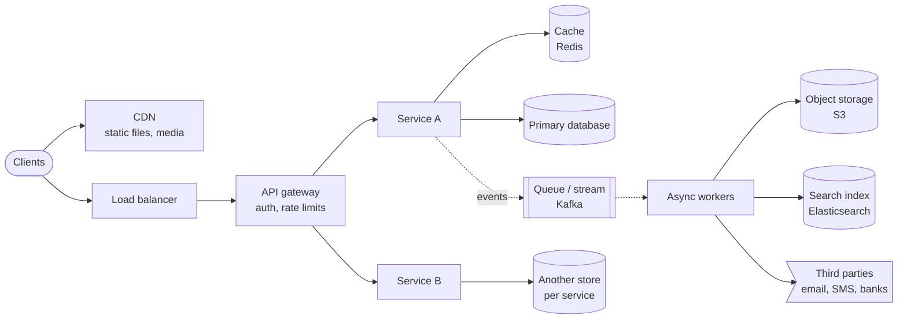

> **In one line:** clarify, estimate, draw something simple that works, break it on purpose, fix it with standard building blocks, then go deep where the interviewer points.

Every article in this repo follows the same script. Learn the script once here, and each problem becomes "fill in the blanks".

## The shape of almost every design

Most HLD answers are this picture with the boxes renamed. What gets you hired is knowing **which boxes the problem needs, why, and what breaks in each one**.

## How to spend the 30 minutes

| Minutes | Step | What you produce |
|---|---|---|
| 0-4 | Clarify requirements | 4-6 functional bullets, 3-5 non-functional bullets with numbers, an explicit out-of-scope list |
| 4-7 | Estimate scale | Requests per second, storage, read/write ratio, and **one sentence on what they imply** |
| 7-10 | API and data model | 3-6 endpoints, the main tables, the partition key |
| 10-14 | Design v1 | A small diagram that works at small scale; walk one request through it |
| 14-17 | Break v1 | List the bottlenecks yourself before the interviewer does |
| 17-24 | Design v2 (and v3) | Fix each bottleneck with a named building block |
| 24-29 | Deep dives | The 1-2 hard parts of this problem, with options and a pick |
| 29-30 | Recap | Six bullets: the design, the key choices, the trade-offs |

If the interviewer jumps ahead ("how would you stop double booking?"), go there. The timeline is a default, not a contract.

## Step 1: clarify requirements

Ask, then write the answers on the board.

- **Who uses it and how?** Consumers on mobile, merchants via API, internal teams?
- **What are the 3-5 core actions?** Everything else is out of scope unless asked.
- **How big?** Daily active users, items, peak events (a sale, a match, 9 AM).
- **What must never go wrong?** Double charges, double bookings, lost messages. This decides where you need strong consistency.
- **What can be a bit stale?** Feeds, counters, search results, analytics.
- **Latency targets?** Interactive actions under ~200 ms; real-time updates in about a second.

> **Say it like this:** "Before I design anything, I want to pin down the core use cases and the scale, and agree on what we'll leave out."

## Step 2: estimate the scale

Use round numbers and show the arithmetic. The point is not precision; it is turning numbers into decisions.

| Rule of thumb | Value |
|---|---|
| Seconds in a day | 86,400 ≈ 10^5 |
| 1 million requests a day | ≈ 12 per second |
| 100 million requests a day | ≈ 1,200 per second |
| Peak vs average | 2x-5x for normal apps, 10x+ for flash sales and live events |
| 1 KB x 1 million | 1 GB |
| 1 KB x 1 billion | 1 TB |
| 1 minute of 1080p video at 5 Mbps | ≈ 37.5 MB |

Rough single-node capacities for planning (real numbers vary a lot with hardware and query shape):

| Component | Ballpark |
|---|---|
| Stateless app server | 1,000-5,000 simple requests/s |
| Redis node | ~100,000 simple ops/s |
| Postgres / MySQL primary | a few thousand to ~10,000 simple writes/s |
| Kafka broker | hundreds of MB/s; plan ~10 MB/s per partition |
| WebSocket server | 50,000-100,000+ mostly idle connections |

Latency to remember: memory read ~100 ns, SSD read ~100 µs, round trip inside a data center ~0.5 ms, cross-continent round trip ~150 ms.

**Turn numbers into decisions:**

- Read/write ratio above 10:1 → caching and read replicas.
- More than ~10 k writes/s, or more than a few TB → shard the database.
- Large blobs (images, video, files) → object storage + CDN, never in the database.
- Big gap between peak and average → queues to absorb bursts, autoscaling, maybe a waiting room.

## Step 3: API and data model

- Name endpoints by resource: `POST /bookings`, `GET /feeds/{user_id}?cursor=...`.
- Any action that moves money or inventory takes an **idempotency key**, so a retry never does it twice.
- Lists use **cursor pagination**, not page numbers, so new items do not shift pages.
- Push to clients with WebSocket or SSE only when the product needs it (chat, tracking, live prices).
- For each main table say: what it stores, which database, and the **partition key**. The partition key is the decision that is hardest to change later.

## Step 4: v1, break it, fix it

Draw the simplest version first: client, one service, one database. Walk one request through it. Then attack your own design. Interviewers grade this step more than any other: **can you see the problem before it happens?**

The same few problems show up in almost every design, and each has a standard fix:

| Symptom | Standard fix | What it costs you |
|---|---|---|
| One server is a single point of failure, or is overloaded | Many stateless servers behind a load balancer | Session state must live elsewhere (Redis, tokens) |
| Database reads are slow or overloaded | Cache-aside in Redis, read replicas | Stale data, cache invalidation |
| Database writes or storage are too big for one machine | Shard by a key (hash or range), consistent hashing | Cross-shard queries, hot shards, resharding |
| Slow or flaky work inside the request (emails, video, third parties) | Put it on a queue, process with async workers | Eventual consistency, need for retries and idempotency |
| An event is lost between "DB commit" and "publish to queue" | Transactional outbox, or change data capture | An extra table and a relay process |
| Retries create duplicates | Idempotency keys, dedupe tables, conditional writes | Storage for keys, a lookup per request |
| Two users grab the same seat, item or driver | Conditional update, row lock, or a lock with a TTL | Contention on very hot items |
| One key is far hotter than the rest | Local in-memory cache, replicate or salt the key, request coalescing | Short staleness |
| Users far away see high latency | CDN for static and cacheable data, multi-region reads | Cross-region consistency |
| Huge spike at one moment | Queue or virtual waiting room, rate limits, pre-scaling, load shedding | Some users wait |
| One business action spans several services | Saga with compensating steps | Temporary inconsistency, more states to handle |
| Complex search and filters | Search index (Elasticsearch / OpenSearch) fed by CDC | Index lag of seconds |
| Clients must see updates instantly | WebSocket / SSE gateway + a registry of who is connected where | Stateful servers, reconnect logic |

## Step 5: deep dives

Each problem has one or two "real" hard parts. Spend your remaining time there:

- **Contention:** seats, rooms, inventory, drivers. How do you guarantee one winner?
- **Fan-out:** feeds, notifications, chat groups, live prices. Push or pull, and what about the huge accounts?
- **Ordering and exactly-once effects:** chat messages, payments, collaborative edits.
- **Geo:** "near me" queries and moving objects.
- **Big blobs:** video and files: chunking, transcoding, CDN.

For each deep dive, use the same three beats: **the problem** in one line, **two or three options** with pros and cons, **your pick and why**.

## Building blocks cheat sheet

### SQL or NoSQL?

| Pick | When | Examples in this repo |
|---|---|---|
| Relational (Postgres, MySQL) | Transactions across rows, constraints, joins, money, inventory | Bookings, orders, payments, ledgers |
| Key-value / wide-column (DynamoDB, Cassandra) | Huge scale, access by key, simple queries, high write rates | URL mappings, chat messages, watch history |
| Document (MongoDB) | Flexible nested records read as a whole | Product catalog, user profiles |
| Search index (Elasticsearch) | Full-text, filters, geo, ranking | Product and hotel search, logs |
| Time-series / columnar (ClickHouse, Druid) | Aggregations over events | Analytics, metrics, candles |
| Object storage (S3) | Large immutable blobs | Video, images, files, log archives |

### Caching patterns

| Pattern | How it works | Use when |
|---|---|---|
| Cache-aside | App reads cache, on a miss reads DB and fills the cache | Default for read-heavy data |
| Write-through | App writes the cache and DB together | Data must be fresh in cache right after a write |
| Write-behind | App writes the cache, which flushes to DB later | Very high write rates where losing a little is acceptable (counters) |

Always set a TTL, and decide how a write invalidates the cache.

### Queues and streams

| Pick | Good at | Typical use |
|---|---|---|
| Kafka | High throughput, ordered per partition, replayable log | Event streams, analytics, fan-out to many consumers |
| SQS / RabbitMQ | Per-message work queues, visibility timeouts, simple retries | Background jobs, task queues |

Both give **at-least-once** delivery in practice, so consumers must be idempotent.

### Real-time delivery

| Method | Direction | Use when |
|---|---|---|
| Short polling | Client asks every N seconds | Rare updates, simplest to build |
| Long polling | Server holds the request until there is news | Fallback when WebSockets are blocked |
| Server-sent events | Server → client stream over HTTP | Live scores, tracking, notifications |
| WebSocket | Both ways, persistent | Chat, collaborative editing, trading |

### IDs

- **UUID v4:** random, no coordination, but bad for index locality.
- **Time-ordered IDs (Snowflake, ULID, UUID v7):** sortable by time, good for "latest first" queries and message ordering.
- **Counters with leased ranges:** short and dense, used for short codes.

### Consistency in one paragraph

During a network partition a system must choose between answering (availability) and answering correctly (consistency). Choose **per feature**, not per system: money, inventory and bookings choose consistency; feeds, counters, recommendations and search choose availability and fix themselves later.

## How you are graded

| Signal | What it looks like |
|---|---|
| Problem framing | You asked about scale and invariants before drawing |
| A working design | v1 really works end to end; no magic boxes |
| Finding bottlenecks | You broke your own design before being asked |
| Trade-offs | Every choice comes with "the cost is ..." |
| Depth | One or two areas explained down to data structures or failure cases |
| Communication | You drove the conversation and checked in with the interviewer |

## Common mistakes

- Drawing 15 microservices in minute 3. Start simple; earn every box.
- Estimating for five minutes and never using the numbers.
- Saying "use Kafka" or "use a cache" without saying what problem it solves.
- Ignoring failure: what happens when the payment provider times out, or a worker dies mid-job?
- Forgetting idempotency on anything a client can retry.
- Running out of time before the deep dive the interviewer cared about. Watch the clock.

## Phrases worth practising

- "Let me start with the simplest version that works, then we'll scale it."
- "The bottleneck here will be ... because ..."
- "We have two options. X gives us ..., Y gives us .... I'd pick X because our requirement is ...."
- "This part needs strong consistency; this part can be eventually consistent."
- "If this component fails, the user sees ..., and we recover by ...."
- "Is there an area you'd like me to go deeper on?"

Now pick a problem from the [list](https://manoshrinivasnm-glitch.github.io/system-design-articles/) and try to talk through it out loud in 30 minutes before reading the article.
