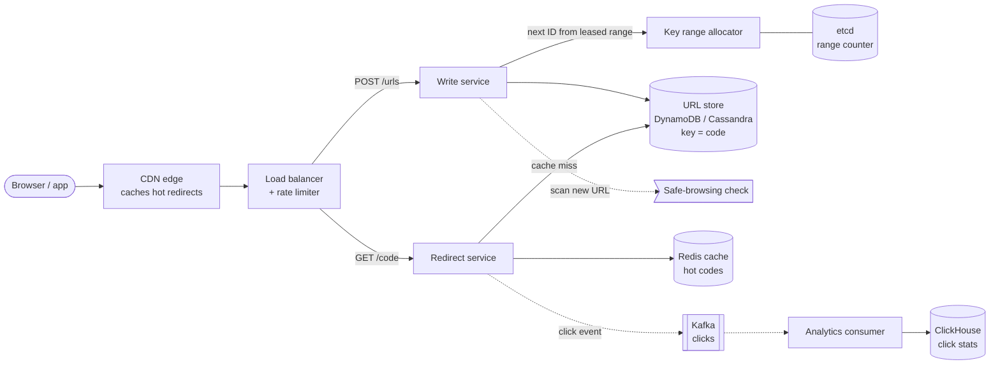
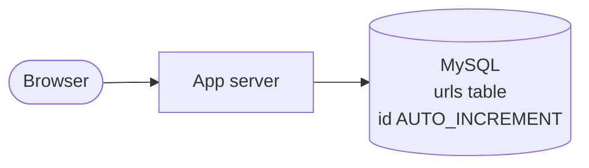
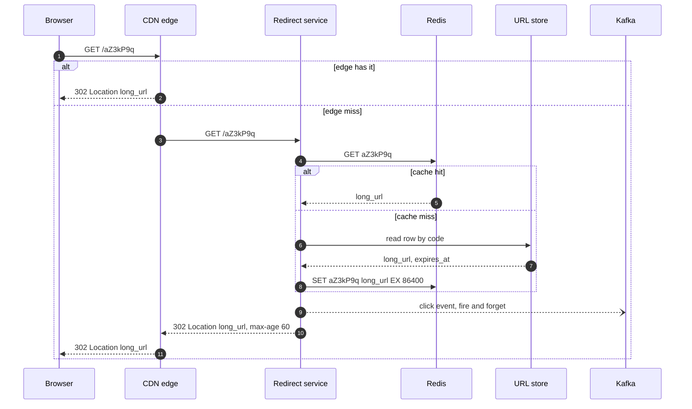

> **In one line:** hand out unique 7-character codes from leased number ranges, store `code → long URL` in a key-value store, and serve the 100x heavier redirect traffic from caches, keeping analytics off the hot path.

## The design at a glance



Follow two paths. **Create**: the write service takes the next number from a range it leased, turns it into a 7-character code, and writes one row. **Redirect**: the CDN or Redis answers almost every request; only cache misses touch the database, and every click is dropped onto Kafka so analytics never slows a redirect.

## How to spend the 30 minutes

| Minutes | What you do | What to say or draw |
|---|---|---|
| 0-3 | Requirements | Custom aliases? Expiry? Analytics? Who are the users? |
| 3-6 | Numbers | 100:1 reads to writes, 6 billion URLs, so 7 characters |
| 6-9 | API and data model | Two endpoints that matter, one table keyed by code |
| 9-13 | Design v1 | One server, one SQL table, auto-increment ID in base62 |
| 13-16 | Break v1 | Read load, single point of failure, guessable codes |
| 16-23 | Design v2 and v3 | Split read/write, cache, range allocator, KV store, Kafka, CDN |
| 23-29 | Deep dives | Code generation, 301 vs 302, hot keys, expiry |
| 29-30 | Recap | The 60-second summary at the bottom |

## Requirements

**Functional**

- Given a long URL, return a short URL like `sho.rt/aZ3kP9q`.
- Visiting the short URL redirects to the long URL.
- Optional custom alias (`sho.rt/summer-sale`).
- Optional expiry date; expired links stop working.
- Owners can see click counts by day, country and referrer.

**Non-functional**

- Redirects are fast: p99 under 50 ms at the server, because they sit in front of every click.
- Highly available: 99.99% for redirects. A dead short link breaks someone else's page.
- A code must never point to two different URLs (strong uniqueness on create).
- Analytics can lag by a minute or so (eventual consistency is fine there).
- Codes should not be guessable in sequence, so private links cannot be enumerated.

**Out of scope**

- User sign-up and billing (assume an API key exists).
- Link-in-bio pages, QR code styling, A/B redirects.

> **Say it like this:** "This is a read-heavy key-value lookup with one hard part on the write side: generating unique short codes without a central bottleneck. I'll design for 100 million new links a month and a 100:1 read ratio, keep redirects under 50 ms, and treat analytics as an async side stream."

## Back-of-the-envelope numbers

| Quantity | Estimate | How |
|---|---|---|
| New URLs | ~40 / s average, ~200 / s peak | 100 M per month ÷ 2.6 M seconds, x5 for peaks |
| Redirects | ~4,000 / s average, ~20,000 / s peak | 100 reads per write |
| URLs stored over 5 years | ~6 billion | 100 M x 12 x 5 |
| Storage | ~3 TB | 6 B rows x ~500 bytes (URL, owner, timestamps) |
| Code length | 7 characters | 62^6 ≈ 57 B, 62^7 ≈ 3.5 trillion: 7 gives 500x headroom |
| Cache size | ~5-10 GB | Hot 20% of the links that are clicked each day, ~500 bytes each |
| Redirect bandwidth | ~10 MB/s at peak | 20 k/s x 500 bytes. Tiny |

**What the numbers tell us:**

- Reads dominate 100:1, so the design is mostly about caching and a fast lookup by key.
- 3 TB and simple lookups by code: a partitioned key-value store fits better than one big SQL box.
- 200 writes a second is low. The write path is hard because of **uniqueness**, not volume.
- The whole hot set fits in RAM on a couple of Redis nodes.

## API

```http
POST /api/v1/urls
Authorization: Bearer <api-key>
Idempotency-Key: 6f1c2e...
{ "long_url": "https://example.com/a/very/long/path", "custom_alias": "summer-sale", "expires_at": "2027-01-01T00:00:00Z" }
→ 201 { "code": "aZ3kP9q", "short_url": "https://sho.rt/aZ3kP9q", "expires_at": "2027-01-01T00:00:00Z" }

GET /{code}
→ 302 Location: https://example.com/a/very/long/path     (404 unknown, 410 expired)

GET /api/v1/urls/{code}/stats?from=2026-10-01&to=2026-10-15
→ 200 { "clicks": 18234, "by_day": [...], "by_country": [...] }

DELETE /api/v1/urls/{code}
→ 204
```

- `Idempotency-Key` makes a retried create return the same code instead of minting a second one.
- The redirect is a bare `GET /{code}` on its own short domain, with no API version, because it is printed on posters and must never change.
- `302` instead of `301` so every click reaches us (see the deep dive).

## Data model

```text
urls                         (key-value store, partition key = code)
  code         string  PK    "aZ3kP9q"
  long_url     string        up to 2 KB
  owner_id     string        nullable for anonymous links
  created_at   timestamp
  expires_at   timestamp     nullable, also set as the row's TTL

users                        (Postgres)
  user_id PK, email, api_key_hash, plan

click_events                 (ClickHouse, append-only)
  code, ts, country, referrer, device
```

- **`urls` in DynamoDB or Cassandra.** Every read is "get by exact code", there are no joins, it shards by `code` with no extra work, and both support a per-row TTL for expiry.
- **`users` in Postgres.** Small, relational, rarely written.
- **`click_events` in ClickHouse.** Columnar storage makes "clicks per day per country" fast over billions of rows.
- Optional secondary index `owner_id → codes` for a "my links" page. It is low traffic, so a separate table or a GSI is fine.

## Design v1: the simplest thing that works



1. `POST /urls` inserts `(long_url)` into MySQL. The database returns the auto-increment `id`, say `125`.
2. The server encodes `125` in base62 (`0-9a-zA-Z`), which gives `"21"`, and returns `sho.rt/21`.
3. `GET /21` decodes `"21"` back to `125`, runs `SELECT long_url WHERE id = 125`, and answers `302`.
4. Click counts: `UPDATE urls SET clicks = clicks + 1 WHERE id = 125` on every redirect.

This genuinely works for a side project with a few thousand links. It is also the right thing to draw first: it shows you know base62 and the shape of the problem.

## Where v1 breaks

| Problem | Why it happens | What the user sees |
|---|---|---|
| Every redirect hits the database | No cache; 20 k reads/s at peak on one MySQL | Slow redirects and timeouts during peaks |
| One app server and one DB | Single points of failure | Every short link on the internet dies during a deploy or crash |
| Codes are sequential | `21`, `22`, `23`... from auto-increment | Anyone can walk through every link, including private ones |
| One counter, one writer | Auto-increment lives on one primary | Writes cannot spread across shards or regions |
| Viral links | One row read millions of times a minute | That one row, and its whole DB node, melts |
| Analytics on the hot path | A row-locking `UPDATE` per click | Redirect latency grows with popularity: the worst possible time |

## Design v2: split the paths, cache the reads, lease the IDs

### Fix 1: separate the write and redirect services

Both are stateless, behind a load balancer. The redirect fleet scales on its own (it gets 100x the traffic) and can be deployed without touching creates. Lose a server and the load balancer routes around it.

### Fix 2: put Redis in front of the database

Read-through: check Redis, on a miss read the DB and write `code → long_url` back with a TTL of a day. Evict with LRU. With an 80/20 popularity skew the hit rate is above 90%, so the database sees a few hundred reads a second instead of 20,000. Also cache "not found" for a minute, so bots scanning random codes cannot hammer the DB.

### Fix 3: unique, non-guessable codes without a central bottleneck

A **key range allocator** hands each write server a block of one million IDs at a time (an atomic increment on a counter in etcd or ZooKeeper). The server counts through its block in memory, so the coordinator is touched once per million links. Before encoding, scramble the number with a reversible permutation (for example, multiply by a large odd constant mod 62^7) so consecutive IDs give unrelated-looking codes. Unique by construction, no collision check needed.

### Fix 4: move `urls` to a partitioned key-value store

Partition by `code`. Codes are effectively random after scrambling, so load spreads evenly. Three replicas per partition give availability; a write succeeds on a quorum.

### Fix 5: take analytics off the redirect path

The redirect service fires a small click event to Kafka and returns immediately. A consumer batches events into ClickHouse every few seconds. A Kafka outage loses some click data, never redirects.

## Where v2 still breaks

| Problem | Why it happens | What the user sees |
|---|---|---|
| A link goes viral on a celebrity post | All requests for one code hit one Redis shard | Hot shard CPU at 100%, rising latency for every code on that shard |
| Users far from our region | Every redirect makes a round trip to one data center | 150-300 ms extra on mobile in other continents |
| Short links used for phishing | Anyone can shorten anything | Our domain lands on blocklists and every link gets flagged |

## Design v3: push redirects to the edge and guard the front door

This is the diagram at the top.

### Fix 6: cache redirects at the CDN

The redirect response carries `Cache-Control: max-age=60`. The CDN answers repeat clicks from the nearest edge, which flattens viral spikes and cuts global latency. Edge hits skip our servers, so click counts come from CDN logs shipped into the same Kafka topic.

### Fix 7: a small in-process cache for the hottest codes

Each redirect server keeps the top few thousand codes in memory for 10 seconds. A hot code is then served by every server instead of one Redis shard.

### Fix 8: abuse controls

Rate-limit creates per API key and IP (see the [rate limiter](21-rate-limiter.md)). Check new URLs against a safe-browsing list asynchronously; a flagged code gets disabled and purged from the cache and CDN.

### Components

| Component | Job | Tech choice |
|---|---|---|
| CDN edge | Serve repeat redirects near the user | CloudFront / Cloudflare, 60 s TTL |
| Load balancer + rate limiter | Spread load, block abusive clients | L7 load balancer, token bucket in Redis |
| Write service | Validate URL, mint code, store row | Stateless, holds one leased ID range |
| Key range allocator | Hand out blocks of 1 M IDs | Atomic counter in etcd |
| Redirect service | Look up code, answer 302 | Stateless, local cache + Redis |
| Redis | Hot `code → long_url` mappings | Clustered, LRU, replicas per shard |
| URL store | Source of truth, 3 TB | DynamoDB or Cassandra, key = code, TTL |
| Kafka + consumer | Click stream into analytics | Partition by code, batch inserts |
| ClickHouse | Click statistics | Columnar, aggregates by day and country |

## Key flow: redirect a short link



- **Expired row:** the store returns `expires_at` in the past (TTL deletion can lag), so the service answers `410` and does not cache it.
- **Unknown code:** answer `404` and cache the miss for 60 seconds.
- **Redis down:** fall through to the store. Latency rises; redirects keep working.
- **Kafka down:** drop or buffer the click locally. Never block the redirect for analytics.

The create flow is short: authenticate, check the idempotency key, validate the URL, take the next ID from the local range, scramble and base62 it, conditional-put the row, return `201`, and queue the safe-browsing scan.

## Deep dives

### How do you generate the short code?

**The problem.** Codes must be unique, short, hard to guess, and produced by many servers at once.

**Options.**

| Option | Good | Bad |
|---|---|---|
| Hash the URL (MD5, take 7 chars) | Same URL gives the same code; no coordination | Collisions: you must check and retry. Two users shortening one URL share stats |
| Random 7 chars + check if taken | Simple, not guessable | One extra read per create, more retries as the space fills |
| Global counter + base62 | Unique, no checks | Sequential and guessable; counter is a bottleneck |
| Pre-generated key pool (KGS) | Fast; keys are random | Separate service and DB to run; handing out keys twice must be prevented |
| **Leased ID ranges + scramble** | Unique by construction, coordination once per million IDs | A crashed server wastes the rest of its range (harmless: 3.5 trillion codes) |

**Pick.** Leased ranges with a reversible scramble. Mention hashing and KGS so the interviewer sees you weighed them.

### 301 or 302?

**The problem.** The status code decides who caches the redirect.

| Option | Good | Bad |
|---|---|---|
| 301 Moved Permanently | Browsers cache it forever: almost no repeat traffic | You lose repeat-click analytics; you cannot change or expire the link for that browser |
| **302 Found** | Every click reaches you (or your CDN), links can expire or be edited | More traffic to serve |

**Pick.** 302, with a short `max-age` so the CDN still absorbs bursts. Offer 301 as an option for customers who want no analytics.

### Hot keys and cache behaviour

**The problem.** Popularity is extremely skewed. One code can get more traffic than the rest put together.

**Pick.** Three layers: CDN (60 s), in-process LRU (10 s), Redis (24 h). Use cache-aside with TTLs so a stale entry fixes itself. On delete or a safe-browsing flag, delete the Redis key and send a CDN purge; the 10 s local cache is the worst-case staleness.

### Custom aliases

**The problem.** A user-chosen alias could clash with an existing code, or with a code the allocator will generate tomorrow.

**Pick.** Keep separate namespaces: generated codes are exactly 7 characters; aliases must be 8-30 characters (or contain a `-`). Write aliases with a conditional put ("insert only if absent") so two users racing for `summer-sale` cannot both win. Keep a blocklist of reserved words (`api`, `login`, brand names).

### Expiry and cleanup

**The problem.** Billions of rows, some with an expiry date.

**Pick.** Store `expires_at` and also set it as the row TTL so the store deletes rows on its own. Because TTL deletion can run late, the redirect service always checks `expires_at` before answering. Expired codes are never reused, so old printed links never point somewhere new.

### Analytics at scale

**The problem.** 20 k click events a second, and owners want daily and per-country counts.

**Pick.** Kafka partitioned by code, a consumer that batches inserts into ClickHouse, and pre-aggregated per-day rollups for the dashboard. Unique visitors use HyperLogLog, which gives about 1% error in a few KB per link instead of storing every visitor ID.

## Trade-offs to say out loud

- We chose **302 over 301** to keep analytics and expiry. The cost is more redirect traffic, which the CDN absorbs.
- We chose **leased ID ranges over hashing** so creates never need a collision check. The cost is a small coordinator (etcd), touched once per million links.
- We chose a **key-value store over SQL** for `urls` because every access is by exact key and it shards for free. The cost is no ad-hoc queries; the "my links" page needs its own index.
- We made **analytics eventually consistent** so redirects never wait on it. The cost is that dashboards lag by about a minute and can lose clicks during a Kafka outage.
- We cache at the **edge for 60 seconds**. The cost is that a deleted link can keep working for up to a minute unless we purge.

## Follow-up questions

**Q: Two users shorten the same long URL. Same code or different?**
Different by default, so each owner gets separate stats and can delete their own. If the product wants "same URL, same code" for anonymous users, add a `long_url_hash → code` lookup table and check it first.

**Q: What if the etcd range counter is down?**
Each server still has the rest of its current block, usually hours of writes. Servers lease the next block when they are 80% through the current one, so a short etcd outage has no effect. Redirects never touch etcd.

**Q: How do you go multi-region?**
Redirects are read-only, so replicate `urls` to every region and serve locally. Give each region its own slice of the ID space (a region prefix in the counter) so creates never conflict and need no cross-region coordination.

**Q: How would you stop someone from scanning all codes?**
The code space is 3.5 trillion and scrambled, so random guessing finds almost nothing. Rate-limit 404s per IP, cache misses, and alert on high 404 ratios.

**Q: Can a user edit where a link points?**
Yes for 302 links: update the row, delete the Redis key, purge the CDN. This is exactly why we did not use 301.

**Q: How do you handle a URL that is 10 KB long?**
Reject URLs above a limit (2 KB covers real-world links) with `400`. It protects storage and caches from abuse.

**Q: What breaks first as traffic grows 10x?**
Redis memory and the hot shard. Add Redis shards and rely more on the CDN and local caches. The write path has years of headroom.

## 60-second recap

- Read-heavy (100:1) key-value lookup; 6 billion links over 5 years, so 7 base62 characters.
- Write path: stateless service takes IDs from a leased range, scrambles them, base62-encodes, and stores one row keyed by code.
- Store: DynamoDB or Cassandra partitioned by code, with TTL for expiry.
- Read path: CDN, then in-process cache, then Redis, then the store. Over 90% of redirects never touch the database.
- 302 redirects so we keep analytics and can expire or edit links.
- Clicks go to Kafka and ClickHouse asynchronously; redirects never wait for analytics.
- Abuse: rate limits on create, safe-browsing scans, 404 throttling.
