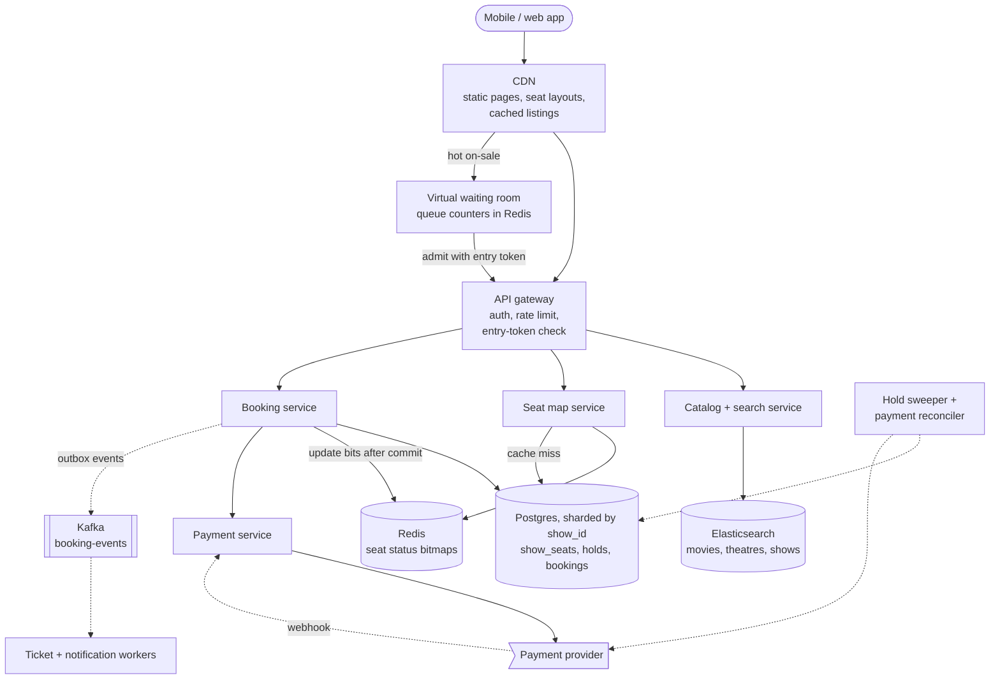
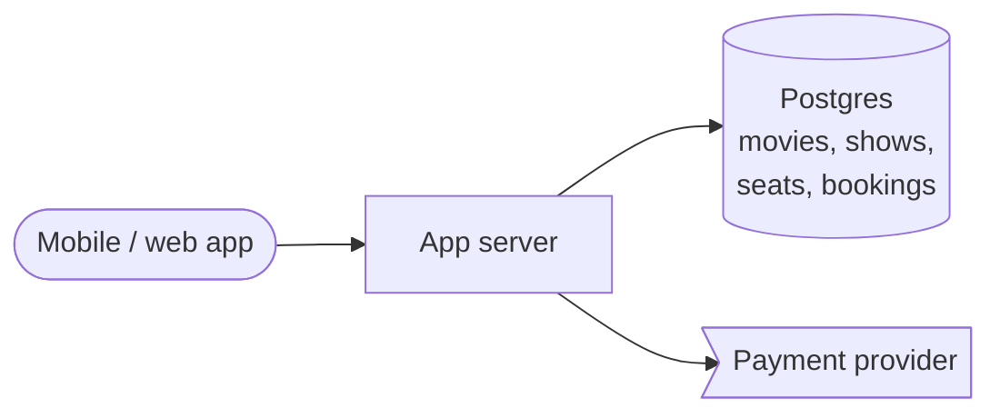
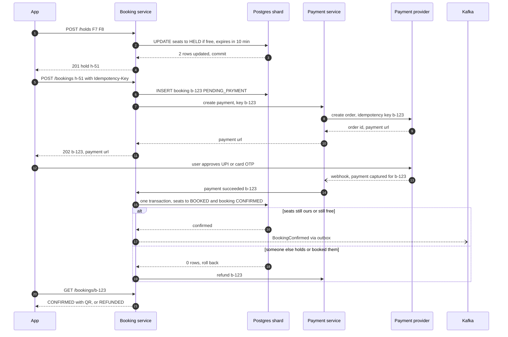

> **In one line:** serve browsing from caches, turn a seat click into one conditional update that holds the seats for 10 minutes, confirm only when the payment webhook arrives (idempotently), and put a virtual waiting room in front of hot on-sales.

## The design at a glance



Follow one booking. Browsing is answered by the CDN and Elasticsearch, and the seat map by a 50-byte bitmap per show in Redis. Picking seats runs one conditional `UPDATE` on the show's Postgres shard that marks them `HELD` for 10 minutes; the payment webhook turns the hold into `BOOKED` in one transaction, and Kafka fans out the ticket and notifications. For a hot on-sale, the waiting room lets users in at a fixed rate, so booking only sees load it can handle.

## How to spend the 30 minutes

| Minutes | What you do | What to say or draw |
|---|---|---|
| 0-3 | Requirements | Movies or concerts? Pick a seat or best available? How long is a hold? |
| 3-6 | Numbers | 100:1 reads to bookings, ~240 bookings/s at peak, 20 fans per seat on hot sales |
| 6-9 | API and data model | Hold and booking as separate resources, one row per seat per show |
| 9-12 | Design v1 | One app, one database, check the seat then update it |
| 12-15 | Break v1 | Double booking race, no hold during payment, double charge, lost payment |
| 15-22 | Design v2 and v3 | Conditional-update holds with TTL, idempotent confirm, cached reads, waiting room |
| 22-29 | Deep dives | Redis vs DB holds, locking styles, payment failures, waiting room |
| 29-30 | Recap | The 60-second summary at the bottom |

## Requirements

**Functional**

- Browse movies by city and date; search by title; filter by language and format.
- See show times per theatre, then a show's seat map with prices.
- Pick up to 10 seats; they are held for 10 minutes while you pay.
- Pay, then get a QR ticket in the app, by SMS and by email.
- Cancel within the theatre's policy and get a refund.

**Non-functional**

- A seat is never sold twice: the booking path is strongly consistent.
- Listings and seat maps: p99 under 200 ms. The seat map may be a few seconds stale.
- A hold succeeds or fails in under 500 ms.
- 99.95% availability for browse and booking.
- Every captured payment ends as exactly one ticket or one refund.
- Survive 1 million users arriving in the same minute for one event.

**Out of scope**

- Theatre onboarding, seat-layout editor, food add-ons, coupons, recommendations.
- The inside of the payment provider (see the [payment gateway](17-payment-gateway.md)).

> **Say it like this:** "Browsing is read-heavy and cacheable. The hard part is booking: thousands of people competing for the same rows, with a slow external payment in the middle. I'll make a hold one atomic database write with a 10-minute expiry, confirm only after the payment webhook, make every step idempotent, and add a waiting room for on-sales that would otherwise melt everything."

## Back-of-the-envelope numbers

| Quantity | Estimate | How |
|---|---|---|
| Shows per day | 50,000 | 10,000 screens x 5 shows |
| Seats on sale per day | 10 M | 50,000 shows x 200 seats |
| Bookings | ~12 / s average, ~240 / s peak | 1 M a day ÷ 86,400 s, x20 on a Friday release evening |
| Browse and seat-map reads | ~1,200 / s average, ~24,000 / s peak | 100 reads per booking, same x20 peak |
| Seat status cache | ~18 MB | 350,000 shows (7 days) x 200 seats x 2 bits = 50 bytes per show |
| Booking storage | ~365 GB a year | 1 M bookings a day x ~1 KB |
| Hot concert on-sale | 1 M fans for 50,000 seats | 20 fans per seat |
| Waiting-room admit rate | ~2,500 users / min | 12,500 buyers x 4 seats sell out in ~5 minutes |

**What the numbers tell us:**

- Reads beat bookings 100:1, so listings and seat maps come from caches.
- 240 bookings a second is small. The hard part is **contention**: many requests for the same rows at once.
- A show has ~200 seats, so it fits on one shard and a hold is a single-shard transaction.
- 20 fans per seat cannot be fixed with more servers. You need a fair queue at the door.

## API

```http
GET /api/v1/movies?city=bengaluru&date=2026-10-17&q=dune&lang=hindi
→ 200 { "movies": [ { "movie_id": "m42", "title": "...", "formats": ["2D", "IMAX"] } ], "next_cursor": "..." }

GET /api/v1/movies/m42/shows?city=bengaluru&date=2026-10-17
→ 200 { "theatres": [ { "theatre_id": "t9", "shows": [ { "show_id": "s777", "starts_at": "...", "format": "IMAX" } ] } ] }

GET /api/v1/shows/s777/seats
→ 200 { "layout_url": "https://cdn.../screen-31.json", "status": "<base64 bitmap>", "prices": { "PRIME": 350 } }

POST /api/v1/shows/s777/holds
Idempotency-Key: 9b2f...
{ "seat_ids": ["F7", "F8"] }
→ 201 { "hold_id": "h-51", "expires_at": "2026-10-17T18:10:00Z", "amount": 700 }      (409 if any seat is taken)

POST /api/v1/bookings
Idempotency-Key: 3c8a...
{ "hold_id": "h-51", "payment_method": "upi" }
→ 202 { "booking_id": "b-123", "status": "PENDING_PAYMENT", "payment_url": "..." }

GET /api/v1/bookings/b-123
→ 200 { "status": "CONFIRMED", "ticket_qr": "..." }
```

- **A hold is its own resource**, so seats are reserved before the payment page. `DELETE /holds/h-51` releases them.
- **`Idempotency-Key`** on holds and bookings: a double tap returns the same object.
- **`202` for bookings**: payment finishes later via the provider's webhook; the app polls or gets a push.
- **The seat map is split**: the layout is a static CDN file; only the tiny status bitmap is dynamic.

## Data model

```text
movies, theatres, screens, shows        (Postgres catalog, indexed in Elasticsearch)
  movie_id, title, languages, genres, duration
  theatre_id, city, name, lat, lng
  screen_id, theatre_id, layout_json
  show_id, movie_id, screen_id, starts_at, format, price_by_category

show_seats                              (Postgres, shard key = show_id)
  show_id + seat_id   PK
  status              AVAILABLE | HELD | BOOKED
  hold_id, hold_expires_at, booking_id  nullable

holds                                   (same shard as the show)
  hold_id PK, show_id, user_id, seat_ids, amount, expires_at, status

bookings                                (same shard as the show)
  booking_id PK, user_id, show_id, hold_id, seat_ids, amount, payment_ref
  status              PENDING_PAYMENT | CONFIRMED | FAILED | CANCELLED | REFUNDED
  idempotency_key     UNIQUE
```

- **Seats, holds and bookings in Postgres, sharded by `show_id`.** We need transactions and conditional updates, and every booking touches exactly one show.
- **Catalog in Postgres, searched through Elasticsearch** (typo-tolerant search, fast filters), kept in sync by change data capture (Debezium).
- **Seat status in Redis**: 2 bits per seat, read thousands of times a second.
- **"My bookings"** queries by user, so keep a small `user_bookings` table keyed by `user_id`.

## Design v1: the simplest thing that works



1. The user browses; the server joins `movies`, `shows` and `theatres` for the city and date.
2. The seat map is `SELECT seat_id, status FROM show_seats WHERE show_id = 's777'`.
3. They pick F7 and F8 and tap Pay. The server checks both are `AVAILABLE`.
4. The user goes to the payment provider for 1-3 minutes (OTP or UPI approval).
5. On success the server sets the seats to `BOOKED`, inserts the booking and sends an email.

This works for one cinema with a few shows a day.

## Where v1 breaks

| Problem | Why it happens | What the user sees |
|---|---|---|
| Two people book the same seat | Both checks see `AVAILABLE` before either `UPDATE`: a read-then-update race | Both pay; one finds a stranger in their seat |
| Nothing reserves the seat during payment | Minutes pass between check and update. Locking the row that long ties up a DB connection while waiting on an outside system | The seat is sold while you type your OTP |
| Double tap or retry on Pay | No idempotency | Charged twice, or two bookings |
| Server crashes after the charge | Charge and booking are in different systems with no record linking them | Money taken, no ticket |
| Browsing shares the booking DB | 24,000 reads/s at peak, with joins, on one primary | Slow listings; bookings time out behind them |
| One server, one database | Single points of failure | Site down during a deploy |

## Design v2: atomic holds, idempotent confirm, a cached read path

### Fix 1: hold seats with one conditional update

Check and write in a single statement:

```sql
UPDATE show_seats
SET status = 'HELD', hold_id = 'h-51', hold_expires_at = now() + interval '10 minutes'
WHERE show_id = 's777' AND seat_id IN ('F7', 'F8')
  AND (status = 'AVAILABLE' OR (status = 'HELD' AND hold_expires_at < now()));
```

If it updates 2 rows, commit; if fewer, roll back and return `409`. In a race, the second request waits on the row lock, re-reads the row after the first commits, sees `HELD` and matches nothing (Postgres's default READ COMMITTED behaviour). Two overlapping multi-seat holds could lock rows in different orders and deadlock, so lock them in seat order first (`SELECT ... ORDER BY seat_id FOR UPDATE`, then the `UPDATE`); if a deadlock still happens, Postgres aborts one and you return `409`. The transaction lasts milliseconds: the hold is a **state** in the row, not a lock held during payment.

### Fix 2: holds expire on their own

The `WHERE` clause treats an expired hold as free, so a hold ends exactly on time even if no job runs. A sweeper every 30 seconds flips expired rows back to `AVAILABLE` to keep the seat map honest. Correctness never depends on it.

### Fix 3: record the booking first, confirm idempotently

`POST /bookings` writes a `PENDING_PAYMENT` row **before** calling the provider and passes `booking_id` as the provider's idempotency key. When the webhook says "paid", one transaction moves the seats to `BOOKED` and the booking to `CONFIRMED ... WHERE status = 'PENDING_PAYMENT'`. A duplicate webhook matches zero rows. Because the row exists before the money moves, a reconciler can find any booking stuck in `PENDING_PAYMENT` and finish or refund it.

### Fix 4: a separate, cached read path

The catalog service queries Elasticsearch, and "movies in Bengaluru today" is cached on the CDN for 60 seconds because it is the same for everyone in the city. The seat map service reads a 2-bit-per-seat bitmap from Redis, which the booking service updates after each commit and rebuilds from a read replica on a miss. A stale map is safe: the conditional update is the real check, so the worst case is "sorry, that seat was just taken".

### Fix 5: shard, replicate, go async

Stateless services behind a load balancer. Postgres sharded by `show_id`, each shard with a synchronous standby so a confirmed booking survives losing the primary. The booking transaction writes an outbox row that a relay publishes to Kafka; workers create the QR ticket (a signed `booking_id` the gate can verify offline) and send it through the [notification system](15-notification-system.md).

## Where v2 still breaks

| Problem | Why it happens | What the user sees |
|---|---|---|
| 1 M fans arrive at 10:00:00 for one concert | One show, so one shard and one cache key take it all | Errors and timeouts, the site looks down |
| 100,000 people want the same 500 front seats | Almost every hold returns `409` | Endless retries that multiply the load |
| Bots and scalpers | Scripts are faster than people | Fans get nothing, resale prices explode |
| Unfair | Whoever's request lands first wins | Fans who waited an hour lose to late arrivals |

## Design v3: a virtual waiting room for hot on-sales

This is the diagram at the top.

### Fix 6: queue users before they reach booking

For hot events, the CDN sends users to a static waiting page. At on-sale time everyone already waiting gets a **random** position, so refreshing early gives no edge; later arrivals join the back. About 2,500 users a minute are admitted, each with a signed entry token (event, user, 15-minute expiry) that the gateway requires for that event's seat-map and hold calls.

### Fix 7: limits that stop bots

One queue entry and one active hold per account per event, and at most 4 tickets per account, enforced in the hold transaction. Phone-verified accounts and bot checks at queue entry raise the cost for scalpers, and the gateway applies per-user and per-IP [rate limits](21-rate-limiter.md).

### Fix 8: less fighting over the same seats

For stadiums, offer "best available in section A". The server picks free seats with `FOR UPDATE SKIP LOCKED`, so buyers grab different seats without waiting on each other. Hot shows display section-level counts, not a live map of 50,000 seats.

### Components

| Component | Job | Tech choice |
|---|---|---|
| CDN | Static pages, layouts, listings, waiting page | CloudFront / Akamai, 60 s TTL |
| Waiting room | Queue numbers, admit rate, entry tokens | Redis counters, HMAC-signed tokens |
| API gateway | Auth, rate limits, token check | L7 gateway, no DB call per token |
| Catalog + search | Movies, theatres, show times | Elasticsearch fed by CDC |
| Seat map service | Seat status per show | Redis bitmaps |
| Booking service | Hold, book, confirm, release | Stateless, conditional updates |
| Postgres | Source of truth for seats and bookings | Sharded by `show_id`, sync standby |
| Payment service | Providers and webhooks | Idempotency key = `booking_id` |
| Kafka + workers | Tickets, notifications | Outbox relay |
| Sweeper + reconciler | Expired holds, stuck payments | Jobs every 30 s and 5 min |

## Key flow: hold seats and pay



- **Payment fails or the user cancels:** mark the booking `FAILED` and release the seats `WHERE hold_id = 'h-51'` at once.
- **Hold expires mid-payment:** the provider's session is 8 minutes, shorter than the hold. A payment that still lands late is confirmed if the seats are free, refunded if not.
- **Duplicate webhook:** the booking is no longer `PENDING_PAYMENT`, so nothing changes. Return `200` so the provider stops retrying.
- **Webhook never arrives:** the reconciler polls the provider after 15 minutes.
- **User closed the app:** the webhook still confirms, and the ticket goes out by SMS and email.

## Deep dives

### Where should the hold live: Redis or the database?

**The problem.** A hold must cover several seats atomically, expire on its own, and never let two people hold one seat.

**Options.**

| Option | Good | Bad |
|---|---|---|
| Redis `SET hold:{s777}:F7 h-51 NX EX 600` | Very fast, built-in expiry, no DB writes | Second system to keep in step. Replication is async, so a failover can lose holds. Multi-seat needs a Lua script |
| **Postgres row: `status` + `hold_expires_at`** | One source of truth; hold and booking in one row, so confirm is one local transaction; multi-seat is all-or-nothing | A DB write per seat click; expiry is lazy, so display needs a sweeper |
| DB transaction kept open during payment | Easy to write | Locks and a connection held for minutes; the pool runs dry |

**Pick.** The Postgres row. 240 bookings a second over many shards is light, and the waiting room caps the hot show. If pushed toward Redis: use the `{show_id}` hash tag so the multi-seat Lua script runs on one node, and keep the database as the final guard at confirm. A lost Redis hold then costs a refund, never a double booking.

### Optimistic or pessimistic locking?

**The problem.** Many transactions want the same rows at once. Which concurrency style?

**Options.**

| Option | Good | Bad |
|---|---|---|
| Pessimistic: `SELECT ... FOR UPDATE`, then `UPDATE` | Easy to reason about | Locks span two statements; lock seats in sorted order or multi-seat holds deadlock |
| Optimistic: `UPDATE ... WHERE version = v` | No locks while reading | Under contention most writes fail and retry |
| **Conditional update on `status`** | One statement, lock held for milliseconds, no retry loop | Must compare the row count with the seats asked for |
| `FOR UPDATE SKIP LOCKED` | Each buyer gets different free seats without waiting | Only for "any 4 in section A", not one exact seat |

**Pick.** The conditional update for chosen seats. For one exact seat the first request wins and everyone else gets `409`, so a retry loop adds nothing. `SKIP LOCKED` for best available.

### Payment failures, expiry races and orphaned payments

**The problem.** Payments can be slow, fail, be retried, or arrive after the hold ended.

**Options.**

| Option | Good | Bad |
|---|---|---|
| Strict: refund any payment after expiry | Simple rule | Refunds people whose seats were still free |
| Payment session shorter than the hold | Late payments become rare | Not every provider lets you set it |
| **Late confirm if seats are still free** | Fewest refunds | Slightly more complex confirm |
| Authorize, then capture after `BOOKED` (cards) | A lost seat means voiding an authorization, not a refund | UPI and wallets debit at once |

**Pick.** The last three together, plus a reconciler. Every 5 minutes it checks bookings stuck in `PENDING_PAYMENT`; daily it matches the provider's settlement file so each capture maps to one confirmed booking or one refund. A second capture for the same booking has nothing to confirm and is refunded.

### The virtual waiting room

**The problem.** 1 million people, 50,000 seats, one minute. One show's shard can only take so much, and entry must be fair.

**Options.**

| Option | Good | Bad |
|---|---|---|
| Autoscale everything | Nobody waits | One show's rows cannot be spread out; still a scramble |
| Rate-limit with `429` | Protects the backend | Random winners, retry storms, feels broken |
| **Waiting room with entry tokens** | Steady load, fair order, clear "you are number 41,203" | One more component; must be switched on per event |

**Pick.** The waiting room. Each user gets a number from Redis `INCR`; a "now serving" counter per event rises by about 2,500 a minute, slower if hold latency climbs. Position is "my number minus now serving", so polling is O(1). Tokens are HMAC-signed, so the gateway checks them without a database. On sell-out, tell everyone waiting at once.

## Trade-offs to say out loud

- We chose **holds as row state in Postgres over Redis locks** for one source of truth. The cost is a DB write per seat click, bounded by the waiting room.
- We chose a **10-minute hold** so OTPs and UPI have time. The cost is seats that look taken while someone dithers, so a failed payment releases them at once.
- We chose a **seat map that can be seconds stale** to serve 24,000 reads a second from memory. The cost is an occasional "seat just taken".
- We chose **webhook-driven confirmation** so a booking survives the app closing. The cost is polling and a reconciler.
- We chose a **waiting room over pure autoscaling** for fairness and safety. The cost is waiting users and per-event setup.

## Follow-up questions

**Q: How do you stop one user from holding 50 seats to block others?**
Cap seats per hold and allow one active hold per user per show, checked in the hold transaction. Repeated hold-and-abandon triggers a cool-down.

**Q: Some theatres run their own ticketing software. What changes?**
Their system becomes the source of truth. Our hold becomes an API call to it, with the same TTL and an idempotency key.

**Q: How would you show seat changes live?**
Polling a 50-byte bitmap every few seconds is enough for normal shows. For hot events, push changes over WebSocket or server-sent events.

**Q: The price changes while a user pays. Which applies?**
The price is fixed on the hold. The charge amount comes from the hold, never from the client.

**Q: A shard primary dies mid-booking?**
The synchronous standby takes over with every committed write. The client retries with the same idempotency key, so nothing is doubled.

**Q: How do you go multi-region?**
Shows are local to a city, so each show's shard lives in its home region. Catalog and search are replicated everywhere.

## 60-second recap

- Read-heavy (100:1): Elasticsearch for search, CDN for listings and layouts, a 50-byte Redis bitmap per show for seat status.
- A hold is one conditional `UPDATE` that sets `HELD` and `hold_expires_at` only where seats are free; fewer rows than asked means `409`.
- Expired holds count as free in that same `WHERE`; a sweeper only tidies the display.
- The booking is written as `PENDING_PAYMENT` before the charge, keyed by `booking_id`; the webhook confirms it in one transaction.
- Late payments confirm if seats are free, else refund; a reconciler catches lost webhooks and double charges.
- Postgres sharded by `show_id`, so each booking is a single-shard transaction.
- Hot on-sales go through a waiting room: random positions at open, a controlled admit rate, signed entry tokens.
