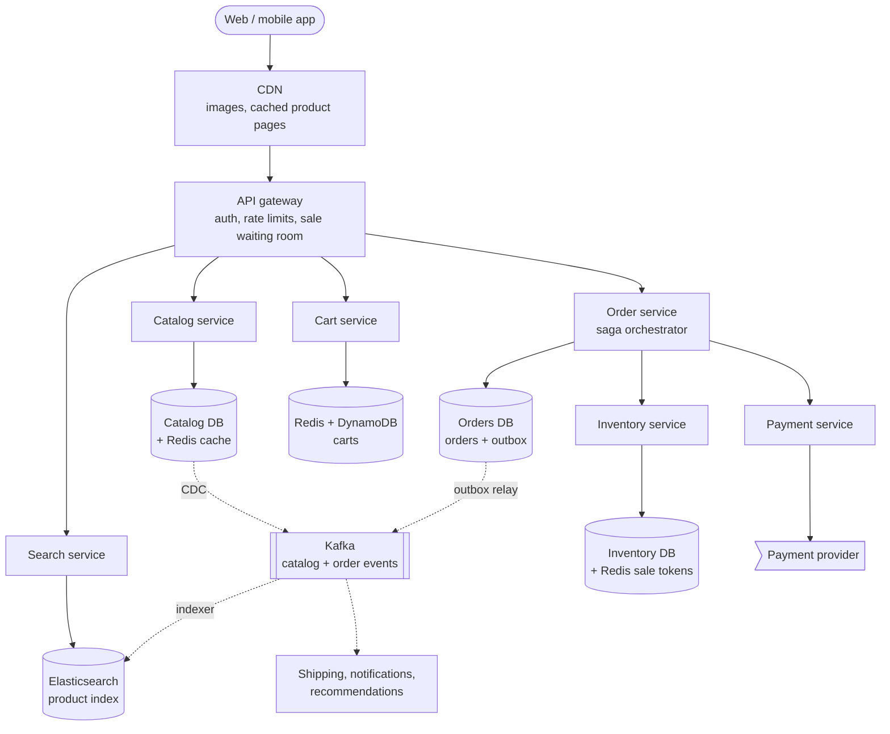
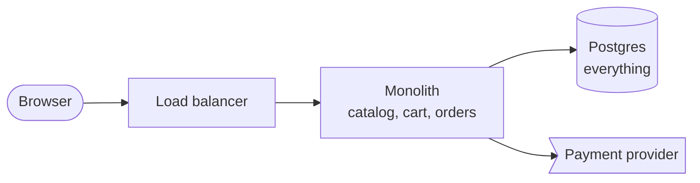
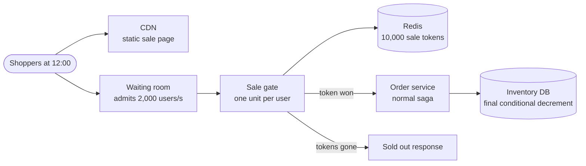
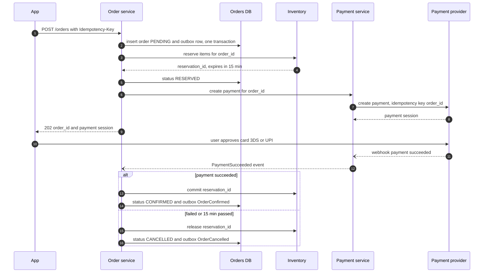

> **In one line:** serve the 200x heavier browsing traffic from CDN, Redis and an Elasticsearch index fed by CDC, and keep the buying path small and correct: a conditional stock decrement with an expiring reservation, an order saga (reserve → pay → confirm, with compensations), and an outbox so events match what was committed.

## The design at a glance



There are two worlds. **Browsing** (search, product pages, cart) is read-heavy and served from the CDN, Redis and Elasticsearch, which change data capture keeps in sync with the catalog DB. **Buying** goes through the order service, which runs a saga: reserve stock, take payment, confirm. Every state change is published through an outbox to Kafka for shipping, emails and recommendations.

## How to spend the 30 minutes

| Minutes | What you do | What to say or draw |
|---|---|---|
| 0-3 | Requirements | Marketplace or single seller? Guest checkout? Flash sales? |
| 3-6 | Numbers | 200:1 browse to buy, 600 orders/s peak, 17 k buy clicks/s in a flash sale |
| 6-9 | API and data model | Search, product, cart, order. Inventory and reservations tables |
| 9-12 | Design v1 | Monolith, one Postgres, stock row locked during payment |
| 12-15 | Break v1 | LIKE search, DB overload, lock across payment, charged but no order |
| 15-22 | Design v2 and v3 | Services, ES + CDC, caches, carts, reservation, saga, outbox, flash sale |
| 22-29 | Deep dives | Saga vs 2PC, no overselling, outbox, cart merge, order status |
| 29-30 | Recap | The 60-second summary at the bottom |

## Requirements

**Functional**

- Search products by text, with filters (brand, price, rating) and sorting.
- Product page: details, images, price, stock status ("only 3 left").
- Cart for guests and logged-in users; the guest cart merges into the account on login.
- Checkout: place an order, pay, get a confirmation.
- Track order status (confirmed, packed, shipped, delivered); cancel and return.
- Sellers update listings, prices and stock.
- Flash sales: a fixed quantity at a fixed time ("10,000 phones at 12:00").

**Non-functional**

- Product page p99 under 200 ms, search p99 under 300 ms.
- Browse and cart 99.99% available; checkout 99.95%, and it degrades rather than oversells.
- **Never oversell** and **never charge without an order**: inventory and orders are strongly consistent.
- Catalog and search may lag the source of truth by a few seconds.
- Survive 10x normal traffic on sale days.

**Out of scope**

- Seller onboarding, warehouse picking, courier routing, ads, fraud models, tax.

> **Say it like this:** "This is really two systems. Browsing is huge, cacheable and fine with a few seconds of staleness. Buying is small and strongly consistent, and the hard parts are not overselling and never charging someone without an order. I'll design them separately, then treat flash sales as a special case."

## Back-of-the-envelope numbers

| Quantity | Estimate | How |
|---|---|---|
| Daily active users | 50 M | Assumption for a large national store |
| Page views | ~12,000 / s average, ~60,000 / s peak | 50 M x 20 = 1 B a day ÷ 86,400 s, x5 for peaks |
| Searches | ~2,300 / s average, ~12,000 / s peak | 50 M x 4 = 200 M a day ÷ 86,400 s, x5 |
| Orders | ~60 / s average, ~600 / s peak | 5 M a day ÷ 86,400 s, x10 on sale evenings |
| Flash sale buy clicks | ~17,000 / s on one SKU | 1 M users clicking "Buy" in the first 60 s |
| Catalog | ~2.5 TB | 500 M SKUs x 5 KB |
| Product images | ~500 TB | 500 M SKUs x 5 images x 200 KB |
| Active carts | ~40 GB | 20 M carts x 2 KB |
| Orders storage | ~3.7 TB / year | 5 M x 365 = 1.8 B orders x 2 KB |

**What the numbers tell us:**

- Page views outnumber orders 200 to 1, so browsing comes from caches and a search index, apart from checkout.
- 600 orders a second is modest for sharded Postgres. Buying is hard because of **correctness**, not volume.
- A flash sale aims 17,000 writes a second at **one stock row**. No row survives that, so it gets its own design (v3).
- Images live in object storage behind a CDN; 40 GB of carts fits in Redis.

## API

```http
GET /api/v1/search?q=running+shoes&brand=nike&sort=price_asc&cursor=eyJzIjo...
→ 200 { "results": [ { "product_id": "P123", "price": 4999, "stock_status": "IN_STOCK" } ], "next_cursor": "..." }

GET /api/v1/products/P123
→ 200 { "product_id": "P123", "title": "...", "variants": [ { "sku": "P123-42-BLK", "price": 4999, "stock_status": "FEW_LEFT" } ] }

POST /api/v1/cart/items
Cookie: guest_cart=g_9f2a...        (or Authorization: Bearer <token>)
{ "sku": "P123-42-BLK", "qty": 1 }
→ 200 { "cart_id": "g_9f2a...", "items": [ ... ], "subtotal": 4999 }

POST /api/v1/orders
Authorization: Bearer <token>
Idempotency-Key: 3b7d1c...
{ "cart_id": "c_77", "address_id": "A1", "payment_method": "upi" }
→ 202 { "order_id": "O-1001", "status": "PENDING_PAYMENT", "payment_session": "ps_..." }

GET /api/v1/orders/O-1001
→ 200 { "order_id": "O-1001", "status": "SHIPPED", "timeline": [ ... ] }
```

- `Idempotency-Key`: a double tap or a retry after a timeout returns the same order, not a second one.
- `202 Accepted`, because payment (3-D Secure, UPI approval) can take minutes. The app follows the status.
- Search pages with a cursor (Elasticsearch `search_after`), because deep offsets are expensive.
- Products show a `stock_status` band, not the exact count, so the response stays cacheable.

## Data model

```text
products          (catalog DB, key = product_id)
  product_id PK, seller_id, title, description, brand, category_id,
  attributes JSON (RAM for phones, size chart for shoes), image_urls[], updated_at
skus
  sku PK, product_id, variant (size, colour), price, mrp

inventory         (Postgres, sharded by sku)
  sku, warehouse_id, available, reserved          PK (sku, warehouse_id)
reservations
  reservation_id PK, order_id, sku, warehouse_id, qty,
  status (HELD | COMMITTED | RELEASED), expires_at

carts             (DynamoDB, key = cart_id, Redis in front)
  cart_id, user_id nullable, items map sku → qty, updated_at, ttl

orders            (Postgres, sharded by user_id)
  order_id PK, user_id, status, total, address, payment_id, created_at
order_items
  order_id, sku, qty, price_at_purchase
outbox            (same database as orders)
  event_id PK, order_id, type, payload, created_at
```

- **Catalog in Postgres with JSONB** (or MongoDB): attributes differ per category. Customers read it through Redis and Elasticsearch.
- **Inventory in Postgres, sharded by SKU**: atomic conditional updates and one transaction over `inventory` and `reservations`.
- **Carts in DynamoDB with Redis in front**: key-value access and a built-in TTL for abandoned guest carts.
- **Orders in Postgres, sharded by `user_id`**, because "my orders" is the main query. The order ID embeds the shard number.
- **Outbox in the orders database**, so an order change and its event commit in one local transaction.

## Design v1: the simplest thing that works



1. Search runs `SELECT ... WHERE title ILIKE '%running shoes%'`.
2. The product page reads the product and its stock row from Postgres.
3. Add to cart inserts into `cart_items`, keyed by session ID for guests.
4. Checkout opens one transaction: `SELECT available ... FOR UPDATE` on the stock row, check the quantity, call the payment provider, decrement, insert the order, commit.

This works for a few thousand orders a day, and it is correct: the row lock stops two buyers taking the last unit.

## Where v1 breaks

| Problem | Why it happens | What the user sees |
|---|---|---|
| Search is a table scan | `ILIKE '%...%'` cannot use a normal index; no relevance, typos or facets | Slow, poor results |
| Every page view hits Postgres | 60 k reads/s at peak on the DB that also takes orders | Slow pages, and checkout slows with them |
| Stock row locked during payment | The lock is held for the 2-30 s a payment takes | Buyers of a popular item queue up and time out |
| Payment and DB are not atomic | The card is charged, then the app crashes before commit | Customer charged, no order |
| Cart tied to a session | The guest session ID changes on login or a new device | Cart empties when you log in |
| One deployable | A bug in reviews crashes the same process as checkout | The whole site goes down together |

## Design v2: split browse from buy, reserve then pay

### Fix 1: services that own their data

Split by business capability, each with its own database: **catalog**, **search**, **cart**, **inventory**, **order**, **payment**, with shipping and notifications downstream. Only checkout makes synchronous calls; the rest reacts to Kafka events. A crash in reviews no longer touches checkout.

### Fix 2: Elasticsearch fed by change data capture

Debezium reads the catalog DB's write-ahead log and publishes each product change to Kafka; an indexer updates Elasticsearch within seconds. ES brings relevance, typo tolerance, facets ("Nike (312)") and sorting. Because CDC reads the log, no code path can forget to update the index.

### Fix 3: cache the product page in layers

Split the page into a **static part** (title, images, description) and a **dynamic part** (price, stock band, delivery date). The static part is cached at the CDN for minutes and in Redis for hours, and CDC events delete the Redis key on change. The dynamic part is a small call with a short TTL.

### Fix 4: a cart service with guest carts

A guest gets a random `guest_cart` cookie, and the cart lives in DynamoDB under that ID (TTL 30 days), with Redis in front. On login the cart service merges it into the user's cart (see the deep dive). The cart stores SKUs and quantities only; prices are read live and fixed when the order is placed.

### Fix 5: reserve stock with a conditional decrement

No lock across the payment. At checkout the inventory service runs one statement:

```text
UPDATE inventory SET available = available - :qty, reserved = reserved + :qty
WHERE sku = :sku AND warehouse_id = :wh AND available >= :qty
```

One row updated means reserved; zero means out of stock. The row lock lasts microseconds. The same transaction inserts a `reservations` row with `expires_at = now + 15 min`, and a sweeper releases expired holds.

### Fix 6: the order is a saga

The order service orchestrates **reserve inventory → take payment → confirm**, saving the current step on the order. Each step has a compensation: payment fails, release the reservation; confirm fails after payment, refund. Every call carries `order_id` as the idempotency key. If the service crashes after the charge, another instance reads the saved step and finishes, so "charged but no order" cannot stick.

### Fix 7: publish events with an outbox

With services talking through Kafka, "update the order, then publish `OrderConfirmed`" is two writes that can half-fail. So the order service inserts the event into an `outbox` table **in the same transaction** as the status change, and a relay publishes it to Kafka. Consumers dedupe by `event_id`.

## Where v2 still breaks

| Problem | Why it happens | What the user sees |
|---|---|---|
| Flash sale hot row | 17 k conditional updates/s on one `inventory` row serialize on its lock | Timeouts for everyone; other SKUs on that shard slow down too |
| Bots | Scripts fire thousands of requests at 12:00:00 | Real users lose to bots |
| Thundering herd | 1 M users hit every service at once | Services sized for 600 orders/s fall over |
| Unpaid holds hide stock | Abandoned reservations last 15 minutes | "Sold out", then stock reappears later |

## Design v3: flash sales with tokens, a waiting room and limits

This is the diagram at the top. The sale path inside it:



### Fix 8: pre-load inventory tokens into Redis

Before the sale, move its 10,000 units into a sale pool and set `sale:123:tokens = 10000` in Redis. A Lua script decrements only if above zero; Redis runs it atomically, around 100,000 times a second per shard. Winners get a token good for 10 minutes of checkout; everyone else hears "sold out" in milliseconds. The database sees about 10,000 reservations over minutes instead of a million writes in one.

Redis is the **gate**, not the source of truth. The reservation still runs the conditional decrement on the sale pool row, so a Redis failover that loses a few decrements produces a "just sold out" message, never an oversell.

### Fix 9: a virtual waiting room

At sale time the gateway queues arriving users (a Redis sorted set by arrival time) and admits about 2,000 a second, while the sale page itself is static on the CDN. When tokens run out, the queue closes and everyone waiting is told at once. [Ticket booking](02-ticket-booking.md) uses the same idea.

### Fix 10: rate limits, one per customer, quick release

Limit requests per user, device and IP at the gateway ([rate limiter](21-rate-limiter.md)). Enforce one unit per customer with `SET sale:123:user:42 1 NX` before taking a token, and require a logged-in, phone-verified account. When a 10-minute sale reservation expires, the sweeper releases it and increments the Redis counter, so the unit goes back to the queue.

### Components

| Component | Job | Tech choice |
|---|---|---|
| CDN | Images, static product and sale pages | CloudFront or Akamai, images in S3 |
| API gateway | Auth, rate limits, waiting room | Envoy or managed gateway, counters in Redis |
| Catalog service | Product details, seller updates | Postgres JSONB, Redis cache-aside |
| Search service | Text search, filters, facets | Elasticsearch, fed by Debezium through Kafka |
| Cart service | Guest and user carts, merge | DynamoDB with TTL, Redis for active carts |
| Inventory service | Reserve, commit, release | Postgres sharded by SKU; Redis tokens for sales |
| Order service | Saga, order state, outbox | Postgres sharded by user_id |
| Payment service | Idempotent charges, refunds | See [payment gateway](17-payment-gateway.md) |
| Kafka + consumers | Shipping, email, analytics, recommendations | Partition by order_id, dedupe by event_id |

## Key flow: place an order



- **Out of stock at step 3:** the order becomes `REJECTED`; nothing was charged.
- **Order service crashes mid-saga:** the step is saved in the DB, and a recovery job resumes orders stuck for over a minute. Every call is idempotent by `order_id`.
- **Webhook lost:** the payment service also polls the provider for payments still pending.
- **Success arrives after the timeout:** the stock is already released, so the saga refunds. Keep the hold longer than the provider's payment timeout so this stays rare.

## Deep dives

### Why a saga and not two-phase commit?

**The problem.** An order spans three services, three databases and an external payment provider, and you want all-or-nothing.

**Options.**

| Option | Good | Bad |
|---|---|---|
| Two-phase commit (XA) | Real atomicity | Payment providers cannot join it. Locks held while waiting; a stuck coordinator blocks everyone |
| Saga by choreography | No central component | The flow is spread over many services; "where is order 1001?" is hard to answer |
| **Saga by orchestration** | One place holds state, steps, timeouts and compensations | More orchestrator code; intermediate states like `RESERVED` are visible |

**Pick.** An orchestrated saga. Say it plainly: this gives **eventual** atomicity; stock is briefly reserved but unpaid, which is fine because the hold expires. Temporal or AWS Step Functions can run it.

### How do you never oversell?

**The problem.** Two buyers, one unit left, same instant.

**Options.**

| Option | Good | Bad |
|---|---|---|
| `SELECT ... FOR UPDATE`, then update | Simple, correct | Lock held while the app works; contention on hot SKUs |
| Optimistic version check | No lock waits | Many retries on popular items |
| **Conditional decrement** | One statement, no read-modify-write race | Still one hot row in a flash sale |
| Redis counter with Lua | ~100 k ops/s, ideal gate | Not durable enough to be the only record |

**Pick.** The conditional decrement normally, with Redis tokens in front for flash sales. Reserve at **checkout**, not at add-to-cart: most carts are abandoned, and holding stock for them would show items as sold out that are not.

### The outbox pattern

**The problem.** If you write the DB and crash before publishing, shipping never hears of the order. If you publish first and the DB write fails, shipping ships a ghost order.

| Option | Good | Bad |
|---|---|---|
| Write DB, then publish | Simple | Event lost on a crash in between |
| Publish, then write DB | Simple | Event for an order that does not exist |
| **Outbox table + relay** | Event commits atomically with the state change | At-least-once delivery, so consumers dedupe |

**Pick.** Outbox, relayed by Debezium (it ships an outbox event router) or a poller that publishes rows in order. Kafka transactions do not help, because they cannot include the Postgres write.

### Guest carts and merging on login

**The problem.** A guest fills a cart, then logs in to an account that already has an older cart.

**Pick.** Server-side carts keyed by the `guest_cart` cookie. On login:

- Union the items. For the same SKU take the larger quantity, not the sum, so the same shoes added on two devices are not bought twice.
- Apply per-customer limits, drop discontinued items, flag price changes.
- Save under the user's cart and delete the guest cart, idempotently, so a second login changes nothing.

### Order status tracking

**The problem.** After payment the order moves through warehouse and courier systems we do not control.

**Pick.** A forward-only state machine in the order service: `CONFIRMED → PACKED → SHIPPED → OUT_FOR_DELIVERY → DELIVERED`, with `CANCELLED` allowed until `SHIPPED` and `RETURN_REQUESTED → REFUNDED` after delivery. Warehouse and courier events arrive on Kafka; each transition is a conditional update (`WHERE status = 'PACKED'`), so a late or duplicate event cannot move an order backwards. Each one also writes an outbox event that becomes a push or email.

## Trade-offs to say out loud

- We chose an **orchestrated saga over 2PC** because the payment provider cannot join a distributed transaction. The cost is visible intermediate states and compensation code.
- We **reserve at checkout, not at add-to-cart**, so abandoned carts never hide stock. The cost is that an item in your cart can sell out before you pay.
- We let **search and product pages lag by seconds**. The cost is an occasional "in stock" badge on a sold-out item; checkout always re-checks.
- We gate **flash sales with Redis tokens**. The cost is extra machinery for one kind of event, and the DB still does the final check.
- We split into **microservices by capability**. The cost is network hops and eventual consistency; a small store should stay a monolith.

## Follow-up questions

**Q: How do recommendations work?**
Mostly offline: order and click events flow from Kafka into a data lake, and batch jobs write "bought together" and per-user lists to a key-value store. The page loads them asynchronously, so a failure just hides that strip.

**Q: The price changed between add-to-cart and checkout?**
The cart always shows the live price. The order snapshots `price_at_purchase`, and if it differs from what the user last saw, checkout asks them to confirm.

**Q: A seller updates stock while orders are reserving it?**
The seller sends an absolute number ("I have 50"). The inventory service applies it as a delta to `available` in one transaction, leaving `reserved` untouched, so in-flight reservations survive.

**Q: Elasticsearch is down. What still works?**
Product pages, carts and checkout do not depend on ES. Search falls back to cached category lists, and recovery is replaying the CDC topic or reindexing from a snapshot.

**Q: How do you go multi-region?**
Serve browsing from every region. Keep each country's inventory and orders in one home region, so "no oversell" stays a single-region guarantee.

**Q: How do you stop one user buying 500 units in the sale?**
Per-customer limits are checked at the token gate and again in the order service, keyed on account, phone and payment instrument, not just the session.

## 60-second recap

- Two systems: cacheable browsing (200x the traffic) and a small, strongly consistent buying path.
- Browsing: CDN and Redis for product pages, Elasticsearch fed by CDC, carts in Redis plus DynamoDB with a guest-cart merge on login.
- Inventory: a conditional decrement plus a reservation that expires in 15 minutes. No lock across the payment.
- Orders: an orchestrated saga, reserve → pay → confirm, with release and refund as compensations. Not 2PC.
- Events: an outbox in the orders DB, relayed to Kafka, so shipping and emails see exactly what was committed.
- Flash sales: waiting room, Redis tokens equal to the stock, one per customer, rate limits; the DB stays the final guard.
- Order status: a forward-only state machine fed by warehouse and courier events.
