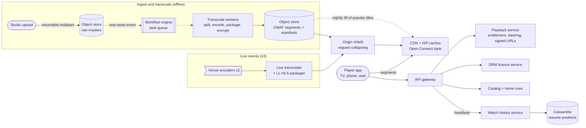
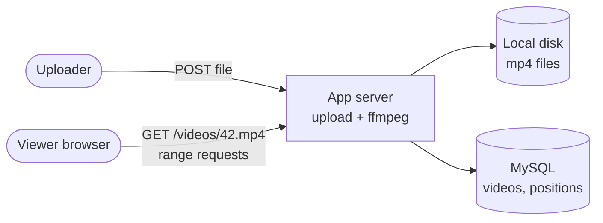
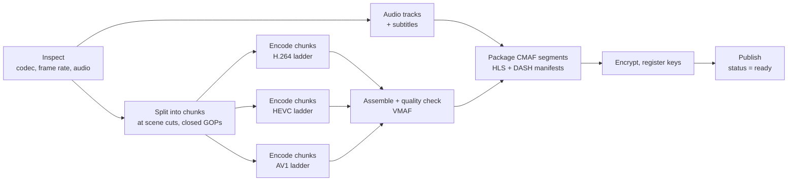
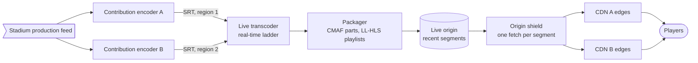
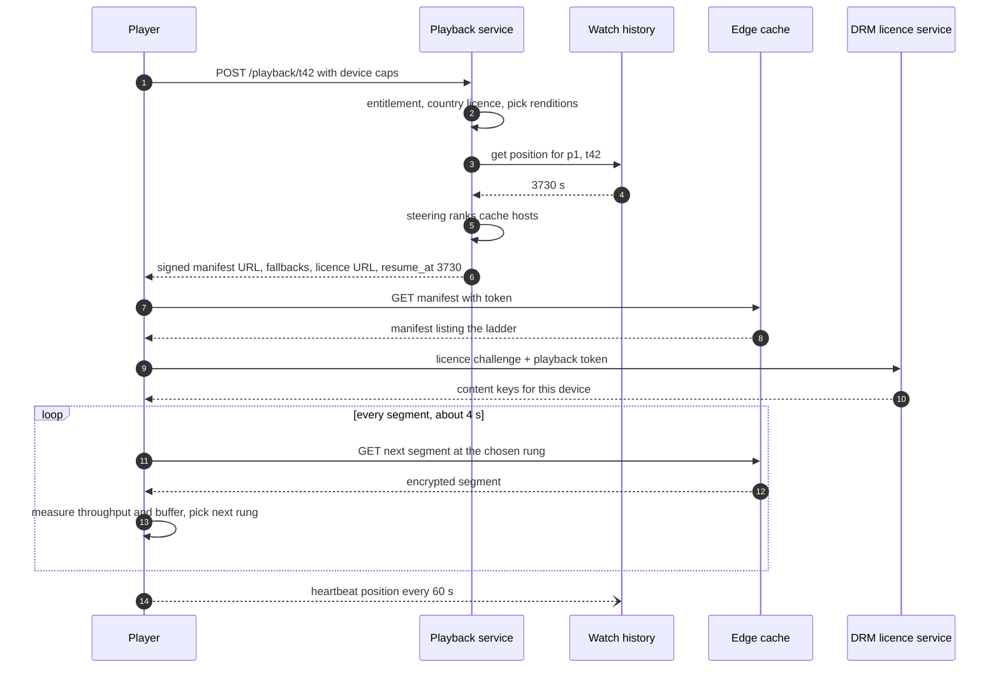

> **In one line:** transcode every title once into a ladder of short, encrypted segments, push the popular ones into caches inside ISPs before anyone presses play, let the player pick a bitrate segment by segment, and keep the small control plane (catalog, playback, watch history) apart from the huge byte path.

## The design at a glance



**Offline**: a master lands in object storage, a workflow encodes its chunks in parallel at every rung of the ladder and packages encrypted segments, and popular titles are copied into ISP caches overnight. **Play**: the player gets a manifest, signed URLs and a DRM licence, pulls segments from the nearest cache while adapting the bitrate, and heartbeats its position to Cassandra. **Live** feeds low-latency HLS through a shield that collapses millions of identical requests.

## How to spend the 30 minutes

| Minutes | What you do | What to say or draw |
|---|---|---|
| 0-3 | Requirements | On demand only, or live too? Studio or user uploads? Which devices? |
| 3-6 | Numbers | 25 M concurrent streams, 125 Tbps: bytes must come from the edge |
| 6-9 | API and data model | Upload, play, heartbeat. Catalog in SQL, positions in Cassandra |
| 9-12 | Design v1 | One server, ffmpeg, one MP4 per video |
| 12-15 | Break v1 | Slow encodes, one bitrate, origin bandwidth, no protection |
| 15-22 | Design v2 | Transcoding DAG, ladder + ABR, ISP caches, playback service, DRM |
| 22-25 | Design v3 | Live sports: LL-HLS, request collapsing, pre-scaling, degrading |
| 25-29 | Deep dives | Chunked encoding, ABR, CDN strategy, DRM |
| 29-30 | Recap | The 60-second summary at the bottom |

## Requirements

**Functional**

- Studios upload a master; it becomes playable on TVs, phones and browsers.
- A personalised home page and catalog search.
- Playback starts fast and adapts to the network without stalling.
- Resume where you left off, on any device.
- Subtitles, audio languages, and licensing per country and date range.

**Non-functional**

- Startup under 2 seconds, rebuffering under 1% of watch time.
- Playback availability 99.99%, about 25 million concurrent streams at peak.
- DRM and expiring URLs (studios require them).
- Watch position may be up to a minute stale.
- A new title may take hours to be ready. Encoding is not latency-critical.

**Out of scope**

- Sign-up and billing (an entitlement service says what a profile may watch).
- Training the recommendation model.

> **Say it like this:** "This is two systems: a small control plane that decides what you may watch and where to fetch it, and a massive data plane that moves bytes. I'll design for 25 million concurrent streams, encode each title once into many bitrates, serve almost all bytes from caches inside ISPs, and then extend it to live sports."

## Back-of-the-envelope numbers

| Quantity | Estimate | How |
|---|---|---|
| Watch time | 200 M hours / day | 100 M daily viewers x 2 hours |
| Concurrent streams | ~8 M average, ~25 M peak | 200 M hours ÷ 24 hours, x3 in the evening |
| Peak egress | ~125 Tbps | 25 M streams x 5 Mbps average |
| Edge servers | 1,250 minimum | 125,000 Gbps ÷ 100 Gbps per box, before headroom |
| Storage per content hour | ~30 GB | Ladder total ~25 Mbps x 3,600 s ≈ 11 GB per codec, x3 codecs (newer ones smaller) |
| Catalog storage | ~1.5 PB encoded, ~5 PB masters | 50,000 content hours x 30 GB, masters ~100 GB / hour |
| Transcode compute | ~2,500 cores busy all day | 200 new hours / day x 30 renditions x 10 core-hours = 60,000 core-hours ÷ 24 |
| Play starts | ~3,500 / s average, ~10 k / s peak | 100 M x 3 plays ÷ 86,400 s, x3 |
| Heartbeat writes | ~400 k / s at peak | 25 M streams ÷ one per 60 s |

**What the numbers tell us:**

- 125 Tbps cannot leave a data center: 95%+ of bytes must come from caches inside ISPs.
- 1.5 PB is modest. Storage is cheap next to bandwidth, so store many renditions and spend CPU to save bits.
- 10 k play starts a second is ordinary: stateless services and caches.
- 400 k small last-write-wins writes a second: Cassandra.

## API

```http
POST /v1/uploads                       { "title_id": "t42", "size_bytes": 210000000000 }
→ 201 { "upload_id": "u9", "part_urls": ["https://raw-bucket/...?sig=..."] }

POST /v1/playback/t42
{ "profile_id": "p1", "device": { "codecs": ["h264", "hevc", "av1"], "drm": "widevine-l1", "max_height": 2160 } }
→ 200 { "manifest_url": "https://oc12.isp.example/t42/main.mpd?token=...", "fallback_hosts": ["oc31...", "cdn2..."],
        "licence_url": "/v1/licence", "resume_at_s": 3730 }

POST /v1/licence                       { "challenge": "<DRM blob>", "playback_token": "..." }
→ 200 { "licence": "<DRM blob>" }

PUT /v1/history/p1/t42                 { "position_s": 3790, "client_ts": 1760550000123 }
→ 204

GET /v1/home?profile_id=p1&cursor=r10  → 200 { "rows": [...], "next_cursor": "r20" }
```

- Uploads go **straight to object storage** through presigned part URLs: a 200 GB master never touches our servers, and a failed part is retried alone.
- `POST /playback` creates a session. Device capabilities decide the renditions, and the **signed, short-lived** manifest URL points at a cache chosen for this client.
- The heartbeat is an idempotent `PUT` with a client timestamp, so a late retry cannot move the position backwards.

## Data model

```text
titles          (Postgres)    title_id PK, type, parent_id (show / season), name, genres, duration_s
availability    (Postgres)    title_id, country, starts_at, ends_at
renditions      (Postgres)    asset_id, title_id, codec, height, bitrate_kbps, key_id, segment_prefix
watch_history   (Cassandra)   PRIMARY KEY (profile_id, title_id), position_s, updated_at, device
home_rows       (KV store)    profile_id → [ { row_name, [title_id ...] } ]
segments        (object store) /t42/av1/1080p/seg_000123.m4s, manifests next to them
```

- **Catalog in Postgres**, cached: a few hundred thousand relational, read-heavy rows, indexed into Elasticsearch for search.
- **Segments in object storage:** billions of immutable files read through the CDN.
- **`watch_history` in Cassandra, partition key `profile_id`.** "Continue watching" is one partition read, and blind upserts are cheap in its LSM storage. Size: 500 M profiles x 500 titles x 100 bytes ≈ 25 TB.
- **`home_rows` in a key-value store:** one precomputed blob per profile, read on every app open.

## Design v1: the simplest thing that works



1. The uploader posts the file to the app server, which saves it to disk and inserts a row with `status = processing`.
2. A background thread runs ffmpeg to make one 720p H.264 MP4, then sets `status = ready`.
3. The page has `<video src="/videos/42.mp4">`. The browser downloads it progressively with range requests, so seeking works.
4. The home page lists the newest videos with a SQL query.
5. Every 10 seconds the page posts the position, and the server runs an `UPDATE` in MySQL.

This works for a training portal with a few hundred videos and shows you know the pieces.

## Where v1 breaks

| Problem | Why it happens | What the user sees |
|---|---|---|
| Encoding takes hours, a crash starts it over | One machine encodes the whole file in sequence | New titles are days late |
| One rendition for everyone | A single 720p H.264 file at ~3 Mbps | Buffering on weak 4G, a blurry picture on a 4K TV |
| All bytes from one origin | 125 Tbps cannot leave one data center, far users have long round trips | Slow starts, stalls every evening |
| The file is a public URL | No auth, no encryption | Anyone can share it, so studios will not license content |
| Files and positions on one box | Local disk, and one MySQL taking 400 k updates a second | Lost files on a crash, database down at peak |
| Same newest-first list for everyone | Home page is one SQL query | Nobody finds anything to watch, and every app open hits MySQL |

## Design v2: encode once into a ladder, serve from the edge

### Fix 1: upload straight to object storage

The studio uploads 100 MB parts in parallel through presigned multipart URLs into a bucket, and the completed upload emits an event that starts the workflow. Masters stay in a cheaper storage class for re-encoding later. No local disk to fill or lose.

### Fix 2: transcoding as a DAG of small tasks

A workflow engine (Temporal, Step Functions or in-house, see the [job scheduler](09-job-scheduler.md)) runs each title as a DAG on a shared worker fleet. Each box is many small tasks, and a failed task is retried alone.



A 2-hour film in 1-minute chunks at 30 renditions is 3,600 independent tasks: about an hour on a big fleet instead of days.

### Fix 3: a bitrate ladder and adaptive bitrate (ABR)

Each title becomes a **ladder**, say 240p at 300 kbps up to 4K at 15 Mbps, in H.264 (plays everywhere), HEVC (4K and HDR on TVs and Apple devices) and AV1 (newest devices, smallest files). Renditions are cut into ~4-second segments aligned at the same timestamps. The manifest (HLS `.m3u8` or DASH `.mpd`) lists the rungs, and the player picks a rung for every segment from its throughput and buffer level.

### Fix 4: a CDN with caches inside ISPs

Put cache appliances inside ISP networks and at internet exchanges, as Netflix Open Connect does; ISPs agree because the traffic stays off their transit links. Each night, in an off-peak **fill window**, titles predicted to be popular in each region are pushed onto the boxes, and the long tail is pulled through the origin shield on a miss. Now 95%+ of bytes never leave the viewer's ISP.

### Fix 5: a playback service for manifests, signed URLs and licences

The playback service checks entitlement and the country licence window, keeps renditions the device can decode and may play (4K only with hardware DRM), and asks **steering** for ranked healthy, nearby caches holding the title. It returns a signed manifest URL and the licence URL. Segments are encrypted once with common encryption (CENC), and the licence service gives the device's Widevine, FairPlay or PlayReady module keys only for a valid playback token. A leaked URL expires; a copied segment is useless without a key.

### Fix 6: watch history in Cassandra

The player sends its position every 60 seconds and on pause, seek or exit. The service upserts `(profile_id, title_id)` with `USING TIMESTAMP` set from the heartbeat's client time (clamped so it is never ahead of the server clock), so Cassandra's own last-write-wins keeps the newest position even when heartbeats arrive out of order. Heartbeats also go to Kafka for recommendations and "trending" rows.

### Fix 7: catalog and a precomputed home page

Recommendation jobs compute rows offline ("Continue watching", "Because you watched X", "Top 10 in India") and store them per profile. The home service fetches them, drops titles not licensed in the user's country, adds artwork URLs (on the CDN) and caches the result, so app open stays fast even when the recommender is slow.

## Where v2 still breaks

A live cricket final with 50 M concurrent viewers (~100 Tbps at 2 Mbps, mostly phones) breaks v2.

| Problem | Why it happens | What the user sees |
|---|---|---|
| The offline DAG is too slow | The video does not exist until it happens | No stream at all |
| 20-30 s behind real time | Classic HLS: 6 s segments, 3 buffered | The neighbours cheer before you see the wicket |
| Millions want the same new segment at once | Nothing to pre-position, every edge misses together | A stampede on the origin, the stream stalls |
| 20 M join in 10 minutes | ~33 k plays a second (3x the evening peak), autoscaling takes minutes | Errors on the play button at the toss |
| One encoder or uplink fails | A single path from the stadium | The stream dies for everyone |
| Demand beats the forecast | A tense last over doubles viewers | Capacity runs out and everyone stalls |

## Design v3: live events at tens of millions of viewers

This is the diagram at the top. The live path on its own:



### Fix 8: a redundant real-time ingest path

Two encoders at the venue send the feed over SRT to ingest points in two regions. A real-time transcoder makes a short H.264 ladder (5-6 rungs, so every phone can play it) and a packager writes CMAF chunks. If feed A drops, the packager switches to feed B within a segment.

### Fix 9: low-latency HLS

Keep segments a few seconds long but publish them as partial segments of under a second. The player requests the next part before it exists (blocking playlist reload) and gets it the moment it is written. Latency drops to about 3-5 s behind live. LL-DASH does the same with chunked CMAF.

### Fix 10: request collapsing and an origin shield

When a thousand players on one edge ask for the same missing part, the edge sends **one** request upstream and holds the rest. The shield does the same for all edges, so the origin sees a handful of requests per segment, not millions.

### Fix 11: scale before the match

Forecast from past matches and pre-scale every API fleet, cache and database hours before the toss. Reserve capacity on two or more CDNs and load-test at the expected peak. Players already watching hold a long-lived token, so they never call the API mid-match.

### Fix 12: degrade gracefully

Prepare switches in advance: turn off recommendations and comments, slow heartbeats to every 5 minutes, serve a static home page, let entitlement fail open for recent valid sessions, and cap the ladder at 720p if CDN capacity runs short. Everyone gets a slightly worse picture instead of some getting nothing.

### Components

| Component | Job | Tech choice |
|---|---|---|
| Object store | Masters, segments, manifests | S3 / GCS: durable, cheap |
| Workflow + workers | Run the DAG, retry failed tasks | Temporal or Step Functions, ffmpeg on spot VMs |
| Edge caches + shield | Serve 95%+ of bytes, collapse misses | ISP appliances + commercial CDNs |
| Playback service | Rights, renditions, steering, signed URLs | Stateless, multi-region |
| DRM licence service | Keys for trusted devices | Widevine, FairPlay, PlayReady, keys in a KMS |
| Catalog + home | Titles, licences, personalised rows | Postgres + cache, Elasticsearch, KV store |
| Watch history | Resume positions | Cassandra by profile |
| Live path | Real-time encode, LL-HLS | Redundant encoders, SRT ingest in two regions |

## Key flow: press play



- **Edge cache dies or slows:** the player retries the segment on the next fallback host. Segments are identical everywhere, so nobody notices.
- **Token expires during a 3-hour film:** the player refreshes it before expiry. The buffer keeps playing meanwhile.
- **Licence service down:** new plays fail, so run it stateless in several regions. Playing sessions keep their keys.
- **Watch history down:** resume from zero and drop heartbeats. Never block playback on history.

## Deep dives

### Chunked and per-title encoding

**The problem.** A 2-hour master at 30 renditions is about 600 core-hours: days on one machine, and a crash at 90% loses it all.

**Options.**

| Option | Good | Bad |
|---|---|---|
| One machine per rendition | 30x parallel | Still hours for 4K and AV1 |
| **Chunks x renditions** | Thousands of tasks, retry one chunk | Chunks must start on keyframes (closed GOP) or the joins glitch |
| **Per-title ladder** | ~20% fewer bits at equal quality | An extra analysis pass |

**Pick.** Split at scene cuts, encode chunks x renditions in parallel, and pick each title's ladder by measuring quality with VMAF (a cartoon needs far fewer bits than an action film). Encoding is paid once; bandwidth on every view.

### How the player picks a bitrate

**The problem.** Phone throughput swings every few seconds. Too high and it stalls; too low and it looks bad.

| Option | Good | Bad |
|---|---|---|
| Throughput-based | Reacts quickly | Noisy estimates make it oscillate |
| Buffer-based (fuller buffer, higher rung) | Stable, few stalls | Slow to climb at startup |
| **Hybrid** | Fast start, stable once warm | More tuning |

**Pick.** Hybrid. Start a rung or two low so the first frame shows in under 2 seconds, lean on throughput while the buffer is small and on buffer level once it is healthy (30+ s), and never exceed the screen's resolution. A stall hurts more than blur.

### CDN strategy

**The problem.** 125 Tbps at peak, and every byte crossing the backbone costs money and latency.

| Option | Good | Bad |
|---|---|---|
| Commercial CDN only | Fast to start | Very expensive at this volume |
| Own CDN in own PoPs | Control, cheaper | Traffic still crosses ISP transit |
| **Appliances inside ISPs, push fill** | Bytes stay inside the ISP | Hardware, fill logic and steering to build |
| Pull-only caching | No predictions | First viewers in each city start slowly, misses spike at peak |

**Pick.** ISP appliances filled nightly for most on-demand traffic, pull for the long tail, and commercial CDNs for overflow and live. Steering ranks caches per client by network distance, health and which box holds the file.

### Protecting the content

**The problem.** Studios demand strong protection, and live matches are pirated in real time.

| Option | Good | Bad |
|---|---|---|
| Signed, expiring URLs | Stops hotlinking | The file itself is in the clear |
| **DRM** | Keys only reach trusted device modules | Licence servers, per-platform quirks |
| Forensic watermarking | Traces a leak to an account | Extra processing |

**Pick.** Layer them: signed URLs, DRM on everything, watermarking for premium live. Encrypt once in CENC `cbcs` mode, which current Widevine, FairPlay and PlayReady clients all accept (old devices may need a `cenc` copy). Allow HD and 4K only with hardware-backed DRM such as Widevine L1.

## Trade-offs to say out loud

- We chose to **pre-encode every rendition** over transcoding on the fly, because play-time CPU cannot scale to 25 M streams. The cost is ~30 GB per content hour and an hour-long pipeline.
- We chose **push pre-positioning** for popular titles over pure pull, so the first viewer in each city starts fast. The cost is nightly fill traffic and some wrong predictions.
- We chose **4-second segments** over 10-second ones for faster adaptation and startup. The cost is more requests and files.
- We made **watch history eventually consistent** so heartbeats never slow playback. The cost is up to a minute of lost position.
- For live we chose **LL-HLS (~4 s behind)** over WebRTC (under a second), because LL-HLS runs on ordinary HTTP CDNs at 50 M viewers. The cost is that we are never truly real time.

## Follow-up questions

**Q: How would this change for user uploads, like YouTube?**
Most videos are rarely watched. Encode two or three H.264 rungs so the video is live in minutes, and add rungs and codecs once it gets views. Popularity is unpredictable, so rely on pull caching.

**Q: How do you make startup fast?**
Start on a low rung, steer to a nearby cache, and prefetch the manifest and first segment of the title the user is hovering over.

**Q: How do subtitles and audio languages work?**
They are separate renditions (WebVTT or TTML for text) listed in the manifest. The player fetches only the chosen ones, and all share one video ladder.

**Q: How do you enforce "2 screens at a time"?**
Each session is a lease in Redis with a 2-minute TTL, refreshed by heartbeats. A play beyond the limit is rejected; a crashed device's lease expires by itself.

**Q: A hit series drops at midnight. What happens?**
The time is known, so push the encrypted episodes to the edge days early and pre-scale the playback service. It is the on-demand cousin of the live problem.

**Q: How do you know playback quality is good?**
Players send startup time, rebuffer ratio, bitrate and errors through Kafka to dashboards. The same data steers users away from sick caches and shapes the next night's fill.

## 60-second recap

- Two systems: a small control plane (catalog, playback, licences, history) and a huge data plane (segments over CDN).
- Uploads go straight to object storage. A DAG encodes chunks in parallel into a per-title ladder in three codecs, packages CMAF segments with HLS and DASH manifests, and encrypts once.
- ISP caches filled nightly serve 95%+ of the 125 Tbps peak; commercial CDNs take overflow.
- The playback service checks rights, filters renditions by device, steers to a cache, and returns signed URLs and a licence URL.
- The player adapts bitrate per segment and heartbeats every 60 s into Cassandra.
- Live: redundant SRT ingest, LL-HLS at 3-5 s, request collapsing, pre-scaling, and switches to degrade gracefully.
