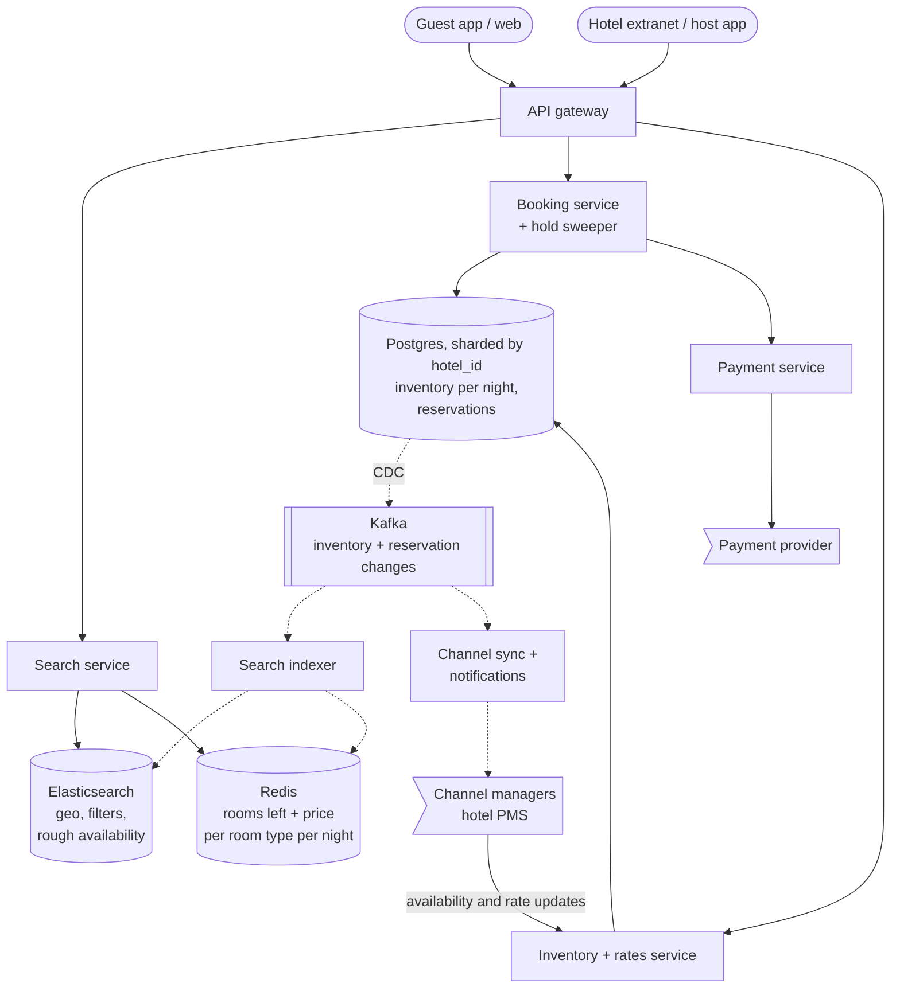
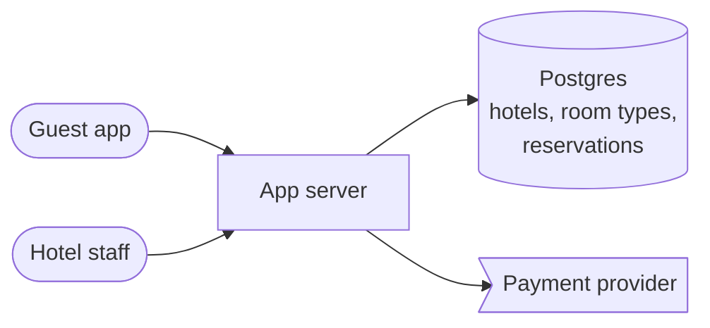
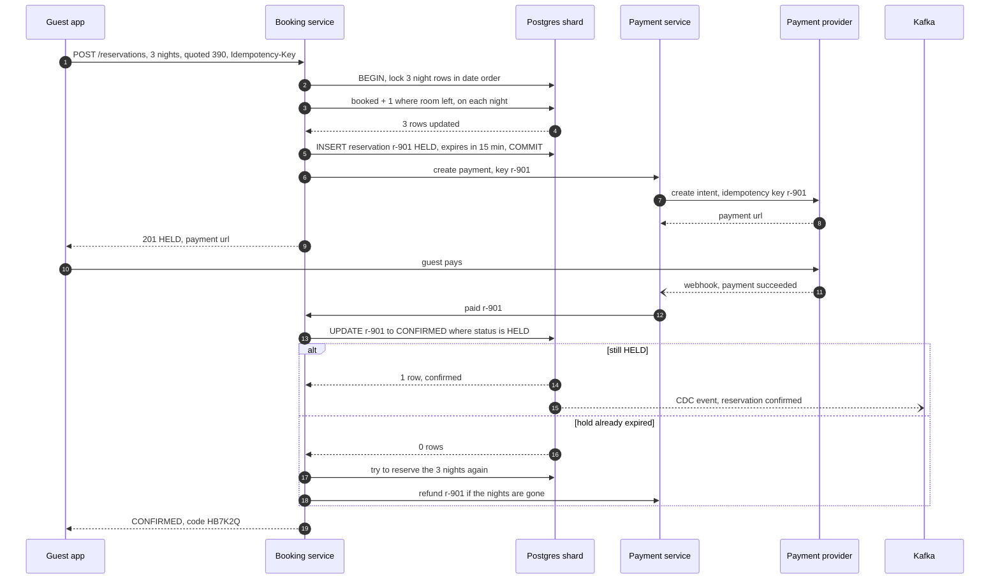

> **In one line:** keep one inventory row per room type per night in a strongly consistent database, book a stay by conditionally decrementing every night in one transaction, and serve search from an eventually consistent Elasticsearch index and availability cache fed by change data capture.

## The design at a glance



There are two halves. **Booking** is small and strict: lock the stay's nights in the hotel's Postgres shard, decrement rooms left on each night only if there is room, and hold the reservation while the guest pays. **Search** is huge and relaxed: Elasticsearch finds hotels on the map that are probably free, Redis gives exact prices for the page you see, and CDC refreshes both seconds after every change. Hotels update rooms and rates through the extranet or a channel manager, and our bookings flow back out the same way.

## How to spend the 30 minutes

| Minutes | What you do | What to say or draw |
|---|---|---|
| 0-3 | Requirements | Hotels or homes? Pay now or at the hotel? Is overbooking ever allowed? |
| 3-6 | Numbers | 500 searches per booking, ~1,000 hotels per search, 2.2 B inventory rows |
| 6-9 | API and data model | Search, availability, reservation; inventory per room type per night |
| 9-12 | Design v1 | One database, availability from an overlap query on reservations |
| 12-15 | Break v1 | Slow search, overbooking race, wrong night math, double charge |
| 15-22 | Design v2 and v3 | Per-night rows, one-transaction booking, holds, search via CDC, channel sync |
| 22-29 | Deep dives | Inventory model, concurrency, keeping search fresh, overbooking policy |
| 29-30 | Recap | The 60-second summary at the bottom |

## Requirements

**Functional**

- Search by place (city, landmark, map area), dates, guests and rooms; filter and sort by price, rating, distance.
- See a hotel's room types with the exact total for the stay.
- Book one or more rooms for a range of nights, pay, get a confirmation.
- Cancel under the rate's policy (free cancellation, non-refundable).
- Hotels and hosts manage room counts, nightly prices and closed dates.
- Guests review a stay after checkout.

**Non-functional**

- Never sell more rooms than the hotel allows on any night: booking is strongly consistent.
- Search p99 under 500 ms; results may lag reality by a few seconds.
- Booking confirms in under 2 seconds, not counting the guest's payment time.
- 99.99% availability for search, 99.95% for booking.
- No double charges; every charge ends as a reservation or a refund.

**Out of scope**

- Flights, car rental, loyalty points, the hotel's front-desk system, ranking model training.

> **Say it like this:** "This is two systems with different rules. Search is huge, geo-based and can be seconds stale. Booking is small but must never oversell a night. I'll keep one inventory row per room type per night, book a stay as one transaction across those rows, and feed search through CDC."

## Back-of-the-envelope numbers

| Quantity | Estimate | How |
|---|---|---|
| Properties | 2 M, ~6 M room types | ~3 room types each on average; homes have 1 |
| Inventory rows | ~2.2 B | 6 M room types x 365 nights |
| Inventory storage | ~110 GB | 2.2 B rows x ~50 bytes |
| Bookings | ~12 / s average, ~60 / s peak | 1 M a day ÷ 86,400 s, x5 on peak evenings |
| Searches | ~5,800 / s average, ~17,000 / s peak | 500 searches per booking, x3 at peak |
| Availability checks if done naively | ~17 M listings / s | 17,000 searches x ~1,000 hotels in the map area |
| Hotel inventory and rate updates | ~2,300 / s | 2 M properties x 100 updates a day |
| Availability cache | ~13 GB | 6 M room types x 365 nights x 6 bytes (rooms left + price) |
| Photos | ~30 TB | 2 M properties x 30 photos x 500 KB |

**What the numbers tell us:**

- Searches outnumber bookings 500:1 and each considers ~1,000 hotels, so search availability comes from an index and a cache, never the booking database.
- 60 bookings a second is tiny. The booking database needs correctness, not throughput.
- Hotels send far more updates (2,300/s) than guests make bookings, so the index must absorb a steady stream of changes.
- 110 GB of inventory shards easily by `hotel_id`, and a booking only touches one hotel.

## API

```http
GET /api/v1/search?lat=15.55&lng=73.75&radius_km=5&check_in=2026-11-10&check_out=2026-11-13&guests=2&rooms=1&max_price=150&cursor=...
→ 200 { "results": [ { "hotel_id": "h88", "name": "...", "total_price": 390, "rating": 8.7, "lat": 15.56, "lng": 73.75 } ], "next_cursor": "..." }

GET /api/v1/hotels/h88/availability?check_in=2026-11-10&check_out=2026-11-13&guests=2
→ 200 { "room_types": [ { "room_type_id": "rt-dlx", "name": "Deluxe King", "nightly": [130, 130, 130], "total": 390, "left": 3, "policy": "free cancel until 2026-11-08" } ] }

POST /api/v1/reservations
Idempotency-Key: 5d1e...
{ "hotel_id": "h88", "room_type_id": "rt-dlx", "check_in": "2026-11-10", "check_out": "2026-11-13", "rooms": 1, "guests": 2, "quoted_total": 390 }
→ 201 { "reservation_id": "r-901", "status": "HELD", "hold_expires_at": "...", "payment_url": "..." }   (409 SOLD_OUT or PRICE_CHANGED)

GET /api/v1/reservations/r-901
→ 200 { "status": "CONFIRMED", "confirmation_code": "HB7K2Q" }

PUT /api/v1/extranet/hotels/h88/inventory
{ "room_type_id": "rt-dlx", "from": "2026-12-01", "to": "2026-12-31", "total_rooms": 12, "price": 140, "closed": false }
→ 200
```

- **Dates are a half-open range**: check-in 10, check-out 13 means the nights of the 10th, 11th and 12th, in the hotel's local dates.
- **`quoted_total`** lets booking refuse when the price changed, instead of silently charging more.
- **`Idempotency-Key`** makes a retry return the same `r-901`, not a second room.

## Data model

```text
hotels, room_types             (Postgres catalog, indexed into Elasticsearch)
  hotel_id PK, name, lat, lng, city, stars, amenities, host_id
  room_type_id PK, hotel_id, name, max_guests, beds, photo_urls

room_type_inventory            (Postgres, shard key = hotel_id)
  hotel_id + room_type_id + night   PK
  total_rooms       12
  booked            9      includes rooms in active holds
  overbook_limit    0      extra rooms the hotel lets us sell
  price             130.00
  closed            false

reservations                   (Postgres, same shard)
  reservation_id PK, hotel_id, room_type_id, guest_id, check_in, check_out,
  rooms, total_price, status (HELD | CONFIRMED | CANCELLED | EXPIRED),
  hold_expires_at, payment_ref, idempotency_key UNIQUE

reviews                        (separate Postgres)
  review_id PK, hotel_id, reservation_id UNIQUE, scores, text, created_at
```

- **Inventory and reservations in Postgres, sharded by `hotel_id`**: a stay is one multi-row transaction on one shard.
- **Elasticsearch** for search: `geo_point` distance and bounding-box queries, filters, ranking. A copy fed by CDC.
- **Redis** for exact rooms left and price per night on the pages guests see.
- **Photos** (30 TB, immutable) in object storage behind a CDN.
- **`reservation_id UNIQUE` on reviews**: only real guests review, once per stay.

## Design v1: the simplest thing that works



1. Search: find hotels in the city, then for each room type count overlapping reservations (`check_in < :out AND check_out > :in`). Show it if the count is below `total_rooms`.
2. The hotel page runs the same count and shows one fixed price per room type.
3. Book: count again; if there is room, charge the card, then insert a `CONFIRMED` reservation.
4. Hotel staff edit rooms and prices in the same database.

This works for one small chain, and it raises the core question: how do you know a room is free on every night of a stay?

## Where v1 breaks

| Problem | Why it happens | What the user sees |
|---|---|---|
| Search is slow | An overlap count per room type for thousands of hotels per search; no geo index | Searches take seconds; the DB is pegged |
| Overbooking under concurrency | Two bookings both count 9 of 10 and both insert. There is no row for "the 10th room" to lock | Two guests arrive for the last room |
| Wrong availability | 2-room hotel: one guest has Monday night, another Wednesday. A Monday-to-Thursday search counts 2 overlaps and says full, though a room is free every night | Free rooms shown as sold out |
| One price per room type | Prices change by night, season and event | Wrong prices |
| Charge, then insert | A retry charges twice; a crash in between leaves a payment with no room | Double charge, or paid with no booking |
| Hotels also sell on other sites | Nothing tells us about rooms sold elsewhere | Overbooking across channels |

## Design v2: per-night inventory, one-transaction booking, a separate search path

### Fix 1: one inventory row per room type per night

Store `(hotel, room_type, night) → total_rooms, booked, price`. A stay is free if **every** night has `booked + rooms <= total_rooms`. Each night is counted on its own, which fixes the Monday/Wednesday mistake, and has its own price.

### Fix 2: book every night in one transaction with conditional decrements

Rooms left is `total_rooms - booked`, so the decrement is written as a guarded `booked + 1`:

```sql
BEGIN;
SELECT night FROM room_type_inventory
WHERE hotel_id = 'h88' AND room_type_id = 'rt-dlx'
  AND night >= '2026-11-10' AND night < '2026-11-13'
ORDER BY night FOR UPDATE;

UPDATE room_type_inventory
SET booked = booked + 1
WHERE hotel_id = 'h88' AND room_type_id = 'rt-dlx'
  AND night >= '2026-11-10' AND night < '2026-11-13'
  AND closed = false
  AND booked + 1 <= total_rooms + overbook_limit;
-- must update 3 rows (one per night), otherwise ROLLBACK and return 409

INSERT INTO reservations (..., status, hold_expires_at) VALUES (..., 'HELD', now() + interval '15 minutes');
COMMIT;
```

Now each night has a row to lock, so the v1 race is gone: a second booking for an overlapping night waits, then sees the new `booked`. Locking in date order means overlapping stays cannot deadlock. The stay is all or nothing.

### Fix 3: hold rooms while the guest pays

The reservation starts `HELD` for 15 minutes and already counts in `booked`, so the room cannot be sold under the guest. Every minute a sweeper sets expired holds to `EXPIRED` and decrements `booked` on their nights, in one transaction. Unlike a seat, a counter cannot expire lazily, so the sweeper is required; if it stalls, rooms are under-sold for a while, never over-sold.

### Fix 4: idempotent payment and confirm

The payment uses `reservation_id` as the provider's idempotency key. The webhook runs `UPDATE reservations SET status = 'CONFIRMED' WHERE reservation_id = 'r-901' AND status = 'HELD'`; a duplicate webhook matches nothing. Because the `HELD` row exists before any money moves, a crash leaves a trace: before expiring a hold, the sweeper asks the provider whether it was paid, and confirms it if so. See the [payment gateway](17-payment-gateway.md).

### Fix 5: search on Elasticsearch, fed by CDC

One document per hotel: a `geo_point`, amenities, stars, review score, and per room type its max guests, lowest nightly price and the dates with a room left. One query finds hotels inside the map box or radius, matching the filters, with a room type that fits the guests on all requested dates. Debezium reads the Postgres write-ahead log into Kafka, and the indexer updates documents seconds later. Search never touches the booking database.

### Fix 6: exact numbers for what the guest actually sees

Elasticsearch narrows 1,000 hotels to the top 50 that are probably free. The search service reads exact rooms left and nightly prices for those 50 from Redis (also fed by CDC) and drops any that are full. The hotel page reads Redis or a replica. Only the booking transaction is the final word.

## Where v2 still breaks

| Problem | Why it happens | What the user sees |
|---|---|---|
| Hotels sell the same rooms on other sites | Bookings made elsewhere never reach our counts | The last room is sold twice across channels |
| Rate update storms | A chain reprices 10,000 nights at once; channel managers push thousands of updates a second | Index lag grows; search shows stale prices and rooms that just sold out |
| Price changes between search and booking | The quote came from the cache, the price changed in the DB | A surprise at checkout |

## Design v3: channel sync and controlled freshness

This is the diagram at the top.

### Fix 7: two-way channel sync

Most hotels sell through several sites and manage rooms in a property management system (PMS), connected through a channel manager. The inventory service accepts availability and rate updates from channel managers, and the channel sync worker pushes every new reservation and cancellation back out within seconds, so the PMS reduces availability on other sites. A few seconds of gap remain, which is why the overbooking policy below exists.

### Fix 8: absorb update storms

The extranet and channel API accept date ranges ("Dec 1-31, price 140"), written as one batched update per room type. Kafka is partitioned by `hotel_id`, so one hotel's changes stay in order, and the indexer merges all changes for a hotel within one second into a single document update. Index lag stays at seconds even during a repricing burst.

### Fix 9: re-price at booking

The reservation request carries `quoted_total`. The booking transaction computes the real total from the night rows; if it differs, it rolls back and returns `PRICE_CHANGED` with the new price, and the guest decides. The guest is never charged a number they did not see.

### Components

| Component | Job | Tech choice |
|---|---|---|
| Search service | Geo + date + guest search, ranking | Stateless |
| Elasticsearch | Hotel documents, rough availability | `geo_point`, nested room types, sharded by region |
| Redis cache | Exact rooms left and price per night | ~13 GB, fed by CDC |
| Booking service | Hold, confirm, cancel, sweep expired holds | Stateless |
| Inventory + rates service | Hotel edits, channel manager API | Batched range updates |
| Postgres | Source of truth | Sharded by `hotel_id`, synchronous standby |
| Payment service | Charge, refund, webhooks | Idempotency key = `reservation_id` |
| Debezium + Kafka | Change stream to search and partners | Partitioned by `hotel_id` |
| Channel sync + notifications | Push bookings out, email guests | Kafka consumers with retries |

## Key flow: book a 3-night stay



- **Fewer than 3 rows updated:** a night is full. Roll back and return `409 SOLD_OUT` with the failed nights so the app can suggest other dates.
- **Payment fails:** set the reservation `EXPIRED` and give the rooms back at once.
- **Duplicate webhook:** `WHERE status = 'HELD'` matches nothing the second time.
- **Pay at the hotel:** skip the charge, store a card token as a guarantee and confirm at once.
- **Kafka is slow:** the booking is committed; search and partners catch up from the log.

## Deep dives

### How do you model inventory?

**The problem.** Answer "is there a room on every night of this stay?" fast and safely under concurrency.

**Options.**

| Option | Good | Bad |
|---|---|---|
| Reservations as date ranges, overlap query | Few rows, natural | Overlap overcounts; concurrent inserts oversell without `SERIALIZABLE` or a room-type lock |
| One row per physical room per night | Exact, assign room 304 up front | 10x more rows; guests book a room type, not a room |
| **One row per room type per night** | Simple per-row condition and lock; per-night price and closures | 2.2 B rows; a host range edit touches many rows |
| Postgres exclusion constraint on a date range | Perfect for one-unit homes: the DB rejects overlaps | Only works when each listing has exactly one unit |

**Pick.** One row per room type per night. It is ~110 GB in total, every check is a condition on rows you lock, and it matches how hotels sell. An Airbnb-style home is the same table with `total_rooms = 1`; the exclusion constraint is a neat alternative to mention.

### Booking several nights without overselling

**The problem.** A 3-night stay must take a room on all 3 nights or none, while other bookings race for the same nights.

**Options.**

| Option | Good | Bad |
|---|---|---|
| **Lock nights in order, conditional update, one transaction** | Correct, simple, one shard | Hot dates queue on a few rows |
| Optimistic: read `version` per night, update `WHERE version = v` | No waiting | Retries pile up on popular dates |
| `SERIALIZABLE` isolation with the overlap query | No explicit locks | Serialization failures and retries; harder to reason about |
| Per-night locks in Redis, then write the DB | Fast locks | Two systems, lock expiry edge cases, still need the DB check |

**Pick.** Locked night rows plus the conditional update. At 60 bookings a second across 2 M hotels, contention is rare, and even on hot dates the lock lasts milliseconds.

### Keeping search fresh

**The problem.** Search reads a copy. How does every booking and hotel edit reach it, reliably and fast?

**Options.**

| Option | Good | Bad |
|---|---|---|
| Dual write: service writes DB, then Elasticsearch | Simple | A crash between the two writes loses an update forever |
| Nightly batch reindex | Easy to run | A day stale; useless for availability |
| **CDC from the database log (Debezium to Kafka)** | Every committed change arrives, in order per hotel; replayable | Kafka and Debezium to run; seconds of lag |

**Pick.** CDC. The database log records every commit, so nothing is missed, and an index can be rebuilt by replaying Kafka. Keep a nightly reindex as a safety net for drift.

### Overbooking: a product choice, not a bug

**The problem.** Some guests never show up, and channel sync has a gap of seconds. Should we ever sell more rooms than exist?

**Options.**

| Option | Good | Bad |
|---|---|---|
| Never: `booked <= total_rooms` | No guest is ever turned away | Hotels lose revenue from no-shows |
| **Per-hotel `overbook_limit` set by the hotel** | Hotels with predictable no-shows earn more; the same code serves both | Occasionally a guest is moved to another hotel |
| Fixed overbooking for everyone | Simple | Wrong for small hotels and homes |

**Pick.** A per-hotel limit, default 0, always 0 for homes. If a guest arrives to a full hotel, the hotel "walks" them to a similar one at its cost. The engineering is one column in the `WHERE` clause; the decision is the business's.

## Trade-offs to say out loud

- We chose **one row per room type per night** over date ranges so every check is a locked-row condition. The cost is 2.2 B small rows and many writes per host range edit.
- We chose **eventually consistent search** so 17,000 searches a second never touch the booking DB. The cost is an occasional "just sold out".
- We chose **CDC over dual writes** so no update is lost. The cost is running Debezium and Kafka, and seconds of lag.
- We chose **holds counted in inventory** so a room cannot vanish during payment. The cost is a sweeper we must keep healthy.
- We chose **sharding by `hotel_id`** so a booking is a single-shard transaction. The cost is that a guest's "my trips" needs its own index.

## Follow-up questions

**Q: A guest books two room types at once?**
Same hotel, same shard: update both sets of nights and insert one reservation in one transaction. Both or neither.

**Q: How does pricing work?**
Each night row has a price that the hotel or a revenue tool sets through the inventory API. The quote adds taxes and fees; search indexes the lowest nightly price for sorting.

**Q: How do reviews work?**
After checkout the guest gets a link tied to the reservation, one review per `reservation_id`. A worker recomputes the hotel's average and pushes it to Elasticsearch for ranking.

**Q: How do cancellations release rooms?**
One transaction sets the reservation `CANCELLED` and decrements `booked` on each night. The refund uses `refund-<reservation_id>` as its idempotency key.

**Q: Airbnb's "request to book", where the host approves?**
Hold the nights for up to 24 hours as `PENDING_HOST` and authorize the card without capturing. Approve: capture and confirm. Decline or timeout: void and release.

**Q: How do you scale search across the world?**
Shard the index by region, since searches are local, and run search clusters near users. Booking stays in the hotel's home region.

## 60-second recap

- Two halves: an eventually consistent search path and a strongly consistent booking path.
- Inventory is one row per room type per night: `total_rooms`, `booked`, `price`, sharded by `hotel_id`.
- A stay locks its nights in date order and conditionally increments `booked` on each; fewer rows than nights means roll back.
- The reservation is `HELD` for 15 minutes during payment; a sweeper releases expired holds; the webhook confirms with `WHERE status = 'HELD'`.
- Search is Elasticsearch with `geo_point` and rough availability, plus a Redis cache for exact prices of the shown results, both fed by CDC.
- Channel managers keep other sites in sync both ways; overbooking is a per-hotel setting, default zero.
