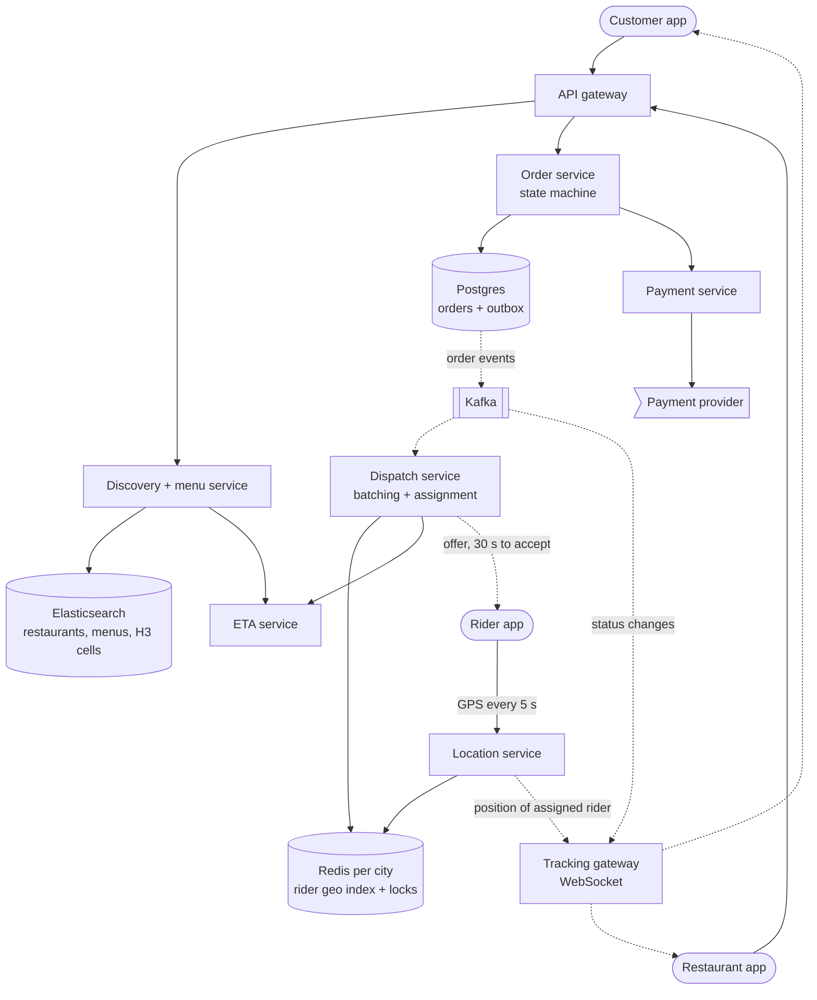
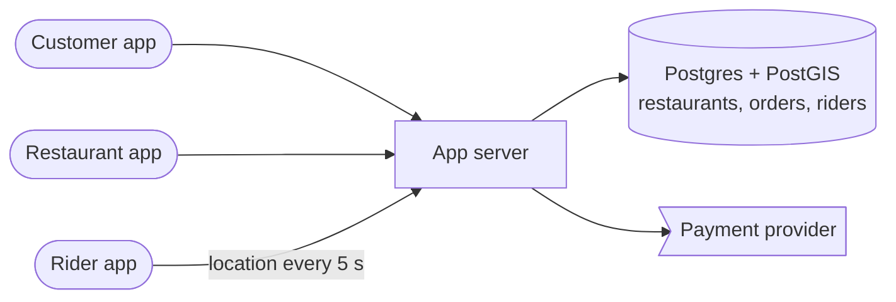
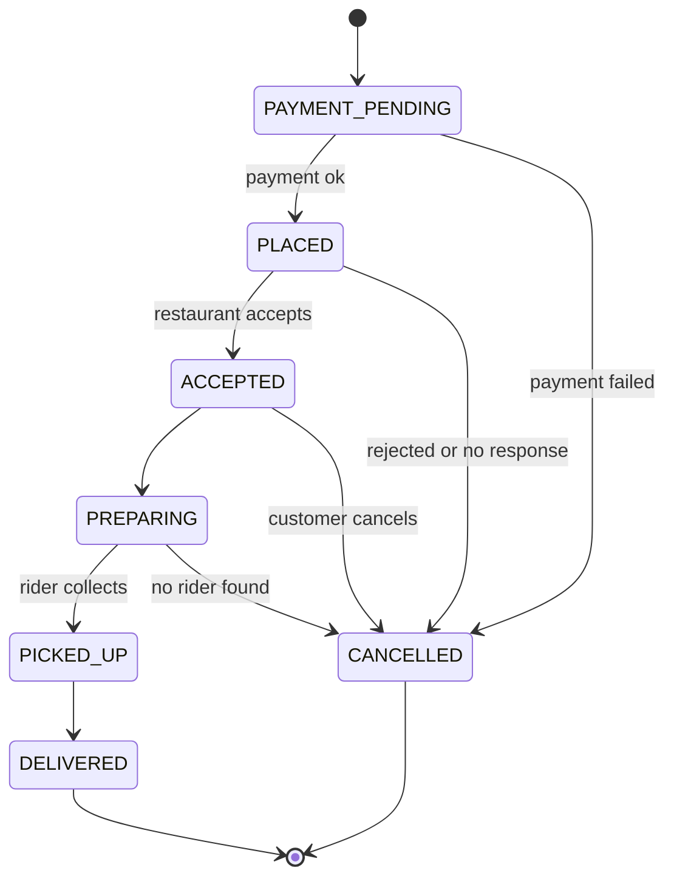
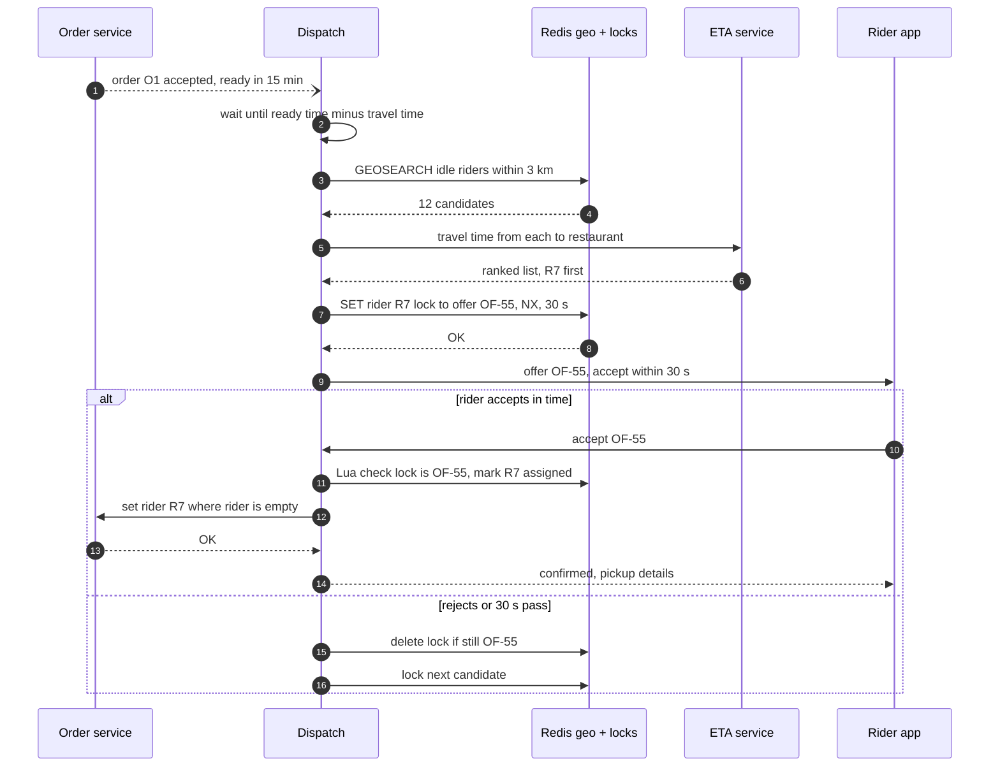

> **In one line:** show only restaurants whose precomputed H3 delivery cells contain the customer, run every order through one strict state machine, keep live rider positions in a Redis geo index, assign riders with a 30-second offer guarded by a per-rider lock, and stream the rider's position to the customer over WebSocket.

## The design at a glance



Discovery answers "who delivers here, and how fast?" from Elasticsearch using H3 cells and the ETA service. The order service owns the state machine and publishes each transition to Kafka. When the food is nearly ready, dispatch finds idle riders near the restaurant in the Redis geo index, locks one and sends an offer, while the location service pushes the assigned rider's position to the customer's WebSocket.

## How to spend the 30 minutes

| Minutes | What you do | What to say or draw |
|---|---|---|
| 0-3 | Requirements | Three apps: customer, restaurant, rider. Live tracking? Cash? |
| 3-6 | Numbers | 350 orders/s at the dinner peak, 300 k riders, 60 k location writes/s |
| 6-9 | API and data model | Orders with state history, rider live state in Redis |
| 9-12 | Design v1 | One server, Postgres + PostGIS, nearest free rider, polling |
| 12-15 | Break v1 | Location writes, radius is not serviceability, assignment race, polling |
| 15-22 | Design v2 and v3 | H3 cells, geo index, state machine, offer + lock, WebSocket, batching |
| 22-29 | Deep dives | Rider geo index, greedy vs batch, tracking transport, cancels |
| 29-30 | Recap | The 60-second summary at the bottom |

## Requirements

**Functional**

- See restaurants that deliver to your address, with an ETA; search by dish or cuisine.
- Menus with live item availability. Cart from one restaurant; pay online or cash.
- Restaurant app: accept or reject, set prep time, mark ready, toggle items and open/closed.
- Rider app: go online, receive offers, accept, pick up, deliver.
- Customers track the status and the rider on a map, with a live ETA.
- Cancel and refund according to the order's stage.

**Non-functional**

- Discovery p99 under 300 ms.
- A rider is assigned within about a minute of being needed, timed to when the food is ready.
- The rider's dot on the customer's map is at most about 10 s old.
- Orders are never lost or duplicated. One order never gets two riders; a rider never holds two offers at once.
- 99.95% available. Dinner is about 5x the daily average.

**Out of scope**

- Restaurant onboarding, rider payouts, the promotions engine, grocery delivery.

> **Say it like this:** "Three apps share one order. The hard parts are real-time: tens of thousands of rider pings a second, assigning a rider without two orders grabbing the same one, and a live map with an honest ETA. Orders are only hundreds a second, so the order store is about correctness, not scale."

## Back-of-the-envelope numbers

| Quantity | Estimate | How |
|---|---|---|
| Orders | 3 M / day | Assumption for a large national player |
| Dinner order rate | ~170 / s, ~350 / s in the peak minute | 40% of orders between 7 and 9 pm: 1.2 M ÷ 7,200 s, x2 for the peak minute |
| Discovery requests | ~2,300 / s average, ~12,000 / s at dinner | 20 M app opens x 10 requests = 200 M a day ÷ 86,400 s, x5 |
| Riders online at peak | 300,000 | Assumption |
| Location updates | 60,000 / s | 300 k riders, one ping every 5 s |
| Orders in flight at peak | ~400,000 | 170 / s x 40 minutes (2,400 s) |
| Tracking pushes | ~80,000 / s | 400 k watched orders, one update every 5 s |
| Location history | up to ~0.5 TB / day | 60 k/s x 100 bytes = 6 MB/s, x 86,400 s as an upper bound |

**What the numbers tell us:**

- 60,000 location writes a second, each overwriting the last: an in-memory geo index, not a database row per rider.
- A few hundred orders a second fits sharded Postgres easily. The real work is correct states and assignment.
- 400,000 open tracking connections need a dedicated WebSocket fleet, about 10 nodes at 40-50 k connections each.
- The peak is the same two hours every day, so scale up on a schedule before 7 pm instead of reacting.

## API

```http
GET /api/v1/restaurants?lat=12.971&lng=77.594&q=biryani&cursor=abc
→ 200 { "restaurants": [ { "id": "R42", "name": "...", "eta_min": 32, "is_open": true } ], "next_cursor": "..." }

GET /api/v1/restaurants/R42/menu
→ 200 { "items": [ { "item_id": "I7", "name": "...", "price": 249, "available": true } ] }

POST /api/v1/orders
Idempotency-Key: 8e1f...
{ "restaurant_id": "R42", "items": [ { "item_id": "I7", "qty": 2 } ], "address_id": "A1", "payment": "upi" }
→ 201 { "order_id": "O-9001", "status": "PAYMENT_PENDING", "eta_min": 35 }

POST /api/v1/restaurant/orders/O-9001/accept     { "prep_minutes": 15 }
POST /api/v1/rider/offers/OF-55/accept           → 200 assigned | 409 offer expired

WS /api/v1/rider/stream          → { "lat": 12.981, "lng": 77.602, "ts": 1760540000 } every 5 s
WS /api/v1/orders/O-9001/track   ← { "status": "PICKED_UP", "rider": { "lat": 12.981, "lng": 77.602 }, "eta_min": 9 }
```

- `Idempotency-Key`: a retry on a flaky mobile network must not order two dinners.
- Accepting an expired offer returns `409`; the app shows "offer missed".
- Riders send GPS over one long-lived connection, cheaper than an HTTPS request every 5 s.
- Tracking is a WebSocket because updates flow server to client every few seconds; polling would be 80 k mostly-unchanged requests a second.

## Data model

```text
restaurants        (Postgres, indexed into Elasticsearch)
  restaurant_id PK, name, lat, lng, cuisines[], rating, is_open, avg_prep_min
  delivery_cells[]   H3 cells it can reach in time, precomputed from road travel times
menu_items
  item_id PK, restaurant_id, name, price, available, updated_at

orders             (Postgres, sharded by city_id)
  order_id PK, city_id, customer_id, restaurant_id, items, total, status,
  rider_id nullable, rider_status, payment_status, promised_eta, created_at
order_events       (same DB, append-only, doubles as the outbox)
  order_id, seq, from_status, to_status, actor, ts

rider live state   (Redis, one cluster per city)
  riders:blr:idle    GEO set   rider_id → (lng, lat)
  rider:R7           hash      status, order_ids, lat, lng, last_seen
  rider:R7:lock      string    offer_id, set with NX, expires in 30 s

location history   (Kafka → object storage)
```

- **Restaurants in Postgres, searched through Elasticsearch**, because discovery mixes text, filters, cell membership and ranking in one query.
- **Orders in Postgres, sharded by city**: transitions need transactions, and orders, riders and dispatch are all local to a city. The order ID embeds the city.
- **Rider live state in Redis**: overwritten every 5 s, only the latest value matters, and GEO commands answer "idle riders within 3 km". If lost, it rebuilds from the next pings.
- **Location history in object storage**: append-only, large, read only by ETA training and disputes.

## Design v1: the simplest thing that works



1. Discovery runs `ST_DWithin(restaurant.location, :customer_point, 7000)` for open restaurants within 7 km.
2. The customer pays and the order is inserted as `PLACED`. The restaurant app polls every 10 s and sees it.
3. The restaurant accepts. The server runs `SELECT rider_id FROM riders WHERE status = 'free' ORDER BY location <-> :restaurant LIMIT 1`, then marks that rider busy and sets the order's `rider_id`.
4. Every rider app runs `UPDATE riders SET location = ...` every 5 s and polls for assignments.
5. The customer app polls `GET /orders/O-9001` every 10 s for status and rider position.

This runs a small town's delivery business fine, and it shows the core: three apps, one order, one rider.

## Where v1 breaks

| Problem | Why it happens | What the user sees |
|---|---|---|
| Location writes swamp the DB | 60 k UPDATEs/s, each writing a new row version and spatial index entry | Orders and discovery slow down at dinner, exactly when it matters |
| A radius is not a delivery area | 3 km in a straight line can be 30 minutes across a river or highway | Restaurants that cannot deliver in time; cold food |
| Two orders grab one rider | Two "nearest free rider" queries run at once and both pick R7 before either marks R7 busy | One order waits with no rider |
| The rider has no say | Assignment is forced; a "free" rider may be on a break or out of battery | Order assigned to a ghost; food sits on the counter |
| Polling everywhere | 400 k customers plus every restaurant tablet polling | Heavy load, a jumpy map, late "new order" alerts in kitchens |
| Status changed anywhere | Any code path writes `status`, with no transition rules | "Delivered" followed by "cancelled", and wrong refunds |

## Design v2: geo index in memory, one state machine, offers with locks

### Fix 1: split by job

Separate **discovery**, **order**, **dispatch**, **location** and a **tracking gateway**. The 60 k/s location firehose gets its own path and can never slow down orders.

### Fix 2: discovery by H3 delivery cells

For each restaurant, precompute the H3 cells (resolution 8, about 0.7 km² each) its riders can reach within, say, 30 minutes by road, using the ETA service. Store them as a keyword field in Elasticsearch. A search becomes "customer's cell is in `delivery_cells`, open, text and filters match", ranked by ETA, rating and relevance. Cache results per cell and filter in Redis for 30-60 s; everyone in a cell sees the same list.

### Fix 3: rider positions in an in-memory geo index

The location service takes each ping, runs `GEOADD riders:blr:idle 77.602 12.981 R7` for idle riders and updates the `rider:R7` hash. Raw points also go to Kafka for history. A GEO set is a sorted set with no per-member expiry, so a sweeper removes riders silent for 30 s. One Redis cluster per city keeps each city's 60 k-writes budget separate.

### Fix 4: one state machine for the order

Only the order service changes `status`, and only along allowed edges, with a conditional update: `UPDATE orders SET status = 'ACCEPTED' WHERE order_id = ? AND status = 'PLACED'`. Each transition appends to `order_events` in the same transaction, which doubles as the outbox for Kafka.



Rider progress (`SEARCHING → OFFERED → ASSIGNED → AT_RESTAURANT`) is a separate field, so the kitchen and the rider can move independently.

### Fix 5: offer, timeout and lock

Dispatch finds idle riders near the restaurant (`GEOSEARCH ... BYRADIUS 3 km`), ranks them by ETA, and locks the best with `SET rider:R7:lock OF-55 NX EX 30`. `NX` means only one order can hold a rider, so two orders can no longer grab the same one. The rider has 30 s to accept. On accept, a Lua script checks the lock still holds this offer, marks the rider assigned and removes them from the idle set; the order then takes the rider with `WHERE rider_id IS NULL`. On reject or silence, the lock is deleted and the next rider is tried, so ghost riders cost 30 s, not a cold dinner.

### Fix 6: push instead of poll

All three apps hold a WebSocket to the tracking gateway, which keeps a registry of which node holds which user. Status changes come from Kafka; the location service publishes the assigned rider's position on a Redis pub/sub channel per order. In the background, push notifications carry status changes.

## Where v2 still breaks

| Problem | Why it happens | What the user sees |
|---|---|---|
| Not enough riders at 8 pm | Orders rise 5x at dinner; riders do not | Orders wait for riders, ETAs blow up |
| One rider per order | Two orders from one restaurant, same direction, two minutes apart get two riders | Fewer deliveries per rider exactly when riders are scarce |
| Riders arrive too early | Dispatch fires on accept, but the food takes 20 minutes | Riders idle at counters during the rush |
| ETA is guesswork | Fixed prep times and straight-line speeds | Promised 30 minutes, delivered in 55 |

## Design v3: batching, timed dispatch and real ETAs

This is the diagram at the top.

### Fix 7: dispatch when the food is nearly ready

Start looking for a rider when `food_ready_at − rider_travel_time ≈ now`. `food_ready_at` is the restaurant's prep time, corrected by its history and how many orders its kitchen has open. Riders now arrive with the food, not 15 minutes early.

### Fix 8: batch matching in short windows

Every 20-30 s, per zone, dispatch collects the orders that need a rider and the available riders, including riders carrying one order with room for another. It solves the assignment for the whole set, minimising total delay rather than each order's delay. Orders from the same or nearby restaurants heading the same way are **batched** onto one rider (2-3 at most) if that adds under about 10 minutes for the first customer. Offers then go out with the same lock and timeout.

### Fix 9: an ETA service

ETA = time until the food is ready or the rider reaches the restaurant, whichever is later, + travel to the customer + hand-off time (finding the gate, the lift). Travel uses a road graph with live speeds from rider pings, and a model trained on past deliveries corrects each leg by time of day, weather and area. It is recomputed on every state change and every minute.

### Fix 10: peak-hour controls

Scale up on a schedule before 7 pm. When riders are short, shrink delivery cells by a ring or two, show longer ETAs, add a surge fee and rider incentives, and let busy kitchens pause orders. Discovery reads these flags from Redis, so lists change within a minute.

### Components

| Component | Job | Tech choice |
|---|---|---|
| Discovery + menu service | Who delivers here, menus | Elasticsearch with an H3 cell field, Redis cache per cell |
| Order service | State machine, outbox | Postgres sharded by city |
| Payment service | Charge, refund, cash reconciliation | Payment provider, see [payment gateway](17-payment-gateway.md) |
| Location service | Ingest 60 k pings/s | Stateless, Redis GEO per city, Kafka for history |
| Dispatch service | Timed dispatch, batching, offers, locks | Per-city workers, Redis locks |
| ETA service | Prep, travel and hand-off estimates | Road graph + ML model, cached per cell pair |
| Tracking gateway | WebSockets to customers and kitchens | ~10 nodes, connection registry in Redis |
| Kafka | Order events, raw location stream | Partitioned by order_id and rider_id |

## Key flow: assign a rider



- **Lock taken (`NX` fails):** the rider is already being offered another order; skip to the next candidate.
- **Accept arrives at 31 s:** the lock is gone, so the rider gets `409` and the order has already moved on.
- **Dispatch worker crashes after locking:** the lock expires in 30 s; a sweeper re-queues orders still without a rider.
- **No rider within 3 km:** widen to 5 km, raise the incentive, update the ETA honestly.
- **Rider goes dark after accepting:** 2 minutes without pings triggers a reassignment, allowed until `PICKED_UP`.

## Deep dives

### How do you index moving riders?

**The problem.** 300,000 points that move every 5 seconds, and queries for "idle riders within 3 km of this restaurant".

**Options.**

| Option | Good | Bad |
|---|---|---|
| PostGIS on the riders table | Accurate, plain SQL | 60 k writes/s churn the table and index; the DB becomes the bottleneck |
| **Redis GEO set per city** | `GEOADD` and `GEOSEARCH` built in, sub-millisecond queries | No per-member TTL (needs a sweeper); memory only, but it rebuilds in seconds |
| Rider set per H3 cell | Same cells as discovery and surge; cheap moves | You write the ring expansion yourself |
| Custom quadtree service | Adapts to density | Custom code, rebalancing as riders move |

**Pick.** Redis GEO, one set per city (or per zone in big cities). H3 cell sets are equally good. More in [proximity search](07-proximity-search.md).

### Greedy assignment or batch matching?

**The problem.** At peak, the best rider for this order may be the only good rider for the next one.

| Option | Good | Bad |
|---|---|---|
| Greedy: best rider per order, immediately | Simple and fast | Locally good, globally poor at peak |
| Broadcast to 5 riders, first to accept wins | Fast acceptance | Riders race, wasted notifications, feels unfair |
| **Batch window + assignment solver** | Lower total delay, enables multi-order trips | Adds up to 30 s; more complex |

**Pick.** Greedy when the zone is quiet, batch windows when it is busy. Always one offer per rider at a time, guarded by the lock, as drivers are in [ride-sharing](11-ride-sharing.md).

### Live tracking transport

**The problem.** 400,000 customers each want a moving dot, updated every few seconds.

| Option | Good | Bad |
|---|---|---|
| Polling every 5 s | Works everywhere | 80 k requests/s, mostly unchanged; laggy |
| **WebSocket** | Two-way, cheap per message | Sticky connections and a registry to find a user's node |
| Server-Sent Events | Simple, plain HTTP | One-way only; fine for customers, not for rider uplink |

**Pick.** WebSocket (SSE is just as good for the customer side), with polling as the fallback and push notifications when the app is in the background.

### Cancellations and payments

**The problem.** Who can cancel at each stage, and who pays for food already cooked?

**Pick.** The order reaches the restaurant only after payment succeeds; the charge is idempotent by order ID, as in the [payment gateway](17-payment-gateway.md). Then:

- Customer cancels before `ACCEPTED`: full refund. After `PREPARING`: partial or no refund, and the restaurant is still paid.
- Restaurant rejects, or does not accept within 5 minutes: auto-cancel and full refund.
- No rider found: escalate with incentives, then cancel with refund and a coupon.
- Cash on delivery: the rider marks cash collected at `DELIVERED`, and it is added to the rider's cash balance.

Every cancel is one state transition that triggers its compensations: refund, free the rider, notify all three apps.

## Trade-offs to say out loud

- We keep **rider positions in Redis, not a database**, because only the latest point matters. The cost is a 5-10 s blind spot after a Redis failure while pings rebuild it.
- We **offer to one rider at a time** with a 30 s lock instead of broadcasting. The cost is up to 30 s per refusal, so rank by likelihood to accept.
- We **batch at peak** instead of assigning instantly. The cost is up to 30 s of decision time and a later first delivery in a batch.
- We use **precomputed H3 cells instead of a radius**. The cost is a nightly job, and cell edges are coarse (about 0.5 km).
- We keep **rider progress separate from order status** so kitchen and rider move independently. The cost is two fields to combine in the UI.

## Follow-up questions

**Q: The rider loses signal mid-delivery. What happens?**
The app buffers points and uploads them on reconnect. The customer sees "last updated 1 min ago", and ops is alerted after a few minutes.

**Q: An item goes out of stock while it sits in carts?**
The update reaches the cache and ES within seconds, and the order service re-checks availability at placement. If the kitchen finds out after accepting, it proposes an edit, or cancels with a refund.

**Q: How do you make sure the restaurant sees a new order?**
WebSocket to the tablet, a push notification and a loud alarm. No accept in 2 minutes triggers an automated call; no accept in 5 cancels the order.

**Q: How do you stop fake "delivered" taps?**
Allow `DELIVERED` only within about 100 m of the address, reject impossible GPS speeds, and use a customer OTP on high-value orders.

**Q: How does the ETA get better?**
Log predicted vs actual for every leg (prep, pickup, drive, hand-off), retrain regularly, and keep a per-restaurant prep bias.

**Q: How does this scale to many cities?**
Everything real-time is per city: Redis, dispatch workers and the order shard. A city is the unit of scale and of failure.

## 60-second recap

- Three apps around one order; orders are hundreds a second, rider pings 60,000 a second.
- Discovery: Elasticsearch with precomputed H3 delivery cells per restaurant, cached per cell, ranked by ETA.
- Orders: one state machine with conditional updates; every transition is an outbox event on Kafka.
- Riders: positions in a Redis GEO set per city, stale riders swept after 30 s.
- Assignment: rank nearby riders by ETA, lock one with `SET NX EX 30`, offer, and fall through on reject or timeout.
- Peak: dispatch timed to food readiness, batch matching every 20-30 s, multi-order trips, smaller areas.
- Tracking: WebSocket gateway pushes status and the rider's position; push notifications in the background.
