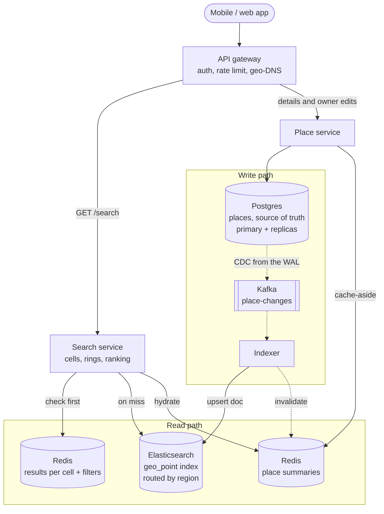
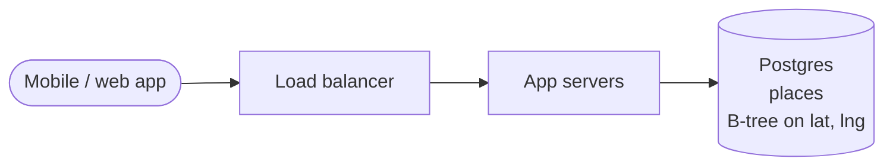
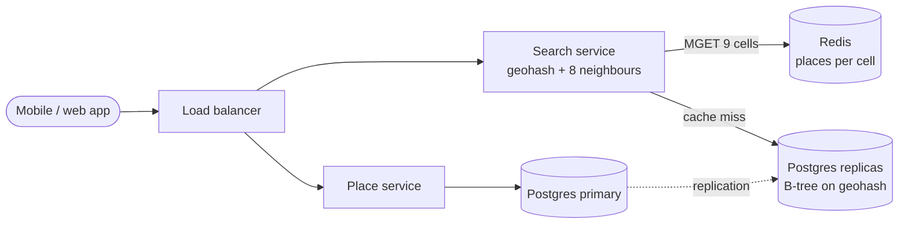
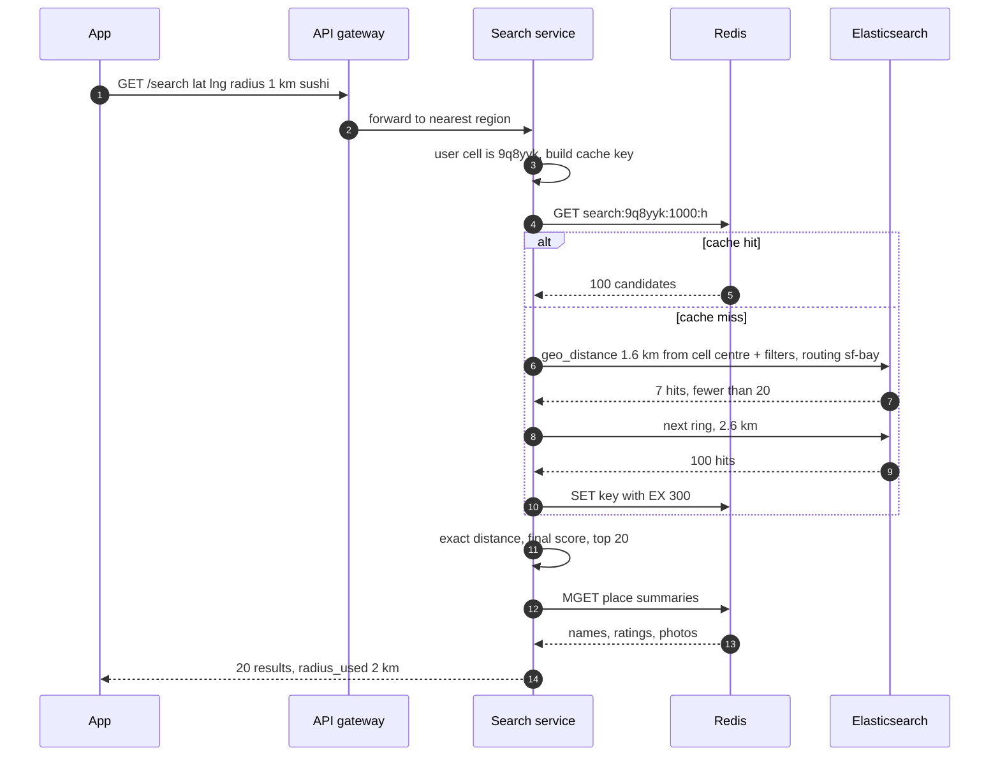

> **In one line:** turn "near me" into a few grid cells (the user's cell plus its 8 neighbours), let a geo index (Elasticsearch `geo_point`, fed from Postgres) apply filters and exact distance, rank by distance plus rating, and serve the 5,000:1 read traffic from caches and region-routed shards.

## The design at a glance



A search turns the user's position into a geohash cell and checks Redis for results already computed for that cell and filter set. On a miss it sends one geo-distance query with filters to the Elasticsearch shard for the user's region, widens the radius if too few places come back, and ranks. Edits flow the other way: Postgres is the truth, and change data capture pushes each change through Kafka into the index within seconds.

## How to spend the 30 minutes

| Minutes | What you do | What to say or draw |
|---|---|---|
| 0-3 | Requirements | Radius or nearest K? Filters? Static places or moving drivers? |
| 3-6 | Numbers | 200 M places, ~17 k searches/s at peak, ~5,000 reads per write |
| 6-9 | API and data model | One search endpoint, a places table with lat, lng and geohash |
| 9-12 | Design v1 | Postgres with `lat BETWEEN` and `lng BETWEEN` |
| 12-15 | Break v1 | Two range conditions defeat the index, one DB, nothing cacheable |
| 15-22 | Design v2 and v3 | Geohash + 8 neighbours, then Elasticsearch, rings, ranking, region routing |
| 22-28 | Deep dives | Geohash vs quadtree vs PostGIS vs Elasticsearch, ranking, moving objects |
| 28-30 | Recap | The 60-second summary at the bottom |

## Requirements

**Functional**

- Given a location and radius (default 2 km), return nearby places, 20 per page.
- Filter by category, price, minimum rating and "open now".
- Default order mixes distance and rating; "sort by distance" is an option.
- Place details page; business owners add and edit places.
- Map view: places inside the visible rectangle.

**Non-functional**

- Search p99 under 100 ms at the server, because every map pan fires one.
- 99.99% available. Slightly stale results beat no results.
- Edits may take up to a minute to appear in search.
- 200 M places, ~17,000 searches a second at peak.
- Correct at cell edges: a place 100 m away is never missed because it sits in another grid cell.

**Out of scope**

- Writing reviews and photos (assume each place has `rating_avg` and `review_count`).
- Directions, ETAs, ads, personalisation.

> **Say it like this:** "This is a read-heavy search over mostly static points. The hard part is the index: finding everything within 2 km without scanning a whole latitude band. I'll design for 200 million places and 17,000 searches a second, accept a minute of staleness on edits, and treat moving drivers as a separate case at the end."

## Back-of-the-envelope numbers

| Quantity | Estimate | How |
|---|---|---|
| Places | 200 M | Worldwide listings |
| Place data | ~200 GB | 200 M x ~1 KB (name, address, hours, tags) |
| Geo index entries | ~5 GB | 200 M x 24 bytes (8-byte ID + two 8-byte coordinates) |
| Searches | ~5,800 / s average, ~17,000 / s peak | 100 M DAU x 5 = 500 M a day ÷ 86,400 s, x3 at dinner time |
| Place edits | ~1 / s | 100,000 a day ÷ 86,400 s ≈ 1.2 |
| Read to write ratio | ~5,000 : 1 | 5,800 ÷ 1.2 |
| Search bandwidth at peak | ~70 MB/s | 17,000 x 4 KB (20 results x 200 bytes) |
| Places in a 2 km circle downtown | ~12,000 | π x 2² ≈ 12.6 km² x ~1,000 places per km² |

**What the numbers tell us:**

- ~5,000 reads per write: build the index once, replicate it, cache hard. A minute of lag costs nothing.
- The geo index is ~5 GB, all data ~200 GB: we shard for latency and fan-out, not storage.
- A downtown circle holds ~12,000 places, so filtering and ranking must happen inside the index.
- One write a second makes index update cost irrelevant for places. For moving drivers it decides everything.

## API

```http
GET /v1/search?lat=37.7749&lng=-122.4194&radius_m=2000&category=sushi&open_now=true&min_rating=4&limit=20&cursor=...
→ 200 { "results": [ { "place_id": "p_8812", "name": "...", "distance_m": 340, "rating": 4.6 } ],
        "radius_used_m": 5000, "next_cursor": "eyJzIjo..." }

GET /v1/map?min_lat=37.70&min_lng=-122.52&max_lat=37.83&max_lng=-122.35&zoom=13
→ 200 { "pins": [...], "clusters": [ { "lat": ..., "lng": ..., "count": 140 } ] }

GET   /v1/places/{place_id}
POST  /v1/places              (owner) { "name": "...", "lat": ..., "lng": ..., "category": "sushi", "hours": {...} }
PATCH /v1/places/{place_id}   (owner) { "hours": {...} }
```

- `radius_used_m` tells the app the server widened the search ("showing results within 5 km").
- The cursor encodes the radius used plus the last score and ID, so page 2 continues the same ranking.
- The map takes a rectangle, because the screen is one; at low zoom it returns cluster counts, not 10,000 pins.

## Data model

```text
places                    (Postgres, source of truth)
  place_id      bigint PK
  name, address, category, price_level, hours, time_zone
  lat, lng      double
  geohash       char(12)        B-tree index (used in v2)
  rating_avg, review_count
  region_id     text            metro area, e.g. "sf-bay"
  updated_at    timestamp

places index              (Elasticsearch, routing = region_id)
  location      geo_point       BKD tree
  name          text
  category, price_level         keyword filters
  bayes_rating, review_count    used in scoring
  open_ranges   integer_range   minutes since Monday 00:00 UTC, for "open now"
```

- **Postgres for places:** relational, transactional edits, 200 GB, ~1 write a second.
- **Elasticsearch for search:** geo, text, filters and scoring in one query, sharded. Rebuildable from Postgres, so never the source of truth.
- **Redis for caches** (results per cell, place summaries): all of it can be lost and recomputed.

## Design v1: the simplest thing that works



1. The app sends `lat=37.7749, lng=-122.4194, radius_m=2000`.
2. The server turns the radius into a box: 2 km is ~0.018° of latitude (111 km per degree) and ~0.023° of longitude here (111 km x cos 37.8° ≈ 88 km per degree).
3. Query: `SELECT ... WHERE lat BETWEEN 37.757 AND 37.793 AND lng BETWEEN -122.442 AND -122.397 AND category = 'sushi'`.
4. The server computes the haversine distance per row, drops box corners beyond 2 km, sorts, returns 20.

For a city guide with 100,000 places this is fine, and the box-then-exact-distance idea survives into every later version.

## Where v1 breaks

| Problem | Why it happens | What the user sees |
|---|---|---|
| Two range conditions, one useful index | A B-tree on `(lat, lng)` is sorted by `lat` first. Inside the latitude band `lng` is scattered, so it walks every place in a 4 km-tall strip around the planet. Two separate indexes are no better: each range alone matches a huge strip | Tens of thousands of entries read to return 20 |
| One database for every search | 17 k big index scans a second on one box | Timeouts at dinner time |
| No two searches look alike | Users 50 m apart send different boxes | No cache helps, even at a stadium |
| Boxes at the 180° meridian | Near Fiji the longitude range wraps, so `BETWEEN` gets min > max | Empty or half results near the date line |

## Design v2: geohash cells and the 8 neighbours



### Fix 1: one geohash column instead of two coordinates

A geohash halves the world by longitude, then latitude, alternating, and writes every 5 bits as a base32 character. Each prefix is a rectangular cell, each extra character splits it into 32, and points in a cell share its prefix: San Francisco City Hall is in `9q8yyk`. Store the 12-character geohash in one B-tree column. "Everything in `9q8yyk`" is `WHERE geohash LIKE '9q8yyk%'`, one contiguous index range (in Postgres, index it with `text_pattern_ops`). One range instead of two fixes the first row.

| Length | Cell size at the equator | Covers a radius up to |
|---|---|---|
| 1 | 5,000 km x 5,000 km | continent |
| 2 | 1,250 km x 625 km | large region |
| 3 | 156 km x 156 km | ~75 km |
| 4 | 39 km x 19.5 km | ~15 km |
| 5 | 4.9 km x 4.9 km | ~2 km |
| 6 | 1.2 km x 0.6 km | ~500 m |
| 7 | 153 m x 153 m | ~75 m |
| 8 | 38 m x 19 m | ~15 m |
| 9 | 4.8 m x 4.8 m | ~2 m |

Widths shrink with latitude: in San Francisco a length-6 cell is 0.97 km wide and 0.61 km tall. The last column assumes the 3x3 search below, up to about 60° latitude.

### Fix 2: search the cell and its 8 neighbours

Nearby points usually share a prefix, not always. A user near a cell edge is closer to places in the next cell than to most of their own. Worst case: two cafés 200 m apart either side of the Greenwich meridian are `gcpuzgqb` and `u10hb530`, with no common prefix.

So pick the length whose cell is at least as big as the radius, and query the user's cell plus the 8 around it. A circle of that radius around any point in the centre cell lies inside the 3x3 block.

```text
   user at 37.7749, -122.4194, radius 500 m, length 6

   +--------------+--------------+--------------+
   |   9q8yyj     |   9q8yym     |   9q8yyt     |
   +--------------+--------------+--------------+
   |   9q8yyh   <-|-- 110 m -- * |   9q8yys     |
   |              |   9q8yyk     |              |
   +--------------+--------------+--------------+
   |   9q8yy5     |   9q8yy7     |   9q8yye     |
   +--------------+--------------+--------------+

   * is 110 m from the west edge and 177 m from the north edge.
   Searching 9q8yyk alone misses a café 150 m to the west.
```

Neighbour codes come from simple arithmetic (decode the cell's box, step one cell each way, re-encode), and the step wraps at ±180°, which fixes the date-line row. Nine short range scans are still far cheaper than a planet-wide strip.

### Fix 3: exact distance, then top 20

The 3x3 block is always bigger than the circle (at least ~3x the area). So fetch `id, lat, lng` from the nine ranges, compute haversine, drop what is outside, sort, take 20. If the overshoot is large, cover the circle with more cells of the finer length (say 5 x 5) instead.

### Fix 4: read replicas and a cache keyed by cell

Searches go to Postgres read replicas; at one write a second, lag is negligible. Cache each cell's places in Redis under `cell:{geohash}:{category}` (at the chosen length), so a search is one `MGET` of nine keys and everyone in a cell shares the entries. Distance is still computed from each user's exact position.

## Where v2 still breaks

| Problem | Why it happens | What the user sees |
|---|---|---|
| Density varies 1,000x | Fixed radius and cell size: a downtown block of nine holds thousands of places, a rural one none | Slow city searches; empty screens outside cities |
| Filters and text | "Vegan pizza, open now, $$, 4+ stars" stacks text and four filters on nine scans; SQL needs an index per combination | The searches people actually run are the slow ones |
| Ranking by distance only | A 3.1-star place at 50 m beats a 4.8-star place at 400 m | Users scroll past bad results |
| One cluster for the world | Every search crosses oceans to one set of replicas | 150-300 ms extra outside the home region |

## Design v3: a search index with ranking, routed by region

This is the diagram at the top.

### Fix 5: Elasticsearch for search, Postgres for truth

Index each place with `location` as a `geo_point`. Lucene stores points in a BKD tree, which splits space adaptively (like a k-d tree), so a `geo_distance` filter only visits blocks overlapping the circle, whatever the density. One `bool` query holds the `geo_distance` and `term` filters, wrapped in a `function_score` that adds a `gauss` decay on `location` and a `field_value_factor` on `bayes_rating`, so only the top 20 leave the shard. Set `boost_mode: replace`: a filter-only query scores every hit 0, and the default multiply would erase the functions.

Debezium streams Postgres's write-ahead log into Kafka and the indexer upserts documents; lag is seconds (the default refresh is 1 s). For a mapping change, build a new index from Postgres and swap an alias.

### Fix 6: ring expansion when results are sparse

Search 1 km, then 2, 5, 10, 25 km, stopping at 20 results or the cap, and return `radius_used_m`. Cities stop at the first ring, so queries stay cheap; a village sees the nearest town instead of a blank screen. Send the first two rings together with `_msearch` to save a round trip.

### Fix 7: rank by distance and quality

Score = 0.6 x distance decay + 0.4 x (Bayesian rating ÷ 5), computed in the index. See the ranking deep dive.

### Fix 8: route by region

Index every document with `routing = region_id`. A San Francisco search carries `routing=sf-bay` and hits one shard instead of all: with 20 shards at 17,000 searches a second, that avoids 323,000 shard queries a second (17,000 x 19). Near a border, pass both values; split huge metros into several region IDs. Run a stack per continent behind geo-DNS.

### Fix 9: cache results per cell

Key `search:{geohash6}:{radius}:{filters hash}`. The cached query runs from the cell centre with the radius padded by half the cell diagonal (~600 m at length 6), so it covers every user in the cell, and keeps the top 100 so the service can re-rank for each exact position. TTL 5 minutes, which also bounds how stale "open now" gets. Place summaries are cached for an hour and invalidated by the indexer.

### Components

| Component | Job | Tech choice |
|---|---|---|
| API gateway | Auth, rate limits, nearest region | L7 gateway, geo-DNS |
| Search service | Cell math, cache, rings, final ranking | Stateless, autoscaled |
| Redis | Results per cell (5 min), place summaries (1 h) | Redis Cluster |
| Search index | Geo + filters + scoring | Elasticsearch `geo_point`, routing by region |
| Place service | Details page, owner edits | Stateless, writes Postgres |
| Postgres | Source of truth, 200 GB | Primary + read replicas |
| CDC + Kafka | Stream every change | Debezium on the WAL, topic `place-changes` |
| Indexer | Upsert docs, invalidate caches | Kafka consumer, ignores events older than the doc's `updated_at` |

## Key flow: "sushi near me"



- **Shard slow or down:** replicas take over. On a timeout, serve the last cached entry for the cell, flagged stale.
- **Border search:** if the padded circle crosses into another region, query both routing values.
- **Hot cell stampede:** a thousand fans at a stadium miss at once. A per-key lock (single flight) lets one request fill the cache.
- **Redis down:** go straight to Elasticsearch, which is sized for the full load.

## Deep dives

### Which geo index: geohash, quadtree, PostGIS or Elasticsearch?

**The problem.** Interviewers want the main options and when each wins.

- **Geohash** works on any store with sorted keys (B-tree, DynamoDB sort key, Cassandra clustering key). Redis GEO is exactly this: a 52-bit geohash as a sorted-set score.
- **PostGIS** puts a GiST index, which works as an R-tree of nested bounding boxes, on a `geography` column. `ST_DWithin(location, ST_MakePoint(-122.4194, 37.7749)::geography, 2000)` uses it and is exact in metres (longitude first). `ORDER BY location <-> point LIMIT 20` walks it nearest-first.

**Options.**

| Option | Good | Bad | Pick when |
|---|---|---|---|
| Geohash on a KV or SQL store | Simple, any store; cell IDs double as cache and shard keys | Fixed cells, edge cells, overfetch; filters and ranking are yours | You must use DynamoDB, Cassandra or Redis |
| Quadtree in memory | Adapts to density; exact nearest-K from RAM | Custom code; whole tree on every server, rebuilt on start | Static points, huge QPS, a team that owns custom code |
| PostGIS | Exact, transactional, joins | Weak text search and ranking; one write primary | Geo sits next to relational data ([hotel booking](05-hotel-booking.md)), few filters |
| **Elasticsearch `geo_point`** | Geo + text + filters + scoring in one query; shards out | Not a source of truth, ~1 s refresh, another cluster to sync | Consumer search with many filters: this problem |

**Pick.** Elasticsearch for search, Postgres for truth, geohash for cache keys. PostGIS with replicas could hold 200 M places too; if Elasticsearch is ruled out, use it and say what you lose: text relevance and flexible scoring.

### Quadtree: adapting to density

**The problem.** Fixed cells are too big downtown and too small in the desert.

- Start with one node for the world. When a node holds more than N places (say 100), split it into four children and push its places down. Downtown leaves end up a hundred metres wide; an ocean stays one leaf.
- Query: find the user's leaf, then visit nodes best-first (a priority queue by distance to each node's box) until K places are closer than any unvisited box. Exact nearest-K, no radius needed.
- Memory: 200 M x 24 bytes ≈ 4.8 GB plus a few million nodes, so every search server holds a full copy.
- Building from 200 M rows takes minutes before a fresh server can serve, so roll servers one at a time.

**Options.** Rebuild nightly (new places wait a day), build a new tree in the background and swap a pointer (double memory), or **load a snapshot and apply the change stream live** under per-leaf locks.

**Pick.** Snapshot plus live stream. At one change a second, lock contention is nil.

### Ranking by distance and rating

**The problem.** Nearest is not best, and a raw average lies when there are few reviews.

- **Bayesian rating:** `(C x m + sum of stars) ÷ (C + n)`, with global mean m = 3.7 and prior weight C = 20. A 5.0 from 2 reviews becomes (74 + 10) ÷ 22 ≈ 3.8; a 4.6 from 3,000 reviews stays ≈ 4.6.
- **Distance decay:** a Gaussian that is 1.0 at the user, 0.5 at 1 km, near 0 at 3 km.
- **Blend:** 0.6 x decay + 0.4 x (rating ÷ 5). A 3.1-star place at 50 m scores ≈ 0.60 + 0.25 = 0.85; a 4.8-star place at 400 m scores ≈ 0.54 + 0.38 = 0.92 and wins.

| Option | Good | Bad |
|---|---|---|
| Distance only | Obvious to users | Bad places that happen to be close win |
| **Weighted blend in the index** | One query, tunable | Hand-tuned weights |
| Index fetches 200, a learned model re-ranks | Best quality, can personalise | A model to train and serve |

**Pick.** The blend now, a learned re-ranker later (as in [news feed](13-news-feed.md) ranking).

### Moving objects: drivers instead of restaurants

**The problem.** Same "near me" question, but the points move. 1 M online drivers pinging every 4 s is 250,000 updates a second, against ~1 a second for places.

| | Static places | Moving drivers |
|---|---|---|
| Updates, freshness | ~1 / s, a minute is fine | ~250,000 / s, seconds matter |
| Index | Elasticsearch or PostGIS, on disk | In-memory grid: Redis GEO, or a geohash or H3 cell map |
| Durability | Postgres is the record | None: the next ping rebuilds it; history goes to Kafka |
| Sharding and query | By region; best 20 by distance and rating | By city; nearest available drivers, then road ETA |

**Pick.** A per-city in-memory index. Each ping runs `GEOADD drivers:sf-bay -122.41 37.77 d_42` (O(log N)); a rider runs `GEOSEARCH drivers:sf-bay FROMLONLAT -122.42 37.77 BYRADIUS 2 km ASC COUNT 20`. Redis GEO has no per-member expiry, so keep a `last_seen` sorted set and drop drivers silent for 30 s. A search index would rewrite a document on every ping. See [ride-sharing](11-ride-sharing.md) and [food delivery](06-food-delivery.md).

## Trade-offs to say out loud

- We chose **Elasticsearch over PostGIS** because one query does geo, text, filters and scoring, and it shards out. The cost is a second copy that lags by seconds.
- We chose **geohash cells as cache keys** so users 100 m apart share entries. The cost is a padded radius and a per-user re-rank.
- We chose **ring expansion over a fixed radius** so cities stay fast and villages are never empty. The cost is extra round trips where it is sparse.
- We chose **region routing** to cut shard fan-out 20x. The cost is two routing values at borders and splitting big metros.
- We chose a **Bayesian rating** so two lucky reviews cannot top the list. The cost is that a great new place climbs slowly.

## Follow-up questions

**Q: What about the poles and the date line?**
Geohash neighbour functions wrap longitude; Elasticsearch and PostGIS `geography` handle both natively. Cells get thin near the poles, but few places are there.

**Q: How does the map view work?**
A `geo_bounding_box` filter for the visible rectangle; at low zoom a `geotile_grid` aggregation returns counts per tile instead of pins.

**Q: How fast does a new restaurant show up?**
Commit, Debezium, Kafka, indexer, 1 s refresh: usually under 5 seconds. We promise a minute.

**Q: What if Elasticsearch is down in a region?**
Serve cached cells, fall back to a geohash query on Postgres replicas with fewer filters, or route to another region.

**Q: Isn't the user's location sensitive?**
Yes. Coordinates in a query string land in access logs, so the gateway strips them (or the app uses `POST /search`), and analytics keep only a length-5 geohash (~5 km).

**Q: What breaks first at 10x traffic?**
The hottest region's shard and the result cache. Split the region, add replicas, grow Redis.

## 60-second recap

- Read-heavy (~5,000:1) search over 200 M static places, ~17 k searches a second at peak.
- v1's two `BETWEEN` ranges use one index range and scan a planet-wide strip.
- Geohash makes location one sortable string where a prefix is a cell. Search the cell plus its 8 neighbours, then filter by exact distance.
- Final: Postgres as truth, CDC into Elasticsearch `geo_point`; geo, filters and ranking run in one query on one regional shard.
- Ring expansion for sparse areas; Bayesian rating blended with distance decay for ranking.
- Redis caches results per cell, so nearby users share work.
- Moving drivers differ: 250 k updates a second go into an in-memory per-city grid like Redis GEO.
