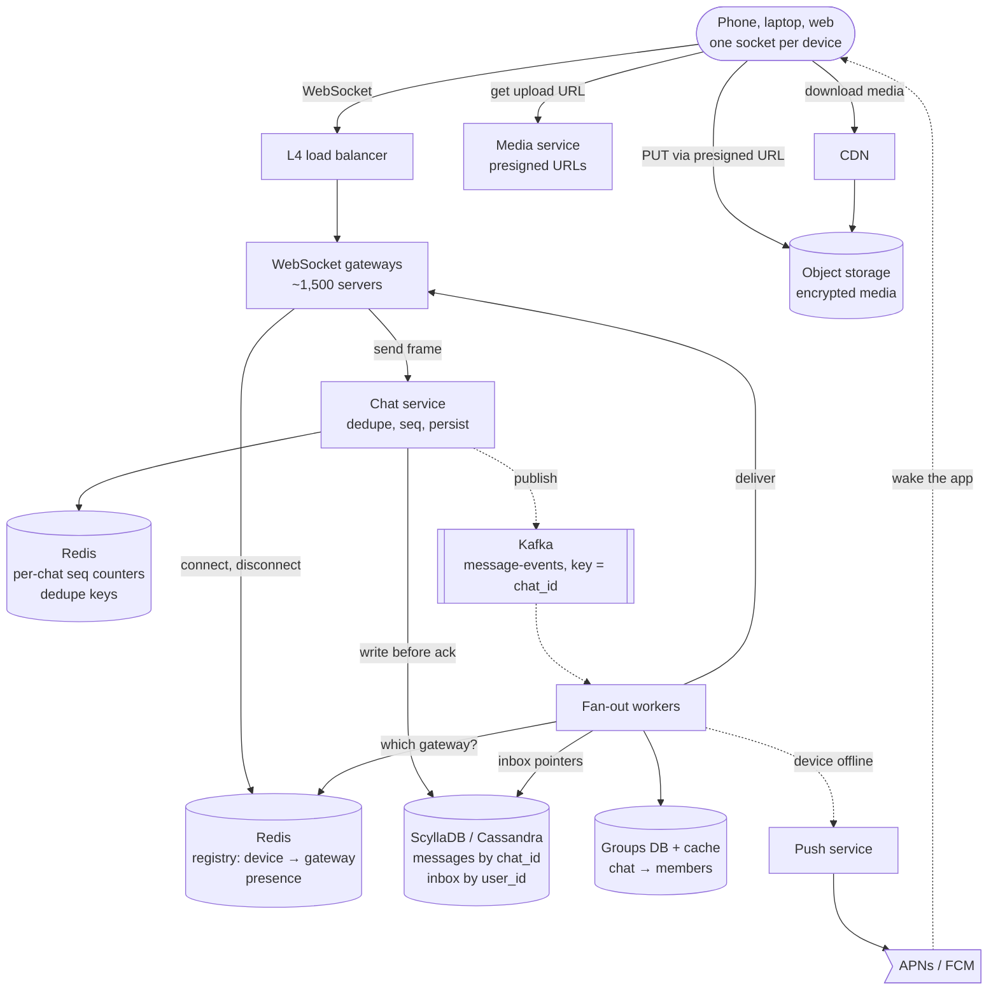
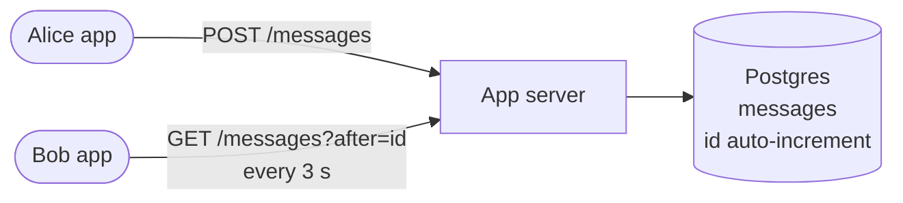
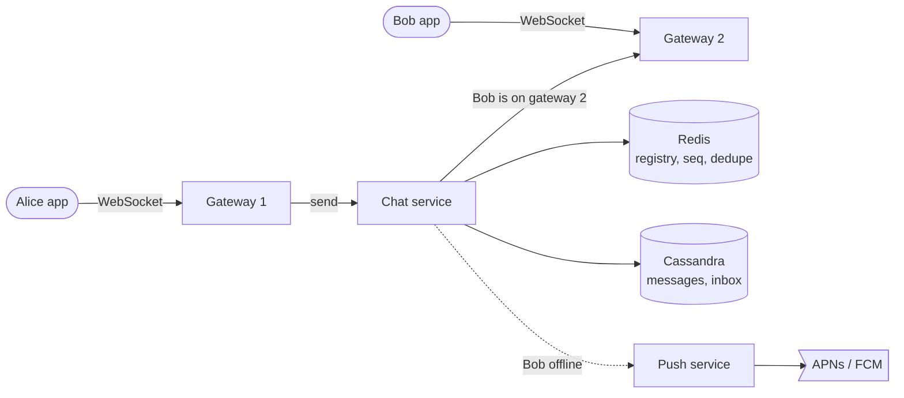
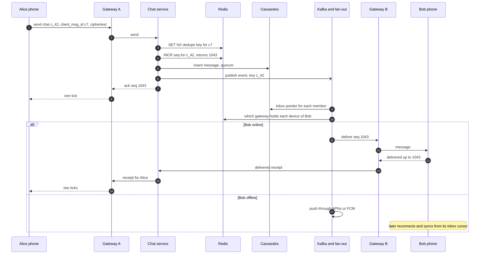

> **In one line:** every device keeps a WebSocket open to a gateway, a Redis registry records which gateway holds each device, and the chat service gives each message a per-chat sequence number and stores it before acking; fan-out workers then deliver it live, or leave it in the recipient's inbox and send a push.

## The design at a glance



Follow one message. The chat service drops duplicates, takes the next sequence number for the chat, writes the message and acks (one tick). A fan-out worker reads the members, adds a pointer to each member's inbox, finds each device's gateway in the registry and delivers; offline devices get a push through APNs or FCM and catch up from their inbox cursor later. Photos and videos skip this path entirely: object storage in, CDN out.

## How to spend the 30 minutes

| Minutes | What you do | What to say or draw |
|---|---|---|
| 0-3 | Requirements | Groups and their size cap? Receipts, presence, media, multi-device, end-to-end encryption? |
| 3-6 | Numbers | 230 k messages/s, 150 M open sockets, media is 50x the bytes of text |
| 6-9 | API and data model | WebSocket frames; messages partitioned by chat, inbox by user |
| 9-12 | Design v1 | HTTP polling against one SQL table |
| 12-15 | Break v1 | Polling cost, latency, ordering, duplicates, sleeping phones |
| 15-23 | Design v2 and v3 | Gateways, registry, seq numbers, inbox and push, Kafka fan-out, media, presence |
| 23-29 | Deep dives | Ordering, group fan-out, presence, end-to-end encryption |
| 29-30 | Recap | The 60-second summary at the bottom |

## Requirements

**Functional**

- One-to-one and group chats (groups up to ~1,000 members).
- Text plus media: photos, videos, voice notes, files.
- Sent, delivered and read receipts.
- Offline users get messages later, plus a push notification.
- Online / last-seen status and typing indicators.
- Several devices per user (phone, laptop, web), all in sync.

**Non-functional**

- p99 under 500 ms from send to delivery when both users are online in one region.
- Durable: once the sender sees one tick, the message is never lost.
- Ordered: everyone in a chat sees the same order.
- No duplicates when a phone on a bad network retries.
- 99.99% available for messaging; presence and typing may degrade first.
- End-to-end encrypted: the server stores only ciphertext.

**Out of scope**

- Voice and video calls (a WebRTC system of their own).
- Stories, payments, bots, server-side message search.

> **Say it like this:** "This is real-time delivery on top of a write-heavy, append-only store. I'll design for 500 million daily users sending 20 billion messages a day, with 150 million devices connected at peak. The hard parts are finding which server a user is on, keeping per-chat order without duplicates, and reaching people who are offline."

## Back-of-the-envelope numbers

| Quantity | Estimate | How |
|---|---|---|
| Daily active users | 500 M | Given |
| Messages sent | ~230 k/s average, ~700 k/s peak | 500 M x 40 a day = 20 B/day ÷ 86,400 s, x3 for peaks |
| Inbox writes and deliveries | ~1.2 M/s average | ~5 per message (recipients + sender's own inbox; groups raise it) |
| Open connections at peak | ~150 M | ~30% of daily users online at once |
| Gateway servers | ~1,500 | 150 M ÷ ~100 k connections each |
| Registry size | ~15 GB | 150 M entries x ~100 bytes: one small Redis cluster |
| Heartbeats | ~5 M/s | 150 M sockets, one every 30 s |
| Text storage | ~4 TB/day, ~1.5 PB/year | 20 B x ~200 bytes (ciphertext + metadata), before 3x replication |
| Media | ~200 TB/day | 1 in 20 messages x ~200 KB |
| Presence pushed to every contact | ~35 M events/s | 500 M x 20 status changes a day x 300 contacts ÷ 86,400 |

**What the numbers tell us:**

- 150 M sockets open for hours: a stateful gateway tier, plus a registry to find any device in one lookup.
- ~700 k appends a second, read newest-first per chat: a log-structured store (Cassandra/ScyllaDB) partitioned by chat.
- Media is 50x the bytes of text, so it never flows through the chat path: object storage plus CDN.
- Heartbeats (5 M/s) and naive presence (35 M/s) dwarf messages (0.7 M/s). Both must end at the gateway.

## API

```http
GET /v1/connect                              (WebSocket upgrade)
Authorization: Bearer <device-token>

→ client frame
{ "type": "send", "client_msg_id": "c7f3...", "chat_id": "c_42", "body": "<ciphertext>" }
← ack to sender
{ "type": "ack", "client_msg_id": "c7f3...", "seq": 1043, "msg_id": "7311..." }
← frame to each recipient device
{ "type": "msg", "chat_id": "c_42", "seq": 1043, "sender": "u_alice", "body": "<ciphertext>" }
→ receipt frame from a recipient
{ "type": "receipt", "chat_id": "c_42", "kind": "read", "up_to_seq": 1043 }

GET  /v1/sync?cursor=88121&limit=500         → { "entries": [...], "next_cursor": "88621" }
GET  /v1/chats/c_42/messages?before=7311...&limit=50
POST /v1/media                               → { "media_id": "m_9", "upload_url": "<presigned PUT>" }
```

- **WebSocket, not polling:** one connection per device carries frames both ways, and the server pushes the moment a message exists.
- **`client_msg_id`** is created on the phone once and reused on every retry, so the server can spot a retry.
- **Receipts are watermarks:** "read up to 1043" acknowledges a whole burst in one frame.
- **Sync and history are plain HTTPS** with cursors.

## Data model

```text
messages             (ScyllaDB / Cassandra)
  PRIMARY KEY ((chat_id, bucket), msg_id)        newest first
  bucket           10-day window taken from msg_id, keeps partitions small
  msg_id           64-bit, time-ordered: ms timestamp + generator id + counter
  seq              per-chat counter 1, 2, 3 ...  the order clients display
  sender_id, sender_device, client_msg_id
  type             text | image | video | edit | delete
  body             ciphertext
  media            media_id, thumbnail            nullable

inbox                (ScyllaDB / Cassandra, TTL 30 days)
  PRIMARY KEY (user_id, inbox_id)                inbox_id is time-ordered
  chat_id, seq, msg_id                           a pointer; short bodies inlined

read_state           (ScyllaDB / Cassandra)
  PRIMARY KEY (chat_id, user_id)  →  delivered_seq, read_seq

chats, members       (sharded MySQL / Postgres by chat_id, cached in Redis)

Redis
  conn:<user_id>                   hash  device_id → gateway_id
  seq:<chat_id>                    integer, INCR per message
  dedupe:<sender>:<client_msg_id>  → seq, 24 h TTL
  presence:<user_id>               online | last_seen
```

- **`messages` and `inbox` in ScyllaDB/Cassandra:** ~700 k appends a second suit an LSM store, and partitions are pre-sorted, so "latest 50 in a chat" or "inbox after my cursor" is one sequential read.
- **`read_state`:** one tiny row per member per chat, overwritten in place.
- **`chats` and `members` in SQL:** small and relational, but read on every group message, hence the cache.
- **Redis:** atomic `INCR` and `SET NX` with TTLs, all rebuildable (gateways re-register, counters reseed from the store).

## Design v1: the simplest thing that works



1. Alice's app sends `POST /messages {chat_id, text}`. The server inserts a row; the auto-increment `id` orders the chat.
2. Bob's app polls `GET /messages?after=<last id>` every 3 seconds and shows anything new.
3. Fetching a message marks it delivered; opening the chat marks it read. Alice sees the ticks on her next poll.
4. Photos are uploaded to the app server and stored as blobs.

This works for a few thousand users. Long polling (the server holds the GET open until something arrives) cuts the empty responses but keeps every other problem below.

## Where v1 breaks

| Problem | Why it happens | What the user sees |
|---|---|---|
| Polling is mostly empty requests | 150 M devices every 3 s = 50 M requests/s, nearly all "nothing new" | Battery drain and a huge bill for nothing |
| Latency equals the poll interval | A message waits for the next poll | 0-3 s delay; typing indicators impossible |
| One database | 700 k inserts/s and 1.5 PB a year do not fit one primary | Timeouts at peak, slow history |
| Order breaks once you shard | Auto-increment is per shard; server clocks disagree | Messages swap places |
| Retries create duplicates | The request timed out after the server saved it | The same message twice |
| Sleeping phones | A backgrounded app does not poll | Messages appear only when the app is opened |

## Design v2: persistent connections and a per-chat log



### Fix 1: WebSocket gateways

Each device keeps one WebSocket open to a gateway behind an L4 load balancer. The server pushes instantly: no empty polls, one network hop of latency. At ~100 k sockets per gateway, 1,500 servers hold 150 M connections. Mobile networks silently kill idle connections, so the app sends a tiny heartbeat every ~30 seconds.

### Fix 2: a connection registry

Bob's socket is on one of 1,500 gateways, but which? On connect the gateway writes `conn:bob → gateway-17` to Redis and deletes it on disconnect. Treat it as a hint: if gateway-17 says "not here", delete the entry and treat Bob as offline.

### Fix 3: a chat service and a partitioned message store

A stateless chat service writes to Cassandra partitioned by `(chat_id, bucket)` and sorted by `msg_id`, so writes spread by chat and "latest 50" is one read. It acks only after a quorum write, so one tick means durable.

### Fix 4: per-chat sequence numbers

Before writing, the service runs `INCR seq:<chat_id>`. Redis executes commands one at a time, so two simultaneous senders get 1043 and 1044. Clients sort by `seq`, so everyone sees one order whatever the clocks say, and a client that gets 1045 after 1043 knows it missed one.

### Fix 5: client-generated message ids

The service first runs `SET NX dedupe:<sender>:<client_msg_id>`. If the key exists, this is a retry: return the original `seq` instead of creating a second message. Devices also drop deliveries they already have, by `(chat_id, seq)`.

### Fix 6: inbox, push and sync for offline devices

For every recipient the service appends a pointer to their `inbox`. Online devices get the message through their gateway; offline ones get a push via APNs (iOS) or FCM (Android), collapsed to one per chat. On reconnect a device sends the last inbox position it processed, and one partition read returns everything newer. Reading from a few seconds before the cursor and dropping what it has covers small clock differences between servers. A device offline beyond the 30-day TTL resyncs from scratch.

## Where v2 still breaks

| Problem | Why it happens | What the user sees |
|---|---|---|
| Big groups block the sender | The chat service writes 1,000 inbox rows and delivers to thousands of devices before acking | Sending to a big group takes seconds |
| One device per user | The registry maps a user to one gateway | Laptop and phone fight over the entry; one misses messages |
| Media through the socket | A 20 MB video crosses the gateway and the chat service | Text queues behind videos; gateway memory explodes |
| Presence floods | Every app open and close pushed to every contact | ~35 M events/s, 150x the message rate |
| The server reads everything | Plaintext in the message store | One breach exposes every chat |

## Design v3: async fan-out, every device, heavy stuff at the edges

This is the diagram at the top.

### Fix 7: fan-out through Kafka

The chat service keeps only the ordered, durable part: dedupe, `seq`, write, publish to Kafka keyed by `chat_id`, ack. Fan-out workers then read members from cache, write inbox pointers and deliver. Keying by chat keeps one chat's events in order on one partition. Kafka redelivers after a crash, so delivery is at-least-once and devices dedupe.

### Fix 8: every device is its own endpoint

The registry becomes a hash `device_id → gateway` per user. Fan-out targets every device of every member, including the sender's other devices, which is how your laptop shows what you sent from your phone. Each device has its own inbox cursor. Read state is per user, so reading on the laptop clears the phone's badge.

### Fix 9: media goes around the chat path

The app gets a presigned URL from the media service, encrypts the file with a random key and uploads it straight to object storage in resumable chunks (see [cloud storage](18-cloud-storage.md)). It then sends a small normal message with the `media_id`, the key and a blurred thumbnail. Recipients download through the CDN.

### Fix 10: presence at the gateway

Heartbeats end at the gateway, which writes to Redis only when a status changes and pushes updates only to people who have that chat open. Typing indicators are fire-and-forget frames, never stored.

### Fix 11: end-to-end encryption

Apps encrypt on the device; the server stores and forwards ciphertext and sees only routing metadata (who, to whom, when, size). See the deep dive.

### Components

| Component | Job | Tech choice |
|---|---|---|
| WebSocket gateways | Hold sockets, heartbeats | Event-loop servers (Netty, Go, Erlang) behind an L4 balancer |
| Registry + presence | Device → gateway, last seen | Redis cluster |
| Chat service | Dedupe, `seq`, durable write, publish | Stateless; Redis `INCR`, `SET NX` |
| Message store | Messages, inboxes, read state | ScyllaDB / Cassandra, quorum writes, 3 replicas |
| Kafka + fan-out workers | Inbox pointers, delivery, push | Keyed by `chat_id`; own topic for big groups |
| Groups DB | Chats and members | Sharded MySQL / Postgres behind Redis |
| Push service | Notify devices with no socket | APNs, FCM (see [notification system](15-notification-system.md)) |
| Media service, storage, CDN | Upload URLs, encrypted blobs | S3-style storage, lifecycle rules, CDN |
| Key directory (not drawn) | Public keys of every device | Small service, read on first contact |

## Key flow: send a message



- **Ack lost, or the chat service died after the write:** Alice's app retries with `c7`. The dedupe key returns 1043, so no second message, and the service re-publishes the event in case the first attempt died between write and publish.
- **Bob's gateway died:** delivery to it fails, so the worker treats Bob as offline and pushes. Bob reconnects elsewhere and syncs.
- **1045 arrives before 1044:** two instances published out of order. The app waits about a second for 1044, then syncs.
- **Kafka redelivers:** Bob gets 1043 twice and drops the copy by `(chat_id, seq)`.

## Deep dives

### How do you keep messages in order?

**The problem.** Two people type into one group at the same moment through different servers. Everyone must see the same order, and a phone must notice a gap.

**Options.**

| Option | Good | Bad |
|---|---|---|
| Client timestamp | No coordination | Phone clocks are wrong; messages jump |
| Server timestamp or time-ordered id | Unique, sortable, no coordination | Server clocks differ by milliseconds, so close messages can swap; gaps are invisible |
| **Per-chat counter (Redis `INCR`)** | Exact order per chat; consecutive numbers expose gaps | One extra hop (~1 ms); must survive restarts |
| One owner server per chat | Exact order, counter in memory | Every chat routed to its owner and moved when servers change |

**Pick.** The counter for `seq`, and the time-ordered `msg_id` as the storage key. A missing counter (expired after a week of silence, or a replaced node) is reseeded from the newest stored `seq`. Redis replicates asynchronously, so a failover can repeat the last few numbers; rows are keyed by `msg_id`, so both messages survive and clients break the tie by `msg_id`. Order is promised only within a chat.

### Group chats: fan-out on write or on read?

**The problem.** One message to a 1,000-member group is 1,000 inbox writes and thousands of deliveries. A 500,000-member broadcast channel makes that absurd.

**Options.**

| Option | Good | Bad |
|---|---|---|
| Fan-out on write: pointer and delivery per member | Sync stays one read per user | Cost grows with size; one huge group delays everyone |
| Fan-out on read: members pull from the chat partition | One write per message | Every sync must check every big group the user is in |
| **Hybrid by size** | Each case takes its cheap path | Two code paths |

**Pick.** Groups up to ~1,000 members fan out on write; the cap bounds the cost and covers almost all traffic. Bigger channels write once, push live only to members who have the channel open, and let everyone else pull "after my last seq" (sync returns each big group's latest `seq`). Their notifications are batched or mentions-only, and their own Kafka topic keeps them from slowing one-to-one chats. The [news feed](13-news-feed.md) faces the same push-vs-pull choice.

### Presence: why is a green dot expensive?

**The problem.** Status changes every time someone opens or closes the app, and pushing each change to every contact means ~35 M events a second. Detecting "offline" also needs heartbeats from 150 M sockets.

**Options.**

| Option | Good | Bad |
|---|---|---|
| Push every change to all contacts | Always accurate | 35 M events/s, nearly all to people not looking |
| Fetch status when a screen opens | Cheap | Goes stale while the chat stays open |
| **Fetch on open, subscribe while viewing** | Cost follows what is on screen | Gateways track subscriptions |

**Pick.** Gateways handle heartbeats locally (5 M/s over 1,500 servers is trivial) and write to Redis only on transitions: online at connect, offline after two missed heartbeats or a clean close, with `last_seen` stamped then. Debounce flaps, so a Wi-Fi to 4G switch does not flash offline. Big groups show no live presence. Presence is the first feature we degrade.

### End-to-end encryption, at interview depth

**The problem.** Only the people in a chat may read it, yet the server must still route, store and sync it.

**Options.**

| Option | Good | Bad |
|---|---|---|
| TLS in transit + encryption at rest | Server can search, moderate, give new devices full history | A breach, insider or court order exposes everything |
| **End-to-end (Signal protocol)** | Server holds only ciphertext and metadata | No server search; new devices need a history transfer; notification previews must be decrypted on the device |

**Pick.** End-to-end:

- Each device generates a key pair and uploads only public keys to a key directory.
- The sender's app fetches the recipient devices' public keys and sets up a session (X3DH key agreement, then the Double Ratchet, which changes keys with every message).
- One-to-one messages are encrypted once per recipient device and once per sender's other device. That is why WhatsApp-style apps delete messages from the server once every device has them.
- Groups use "sender keys", shared once over the pairwise sessions, so each message is encrypted once and fan-out sends the same ciphertext to all.
- Media is encrypted with a random key carried inside the message, so the CDN only serves ciphertext.

## Trade-offs to say out loud

- We chose **WebSockets over polling** to remove 50 M empty requests a second. The cost is a stateful gateway tier, a registry, and reconnect storms on deploys.
- We chose a **per-chat counter over timestamps** for order. The cost is one Redis hop per message and reseeding after failures.
- We **ack after the durable write, before fan-out**, so one tick is fast. The cost is at-least-once delivery, so devices dedupe.
- We **fan out on write for groups up to ~1,000**. The cost is write amplification, and big channels need a pull path.
- We show **presence only for what is on screen**. The cost is a dot that can be seconds stale.
- We chose **end-to-end encryption**. The cost is no server search, harder history on new devices, and moderation by user reports.

## Follow-up questions

**Q: How do you deploy gateways without dropping everyone?**
Drain one at a time: stop accepting sockets, tell clients to reconnect with random jitter over a few minutes, then stop. Clients land on other gateways and sync from their cursor, so nothing is lost.

**Q: What if the registry Redis loses its data?**
Each gateway knows its own sockets and re-registers them. Meanwhile deliveries miss, fall back to push, and devices sync. The inbox, not the registry, is the source of truth.

**Q: How does the chat list, sorted by latest message, work?**
Fan-out workers also update a per-user row per chat (last `seq`, preview, unread count). The app keeps the list locally and applies sync results.

**Q: How do edits and "delete for everyone" work?**
As new messages of type `edit` or `delete` pointing at the original `seq`, through the same pipeline, so every device applies them in order.

**Q: How do you go multi-region?**
Users connect to the nearest region. Each chat has a home region that owns its counter and partitions; events are relayed to other regions for local delivery. An extra 100 ms is fine for chat.

**Q: How do you fight spam?**
Per-device send limits with a [rate limiter](21-rate-limiter.md), stricter limits for new accounts, forwarding caps and user reports. The server judges behaviour, not content.

## 60-second recap

- 500 M daily users, ~700 k messages/s at peak, 150 M open sockets; media is 50x the bytes of text.
- Devices hold WebSockets to ~1,500 gateways; a Redis registry maps each device to its gateway.
- The chat service dedupes by `client_msg_id`, takes a per-chat `seq`, writes to ScyllaDB/Cassandra partitioned by chat, then acks.
- Kafka fan-out writes inbox pointers and delivers to every device of every member; offline devices get a push and sync from a per-device cursor.
- Receipts are watermarks; groups up to ~1,000 fan out on write, bigger channels are pulled.
- Presence ends at the gateway; media goes through object storage and the CDN.
- End-to-end encryption: the server only routes and stores ciphertext.
