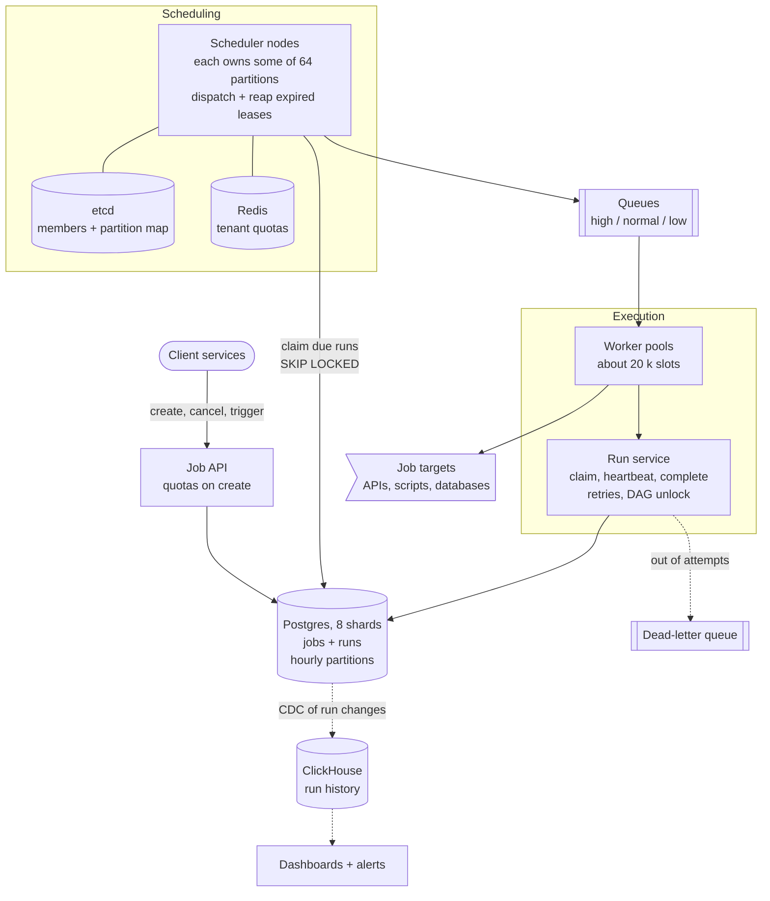
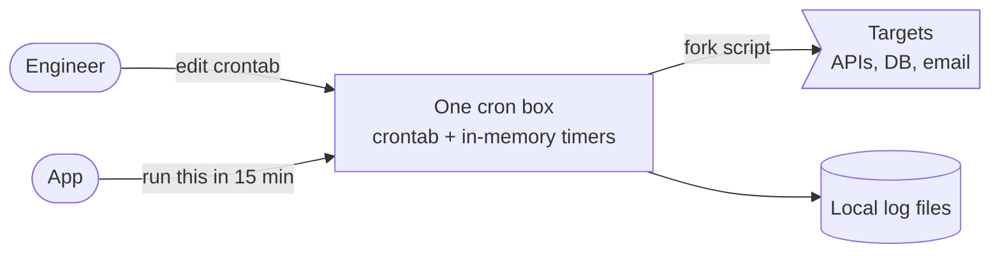
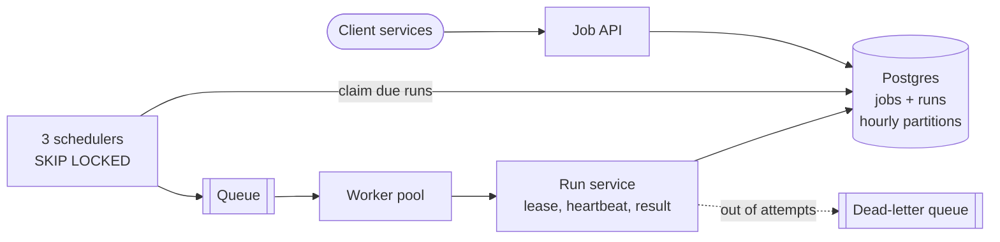
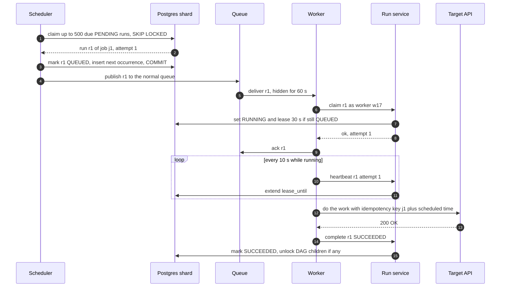

> **In one line:** every pending run is a row in a sharded, hour-partitioned Postgres table; schedulers that each own a slice of it claim due rows with `SKIP LOCKED` and queue them, and workers run them under a heartbeated lease, so a dead worker's job is simply retried (at-least-once, so handlers must be idempotent).

## The design at a glance



Every attempt to run a job is a row in `runs` with a `due_at`. Each scheduler owns some of the 64 partitions (the map lives in etcd), claims due rows with `FOR UPDATE SKIP LOCKED`, and queues them if the tenant is within quota. Workers lease each run through the Run service and heartbeat while it runs; failures return as new attempts with backoff.

## How to spend the 30 minutes

| Minutes | What you do | What to say or draw |
|---|---|---|
| 0-3 | Requirements | One-off, delayed, cron, DAGs? At-least-once OK? Precision? |
| 3-6 | Numbers | 10 k runs/s, 860 M a day, ~40 k DB writes/s, 20 k jobs running at once |
| 6-9 | API and data model | `jobs` and `runs`, one row per attempt, idempotency key |
| 9-14 | Design v1 and its flaws | One cron box: single point of failure, lost jobs, double runs with two boxes |
| 14-21 | Design v2 | Jobs table + `SKIP LOCKED`, queue, leased workers, retries, DLQ |
| 21-25 | Design v3 | Shard the scan, misfire policy, tenant fairness, DAGs |
| 25-29 | Deep dives | Where due jobs live, cron and missed runs, fairness |
| 29-30 | Recap | The 60-second summary at the bottom |

## Requirements

**Functional**

- Schedule a job as **one-off** (at 09:00 on 1 Nov), **delayed** (in 15 minutes) or **cron** (`0 2 * * *` in a time zone).
- Pause, resume, cancel, run now.
- Retries with backoff; runs that keep failing land in a dead-letter queue.
- DAGs: run a task when all its parents succeed.
- History of every attempt.

**Non-functional**

- 10 k executions/s on average, 5x bursts at the top of the hour.
- Dispatch lag (due time to handed to a worker) p99 under 2 s; seconds, not minutes, in bursts.
- A job accepted with `201` is never lost.
- At-least-once execution, so handlers must be idempotent.
- 99.99% available for accepting and dispatching; every tier scales out.

**Out of scope**

- Building and deploying the job code (we call a registered handler).
- Resource-aware placement like Kubernetes.
- Sub-second precision. About 1 s is the contract.

> **Say it like this:** "This is a durable timer service in front of a work queue. The hard parts are firing 10 k due jobs a second without a single-scheduler bottleneck, surviving dead workers, and fairness between tenants. I'll promise at-least-once with idempotency keys and one-second precision."

## Back-of-the-envelope numbers

| Quantity | Estimate | How |
|---|---|---|
| Executions | 10 k/s average, ~50 k/s for a minute after :00 | Given; crons cluster on the hour, so x5 |
| Executions per day | ~860 M | 10 k x 86,400 s |
| Active job definitions | ~50 M, ~50 GB | 10 M crons + 40 M pending one-off jobs, ~1 KB each |
| Database writes | ~40 k/s + up to 2 k/s heartbeats | ~4 per run (queue, start, finish, next occurrence); 20 k running ÷ 10 s |
| Run rows | ~260 GB/day | 864 M x ~300 bytes |
| Postgres shards | 8 primaries | 40 k ÷ 8 = 5 k writes/s each; 3 days of runs = 780 GB, ~100 GB per shard |
| Jobs running at once | ~20 k, on ~1,000 pods | 10 k/s x 2 s average (Little's law); 20 slots per I/O-bound pod |
| History | ~26 GB/day, ~2.3 TB for 90 days | 260 GB compressed ~10x in ClickHouse |

**What the numbers tell us:**

- 40 k writes/s is too much for one Postgres primary: shard by `job_id`.
- 860 M rows a day cannot be deleted row by row: partition by time, drop whole buckets.
- Workers are the real cost; deciding *when* is cheap. Scale the two separately.
- Bursts at :00 are 5x: let dispatch lag a few seconds and keep the backlog in the database.

## API

```http
POST /v1/jobs
Idempotency-Key: 3b9e...
{ "schedule": { "type": "cron", "cron": "0 2 * * *", "tz": "Asia/Kolkata" },
  "handler": "billing.send_invoices", "payload": { "region": "south" }, "priority": "normal",
  "retry": { "max_attempts": 5, "base_s": 10, "cap_s": 3600 }, "misfire": "run_once" }
→ 201 { "job_id": "j_81f2", "next_run_at": "2026-10-15T20:30:00Z" }
   or "schedule": { "type": "once", "run_at": "..." } / { "type": "delayed", "delay_s": 900 }

GET /v1/jobs/{job_id}/runs?status=FAILED&cursor=abc   → 200 { "runs": [...], "next_cursor": "..." }

POST /internal/runs/{run_id}/claim      { "worker_id": "w-17" }    → 200 { "attempt": 1 } or 409
POST /internal/runs/{run_id}/heartbeat  { "worker_id", "attempt" }  → 200 or 409 lease lost
POST /internal/runs/{run_id}/complete   { "worker_id", "attempt", "status": "FAILED", "retryable": true }
```

- `Idempotency-Key` on create, so a client retry does not schedule the job twice. A delay becomes an absolute `run_at` at create time.
- `claim` returns `409` if the run is taken, so duplicate messages die there. `heartbeat` and `complete` carry `attempt`, so a worker that lost its lease cannot overwrite the retry.

## Data model

```text
jobs              Postgres, shard key = job_id (dag_id for DAG tasks)
  job_id, tenant_id, kind (once | delayed | cron | dag), run_at, cron_expr, tz, next_run_at
  handler, payload (up to 64 KB, else a pointer to S3), priority, retry policy, misfire, enabled

runs              Postgres, same shard as its job, partitioned by hour of due_at
  due_at          when to dispatch: scheduled_for, or now + backoff for a retry
  run_id          one row per attempt, key (due_at, run_id)
  job_id, tenant_id, attempt
  scheduled_for   logical fire time. job_id + scheduled_for = idempotency key
  status          PENDING | QUEUED | RUNNING | SUCCEEDED | FAILED | TIMED_OUT | DEAD | SKIPPED
  worker_id, lease_until, queued_at, started_at, finished_at, error

dag_task_state    Postgres, shard key = dag_id: dag_run_id, task_id, pending_parents, status
run_history       ClickHouse, ordered by (tenant_id, job_id, scheduled_for)
```

- **Postgres for `jobs` and `runs`**: claiming a run and inserting the next occurrence is one transaction; row locks make concurrent claims safe.
- **`runs` partitioned by hour**: old buckets are dropped whole. Postgres needs the partition key in the primary key, hence `(due_at, run_id)`; messages carry both.
- **ClickHouse for history**: "failure rate per job per day for 90 days" is a columnar scan.

## Design v1: the simplest thing that works



1. An engineer adds `0 2 * * * /opt/jobs/send_invoices.sh` to the crontab.
2. For delayed jobs, the app calls an endpoint on the box, which sets an in-process timer.
3. At 02:00 cron forks the script, which does the work and appends to a local log.
4. The exit code is ignored, or at best emailed to someone.

Fine for a startup with 50 jobs. It shows the two things every scheduler does: decide when, then run.

## Where v1 breaks

| Problem | Why it happens | What the user sees |
|---|---|---|
| The box dies or is redeployed | One machine does everything | Jobs silently do not run |
| Delayed jobs vanish | Timers live in RAM | "I scheduled it, it never ran" |
| A second box for HA runs everything twice | Both crontabs fire independently | Duplicate emails, duplicate charges |
| Slow jobs make other jobs late | Timing and execution share one machine | A 2-hour ETL makes a 1-minute cron start 10 minutes late |
| No retries | Cron fires and forgets | One network blip means a missing report |
| No history | Output is in a local file, if anywhere | Nobody knows if it ran or why it failed |

## Design v2: a jobs table, many schedulers, leased workers



### Fix 1: store jobs and runs in Postgres

The API writes the job and its first `PENDING` run in one transaction and answers `201` once a synchronous replica has it. Restarts lose nothing; "did it run?" is a query.

### Fix 2: many schedulers claim due runs with SKIP LOCKED

```sql
BEGIN;
UPDATE runs SET status = 'QUEUED', queued_at = now()
WHERE run_id IN (
  SELECT run_id FROM runs
  WHERE status = 'PENDING' AND due_at <= now()
  ORDER BY due_at LIMIT 500
  FOR UPDATE SKIP LOCKED)
RETURNING run_id, due_at, job_id, attempt;
-- for each cron run with attempt = 1: INSERT the next occurrence as PENDING
COMMIT;   -- then publish the batch to the queue
```

`SKIP LOCKED` (Postgres 9.5+, MySQL 8.0+) skips rows another scheduler has locked instead of waiting. Three schedulers poll at once, each row goes to exactly one (so the next occurrence is inserted once), and any of them can die. Airflow's multi-scheduler mode uses the same trick.

### Fix 3: time-bucketed partitions

A retry or next occurrence is a new row in the hourly bucket of its own due time. The claim query skips future buckets, and a partial index on `due_at WHERE status = 'PENDING'` stays tiny. A finished bucket is dropped whole once history has it: instant, where deleting 860 M rows a day would keep vacuum busy forever.

### Fix 4: split scheduling from execution

The scheduler only decides *when*, so a slow job cannot delay anyone's start. The queue absorbs bursts; worker pools per handler type autoscale on its depth. Use a queue with per-message acks (SQS, RabbitMQ), not Kafka: one slow message holds back the committed offset of everything behind it.

### Fix 5: leases, heartbeats and visibility timeouts

- **Before the claim:** a delivered message is hidden, not deleted (SQS visibility timeout of 60 s; RabbitMQ redelivers if the consumer's connection drops), so a worker dying right after delivery loses nothing.
- **After the claim:** `claim` sets `RUNNING` with `lease_until = now + 30 s` only if the row is still `QUEUED`; the worker acks the message and heartbeats every 10 s. If it dies, the scheduler's reaper turns `RUNNING AND lease_until < now()` into `TIMED_OUT` plus a retry, within 30 s whether the job takes 5 seconds or 5 hours.

### Fix 6: retries with backoff, jitter and a dead-letter queue

On a retryable failure the Run service marks attempt n `FAILED` and, in the same transaction, inserts attempt n+1 with `due_at = now + random(0, min(cap, base x 2^(n-1)))`: up to 10 s, 20 s, 40 s... for a 10 s base. Without jitter, 50 k jobs failed by one outage retry in the same second and knock the downstream over again. After `max_attempts` the run is `DEAD` and goes to the DLQ for a human to redrive.

### Fix 7: accept at-least-once, make jobs idempotent

A worker can finish the side effect and die before reporting success, or freeze in a GC pause and wake up while the retry runs. So every attempt carries the key `job_id + scheduled_for`, the same across retries: pass it to the [payment gateway](17-payment-gateway.md), upsert instead of insert, or record processed keys.

## Where v2 still breaks

| Problem | Why it happens | What the user sees |
|---|---|---|
| One Postgres primary | ~40 k writes/s and 260 GB a day on one box | Dispatch lag climbs every hour at :00 |
| More schedulers do not help | All scan the same index head, skipping each other's locks | Add nodes, lag stays flat |
| Backlog after an outage | 2 hours down leaves every cron overdue | A stampede on downstreams, or a digest sent 8 times |
| One tenant floods the system | 2 M jobs due at 09:00, dispatched in due order | Everyone else's jobs wait minutes |
| Workflows faked with sleeps | "Run B at 02:30, A usually takes 20 minutes" | B runs on missing data the night A is slow |
| History disappears | Postgres keeps 3 days of runs | No failure trends, no lag graphs |

## Design v3: shard the scan, add fairness and DAGs

This is the diagram at the top.

### Fix 8: shard the store

Hash `job_id` into 64 logical partitions on 8 Postgres primaries, each with a synchronous replica and automatic failover (Patroni). A job and its runs share a partition, so claim plus next occurrence stays local. Adding primaries means moving partitions, never re-hashing rows.

### Fix 9: each scheduler owns a slice of the partitions

Schedulers register in etcd with a 10 s lease, and an elected leader writes the map "partition → scheduler". Each node polls only its own partitions, so more nodes means more throughput; a dead node's partitions move within ~15 s. (Consistent hashing over live members needs no leader, but nodes can briefly disagree.) Ownership only avoids wasted work: in a handoff, row locks still give each run to one node.

### Fix 10: a misfire policy for missed runs

A cron run claimed over 60 s late follows its job's policy (`run_once`, `run_all` or `skip`); catch-up is rate-capped. See the deep dive.

### Fix 11: priorities and tenant quotas at dispatch

Workers poll the high, normal and low queues with weights 6:3:1, so low is slower but never starved. Tenants over their dispatch rate or in-flight cap (counters in Redis) are left out of the claim query, so a flood waits in Postgres while the queue stays seconds deep.

### Fix 12: DAG dependencies with counters

A parent's success decrements its children's `pending_parents` in the same transaction; a child at zero gets a `PENDING` run. See the deep dive.

### Fix 13: history and observability

CDC (Debezium on the Postgres WAL) streams run changes into ClickHouse for 90 days; job stdout goes to the [logging system](16-distributed-logging.md) tagged with `run_id`. Alert on dispatch lag (`queued_at - due_at`, the headline SLO), queue depth, lease expiries, DLQ growth, and crons that have not succeeded in two periods.

### Components

| Component | Job | Tech choice |
|---|---|---|
| Job API | Validate, write job + first run | Stateless, create quotas |
| Job store | Jobs, runs, and the due queue itself | Postgres, 64 partitions on 8 primaries, hourly partitions |
| etcd | Membership, leader election, partition map | 3-5 nodes, 10 s leases |
| Scheduler nodes | Claim due runs, misfires, reap leases | ~8 stateless nodes |
| Redis | Tenant rate and in-flight counters | Token buckets, see the [rate limiter](21-rate-limiter.md) |
| Queues | Hand runs to workers, absorb bursts | SQS or RabbitMQ, per priority per pool |
| Run service | Claim, heartbeat, complete, retries, DAG unlock | Stateless; pools DB connections for 20 k worker slots |
| Worker pools | Execute handlers | ~1,000 pods, autoscaled on queue depth |
| ClickHouse | 90 days of run history | Columnar, cheap aggregations |

## Key flow: one cron run, from due to done



- **Worker dies after the claim:** the lease expires within 30 s; the reaper marks attempt 1 `TIMED_OUT` and inserts attempt 2 with backoff.
- **Worker dies before the claim:** the message was never acked, so it reappears after 60 s.
- **Scheduler dies between COMMIT and publish:** the reaper re-publishes runs stuck in `QUEUED` for 2 minutes; a duplicate copy gets `409` on `claim`.
- **Target succeeded but `complete` was lost:** the job runs again; the idempotency key makes the target return the first result.
- **Heartbeat returns `409`:** the worker lost its lease (GC pause, network split) and aborts; its late `complete` is rejected.

## Deep dives

### Where should due jobs live?

**The problem.** "The runs due now, each to exactly one scheduler", durably, at 10 k per second.

**Options.**

| Option | Good | Bad |
|---|---|---|
| Redis sorted set, score = due time | Very fast | Can lose the last second of writes; no transaction with the job row |
| Kafka delay topics (1 min, 1 h tiers) | Durable, huge throughput | Cannot cancel or reschedule a message; odd delays need many tiers |
| Cassandra rows keyed by (minute, shard) | Writes scale linearly | No row locks; claiming needs slow lightweight transactions |
| **Postgres + SKIP LOCKED + hourly partitions** | Durable; claim and next occurrence in one transaction; easy to debug | Needs sharding at this scale |

**Pick.** Postgres: the claim must be atomic with "create the next occurrence".

### Cron time, DST and missed runs

**The problem.** `0 2 * * * Europe/Berlin` must become a UTC instant every day, through DST and outages. After 2 hours down, an every-15-minute job has missed 8 slots.

Rules for `next_run_at`:

- **once:** `due_at = run_at`. **delayed:** `run_at = now + delay_s`, fixed at create time.
- **cron:** the next match strictly after the previous `scheduled_for` (not after "now"), so it never drifts. Evaluate in the job's IANA zone (`Europe/Berlin`, not `+01:00`) with a well-tested cron library, store UTC.
- **DST gap** (02:30 does not exist on the last Sunday of March): run at the first valid instant after it. **DST overlap** (02:30 happens twice in late October): run once.

**Options** for missed slots:

| Option | Good | Bad |
|---|---|---|
| `run_once`: one run now, then normal slots | Cheap; data becomes current | Per-slot work is lost |
| `run_all`: every missed slot, oldest first, own `scheduled_for` each | No gaps in per-period work | A burst of load, results late |
| `skip`: mark missed slots `SKIPPED` | Never acts on stale timing | Work silently missing unless you alert |

**Pick.** Per job: `run_once` by default, `run_all` for hourly reports and billing periods, `skip` for "good morning" pushes. One-off jobs always run late unless they set an `expires_at`.

### Priorities and per-tenant fairness

**The problem.** Tenant A schedules 2 M jobs for 09:00. In due order, tenant B's job due at 09:00:01 waits behind all of them: over 3 minutes at 10 k/s.

**Options.**

| Option | Good | Bad |
|---|---|---|
| FIFO by due time | Simple | One flood delays everyone |
| Priority queues only | Urgent work jumps ahead | No help between tenants at the same priority |
| Per-tenant queues, round robin | Perfectly fair | Thousands of queues to poll and monitor |
| **Tenant rate + in-flight quotas at dispatch** | Flood waits in Postgres; queue stays short | A quota store to run; a big tenant's jobs run late (by design) |

**Pick.** Weighted priority queues, quotas at dispatch, and dedicated partitions and pools for the few largest tenants. Fairness lives where rows leave the database: once 2 M messages are queued it is too late.

### DAG dependencies

**The problem.** "Run `load` after `extract_a` and `extract_b` both succeed", without sleeps.

**Options.**

| Option | Good | Bad |
|---|---|---|
| Fixed time offsets | Nothing to build | Breaks the night a parent is slow |
| Re-check every running DAG each loop | Flexible trigger rules | Cost grows with active DAG runs x tasks |
| **Counter per task, decremented on parent success** | Event-driven, work proportional to edges | The decrement must happen exactly once |

**Pick.** Counters:

1. On submit, reject cycles. When the DAG fires, create a `dag_task_state` row per task with `pending_parents`; roots get `PENDING` runs.
2. On success, mark the task `SUCCEEDED` only if the attempt matches, and in the same transaction decrement each child; a child at zero gets a run due now. A duplicate `complete` fails the condition and cannot decrement twice.
3. A `DEAD` task marks its descendants `UPSTREAM_FAILED`; "clear and rerun" restarts only that subtree.

## Trade-offs to say out loud

- We chose **Postgres with SKIP LOCKED over a Redis sorted set**, because claiming and creating the next occurrence must be one durable transaction. The cost is sharding and time partitioning.
- We chose **at-least-once over exactly-once**, because exactly-once against someone else's system is not achievable. The cost is that every handler must be idempotent.
- We keep **the backlog in the database and the queue short**, so priorities and fairness are enforced at dispatch. The cost is more work per poll.
- We use **leases with heartbeats over long visibility timeouts**, so a dead worker is noticed in 30 s for any job length. The cost is up to 2 k heartbeat writes a second.

## Follow-up questions

**Q: Can you guarantee exactly-once?**
Not for side effects on other systems. You get exactly-once effects only when the job's write and its "done" marker commit in one transaction, or the target honours an idempotency key.

**Q: What happens when a Postgres primary dies?**
Its synchronous replica is promoted in about 30 s, so runs in those partitions are that late. Nothing is lost, because `201` waited for the replica.

**Q: A million crons at exactly midnight?**
Let jobs opt into a `jitter_s` window so `0 0 * * *` spreads over a few minutes. Otherwise the queue absorbs the burst and dispatch lags a few seconds.

**Q: Why not Kubernetes CronJobs?**
Fine for dozens of jobs, but each run starts a pod, which takes seconds; 10 k pods a second is far beyond what a cluster schedules. Use Kubernetes for the worker pools, not the timer.

**Q: How is Temporal different?**
It records each workflow's event history and replays your code to rebuild state, so whole multi-step workflows are durable. Underneath: sharded persistence with shard ownership, durable timers, task queues, heartbeated activities.

**Q: How do you know a cron silently stopped?**
A dead man's switch: alert when a job's last success is older than two periods. A canary cron every minute catches platform-wide stalls.

## 60-second recap

- Every attempt is a row in `runs` with a `due_at`, partitioned by hour and dropped whole when done.
- Postgres in 64 logical partitions on 8 primaries. Schedulers own partitions through etcd and claim with `FOR UPDATE SKIP LOCKED`; row locks, not ownership, prevent double dispatch.
- Scheduler → priority queues → workers; tenant quotas at dispatch keep the backlog in the database.
- 30 s leases, 10 s heartbeats; an expired lease becomes a retry with exponential backoff and jitter, then the DLQ.
- At-least-once, so handlers get the idempotency key `job_id + scheduled_for`, and stale workers are fenced by attempt.
- Misfire policy per job, counters for DAGs, ClickHouse for history, dispatch lag as the key metric.
