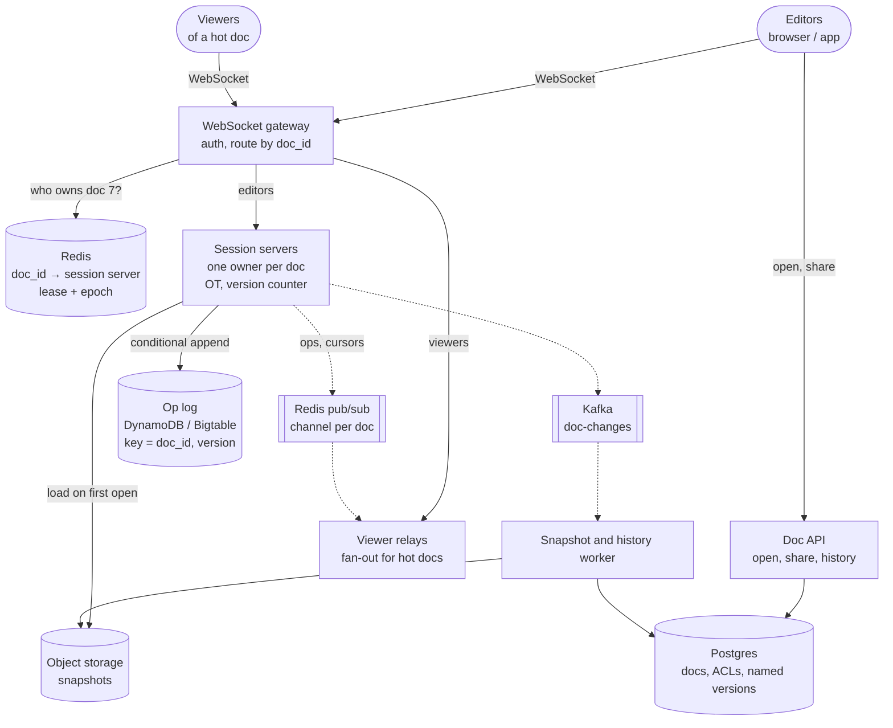
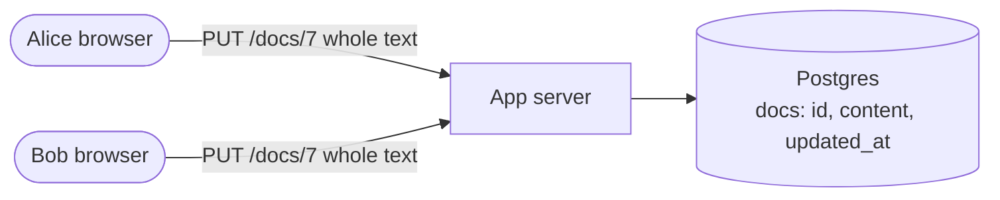
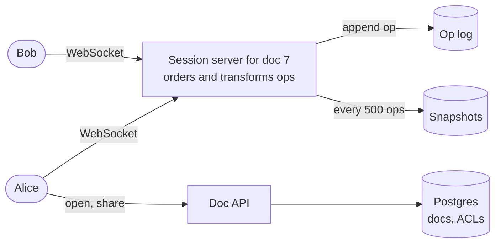
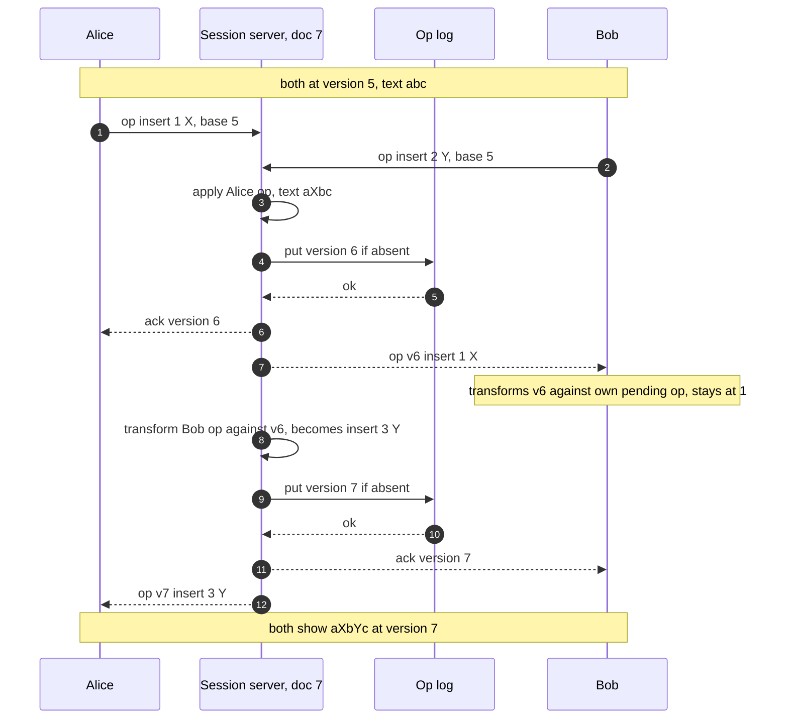

> **In one line:** every open document lives on exactly one session server, which puts all edits into one order, transforms concurrent ones (OT), appends each to an op log before acking and broadcasts it over WebSockets; snapshots keep loading fast, and cursors travel as throwaway pub/sub messages.

## The design at a glance



Opening a doc checks permissions through the Doc API, then opens a WebSocket that the gateway routes to the one session server that owns that document. The owner applies each incoming operation in a single order, transforms it against anything the sender had not seen yet, appends it to the op log with a conditional write, acks the author and broadcasts it to the other editors. Viewers of very popular docs hang off relays fed by pub/sub, and a background worker turns the op stream into snapshots and version history.

## How to spend the 30 minutes

| Minutes | What you do | What to say or draw |
|---|---|---|
| 0-3 | Requirements | How many editors per doc? Offline? History? Sharing roles? |
| 3-6 | Numbers | 10 M sessions and 1 M ops/s overall, but only a few ops/s per doc |
| 6-9 | API and data model | Ops over WebSocket; op log keyed by (doc, version) |
| 9-12 | Design v1 | Save the whole document, last write wins |
| 12-15 | Break v1 | Lost update, conflict errors, no live view, no history |
| 15-23 | Design v2 and v3 | Ops, one server per doc, OT worked example, op log + snapshots, failover, hot docs |
| 23-29 | Deep dives | OT vs CRDT, routing, persistence, hot documents |
| 29-30 | Recap | The 60-second summary at the bottom |

## Requirements

**Functional**

- Many people edit the same rich-text document at once and see each other's changes live.
- See collaborators' cursors, selections and who is present.
- Share with people, groups or a link, as owner, editor, commenter or viewer.
- Version history: who changed what, named versions, restore.
- Keep editing offline; changes merge on reconnect.

**Non-functional**

- Your own typing appears instantly; others' edits arrive within ~300 ms (p99, same region).
- Convergence: every copy of the document ends up identical.
- Intent: two concurrent inserts both survive, where their authors put them.
- Durable: an acknowledged edit is never lost.
- 99.99% available; a server crash costs a few seconds of reconnect, never data.
- Up to ~100 active editors and tens of thousands of viewers on one document.

**Out of scope**

- Spreadsheets and slides (same ideas, different operation types).
- Search across documents, export to PDF, templates.

> **Say it like this:** "Scale per document is small; correctness is the hard part. Concurrent edits must converge without losing anyone's work. I'll send small operations instead of whole documents, give every open document one server that orders them, resolve conflicts with operational transformation, and then make that server replaceable with an op log and snapshots."

## Back-of-the-envelope numbers

| Quantity | Estimate | How |
|---|---|---|
| Daily users | 100 M | Given |
| Concurrent sessions at peak | ~10 M | ~10% of daily users with a doc open at once |
| Open documents | ~5 M | ~2 sessions per open doc; most have one person |
| Ops in | ~1 M/s at peak | 5% of sessions typing at any instant x 2 ops/s (keystrokes batched every 500 ms) |
| Ops per document | ~0.2/s average, ~50/s for a busy doc | 1 M ops/s ÷ 5 M open docs |
| Ops out (broadcast) | ~3 M/s | Each op goes to ~3 other sessions on average |
| Session servers | ~200 | 10 M sockets ÷ 50 k per server |
| Open-doc memory | ~500 GB total, ~2.5 GB per server | 5 M docs x ~100 KB |
| Op log growth | ~3 TB/day | ~330 k ops/s average x 100 bytes x 86,400 s |
| Snapshot storage | ~250 TB | 5 B documents x ~50 KB |

**What the numbers tell us:**

- The total is large but each document is tiny (0.2 ops/s on average), so one server per document can easily order all its edits. Shard everything by `doc_id`.
- Open documents fit in RAM (2.5 GB per server): the live copy lives on the session server, and storage is for durability.
- The op log grows ~3 TB a day, so snapshots and compaction are needed to keep load times flat.
- Hot documents with thousands of viewers break one-server-per-doc for fan-out, not for ordering.

## API

```http
GET /v1/docs/{doc_id}
→ 200 { "title": "Q3 plan", "role": "editor", "session_token": "<signed, 10 min>" }

WS  wss://collab.example.com/v1/docs/{doc_id}?token=...
← { "type": "init", "version": 4210, "content": "<doc state>", "peers": ["u_bob"] }
→ { "type": "op", "client_op_id": "a1:57", "base_version": 4210, "op": { "insert": "Y", "pos": 2 } }
← { "type": "ack", "client_op_id": "a1:57", "version": 4211 }
← { "type": "op", "version": 4212, "author": "u_bob", "op": { "delete": 3, "pos": 40 } }
→ { "type": "cursor", "pos": 118, "sel_end": 130 }

GET  /v1/docs/{doc_id}/versions?cursor=...
POST /v1/docs/{doc_id}/versions/{version}/restore
PUT  /v1/docs/{doc_id}/acl   { "principal": "bob@acme.com", "role": "commenter" }
```

- **`base_version`** tells the server which ops the client had already seen, so it knows exactly what to transform against.
- **`client_op_id`** makes resending after a reconnect safe: the server re-acks instead of applying twice.
- **HTTP for open, share and history**, which are ordinary request/response calls; the WebSocket carries only the live session.
- **Cursor frames are fire-and-forget:** never acked, never stored.

## Data model

```text
documents        (Postgres, sharded by doc_id)
  doc_id, owner_id, title, created_at, snapshot_version, snapshot_key

acl              (Postgres)
  doc_id, principal (user | group | domain | link token), role

op_log           (DynamoDB / Bigtable: partition = doc_id, sort = version)
  doc_id, version, author_id, client_op_id, op (bytes), ts
  written only if that version does not exist yet

snapshots        (object storage)
  docs/<doc_id>/<version>.snap      full state at that version

named_versions   (Postgres)
  doc_id, version, name, created_by, created_at

registry         (Redis)
  doc:<doc_id> → session server + lease epoch, TTL 10 s, renewed
```

- **`op_log` in DynamoDB or Bigtable.** Append-only, read as "versions after N" for one doc, and both offer a cheap conditional write (DynamoDB condition expressions, Bigtable check-and-mutate). That condition is what stops two servers from writing the same version.
- **Snapshots in object storage.** Opaque blobs, written every few hundred ops; cheap and durable.
- **`documents`, `acl`, `named_versions` in Postgres.** Relational and modest in size; sharing changes want transactions.
- **Registry in Redis.** Tiny, with TTLs. It is only a routing hint; safety comes from the conditional append.

## Design v1: the simplest thing that works



1. Opening doc 7 does `GET /docs/7` and loads the full text into the editor.
2. Every few seconds the editor autosaves with `PUT /docs/7 {content}`; the server overwrites the row.
3. Others see the changes when they reload.

Now the lost update. Alice and Bob both open the doc. Alice adds a paragraph and saves at 10:00:05. Bob fixes a typo and saves at 10:00:06, from his copy, which never had Alice's paragraph. The paragraph is gone, and nobody was told: last write wins.

## Where v1 breaks

| Problem | Why it happens | What the user sees |
|---|---|---|
| Lost updates | Each save replaces the whole document | Alice's paragraph silently vanishes |
| Version checks only move the pain | Optimistic locking (`WHERE version = 12`) rejects the stale save | "Someone else edited this, reload" every few seconds |
| No live view | Changes reach others only on reload | No live typing, no cursors |
| Wasted writes | 100 KB saved every few seconds for a one-letter change | Load grows with document size |
| No history | Each save overwrites the row | Cannot see who changed what or roll back |
| Offline | One big save on return overwrites everyone | Hours of other people's work erased |

## Design v2: operations, one server per document, OT



### Fix 1: send operations, not documents

The editor turns each change into a small operation: `insert "Y" at 2`, `delete 3 at 40`, `bold 10-20`. It applies the op locally first, so typing feels instant, then sends it, batching keystrokes every few hundred milliseconds. An op is ~100 bytes whatever the document size, and the list of ops is the history.

### Fix 2: a WebSocket to a session server

Ops flow both ways over one long-lived connection, so a remote edit reaches you in one hop without polling, the same way a [chat app](08-chat-app.md) delivers messages. The same socket carries cursors and presence.

### Fix 3: one session server per document

All editors of doc 7 are routed to the same session server (how is a deep dive). That server holds the document in memory and a version counter, and every op it accepts becomes version N+1. One place deciding the order is what makes conflicts solvable.

### Fix 4: operational transformation (OT)

An op says "insert at position 2", but if someone else changed the text before position 2 in the meantime, that position is now wrong. The server transforms each incoming op against every op the client had not seen (`base_version` to now). A worked example, starting from `abc` at version 5:

| Step | What happens | Text |
|---|---|---|
| 1 | Alice types `X` at 1 and sends `insert(1, X)`, base 5 | Alice sees `aXbc` |
| 2 | Bob, also at version 5, types `Y` at 2 (after `b`) and sends `insert(2, Y)` | Bob sees `abYc` |
| 3 | Server gets Alice's op first; nothing to transform; it becomes version 6 | `aXbc` |
| 4 | Bob's op arrives, base 5. Applied as is it would give `aXYbc`, with Y before `b` | wrong |
| 5 | Transform: Alice inserted at 1, before Bob's 2, so Bob's op shifts to `insert(3, Y)`: version 7 | `aXbYc` |
| 6 | Alice receives v7 `insert(3, Y)` | `aXbYc` |
| 7 | Bob receives v6 `insert(1, X)` and transforms it against his own unacked op: 1 is before 2, so it stays at 1 | `aXbYc` |

Everyone converges on `aXbYc`, and both people's intent survived. Equal positions need a fixed tie-break (the op the server ordered first stays left) that every side applies. Each client keeps at most one op in flight and buffers the rest, which keeps the client side to "transform incoming ops against my pending ones".

### Fix 5: an op log plus snapshots

The session server appends each op to the op log before acking it, so an ack means durable. Every ~500 ops a snapshot of the full document goes to object storage. Loading is "latest snapshot + the ops after it", never a replay from the beginning, and the log doubles as version history.

## Where v2 still breaks

| Problem | Why it happens | What the user sees |
|---|---|---|
| Session server crashes | The live document and in-flight ops were in its memory | Editing freezes; unacked typing must be resent |
| Two owners after a network blip | A paused server still thinks it owns doc 7 while another takes over | Two orders, so the document forks |
| Hot document | 5,000 viewers on an all-hands doc, every op broadcast to all of them | One server pushes 50 k messages/s for one doc; everyone lags |
| Cursor chatter | Cursors move more often than text changes and go to everyone | Wasted bandwidth, jittery cursors |
| Long offline sessions | Edits made against a version from hours ago | Big transforms; if old ops were compacted, nothing to transform against |
| Sharing changes mid-session | Access is checked only when the doc opens | A removed user keeps editing until they reload |

## Design v3: safe failover, hot documents, live permissions

This is the diagram at the top.

### Fix 6: leases with fencing

Ownership is a lease in Redis: `doc:7 → server-12, epoch 31`, TTL 10 s, renewed every 3 s. If server-12 dies the lease expires, the next connection lands on a new server, which takes the lease with epoch 32, loads snapshot plus tail, and carries on. Clients reconnect and resend unacked ops; `client_op_id` stops duplicates. A zombie owner cannot fork the document: version N+1 is a conditional write, so only one server's append succeeds, and the loser drops its state and closes its sockets.

### Fix 7: viewer relays for hot documents

Editors (capped at around 100 per document) connect to the owner. Everyone else joins as a viewer on relay servers that subscribe to the doc's pub/sub channel and forward ops in batches every ~200 ms. Ordering stays on one server; fan-out spreads across many.

### Fix 8: cursors and presence as ephemeral pub/sub

Cursor and selection updates are throttled to a few per second per user, sent fire-and-forget, never stored, and dropped if not refreshed within ~30 s. They are positions, so they shift when text before them changes; clients transform remote cursors with the same OT function as text. A hot document shows a viewer count and a handful of avatars, not 5,000 cursors.

### Fix 9: offline queue

The editor keeps unsent ops and their `base_version` in IndexedDB. On reconnect it sends them as one batch; the server transforms them against everything since. The op log keeps fine-grained ops for 30 days so that is always possible; past that, the client reloads and shows its offline changes as suggestions to re-apply. (Whole-file sync, as in [cloud storage](18-cloud-storage.md), usually falls back to a conflicted copy; merging at the level of ops is what avoids that.)

### Fix 10: permissions enforced live

The Doc API issues a short-lived token carrying the role; the session server rejects ops from viewers and commenters. An ACL change publishes an event, and the owner server downgrades or disconnects the affected sockets within a second.

### Components

| Component | Job | Tech choice |
|---|---|---|
| Doc API | Open, share, history, issue session tokens | Stateless HTTP service |
| WebSocket gateway | TLS, auth, route socket to owner or relay | Stateless; reads the registry |
| Registry | `doc_id → owner`, lease, epoch | Redis with TTL; a hint, not the safety net |
| Session servers | Hold live docs, order and transform ops, broadcast | Stateful, ~50 k sockets and ~25 k open docs each |
| Op log | Durable ordered ops per doc | DynamoDB / Bigtable, conditional put on (doc, version) |
| Snapshot store | Full document state every ~500 ops | S3 / GCS |
| Pub/sub + relays | Cursors, presence, ops for viewers | Redis pub/sub channel per doc, relay fleet |
| Kafka + worker | Snapshots, history checkpoints, search indexing | Kafka keyed by `doc_id` |
| Metadata DB | Docs, ACLs, named versions | Postgres sharded by `doc_id` |

## Key flow: two people type at the same moment



- **Ack lost:** the client resends with the same `client_op_id`; the server finds it among recent ops and re-acks with the original version.
- **Conditional put fails:** another server owns the doc now. This one drops its copy and closes sockets; clients reconnect to the new owner.
- **Server crashes before the append:** the op was never acked, so the client resends it to the new owner, which transforms it against anything newer.
- **`base_version` older than the retained log:** the server answers "reload"; the client fetches fresh state and offers its unsent changes as suggestions.

## Deep dives

### OT or CRDT?

**The problem.** Concurrent edits must converge and keep everyone's intent. There are two families of answers, and interviewers like to hear both.

**Options.**

| Option | Good | Bad |
|---|---|---|
| Lock a paragraph while someone edits it | Simple | Not real co-editing; stale locks |
| Three-way merge, like git | Works on any text | Conflicts need a human; not real time |
| **OT with a central server** | Small ops and a compact document; the server's order keeps transforms simple; the approach behind Google Docs | Needs that server; transform rules for rich text are fiddly |
| CRDT (Yjs, Automerge) | No central order; merges in any order, ideal offline and peer-to-peer | Ids and tombstones per character add metadata; cleanup and rich-text intent are harder |

**Pick.** OT with a central server, because we need that server anyway for permissions, durability and history. Know how a CRDT works: every character gets a unique id such as `(client_id, counter)`, an insert says "after character id X" rather than "at index 2", and a delete leaves a tombstone. Ids never shift, so merges commute and replicas converge with no central order. For an offline-first notes app, pick a CRDT; the rest of this design barely changes.

### How do all editors of a document reach the same server?

**The problem.** Ordering needs one owner per document, but sockets arrive at any gateway and servers come and go.

**Options.**

| Option | Good | Bad |
|---|---|---|
| No affinity, any server plus shared pub/sub | Stateless and simple | No single place to order ops; every server loads every doc |
| Consistent hashing on `doc_id` | No lookup; every gateway computes the owner | Adding a server moves live docs mid-session; cannot place by load |
| **Registry with leases** | Docs stay put while open; new docs go to the least-loaded server; a hot doc can be moved on purpose | One lookup per connect; lease logic |

**Pick.** The registry. On connect the gateway reads `doc:7`; if it is empty, it picks the least-loaded server, which claims the lease with `SET NX` and a TTL. Consistent hashing over the live server list is the fallback when Redis is unavailable. Either way, correctness never depends on routing being perfect: the conditional append fences out a second owner.

### Persistence and version history

**The problem.** Edits must be durable the moment they are acked, documents must load fast after years of edits, and users want to see and restore old versions.

**Options.**

| Option | Good | Bad |
|---|---|---|
| Save the full document on every change | Simple reads | Huge writes, no history |
| Op log only | Tiny writes, perfect history | Opening an old doc replays millions of ops |
| **Op log + periodic snapshots** | Load = snapshot + short tail; full history | A snapshot worker and compaction to run |

**Pick.** Op log plus snapshots every ~500 ops or 5 minutes of activity, written by a worker reading Kafka so the session server stays light. Keep fine-grained ops for 30 days (offline merges, detailed history), then compact them into hourly checkpoints; named versions are kept forever. The history view groups ops by author and time. Restoring a version applies the difference as a new edit, so history is never rewritten.

### Hot documents with thousands of viewers

**The problem.** A company all-hands doc or a live-event page has 50,000 people watching. At 10 ops/s, the owner would send 500,000 messages a second for one document.

**Options.**

| Option | Good | Bad |
|---|---|---|
| Everyone on the owner server | Simple | One machine does all the fan-out |
| **Owner for editors, relays for viewers** | Ordering stays on one server; fan-out scales out | Viewers see edits ~200 ms later |
| Viewers poll snapshots | Very cheap | Seconds stale, no live typing |

**Pick.** Relays. With 50 relays, each sends ~10,000 messages a second, which is easy. Relays batch ops every ~200 ms, viewers' cursors are not broadcast at all, and if the crowd keeps growing, add relays. Cap active editors around 100 so the transform and broadcast work on the owner stays bounded.

## Trade-offs to say out loud

- We chose **OT over a CRDT** because we run a central server anyway. The cost is a hard dependency on that server and weaker offline merging.
- We chose **one owner server per document** over stateless servers, so ordering is trivial. The cost is stateful routing and a few seconds of reconnect after a crash.
- We **ack after the durable append**, not after the broadcast. The cost is one storage write (a few ms) on every op's path.
- We chose an **op log plus snapshots** over saving the document. The cost is two stores and a compaction job.
- We made **cursors ephemeral**. The cost is that they vanish on reconnect until the next update.
- We put **viewers on relays**. The cost is viewers seeing edits ~200 ms later than editors.

## Follow-up questions

**Q: How does undo work when others are editing too?**
Undo only your own ops: take the inverse of your last op, transform it against everything that happened since, and send it as a new op. Never roll the whole document back.

**Q: How do comments stay attached to the right text?**
A comment stores its anchor as a range at a version. The server transforms the range like a cursor as ops arrive; if the text is deleted, the comment is marked orphaned.

**Q: How does rich text change the picture?**
The document becomes characters with attributes (or a tree of blocks), and ops become insert, delete and format. Same OT idea, more transform cases.

**Q: How do you go multi-region?**
Each document's owner lives in one region, usually nearest to most editors. Distant editors see remote edits ~150 ms later, but their own typing stays instant because ops apply locally first.

**Q: Where do images in a document go?**
In object storage behind a CDN, referenced by id from the document, so ops and snapshots stay small. Cap the text itself at a few MB.

**Q: What if Redis, holding the registry and pub/sub, goes down?**
Gateways fall back to consistent hashing, and the conditional append keeps ordering safe. Cursors and viewer updates pause; editing continues.

## 60-second recap

- Send small operations, not documents; apply them locally first so typing is instant.
- Every open document has one owner session server, found through a Redis lease registry, which orders ops and transforms concurrent ones with OT.
- Each op is appended to an op log with a conditional write before it is acked; snapshots every ~500 ops make loading fast.
- The conditional write fences out zombie owners, so failover is safe: a new owner loads snapshot plus tail and clients resend unacked ops.
- Cursors and presence are throttled, ephemeral pub/sub messages; hot documents put viewers on relays.
- Offline edits queue locally and are transformed on reconnect; permissions are checked on every op.
- Mention CRDTs as the alternative for offline-first or peer-to-peer editing.
