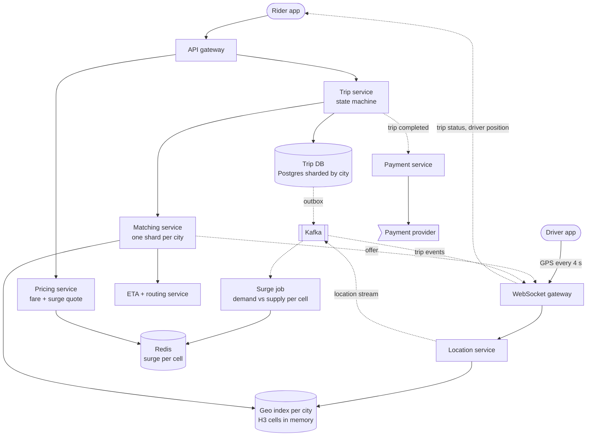
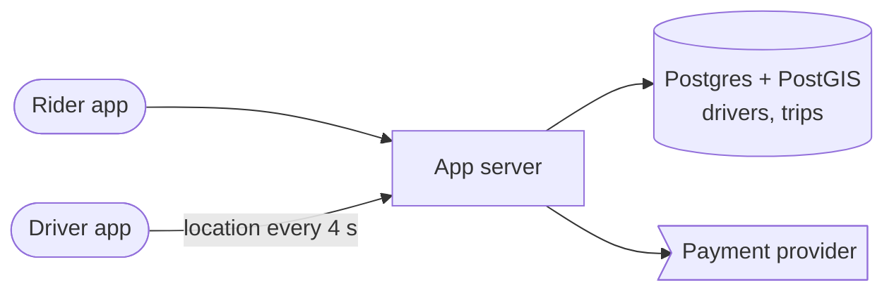
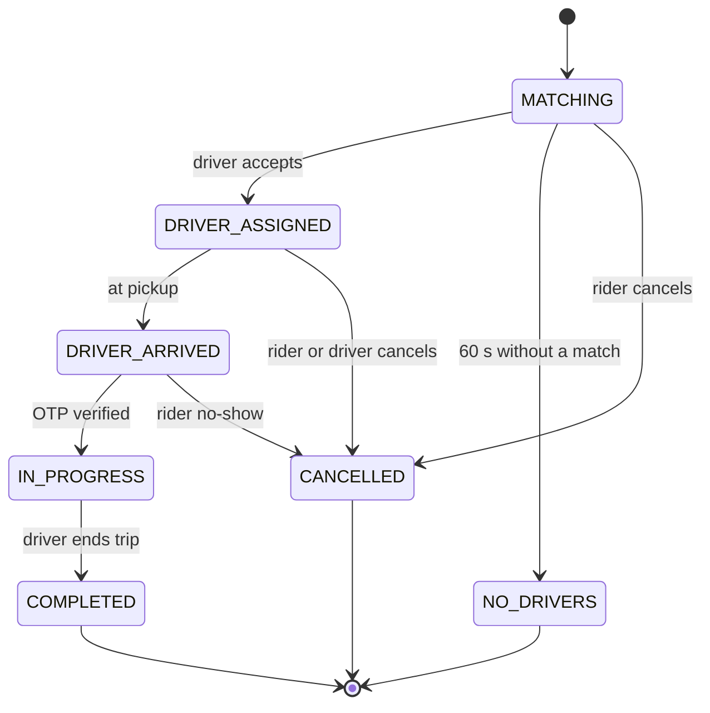
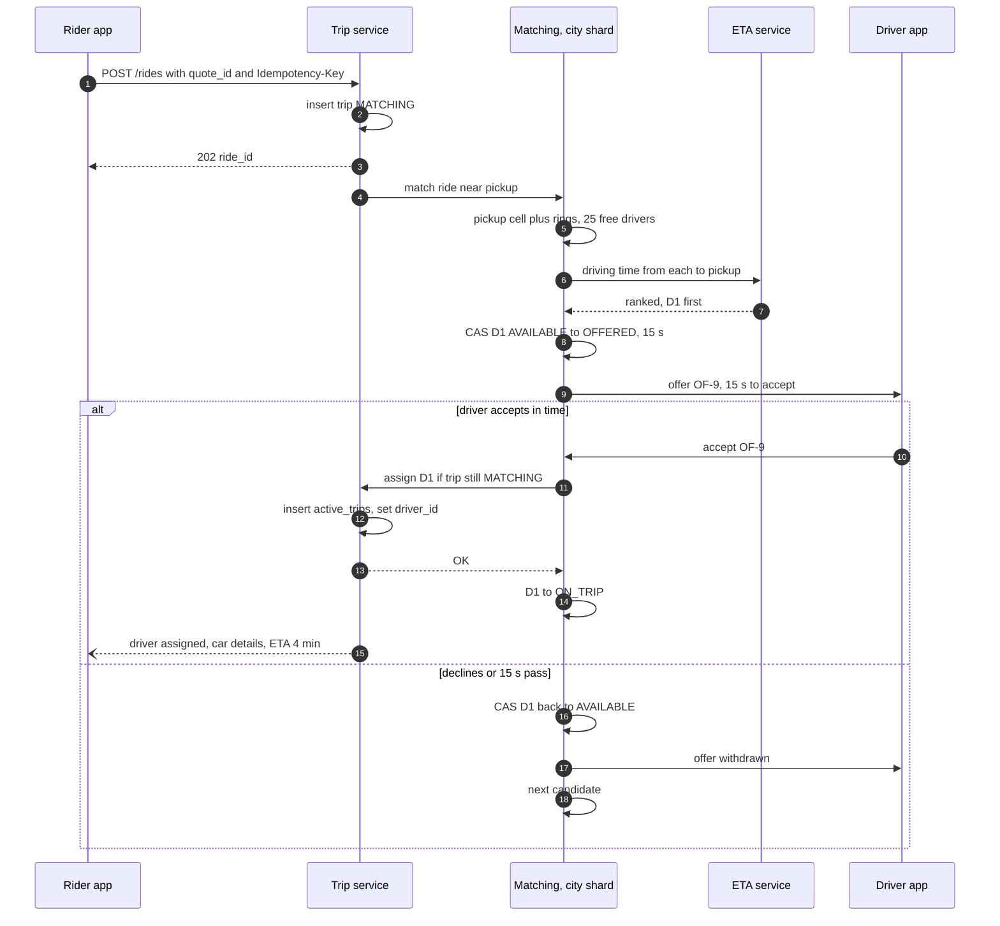

> **In one line:** drivers stream GPS every 4 seconds into an in-memory H3 cell index sharded by city; matching ranks nearby free drivers by road ETA and offers the trip to one driver at a time under a short lock; a trip service runs a strict state machine, and WebSockets push every change to both apps.

## The design at a glance



Drivers stream GPS through the WebSocket gateway to the location service, which updates the city's in-memory cell index and Kafka. A ride request creates a trip; the city's matching shard pulls free drivers near the pickup, ranks them by road ETA, locks one and sends the offer. Pricing quotes fares from per-cell surge computed off the Kafka stream, and payment is charged when the trip completes.

## How to spend the 30 minutes

| Minutes | What you do | What to say or draw |
|---|---|---|
| 0-3 | Requirements | Products (auto, bike, car)? Surge? Cash? One country or global? |
| 3-6 | Numbers | 1 M drivers online, 250 k location writes/s, 700 ride requests/s |
| 6-9 | API and data model | Quote, request, accept, WebSockets. Trips, driver live state |
| 9-12 | Design v1 | One server, PostGIS, nearest driver, polling |
| 12-15 | Break v1 | Write load, straight-line distance, double match, polling, one region |
| 15-22 | Design v2 and v3 | H3 index per city, ETA ranking, offer + lock, state machine, surge, failover |
| 22-29 | Deep dives | Geo index, matching strategy, locking the driver, ETA and routing |
| 29-30 | Recap | The 60-second summary at the bottom |

## Requirements

**Functional**

- Rider sees nearby cars and a fare estimate from pickup to drop for each product.
- Rider requests a ride and is matched with a driver within seconds.
- Drivers go online, receive offers, accept or decline.
- Both see each other live on the map, with ETAs to pickup and destination.
- Trip lifecycle: arrive, start with an OTP, end; either side can cancel.
- Fare with surge, charged after the trip (card, wallet, UPI or cash).

**Non-functional**

- Match in under 10 s at p50; give up with "no drivers" after about 60 s.
- Driver positions in the index are at most about 5 s old.
- A driver is never matched to two riders, and a trip never gets two drivers.
- 99.99% available; a city keeps working when a node dies.
- Trips and payments are durable and strongly consistent; location data may be lossy.

**Out of scope**

- Driver onboarding and KYC, shared rides (see follow-ups), fraud models.

> **Say it like this:** "This is real-time geo matching. A million drivers pinging every 4 seconds is 250,000 writes a second of data that goes stale at once, so it lives in memory, sharded by city. Matching is local: find free drivers near the pickup, rank by road ETA, offer to one at a time under a lock. Only trips and payments need a durable, strongly consistent store."

## Back-of-the-envelope numbers

| Quantity | Estimate | How |
|---|---|---|
| Drivers online at peak | 1 M | Assumption, all cities together |
| Location updates | 250,000 / s | 1 M drivers ÷ one ping every 4 s |
| Location bandwidth | ~25 MB/s | 250 k x 100 bytes (id, lat, lng, heading, speed, time) |
| Trips | 20 M / day | Assumption |
| Ride requests | ~230 / s average, ~700 / s peak | 20 M ÷ 86,400 s, x3 for rush hour |
| Estimate and nearby-car calls | ~7,000 / s peak | ~10 per ride request |
| Trips in progress at peak | ~840,000 | 700 / s x 20-minute trips (1,200 s) |
| Open WebSockets | ~2 M | 1 M drivers + 0.84 M riders on trips + riders browsing |
| Geo index memory | ~200 MB | 1 M drivers x ~200 bytes |
| Trip storage | ~15 TB / year | 20 M x 2 KB = 40 GB a day, x 365 |

**What the numbers tell us:**

- 250 k writes a second of throwaway data must stay in memory. It fits in 200 MB; the challenge is the write rate, not the size.
- Matching only needs drivers within a few km, so shard by city. A big city with 100 k drivers online is 25 k pings a second, comfortable for one shard.
- About 700 trips a second, each with ~10 state changes, is ~7,000 writes a second: easy for sharded Postgres.
- 2 M open sockets means a gateway fleet of about 40 nodes at 50 k connections each.

## API

```http
POST /api/v1/estimates
{ "pickup": { "lat": 19.076, "lng": 72.877 }, "drop": { "lat": 19.114, "lng": 72.869 }, "product": "sedan" }
→ 200 { "quote_id": "Q-7f3", "fare": { "min": 240, "max": 290 }, "surge": 1.4, "pickup_eta_min": 4, "expires_in_s": 120 }

POST /api/v1/rides
Idempotency-Key: 51ac...
{ "quote_id": "Q-7f3", "payment_method_id": "pm_12" }
→ 202 { "ride_id": "T-1001", "status": "MATCHING" }

POST /api/v1/rides/T-1001/cancel
POST /api/v1/driver/offers/OF-9/accept        → 200 assigned | 409 offer expired

WS /api/v1/driver/stream   → { "lat": 19.081, "lng": 72.880, "heading": 90, "speed": 8.2, "ts": 1760540000 } every 4 s
                           ← { "type": "offer", "offer_id": "OF-9", "ride_id": "T-1001", "expires_in_s": 15 }
WS /api/v1/rides/T-1001    ← { "status": "DRIVER_ASSIGNED", "driver": { "lat": 19.079, "lng": 72.881 }, "eta_min": 3 }
```

- The `quote_id` is signed and fixes the fare and surge for 2 minutes, so the price the rider accepted is the price used.
- `202` with `MATCHING`: the match arrives over the rider's WebSocket a few seconds later.
- Drivers use one WebSocket both ways: GPS up, offers down (plus a push notification in case it is reconnecting).
- `Idempotency-Key` stops a retry from booking two cars.

## Data model

```text
trips              (Postgres, sharded by city_id; trip_id embeds the city)
  trip_id PK, city_id, rider_id, driver_id nullable, status, product,
  pickup, drop, quote_id, surge, final_fare, payment_status, time of each state
trip_events        (same DB, append-only, doubles as the outbox)
  trip_id, seq, from_status, to_status, actor, ts
active_trips       (same DB)
  driver_id PK, trip_id          a driver can hold only one live trip
rider_trips        (history index)  rider_id, trip_id, created_at

quotes             (Redis, TTL 2 min)   quote_id → product, route, fare, surge, signature
surge              (Redis, per city)    h3 cell (res 7) → multiplier, refreshed every minute

driver live state  (in memory, in the city's geo shard)
  driver_id → lat, lng, heading, cell (res 8), last_seen,
              status OFFLINE | AVAILABLE | OFFERED | ON_TRIP, offer_id, offer_expires_at
  cell (res 8) → set of AVAILABLE driver_ids

location history   (Kafka → object storage)
```

- **Trips in Postgres**: transitions are conditional updates in one transaction with the outbox, and a city's trips live on one shard.
- **`active_trips` keyed by `driver_id`**: the durable backstop that makes "one driver, two trips" impossible even if an in-memory lock is lost.
- **Driver live state in memory**: overwritten every 4 s, so losing it costs one ping interval.
- **Quotes and surge in Redis**: small, short-lived, read on every estimate.

## Design v1: the simplest thing that works



1. Each driver app sends its location; the server runs `UPDATE drivers SET location = ..., last_seen = now()`.
2. A rider requests a ride. The server runs `SELECT driver_id FROM drivers WHERE status = 'available' ORDER BY location <-> :pickup LIMIT 1`.
3. It sets that driver to `on_trip`, inserts the trip with the driver, and returns.
4. The driver app polls `GET /driver/assignment` every 3 s; the rider app polls `GET /rides/T-1001`.
5. When the driver taps "end trip", the server computes the fare and charges the card.

This works for one small city with a few hundred drivers, and it already has the right nouns.

## Where v1 breaks

| Problem | Why it happens | What the user sees |
|---|---|---|
| 250 k location writes/s | Each update writes a new row version and spatial index entry in one Postgres | DB saturates; requests and trips stall |
| Straight-line "nearest" | 500 m away across a flyover can be 12 minutes by road | Long pickups; riders cancel |
| Double matching | Two requests read the same nearest driver before either commits | One driver, two riders; one is stranded |
| Forced assignment | No offer or accept; "available" may mean on a break or in a tunnel | Trips assigned to drivers who never come |
| Polling | 2 M apps polling every few seconds | Heavy load, jumpy cars, slow offers |
| One region, one DB | Every city shares one failure domain | One outage stops every city |

## Design v2: a city-sharded geo index and offers with locks

### Fix 1: a WebSocket gateway and a location service

Driver apps keep one WebSocket open. The gateway forwards pings to the location service, which updates the in-memory geo index and appends to Kafka (partitioned by city) for tracking, surge and history. No database is on this path.

### Fix 2: an in-memory H3 index, sharded by city

Each city (big cities split into zones) has a geo shard holding `driver → state` and `cell → available drivers`, using H3 resolution 8 cells (about 0.7 km² each). Most pings only update coordinates; when a driver crosses into a new cell, they move between two sets. A lookup takes the pickup cell plus rings: 1 ring is 7 cells (roughly 1 km around), 3 rings is 37 cells (roughly 2.5 km). Expand until there are about 20 candidates.

### Fix 3: rank by road ETA, not distance

Matching takes the ~20 nearest candidates and asks the ETA service for the driving time from each to the pickup, using the road graph and live traffic. It ranks by ETA, nudged by acceptance rate and vehicle type, so the car across the flyover drops down the list.

### Fix 4: offer to one driver at a time, under a lock

The geo shard is the **single writer** for its drivers, so it locks one with an in-memory compare-and-set: `AVAILABLE → OFFERED(trip T1, expires in 15 s)`. Two matchers cannot both win. On accept, the trip service runs one transaction (insert into `active_trips`, set `driver_id` on the trip `WHERE status = 'MATCHING'`), and the shard moves the driver to `ON_TRIP`. On decline or timeout, the driver goes back to `AVAILABLE` and the next candidate gets the offer. Drivers who are not really available simply never accept.

### Fix 5: a trip state machine



Only the trip service changes status, with conditional updates (`WHERE status = 'DRIVER_ARRIVED'`), and each change appends to `trip_events`, which doubles as the outbox. A driver cancelling after accepting sends the trip back to `MATCHING`, not to `CANCELLED`.

### Fix 6: push updates both ways

Trip events go from the outbox through Kafka to the gateway, which pushes them to rider and driver, using a registry in Redis (`user_id → gateway node`). Once a driver is assigned, the location service forwards that driver's pings to the rider every 4 s.

## Where v2 still breaks

| Problem | Why it happens | What the user sees |
|---|---|---|
| A geo or matching node dies | The city's in-memory index and pending offers vanish with it | Requests in that city hang; drivers stuck as "offered" |
| Demand spike in a few cells | A concert ends or rain starts: 3,000 requests, 200 drivers nearby | Nobody gets a car; long waits |
| Payment fails after the trip | The card is declined once the ride is over | Driver unpaid, revenue lost |
| Region outage | A country's cities are served from one data center | Everyone stranded |

## Design v3: surge, failover and payments

This is the diagram at the top.

### Fix 7: surge pricing per cell

Every minute, a streaming job (Flink) computes demand (requests, app opens) and supply (available drivers) per H3 resolution 7 cell, about 5 km². The multiplier follows a demand-to-supply curve, smoothed over a few minutes, capped, and blended with neighbouring cells so prices do not jump at an edge. Pricing reads it from Redis into the 2-minute quote. Higher prices trim demand, and the driver heat map pulls drivers in.

### Fix 8: survive a matching node failure

Each city shard has a **warm replica** consuming the same Kafka partition, so its driver index is already current. The leader holds a lease in etcd; when it dies, the replica takes over within seconds, and the lease's epoch number (a fencing token) lets the gateway ignore the old leader if it comes back. Even a cold start rebuilds the index within one 4 s ping round. Pending offers are lost, but nothing durable is: the new leader restarts every trip still in `MATCHING`. A driver accepting an old offer gets `409`, and `active_trips` blocks any double assignment.

### Fix 9: payments after the trip

At request time, check the payment method and, for cards, place a pre-authorisation hold for the upper fare estimate. On `COMPLETED`, the outbox emits `TripCompleted`; the payment service prices the map-matched route with the quoted surge and captures idempotently by `trip_id`. If retries fail, the amount becomes a balance the rider must clear before the next ride. The driver is credited in a ledger either way. See [payment gateway](17-payment-gateway.md).

### Fix 10: home regions per city

Each city has a home region, with its trip DB replicated to a standby region. Failover is per city; driver locations are not replicated, they rebuild from pings.

### Components

| Component | Job | Tech choice |
|---|---|---|
| WebSocket gateway | 2 M connections, GPS up, offers and updates down | ~40 nodes, registry in Redis |
| Location service | Validate pings, update index, publish | Stateless, Kafka partitioned by city |
| Geo index | Drivers by H3 cell, driver locks | In-memory shard per city or zone, warm replica, etcd lease |
| Matching service | Candidates, ETA ranking, offers, timeouts | Runs next to the city's geo shard |
| ETA + routing | Driving time for pairs of points | Precomputed road-graph router, live traffic, ML correction |
| Trip service | State machine, outbox, `active_trips` | Postgres sharded by city |
| Pricing + surge | Quotes; multiplier per cell | Flink job every minute, Redis |
| Payment service | Pre-auth, capture, retries, driver ledger | Payment provider, idempotent by trip_id |

## Key flow: request a ride and match a driver



- **Nobody nearby:** widen the rings and retry; after 60 s, `NO_DRIVERS` with a suggestion to try another product.
- **Rider cancels during matching:** the trip moves to `CANCELLED`, so step 11's conditional assign fails and the driver is released.
- **Driver accepts at 16 s:** the offer has expired, so the driver gets `409`.
- **Duplicate request:** the `Idempotency-Key` returns the same `ride_id`.

## Deep dives

### Which geo index?

**The problem.** A million moving points, and "free drivers near here" in a few milliseconds.

**Options.**

| Option | Good | Bad |
|---|---|---|
| Geohash prefixes | Simple strings; works in any key-value store | Rectangles vary in size with latitude; needs 8 neighbour lookups at edges |
| S2 cells | Hierarchical, great for covering regions | Square-ish cells, so neighbours are at uneven distances |
| **H3 hexagons** | All 6 neighbours equidistant; rings approximate circles; same cells for surge | Child cells do not nest exactly inside parents |
| Redis GEO per city | Built-in commands, little code | A separate store for the lock; one hot sorted set per big city |

**Pick.** H3 cells in memory, one shard per city or zone. More in [proximity search](07-proximity-search.md).

### Matching strategy

**The problem.** Who gets this rider, and how do we ask them?

| Option | Good | Bad |
|---|---|---|
| Nearest by straight line | Trivial | Ignores roads and traffic |
| Broadcast to 5 drivers, first to accept wins | Fast | Drivers race; four wasted offers; lock churn |
| **ETA-ranked, one driver at a time, 15 s timeout** | Fair, predictable, no races | Each decline costs up to 15 s |
| Batch every 2 s across all nearby requests | Better global pickups | A couple of seconds of delay; more compute |

**Pick.** ETA-ranked offers to one driver at a time. In dense areas at rush hour, collect requests for 2 s and assign them jointly. Count drivers about to finish a trip near the pickup as candidates too. [Food delivery](06-food-delivery.md) pushes batching further, with several orders per rider.

### Locking the driver

**The problem.** Two requests in the same street both want the same best driver.

| Option | Good | Bad |
|---|---|---|
| `SELECT ... FOR UPDATE` on a driver row | Durable | Puts the DB on the hottest path |
| Redis `SET lock:D1 T1 NX EX 15` | Simple; expiry frees the driver | One more network hop; a Redis failover can drop a lock |
| **Compare-and-set in the shard that owns the driver** | No extra hop; a single writer cannot race itself | Needs a leader per shard and failover |

**Pick.** CAS in the owning shard, with `active_trips` as the durable backstop. If the in-memory lock is ever lost, the worst case is a second offer that ends in a `409`, never a double trip.

### ETA and routing

**The problem.** Ranking, pricing and tracking need road ETAs: ~700 requests a second x 20 candidates is ~14,000 queries a second, plus estimates.

| Option | Good | Bad |
|---|---|---|
| Straight-line distance x a factor | Free | Wrong near rivers, flyovers and one-ways |
| Dijkstra on the road graph per query | Exact | Too slow for 14 k queries/s on a graph with millions of edges |
| **Precomputed hierarchy (CH or MLD) + live traffic** | Millisecond queries | Preprocessing; live traffic needs a customisable variant |

**Pick.** A routing engine with a customisable precomputed hierarchy (OSRM's multi-level Dijkstra, or customisable contraction hierarchies), so traffic weights learned from driver pings can be refreshed every few minutes. An ML model corrects the result by time of day and area, and cell-to-cell ETAs are cached for a minute for ranking.

## Trade-offs to say out loud

- We keep **driver locations in memory, not a database**. The cost is a 4 s blind spot after a crash, which warm replicas mostly remove.
- We **shard by city**. The cost is extra work at boundaries and for huge cities, which we split into zones.
- We **offer to one driver at a time** instead of broadcasting. The cost is slower matching when drivers decline, so the timeout stays short.
- We **price surge per cell**. The cost is sharp price edges and fairness worries, softened by blending neighbours, smoothing and caps.
- We **charge after the trip** for a smooth ride. The cost is failed payments, reduced by pre-authorisation and an outstanding-balance rule.

## Follow-up questions

**Q: How does the rider see nearby cars before requesting?**
Read the geo shard for cells around the rider and return up to 10 positions, cached per cell for 2-3 s. Positions are slightly fuzzed for driver privacy.

**Q: GPS is noisy or jumps across the road. What then?**
Snap points to roads (map matching with a Kalman filter or HMM) and drop points that imply impossible speeds. The fare uses the matched path.

**Q: The driver's phone goes offline mid-trip?**
The app buffers points and uploads them on reconnect; the trip stays `IN_PROGRESS`. If they never arrive, the fare uses the route estimate.

**Q: How would you add shared rides?**
Matching becomes route insertion: a new rider can join a trip in progress if the detour adds less than a few minutes for everyone already on board.

**Q: What about a driver right at a city boundary?**
The driver belongs to the shard of their current cell and moves shards when crossing. Requests near a boundary query both shards.

**Q: How do scheduled rides work?**
Store the booking, and create the `MATCHING` trip 10-15 minutes before pickup so the normal flow runs with time to spare.

## 60-second recap

- 1 M drivers pinging every 4 s is 250 k writes a second, held in memory as an H3 cell index sharded by city.
- Matching takes free drivers from the pickup cell and its rings, ranks them by road ETA, and offers to one at a time with a 15 s timeout.
- A driver lock is a compare-and-set in the owning shard; `active_trips` in the trip DB makes a double assignment impossible.
- Trips follow a strict state machine in sharded Postgres, with an outbox feeding Kafka and the WebSocket gateway.
- Surge is computed per H3 cell every minute from demand and supply, and fixed in a 2-minute quote.
- Node failure: warm replica, etcd lease with fencing, `MATCHING` trips restarted.
- Payment: pre-authorised at request, captured after the trip, idempotent by `trip_id`.
