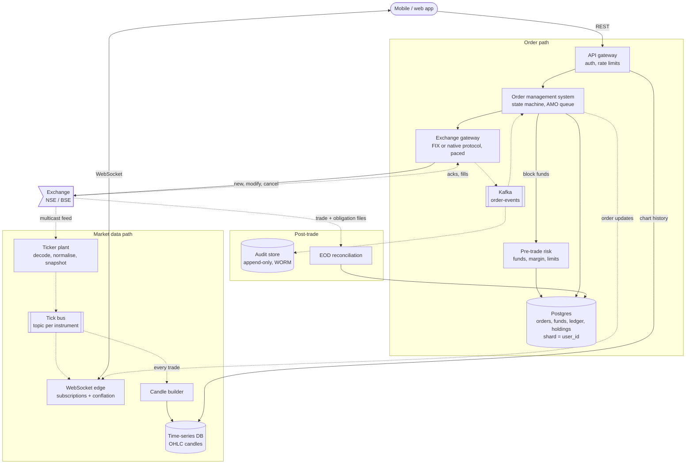
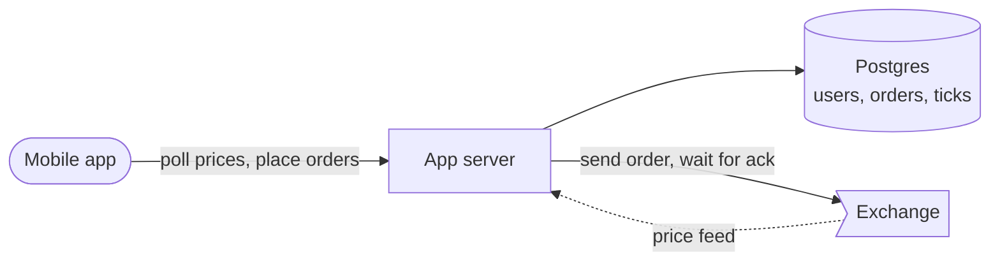
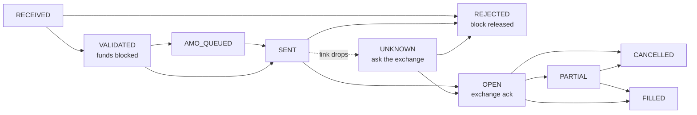
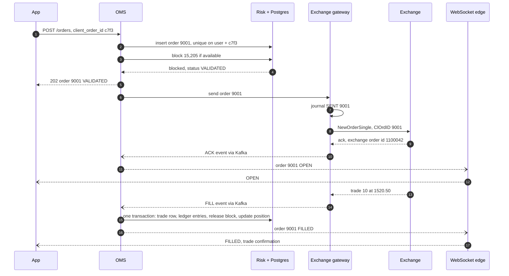

> **In one line:** build two systems: a market-data pipeline that turns the exchange feed into conflated per-instrument WebSocket pushes for millions of screens, and a small, strictly consistent order path that blocks funds atomically, journals every order before it reaches the exchange, and reconciles with the exchange every day.

## The design at a glance



Follow two paths. **Prices**: the ticker plant decodes the exchange feed and publishes per-instrument updates; WebSocket edges push each screen only the instruments it subscribed to, a few times a second. **Orders**: the OMS records the order, risk blocks the money in one atomic update, the gateway journals and sends it, and acks and fills flow back through Kafka to the order, the ledger and the screen.

## How to spend the 30 minutes

| Minutes | What you do | What to say or draw |
|---|---|---|
| 0-3 | Requirements | Equity and F&O? Which exchanges? We are the broker, not the matching engine |
| 3-6 | Numbers | 2 M sockets, ~40 M price updates/s out, 20 k orders/s at 9:15 |
| 6-9 | API and data model | REST for orders, WebSocket for ticks, `client_order_id`, funds row |
| 9-12 | Design v1 | One server, polling, check-then-act on balance |
| 12-15 | Break v1 | Polling load, double spend, duplicate orders, link drop |
| 15-23 | Design v2 and v3 | Ticker plant, OMS + risk + gateway, journal, open-day plan, reconciliation |
| 23-29 | Deep dives | Conflation, atomic blocks, exchange disconnect, 9:15 |
| 29-30 | Recap | The 60-second summary at the bottom |

## Requirements

**Functional**

- Live prices for a watchlist; market depth (best 5 bids and asks) for the open instrument.
- Charts: candles from 1 minute to 1 day, with the forming candle updating live.
- Place, modify, cancel orders: market, limit, stop-loss; intraday and delivery; equity and F&O.
- After-market orders (AMO): placed after hours, sent at the next open.
- Real-time order status and trade confirmations.
- Funds, holdings, positions with live P&L; add money through a [payment gateway](17-payment-gateway.md).

**Non-functional**

- Orders: p99 under 50 ms inside the broker, API to exchange socket.
- Prices: under 1 s from exchange to screen.
- Money is exact: a balance is never spent twice, an order never sent twice, a fill never lost. Strong consistency for funds and orders.
- 99.99% availability during market hours (9:15 to 15:30); deploys happen after hours.
- Survive the open: 2 M sockets and ~20 k orders/s in the first minute.
- Every order event kept immutably for years.

**Out of scope**

- The exchange's matching engine and clearing.
- KYC, mutual funds, IPOs, research and recommendations.

> **Say it like this:** "This is two systems. Market data is fan-out: hundreds of thousands of updates a second in, tens of millions out, and freshness beats completeness. The order path is small but must be exact: block funds atomically, never send an order twice, never lose a fill. I'll design both, then handle 9:15 and reconciliation."

## Back-of-the-envelope numbers

| Quantity | Estimate | How |
|---|---|---|
| Users | 10 M active, 2 M connected at the open | Assumption; 20% open the app around 9:15 |
| Orders per day | 10 M | About 1 per active user on average |
| Average order rate | ~450 / s | 10 M ÷ 22,500 s (9:15 to 15:30 is 6 h 15 min) |
| Peak order rate | ~20,000 / s for a minute | 1 M queued AMOs ÷ 60 s ≈ 17 k/s, plus live orders |
| Instruments | ~100 k | Equities plus futures and options across strikes and expiries |
| Exchange feed in | ~500 k messages / s at peak | Assumption, all segments |
| Price updates out | ~40 M / s | 2 M clients x ~20 changed instruments/s after conflation |
| Push bandwidth | ~2 GB/s (~16 Gbps) | 40 M x ~50 bytes, binary |
| 1-minute candles | ~2 GB / day, ~0.5 TB / year | 100 k x 375 min x 50 bytes = 1.9 GB, x 250 trading days |
| Order events (audit) | ~25 GB / day, ~6 TB / year | 10 M orders x 5 events x 500 bytes, x 250 days |

**What the numbers tell us:**

- Fan-out is 80x the inbound feed and 2,000x the order rate: market data needs its own pipeline and conflation.
- 2 M sockets at ~50 k per server is ~40 WebSocket servers, plus headroom for reconnect storms.
- Orders spike over 40x at a known time, so pre-scale instead of autoscaling.
- Candles and audit are small per day but kept for years: a time-series DB and immutable object storage.

## API

```http
POST /api/v1/orders
Authorization: Bearer <session-token>
{ "client_order_id": "c7f3a9e2", "instrument": "NSE:INFY", "side": "BUY", "qty": 10,
  "order_type": "LIMIT", "price": 1520.50, "product": "DELIVERY" }
→ 202 { "order_id": "9001", "status": "VALIDATED" }      (422 insufficient funds)

PUT    /api/v1/orders/{order_id}   { "qty": 5, "price": 1518.00 }  → 202
DELETE /api/v1/orders/{order_id}                                  → 202

GET /api/v1/orders?date=today    GET /api/v1/positions    GET /api/v1/holdings    GET /api/v1/funds

GET /api/v1/candles/NSE:INFY?interval=5m&from=2026-10-01&to=2026-10-15

WS  wss://stream.broker.example/v1
→ { "action": "subscribe", "instruments": [408065, 738561], "mode": "quote" }
← binary price frames, plus order updates for this user
```

- `client_order_id` is generated once per tap; a retry with the same id returns the existing order.
- `202`, not `201`: the broker accepted the order, the exchange has not yet; the outcome arrives over the WebSocket.
- Subscriptions carry a mode (`ltp`, `quote`, `depth`) so each screen pays only for the detail it shows.

## Data model

```text
funds              (Postgres, shard key = user_id)
  user_id PK, cash, collateral, blocked        available = cash + collateral - blocked

orders             (Postgres, same shard)
  order_id PK                    also the ClOrdID sent to the exchange
  user_id, client_order_id       UNIQUE together
  instrument, side, qty, price, order_type, product
  status, exchange_order_id, filled_qty, avg_price, blocked_amount

trades             (same shard)    exchange_trade_id PK, order_id, qty, price, ts
ledger_entries     (same shard)    entry_id, txn_id, account, debit_or_credit, amount, reason
holdings           (same shard)    user_id, isin, qty, t1_qty, blocked_qty, avg_cost
positions          (same shard)    user_id, instrument, product, net_qty, buy_value, sell_value

candles            (TimescaleDB or ClickHouse)
  instrument, interval, ts, open, high, low, close, volume

order_events       (Kafka keyed by user_id, archived to S3)
  event_id, order_id, user_id, type, source, payload, ts
```

- **Postgres, sharded by `user_id`, for money.** A risk check or a fill touches one user's rows, so one ACID transaction covers it. `cash` and the ledger are updated together.
- **Candles in a time-series store,** because every query is "one instrument, a time range".
- **Live prices stay in memory** in the ticker plant and edges.
- **Order events in Kafka keyed by `user_id`,** so each user's events stay in order.

## Design v1: the simplest thing that works



1. The app server reads the exchange feed, keeps the latest prices in memory, and inserts every tick into a `ticks` table for charts.
2. The app polls `GET /quotes` every second.
3. To buy, the server reads the balance, checks it covers `price x qty`, inserts the order and subtracts the amount.
4. It sends the order on its one exchange connection and waits for the ack before answering.
5. Fills arrive on the same connection; the server updates the order and holdings.

This works for a few hundred users and shows you know the pieces.

## Where v1 breaks

| Problem | Why it happens | What the user sees |
|---|---|---|
| Clients poll for prices | 2 M phones x 1 request/s, mostly "nothing changed" | Laggy prices; servers fall over at 9:15 |
| Ticks stored in Postgres | ~500 k inserts/s into the database that holds orders | Charts time out, order writes slow down |
| Check-then-act on the balance | Phone and laptop both read ₹10,000 free before either writes | The same money buys twice |
| A retry places a second order | Request timed out after the order was sent; user taps Buy again | Twice the position |
| One synchronous exchange connection | Every request waits; the exchange caps messages per second per connection | Orders queue and time out at the open |
| The link drops mid-order | Order sent, ack never came, state only in memory | Order stuck "pending", or a fill for an order we forgot |

## Design v2: two pipelines, and an order path that cannot double-spend

### Fix 1: a ticker plant and WebSocket fan-out

The **ticker plant** decodes the exchange multicast feed, builds quotes and depth per instrument, and publishes on a tick bus with a topic per instrument. **WebSocket edges** hold client connections, subscribe only to instruments their clients want, and every 250-500 ms send each client one binary frame with just the instruments that changed. Polling disappears.

### Fix 2: candles from the stream into a time-series DB

A candle builder consumes every trade and keeps the forming 1-minute candle per instrument in memory (first, highest, lowest and last price, summed volume). At each minute boundary it writes one row to TimescaleDB or ClickHouse; longer intervals are roll-ups. That is ~100 k rows a minute, none in the orders database.

### Fix 3: block funds with one atomic conditional update

Risk computes the margin (full value for delivery, a fraction for intraday, the clearing corporation's SPAN figure for F&O), then runs:

`UPDATE funds SET blocked = blocked + 15205 WHERE user_id = 42 AND cash + collateral - blocked >= 15205`

One row updated means the money is held; zero means reject. Updates to one row are serialised, so two orders cannot both pass. Sells do the same with `blocked_qty` on holdings.

### Fix 4: idempotent `client_order_id`

`UNIQUE (user_id, client_order_id)` turns a retry into a lookup of the existing order. The broker's own `order_id` goes to the exchange as the `ClOrdID`, so the gateway can also spot duplicates.

### Fix 5: OMS, async gateway pool, state machine

The **OMS** owns order state and answers `202` once funds are blocked. A pool of **exchange gateways** holds many exchange sessions and paces each under the exchange's per-session limit with a token bucket. Acks and fills come back as Kafka events; the OMS applies them and pushes updates to the user.



### Fix 6: journal before send, recover by asking

The gateway writes `SENT` to a replicated journal *before* writing to the socket. If the link drops, every `SENT` order without an ack becomes `UNKNOWN`; on reconnect the gateway replays missed messages and asks the exchange about each one. It never resends blindly.

## Where v2 still breaks

| Problem | Why it happens | What the user sees |
|---|---|---|
| The 9:15 spike | 1 M AMOs, 2 M logins and a reconnect storm in one minute; autoscaling takes minutes | Login errors, frozen prices, stuck orders at the busiest minute |
| Our books drift from the exchange's | A fill missed during a reconnect, a manual fix, a stock split | Wrong holdings or funds |
| No proof of what happened | Order rows are updated in place | Cannot answer "I cancelled at 10:02:03, why did it fill?" |

## Design v3: plan for the open, reconcile daily, record everything

This is the diagram at the top.

### Fix 7: an open-day playbook

Scale login, edges, gateways and OMS on a schedule at 8:30, sized from replays of past opens. AMOs were validated and funds blocked when placed, so at the open they are only released, in placement order, paced across all sessions. Cancels and exits jump the queue; clients reconnect with jittered backoff; session tokens are verified locally, so no session store runs hot.

### Fix 8: a double-entry ledger and reconciliation

Every money movement is a balanced transaction: a fill debits the user's cash and credits "clearing payable"; brokerage and taxes are separate entries. A drop-copy feed (a second copy of every execution, where the exchange offers one) is matched against our trades during the day. After the close, the exchange's trade file, the clearing corporation's obligations and the depository's holdings are matched against our books.

### Fix 9: an append-only audit trail

Every request, risk decision and gateway message is an event on Kafka with user, device, IP and timestamps, archived to S3 with Object Lock (write once, read many). Replaying an order's events reproduces its exact history.

### Components

| Component | Job | Tech choice |
|---|---|---|
| Ticker plant | Decode feed, build quotes and depth | C++ / Rust; reads both A and B feed lines, first copy wins |
| Tick bus | Fan updates out | NATS or multicast relay for live ticks; Kafka for trades |
| WebSocket edge | ~50 k sockets each, conflation | Go or Netty, binary frames, last-value cache |
| Candle builder | 1-minute OHLCV, roll-ups | TimescaleDB or ClickHouse |
| API gateway | Auth, per-user rate limits | Local JWT check, token bucket ([rate limiter](21-rate-limiter.md)) |
| OMS | State machine, idempotency, AMO queue | Stateless, state in Postgres |
| Pre-trade risk | Limits, margin, atomic blocks | SPAN files cached in memory |
| Exchange gateway | Sessions, pacing, journal, recovery | FIX engine or native adapter, hot standby |
| Postgres | Money and orders | Sharded by `user_id`, synchronous replica |
| Audit store | Immutable history | S3 with Object Lock |

## Key flow: place a buy order and get it filled



- **Not enough money:** the update changes zero rows, the order is `REJECTED`, the app gets `422`, nothing reaches the exchange.
- **App retries:** the unique index returns order 9001 again.
- **Exchange rejects** (outside the circuit band, wrong lot size): mark `REJECTED` and release the block together.
- **Partial fills:** each fill converts its share of the block; cancelling the rest releases it.
- **Fill delivered twice** (Kafka is at-least-once): `exchange_trade_id` is the primary key of `trades`, so the duplicate transaction fails and changes nothing.
- **Link drops after step 8:** see the deep dive below.

## Deep dives

### Fanning out prices to 2 million sockets

**The problem.** 500 k updates a second come in; phones on 4G cannot take every tick.

**Options.**

| Option | Good | Bad |
|---|---|---|
| Push every tick | Nothing missed | Huge bandwidth; slow phones build queues without bound |
| Send the whole watchlist every second | Simple | Resends unchanged data, up to 1 s extra delay |
| **Conflate per instrument, flush changes every 250-500 ms** | Bounded bandwidth, always the latest price | Screens skip intermediate ticks |

**Pick.** Conflation. Each connection keeps `instrument → latest value`; new ticks overwrite, a timer flushes changes, so a slow client gets fewer, fresher updates, never a backlog. On subscribe, the edge sends the cached last value at once. Order updates are never conflated: the user's edge subscribes to a per-user subject, and the app refetches orders after a reconnect (as in the [chat app](08-chat-app.md)).

### Blocking funds so money is never spent twice

**The problem.** A user with ₹10,000 fires two ₹8,000 orders from two devices at once.

**Options.**

| Option | Good | Bad |
|---|---|---|
| Read, then write | Simple | Both reads see ₹10,000; both pass |
| `SELECT ... FOR UPDATE`, then update | Correct | Lock held across the margin calculation |
| **One conditional `UPDATE`** | Atomic, one round trip | A DB write per order, so you shard |
| In-memory risk engine per account partition | Microseconds | Must rebuild from a journal after a crash |

**Pick.** The conditional update. 20 k orders/s over 16 shards is ~1,250 blocks per shard per second, easy for Postgres. Market orders have no price, so block at a buffer (last price plus a few percent, capped at the circuit limit) and release the excess on fill.

### The exchange connection drops mid-order

**The problem.** Order 9001 was written to the socket, then the link died. Does the exchange have it?

**Options.**

| Option | Good | Bad |
|---|---|---|
| Resend after reconnect | Simple | If the exchange had it, the user gets two orders |
| Mark failed, release funds | Simple | If the exchange had it, it fills with no funds blocked |
| **Journal, replay, query, then decide** | Exactly one outcome | Orders sit in `UNKNOWN` for seconds |

**Pick.** Journal and recover. FIX numbers every message, so on reconnect the gateway requests a resend from its last processed sequence number and applies missed acks and fills; native protocols have an equivalent. Still unknown? Send an `OrderStatusRequest`. If the exchange has no record, mark `REJECTED` and tell the user rather than send a stale order late. The journal is replicated so a standby gateway can take over. Some venues cancel a session's open orders on disconnect.

### Surviving 9:15

**The problem.** The day's peak lands in the minute users care about most.

**Options.**

| Option | Good | Bad |
|---|---|---|
| Autoscale on CPU | Cheap | Reacts in minutes; the spike is over |
| **Scheduled pre-scaling, tested on replays** | Ready in time | Idle capacity for an hour |
| **Admission control with priorities** | Protects the core path | Low-priority work waits |

**Pick.** Both. Release AMOs when the exchange starts accepting orders (the pre-open session at 9:00 for equities), re-checked against the new price bands, paced under the sum of session limits. Cancels and exits outrank new orders because they reduce risk.

### End-of-day reconciliation and audit

**The problem.** Our books must match the exchange's to the share and the paisa.

**Options.**

| Option | Good | Bad |
|---|---|---|
| Trust our books | Nothing to build | Silent drift; a missed fill is an untracked position |
| Intraday drop copy | Catches a missed fill in seconds | Not offered everywhere |
| **EOD file reconciliation** | Exchange and clearing files are the legal record | Only after the close |

**Pick.** Drop copy plus EOD. Match trades by exchange trade id, funds against clearing obligations, holdings against the depository (today's buys sit in `t1_qty` until credited on T+1). Every break goes to an ops queue and is fixed with a new ledger entry, never an edit. Contract notes go out only after trades match.

## Trade-offs to say out loud

- We chose **conflated prices over every tick** to bound bandwidth. The cost is skipped ticks on screen.
- We chose **Postgres conditional updates over an eventually consistent store** for money. The cost is sharding work and a few milliseconds per order.
- We answer **`202` and push the outcome** instead of waiting for the exchange. The cost is a pending state in the app.
- We **freeze unknown orders instead of guessing.** The cost is a few seconds of "pending confirmation".
- We **pre-scale for the open instead of autoscaling.** The cost is idle machines every morning.
- We keep **market data and orders separate,** so a feed outage does not stop orders. The cost is two systems to run.

## Follow-up questions

**Q: How do you show live P&L for millions of positions?**
The app computes it from positions and live ticks. The server does it only in the risk engine, which watches intraday margin.

**Q: Who triggers a stop-loss order?**
Plain stop-loss orders are held by the exchange. Good-till-triggered orders live at the broker: a trigger service watches ticks and places a normal order via the OMS.

**Q: How are intraday positions squared off?**
A scheduled job shortly before the close creates exit orders for open intraday positions, at high priority, paced like AMOs.

**Q: Why not Kafka from the ticker plant straight to clients?**
Kafka suits durable, replayable streams like the candle builder's. Millions of short-lived subscriptions want an in-memory pub/sub.

**Q: How do you handle a stock split?**
On the ex-date, adjust holdings and average cost with new entries, and back-adjust old candles so charts show no fake crash.

**Q: What about disaster recovery?**
A DR site in another city with its own exchange lines; Postgres replicates to it asynchronously, and failover is drilled regularly.

## 60-second recap

- Two systems: market-data fan-out (500 k in, ~40 M out per second) and a small, strictly consistent order path.
- Ticker plant decodes the feed; WebSocket edges push subscribed instruments, conflated every 250-500 ms, in binary.
- Candles are built from every trade into a time-series DB.
- Orders: `client_order_id` for idempotency, one conditional update to block funds or shares, `202` then push.
- Gateways pace sessions, journal before send, and recover by replay and status query, never blind resends.
- 9:15: pre-scale, release pre-validated AMOs in order, cancels and exits first.
- Double-entry ledger, drop copy plus end-of-day reconciliation, immutable audit trail.
