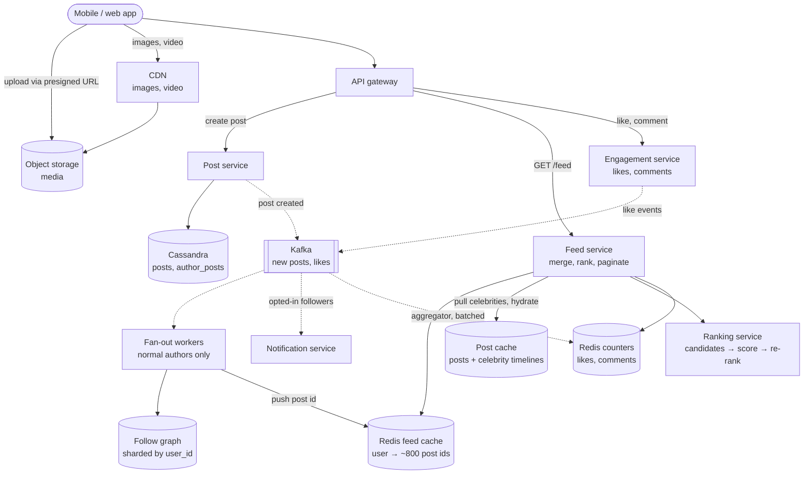
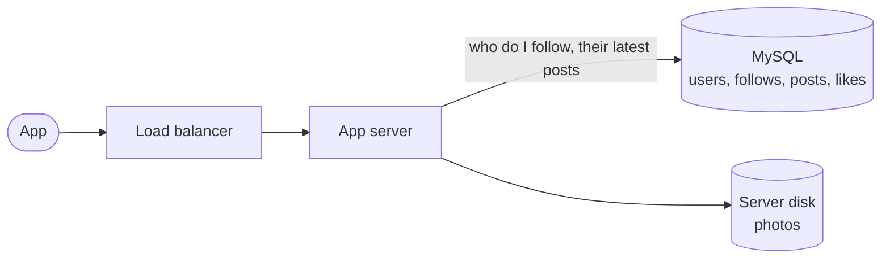
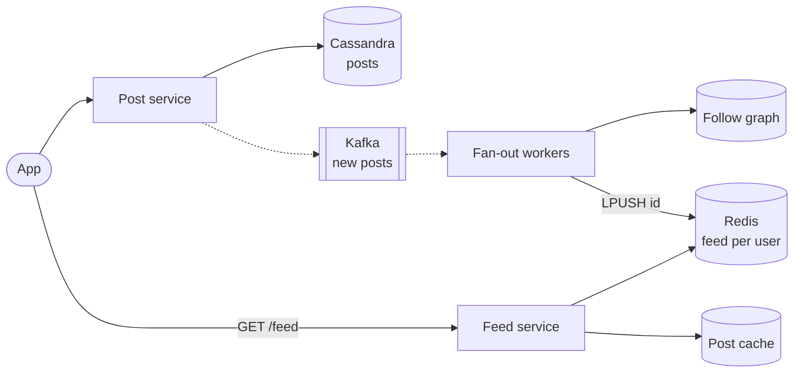
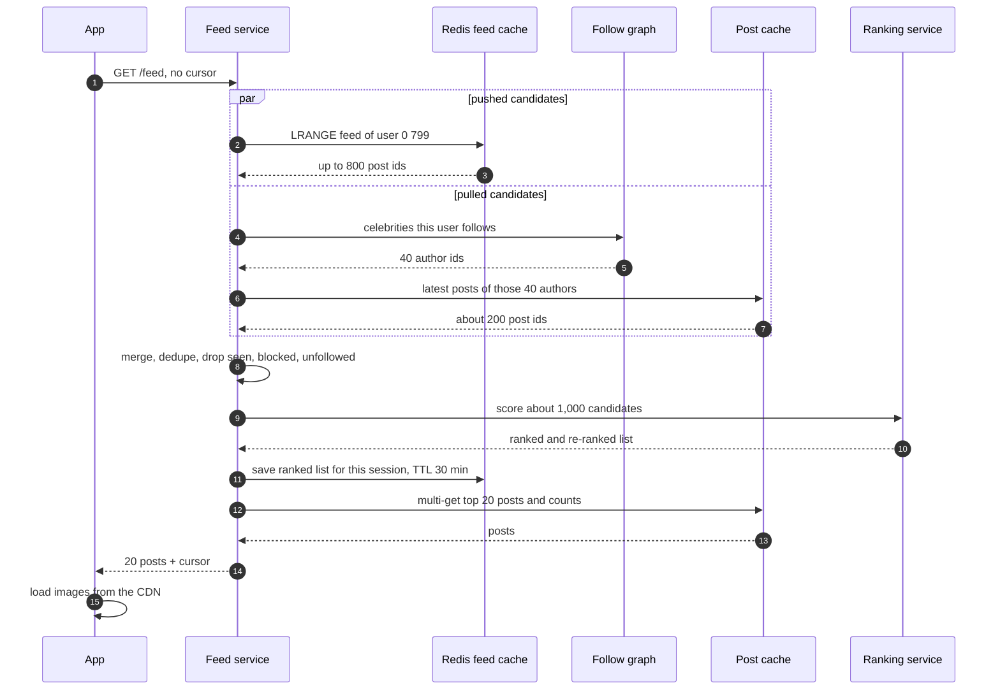

> **In one line:** write each post once, push its id into the cached feeds of a normal author's active followers, pull celebrity posts at read time, then merge, rank and hydrate from caches, with media on a CDN and like counts aggregated off the hot path.

## The design at a glance



Two paths. **Posting**: the post service writes the post once and publishes an event; fan-out workers push the post id into the Redis feed lists of the author's active followers, unless the author is a celebrity. **Reading**: the feed service takes the user's pushed ids, adds recent posts from the celebrities they follow, ranks the merged candidates, and hydrates the top 20 from the post cache. Images and video come from the CDN, and likes reach the counters through Kafka in batches.

## How to spend the 30 minutes

| Minutes | What you do | What to say or draw |
|---|---|---|
| 0-3 | Requirements | Follow model, ranked or chronological, media, likes and comments, notifications |
| 3-6 | Numbers | 500 M daily users, 175 k feed loads/s, 230 k fan-out writes/s, 100 M-follower accounts |
| 6-9 | API and data model | Feed with a cursor; posts by id; follow graph in both directions |
| 9-12 | Design v1 | Fan-out on read: query followees' posts and merge |
| 12-15 | Break v1 | Scatter-gather latency, repeated work, no ranking, hot like rows |
| 15-23 | Design v2 and v3 | Push into Redis, the celebrity problem, hybrid, skip inactive users, ranking |
| 23-29 | Deep dives | Push vs pull, ranking pipeline, counters, pagination |
| 29-30 | Recap | The 60-second summary at the bottom |

## Requirements

**Functional**

- Post text, photos and videos.
- Follow and unfollow accounts (one-way, like Instagram or X).
- Home feed of posts from accounts you follow, ranked, with infinite scroll.
- Like and comment, and see the counts.
- Optional notification when certain accounts post.

**Non-functional**

- First feed page in under 300 ms p99 at the server.
- 99.99% available for reads: a slightly stale feed beats an error page.
- Eventually consistent: a new post may take a few seconds (up to a minute for big accounts) to reach followers; counts may lag seconds.
- An acknowledged post is never lost.
- 500 M daily users; some accounts have 100 M+ followers.

**Out of scope**

- Ads auction, search, direct messages, stories.
- The content-moderation pipeline (we only call it as a filter).

> **Say it like this:** "A feed is a read-heavy problem with a write-amplification twist. Reads are 50x writes, so I'll precompute feeds by pushing post ids to followers when a post is created, and switch to pulling for celebrities whose follower counts make pushing too expensive. Ranking happens at read time over about a thousand candidates."

## Back-of-the-envelope numbers

| Quantity | Estimate | How |
|---|---|---|
| Daily active users | 500 M | Given |
| Feed loads | ~58 k/s average, ~175 k/s peak | 500 M x 10 opens a day = 5 B ÷ 86,400 s, x3 for peaks |
| New posts | ~1.2 k/s average, ~3.5 k/s peak | 100 M posts a day ÷ 86,400 |
| Fan-out writes | ~230 k/s average | 100 M posts x 200 followers = 20 B inserts a day ÷ 86,400 |
| One celebrity post, pushed | 100 M inserts, ~17 minutes | 100 M followers ÷ 100 k inserts/s |
| Feed cache | ~4 TB | 500 M users x 800 ids x ~10 bytes per id in a Redis list |
| Post metadata | ~100 GB/day, ~36 TB/year | 100 M x ~1 KB |
| Media | ~50 TB/day | Half the posts carry ~1 MB of photos or video |
| Likes | ~58 k/s average, ~175 k/s peak | 5 B a day ÷ 86,400, x3 for peaks |

**What the numbers tell us:**

- Feed loads outnumber posts 50 to 1 (175 k vs 3.5 k/s at peak), so do the work once at write time: precompute feeds.
- Pushing turns 1.2 k posts/s into 230 k cache writes/s, which is fine for normal users. A single 100 M-follower post would occupy the pipeline for ~17 minutes, so celebrities must be pulled.
- 4 TB of feed cache is affordable only because feeds hold ids, not posts, and are capped at ~800.
- Media is 500x the bytes of post metadata: it goes straight to object storage and out through the CDN.

## API

```http
POST /v1/media/uploads            → { "media_id": "m_81", "upload_url": "<presigned PUT>" }

POST /v1/posts
Idempotency-Key: 9b2c...
{ "text": "Sunset at Varkala", "media_ids": ["m_81"] }
→ 201 { "post_id": "1849302..." }

GET /v1/feed?limit=20&cursor=<opaque>
→ 200 { "items": [ { "post_id": "...", "author": "...", "text": "...", "media": ["..."],
                     "likes": 1204, "comments": 33, "liked_by_me": false } ],
        "next_cursor": "<opaque>" }

PUT  /v1/posts/{post_id}/like          → 204    (DELETE to unlike)
POST /v1/posts/{post_id}/comments      { "text": "..." } → 201
PUT  /v1/users/{user_id}/follow        → 204    (DELETE to unfollow)
```

- **Opaque cursor, not page numbers:** new posts arriving at the top would shift offsets and cause duplicates (see the deep dive).
- **`PUT` for like and follow:** idempotent, so a double tap or a retry never counts twice.
- **`Idempotency-Key` on create:** a retried post is not published twice.
- **Media goes direct** to object storage with a presigned URL; the post only references `media_ids`.

## Data model

```text
posts            (Cassandra, partition = post_id)
  post_id        64-bit Snowflake-style id: sorts by creation time
  author_id, text, media_keys, created_at, visibility, deleted

author_posts     (Cassandra, partition = author_id, clustering = post_id DESC)
  author_id, post_id               "latest posts by X": profiles and the pull path

followers        (sharded MySQL or KV, partition = followee_id)
  followee_id, follower_id         fan-out reads this, in pages
following        (same store, partition = follower_id)
  follower_id, followee_id         "who do I follow", incl. celebrities to pull

feed:<user_id>   (Redis list)      newest ~800 post ids, LPUSH + LTRIM

likes            (Cassandra, partition = user_id)     user_id, post_id, ts
comments         (Cassandra, partition = post_id, clustering = comment_id)
counters         (Redis, flushed to Cassandra)        likes and comments per post
users            (sharded MySQL)   profile, follower_count, last_active_at, is_celebrity
```

- **`posts` in Cassandra by `post_id`:** hydration is a multi-get by id, and time-sortable ids let the feed sort candidates without loading them.
- **`author_posts`:** one partition per author, newest first, so "latest 10 by this celebrity" is one read.
- **Follow graph as two adjacency tables:** we only ever need one hop, so a graph database adds nothing; both directions are stored because fan-out and the pull path ask opposite questions. A 100 M-follower list is split into buckets so no partition grows huge. (Facebook's TAO is the well-known version: a graph cache over sharded MySQL.)
- **Redis list for feeds:** a list packs each 64-bit id into about 10 bytes; a sorted set with more than 128 entries switches to a skiplist and costs several times more memory.
- **`likes` by user:** "which of these 20 posts have I liked?" is one partition read.

## Design v1: the simplest thing that works



1. `GET /feed` runs `SELECT followee_id FROM follows WHERE follower_id = me`: say 400 accounts.
2. Then `SELECT * FROM posts WHERE author_id IN (...400 ids...) ORDER BY created_at DESC LIMIT 20`.
3. For each post, `COUNT(*)` its likes and check whether I liked it.
4. The next page uses `OFFSET 20`.

This is **fan-out on read**: nothing is precomputed, every load builds the feed from scratch. With one database and a small network it is perfectly fine, and it is the right first drawing.

## Where v1 breaks

| Problem | Why it happens | What the user sees |
|---|---|---|
| Every load is a scatter-gather | Once posts are sharded, 400 followees sit on dozens of shards and the query waits for the slowest | Feed takes seconds; terrible p99 |
| The same work, over and over | Reads are 50x writes and every refresh recomputes from scratch | 175 k heavy queries/s at peak |
| No room for ranking | Fetching enough candidates eats the whole latency budget | Chronological only |
| Like counts on the hot path | `COUNT(*)` per post, or one `UPDATE` per like on one row | Slow feeds; a viral post's row locks up |
| Offset pagination | New posts push everything down a page | Duplicates and skipped posts while scrolling |
| Media on app servers | Big files served by the app tier | Slow images, saturated servers |

## Design v2: fan-out on write



### Fix 1: write once, publish an event

The post service writes `posts` and `author_posts`, publishes `post_created` to Kafka and returns `201`. Posting stays fast no matter how many followers the author has.

### Fix 2: push post ids into followers' feeds

Fan-out workers page through the author's followers 1,000 at a time and, for each, run `LPUSH feed:<follower> <post_id>` then `LTRIM 0 799`, pipelined. Each feed holds only the newest ~800 ids, which bounds memory and is more than anyone scrolls in a session. Reading the feed is now one Redis call instead of a scatter-gather.

### Fix 3: hydrate from a post cache

The feed service turns ids into posts with one multi-get against a Memcached/Redis post cache (backed by Cassandra), plus "liked by me" from one `likes` partition read. Posts are cached once and shared by every feed that contains them.

### Fix 4: media through object storage and a CDN

The app uploads straight to object storage with a presigned URL. A worker makes resized variants (thumbnail, feed size, full size) and transcodes video (see [video streaming](04-video-streaming.md)). The CDN serves them, so app servers never touch media bytes.

### Fix 5: counters off the hot path

A like writes one `likes` row (the truth, and idempotent) and emits an event. An aggregator sums the events for a second and applies one `INCRBY` per post to a Redis counter. Feeds read counts from cache instead of counting rows. Details in the deep dive.

### Fix 6: cursor pagination

The cursor points into a fixed list instead of an offset into a moving one (deep dive), so scrolling never repeats or skips posts.

## Where v2 still breaks

| Problem | Why it happens | What the user sees |
|---|---|---|
| Celebrity posts | 100 M followers means 100 M list writes, ~17 minutes at 100 k/s | Fans see the post late; everyone else's posts queue behind it |
| Pushes to inactive users | Many followers have not opened the app in months | Memory and write capacity spent on nobody |
| Chronological only | The Redis list is ordered by time | Users miss the posts they care about most |
| New follows and unfollows | Feeds were built from pushes made before the change | Nothing from a new follow until they post again; unfollowed posts linger |
| No nudge for important posts | Nothing tells close friends a post exists | They miss it unless they happen to scroll |

## Design v3: hybrid fan-out and ranking

This is the diagram at the top.

### Fix 7: pull celebrities instead of pushing them

Authors above a threshold (around 1 M followers, tunable, kept as `is_celebrity`) skip fan-out. Their latest posts sit in a hot, heavily replicated author-timeline cache. At read time the feed service reads the user's pushed list plus the latest posts of the few dozen celebrities they follow, and merges. A celebrity post costs one write instead of 100 M; each reader pays a few extra cache reads.

### Fix 8: skip inactive users

Fan-out only pushes to followers active in the last ~30 days (`last_active_at`). Inactive users' feed lists expire. When they come back, the feed service rebuilds their list once by pull from `author_posts` (about a second, once) and normal pushes resume.

### Fix 9: rank at read time

The pushed and pulled ids are only candidates. The ranking service scores ~1,000 of them and re-ranks for diversity, so the feed shows what each user is most likely to care about (deep dive). If ranking times out, the feed falls back to chronological order of the same candidates.

### Fix 10: follow and unfollow repair

On follow, a job copies the new account's latest ~20 posts into your feed. On unfollow, the feed service filters candidates against your `following` set, and stale ids age out of the 800-item list on their own.

### Fix 11: new-post notifications, carefully

Only followers who opted in (the bell, close friends) get a push, via the [notification system](15-notification-system.md). Notifications are batched and rate-limited per recipient, and a celebrity's notifications are paced over minutes so millions of phones do not open the app in the same second.

### Components

| Component | Job | Tech choice |
|---|---|---|
| Post service | Validate, store, publish `post_created` | Stateless; Cassandra writes, idempotency key |
| Fan-out workers | Push ids to active followers of normal authors | Kafka consumers, pipelined Redis writes |
| Follow graph | Followers and following lists | Sharded MySQL or KV with a cache in front |
| Feed cache | Newest ~800 ids per active user | Redis lists, ~4 TB plus replicas |
| Feed service | Merge push and pull, filter, paginate | Stateless, parallel fetches |
| Ranking service | Score candidates, re-rank | Two-stage ML models plus a feature store |
| Post cache | Posts and celebrity timelines | Memcached / Redis, replicated for hot keys |
| Engagement + counters | Likes, comments, counts | Cassandra rows, Kafka aggregator, Redis counters |
| Media | Upload, resize, serve | Object storage, resize workers, CDN |
| Notification service | Opted-in new-post pushes | Queue per channel, per-user rate limits |

## Key flow: load the home feed



- **Ranking slow or down:** time out after ~100 ms and serve the same candidates in time order.
- **Feed list missing** (new or returning user): rebuild by pull from followees' `author_posts`, write it to Redis, continue.
- **A post was deleted after its id was pushed:** hydration sees `deleted` and drops it. Nobody rewrites millions of lists.
- **Post cache miss:** read Cassandra and backfill the cache.
- **A celebrity timeline is very hot:** it is replicated across cache nodes and held in each feed server's memory for a few seconds.

Posting is short: upload media with a presigned URL, `POST /posts` with an idempotency key, write `posts` and `author_posts`, publish to Kafka, return `201`. Workers then push to active followers (unless the author is a celebrity) and queue opted-in notifications.

## Deep dives

### Push, pull or hybrid?

**The problem.** Someone has to do the merging: either the writer, once per follower, or the reader, on every load. Follower counts range from 10 to 100 M.

**Options.**

| Option | Good | Bad |
|---|---|---|
| Fan-out on read (pull) | Writes are cheap; no wasted work for inactive users | Every load is a slow scatter-gather; reads are 50x writes |
| Fan-out on write (push) | Reads are one cache call | Celebrity posts mean 100 M writes; work wasted on inactive users |
| **Hybrid** | Push for the 99.9% of authors with modest followings, pull for the few huge ones | Two read paths and a threshold to tune |

**Pick.** Hybrid. Push for normal authors to active followers, pull for celebrities, and merge at read time. Use hysteresis on the threshold (become a celebrity at 1 M, revert below 800 k) so accounts near the line do not flip back and forth. The same push-vs-pull choice shows up in [group chat](08-chat-app.md).

### The ranking pipeline

**The problem.** From ~1,000 candidates, pick the best 20 in about 100 ms, using signals that change by the minute (a post going viral, who you just messaged).

**Options.**

| Option | Good | Bad |
|---|---|---|
| Chronological | Simple, predictable, no ML | Busy users miss what matters to them |
| Hand-tuned score: affinity x post-type weight x time decay | Cheap and explainable | Stops improving; hard to tune by hand |
| **Multi-stage ML** | Best engagement; each stage spends compute only where it pays | Feature store, training pipeline, model serving |

**Pick.** Multi-stage:

1. **Candidate generation:** pushed ids, pulled celebrity posts, and a few out-of-network recommendations.
2. **Light ranker:** a cheap model trims ~1,000 to ~300.
3. **Heavy ranker:** a bigger model predicts the chance of like, comment, share and hide, and combines them into one score, using features from a feature store updated by streaming jobs.
4. **Re-ranking rules:** no more than two posts in a row from one author, mix photos and videos, drop already-seen posts, apply integrity filters, insert ads.

Keep a chronological "Following" tab as well: it is cheap (the Redis list is already in time order) and users ask for it.

### Like and comment counters at scale

**The problem.** 175 k likes a second at peak, very unevenly spread: a viral post can collect 100 k likes a minute, and its count is shown in millions of feeds.

**Options.**

| Option | Good | Bad |
|---|---|---|
| `UPDATE posts SET likes = likes + 1` | Simple, exact | One hot row; a viral post's row locks up |
| `COUNT(*)` over like rows when reading | Always exact | Far too slow for every feed render |
| Sharded counter: N sub-counters per post, summed on read | Spreads write contention across rows or nodes | Still one write per like; every read touches N keys |
| **Async aggregation** | Write load stops depending on popularity | Counts lag by a few seconds |

**Pick.** Async aggregation. The `likes` row is the truth, and `PUT` makes it idempotent. Like events go to Kafka partitioned by user, so a viral post does not overload one partition; each aggregator sums what it saw over one second and applies one `INCRBY` per post, so even a viral post gets at most one increment per aggregator per second. Redis holds the live count, flushed to Cassandra every minute. Reads come from the post cache with a few seconds of TTL, and the app shows rounded numbers ("12.4K") and bumps the count locally when you tap. A nightly job recounts from `likes` to fix drift. Sharded counters are the fallback if you cannot run a stream.

### Pagination in a ranked feed

**The problem.** Ranked feeds are not in time order, and new posts keep arriving. Page 2 must not repeat or skip anything from page 1.

**Options.**

| Option | Good | Bad |
|---|---|---|
| `OFFSET 20` | Trivial | New posts shift everything: duplicates and gaps |
| Cursor = last seen `post_id` | Stable for time-ordered lists | Meaningless once the list is ranked |
| **Ranked session snapshot** | Stable pages in a ranked feed | Goes stale; costs memory per session |

**Pick.** On the first load the feed service stores the top few hundred ranked ids for 30 minutes and returns `cursor = session id + position`. Later pages read the next 20 ids from that frozen list and hydrate them; a user who scrolls past the end gets a fresh ranking that excludes what they have seen. New posts appear as a "New posts" pill at the top, and tapping it starts a new session. Chronological views (profiles, the Following tab) use a plain "older than this `post_id`" cursor.

## Trade-offs to say out loud

- We chose **hybrid fan-out over pure push** because celebrities make pushing explode. The cost is two read paths and a threshold to tune.
- We store **only ids in feeds**, not posts. The cost is a hydration multi-get on every load, which the post cache absorbs.
- We **rank at read time** over precomputed candidates, so fresh engagement counts. The cost is ~100 ms of model work per load and a feature store to run.
- We accept **eventual consistency**: posts reach feeds seconds later, counts lag. The cost is the occasional "why is my friend's post not here yet".
- We **skip inactive users** during fan-out. The cost is a slower first load when they return.
- We **freeze the ranked list per session** for pagination. The cost is that a long session goes stale until the user refreshes.

## Follow-up questions

**Q: A normal user suddenly goes viral and gains 2 M followers. What happens?**
They cross the threshold and get `is_celebrity`; their next posts use the pull path. Ids already pushed stay where they are and age out.

**Q: How is a deleted or newly private post removed everywhere?**
Mark it deleted, purge the post cache and the CDN copies of its media. Feeds keep the id, but hydration drops it.

**Q: What about someone who follows 5,000 accounts?**
Their list still caps at 800 ids. Limit the pull path to the celebrities they interact with most, so one read never fetches thousands of timelines.

**Q: How do you go multi-region?**
Posts and the follow graph replicate asynchronously across regions. Each region runs its own fan-out into feed caches for the users who live there, so reads stay local.

**Q: How do you know ranking is good?**
A/B tests on time spent, meaningful interactions, hides and reports. Logged impressions and their outcomes become the next training set.

**Q: How do you avoid showing the same post twice across sessions?**
Keep a compact per-user set of recently seen post ids (a Bloom filter works) and filter candidates against it.

**Q: What breaks first at 10x?**
Fan-out write volume and feed-cache memory. Lower the celebrity threshold so more authors are pulled, keep shorter feeds for light users, and add Redis shards.

## 60-second recap

- 500 M daily users; feed loads are 50x posts, so precompute feeds; media is 500x the bytes of metadata, so CDN.
- Posts are written once to Cassandra; Kafka-driven workers push post ids into Redis lists of active followers, capped at ~800.
- Celebrities (around 1 M+ followers) are pulled at read time from a hot timeline cache and merged in.
- Inactive users are skipped and rebuilt on return; follows backfill, unfollows filter at read time.
- Reading: candidates → light ranker → heavy ranker → re-rank, then hydrate 20 posts from the post cache.
- Likes are idempotent rows; counts are aggregated through Kafka into Redis; pages come from a frozen ranked list.
- Opted-in new-post notifications go through the notification system, rate-limited and paced.
