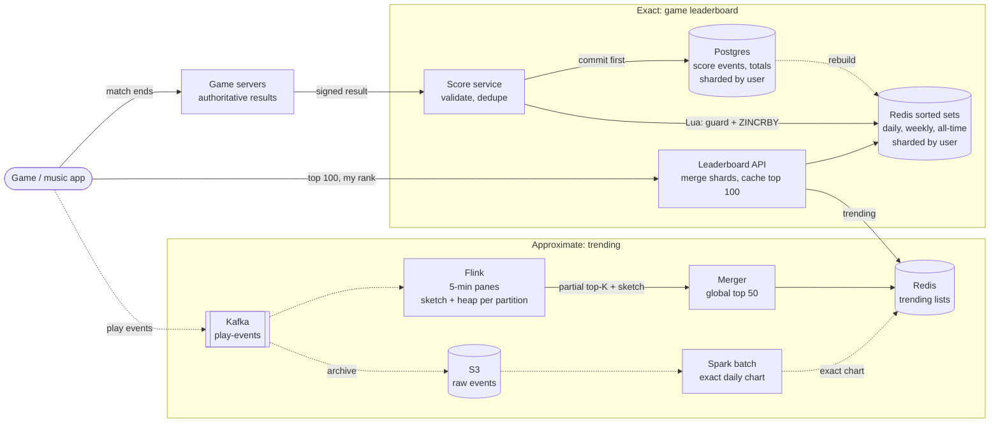
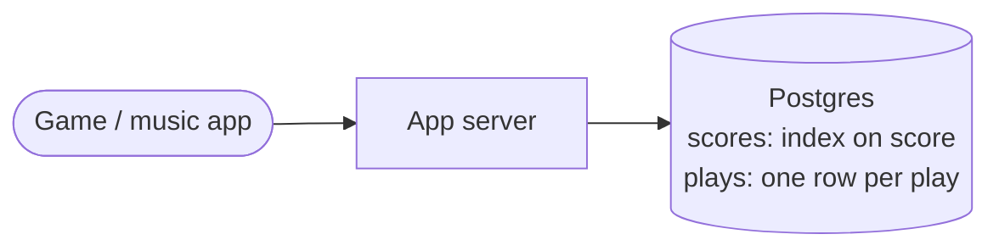
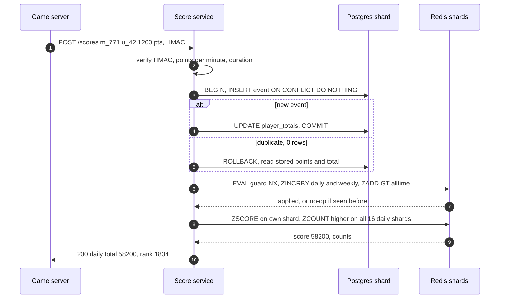

> **In one line:** exact game ranks live in Redis sorted sets (one per board and period) fed by validated, deduplicated score events and rebuildable from Postgres; trending top-K is counted approximately in Flink with a count-min sketch and min-heap per partition, merged globally, and corrected by an exact batch job.

## The design at a glance



Two paths share one API. **Game boards** are exact: a game server sends a signed result, the score service commits it to Postgres (the dedupe point), then updates the player's Redis sorted sets; top K and "my rank" are O(log N) reads. **Trending** is approximate: plays stream through Kafka into Flink, each partition keeps a sketch and a heap per 5-minute pane, a merger builds the global top 50, and a nightly Spark job computes the exact chart.

## How to spend the 30 minutes

| Minutes | What you do | What to say or draw |
|---|---|---|
| 0-3 | Requirements | Exact rank for everyone or only the top? Which periods? Trending window? |
| 3-6 | Numbers | 100 M players, ~12 k score events/s peak, ~350 k plays/s peak |
| 6-9 | API and data model | Signed score submission, top-K, my rank; sorted set per board |
| 9-12 | Design v1 | SQL `ORDER BY score` and `COUNT(*)` for rank, `GROUP BY` for trending |
| 12-15 | Break v1 | Rank is O(N), cheating, retries double count, trending scans an hour |
| 15-22 | Design v2 and v3 | Redis sorted sets, validation, period keys; then sharding, Flink + sketches, batch path |
| 22-28 | Deep dives | Sharding a board, ties, anti-cheat, count-min sketch, exact vs approximate |
| 28-30 | Recap | The 60-second summary at the bottom |

## Requirements

**Functional**

- Scores update after every match, on daily, weekly and all-time boards per game.
- Show the top 100, "my rank" with 5 players above and below, and a friends board.
- Trending: top 50 songs or videos in the last hour and last 24 hours, global and per country.
- An official daily chart with exact counts.

**Non-functional**

- A new score shows on the board within 2 seconds.
- Top-100 and my-rank reads under 50 ms p99.
- Game ranks are exact. Trending may be approximate (the right top 50, roughly ordered), refreshed every 5 minutes.
- A retried submission never counts twice; scores come only from trusted game servers.
- 99.9% available. If leaderboards are down, games still play and scores are applied later.

**Out of scope**

- Matchmaking and skill ratings (Elo), prize payouts, recommendations.

> **Say it like this:** "There are two problems hiding in this question. A game leaderboard needs an exact rank for each of 100 million players, which is a sorted-set problem. Trending needs the top 50 of 100 million items at 350,000 events a second, which is a streaming heavy-hitters problem where approximate is fine. I'll design the game board first, then trending."

## Back-of-the-envelope numbers

| Quantity | Estimate | How |
|---|---|---|
| Score events | ~2,300 / s average, ~12,000 / s peak | 20 M DAU x 10 matches = 200 M a day ÷ 86,400 s, x5 during events |
| Redis ops at peak | ~48,000 / s | 12,000 x (3 board writes + 1 rank read) |
| Board memory | ~17 GB | (100 M all-time + 50 M weekly + 20 M daily entries) x ~100 bytes |
| Play events | ~115,000 / s average, ~350,000 / s peak | 200 M DAU x 50 plays = 10 B a day ÷ 86,400 s, x3 |
| Events in a 1-hour window at peak | ~1.26 B | 350,000 x 3,600 |
| Count-min sketch | ~7.6 MB | 7 rows x 271,829 counters x 4 bytes (ε = 0.00001, δ = 0.001) |
| Raw play history | ~1 TB / day | 10 B events x ~100 bytes |

**What the numbers tell us:**

- 48 k ops/s and ~17 GB fit one Redis primary today; a 10x tournament does not. Plan to shard a board.
- Rank must be O(log N). Counting 100 M rows per request is out.
- 350 k plays a second cannot hit one key. Trending needs a stream tier that pre-aggregates.
- A 7.6 MB sketch replaces up to 100 M exact counters (~1.6 GB) per pane, a 200x cut, overcounting by at most 1.26 B x 0.00001 = 12,600 plays per window.

## API

```http
POST /v1/scores                          (game servers only, mTLS)
{ "match_id": "m_771", "game_id": "racer", "user_id": "u_42", "points": 1200, "duration_s": 312, "sig": "hmac-sha256..." }
→ 200 { "daily_total": 58200, "daily_rank": 1834 }

GET /v1/leaderboards/racer/daily?limit=100
→ 200 { "period": "2026-10-15", "entries": [ { "rank": 1, "user_id": "u_9", "score": 99100 } ] }

GET /v1/leaderboards/racer/weekly/me?around=5
→ 200 { "rank": 1834, "score": 58200, "above": [...], "below": [...] }

GET /v1/leaderboards/racer/alltime/friends

GET /v1/trending/songs?region=IN&window=1h&k=50
→ 200 { "as_of": "2026-10-15T18:05:00Z", "items": [ { "rank": 1, "song_id": "s_311" } ] }
```

- Scores come only from game servers, signed, never from the client. The game server saw the match; the phone can be modified.
- `match_id` + `user_id` is the idempotency key: a retry returns the same answer and adds nothing.
- `around=5` is `ZREVRANK` followed by `ZREVRANGE rank-5 rank+5`.
- Trending returns `as_of` and no counts, because the list is recomputed every 5 minutes and the counts are estimates.

## Data model

```text
score_events     (Postgres, sharded by user_id)
  user_id, match_id    PK: one row per player per match, the dedupe key
  game_id, points, duration_s, ts, status (ok | quarantined)

player_totals    (Postgres, same shard)
  user_id, game_id     PK
  alltime_total, best_score, updated_at

Redis sorted sets (member = user_id, score = points)
  lb:racer:daily:2026-10-15      expires 8 days after the day
  lb:racer:weekly:2026-W42       expires 5 weeks after the week
  lb:racer:alltime
  seen:m_771:u_42                retry guard, TTL 2 days

play_events      (Kafka, keyed by user_id, 7-day retention, archived to S3 as hourly Parquet)
  item_id, user_id, region, ts, ms_played

trending         (Redis) trending:IN:1h → 50 item IDs, rewritten every 5 min
```

- **Postgres for scores.** Inserting the event and bumping the total in one transaction gives exact dedupe. 12 k inserts a second at peak fits a few shards keyed by `user_id`.
- **Redis sorted sets for boards.** Rank and top-K in O(log N) from memory. Derived data: rebuildable from Postgres.
- **Kafka for plays.** Absorbs 350 k/s, replayable, and feeds both the stream and the batch path.
- **S3 for history.** Cheap storage for the exact batch job.

## Design v1: the simplest thing that works



1. After a match the client posts its score: `UPDATE scores SET score = score + 1200 WHERE user_id = 'u_42'`.
2. Top 100: `SELECT user_id, score FROM scores ORDER BY score DESC LIMIT 100`. The index on `score` makes this fast.
3. My rank: `SELECT COUNT(*) + 1 FROM scores WHERE score > 58200`.
4. Trending: insert a row per play, then `SELECT song_id, COUNT(*) FROM plays WHERE ts > now() - interval '1 hour' GROUP BY song_id ORDER BY 2 DESC LIMIT 50`.
5. Daily board: a `day` column, and a nightly job that archives yesterday.

For a game with 50,000 players this is completely fine.

## Where v1 breaks

| Problem | Why it happens | What the user sees |
|---|---|---|
| "My rank" is O(rank) | A B-tree cannot count. `COUNT(*) WHERE score > x` walks every higher entry: a mid-table player scans 50 M | Rank takes seconds; the DB melts after every match |
| Index churn on every score | Each update moves the row inside the score index, 12 k times a second on one primary | Write latency spikes in tournaments |
| Client-reported scores | The phone sends the number | A cheater at #1 within an hour |
| Retries double count | `score = score + 1200` runs again on a retried request | Inflated scores, angry honest players |
| Trending scans an hour of plays | `GROUP BY` over 1.26 B rows per refresh, plus 350 k inserts a second | Trending page times out; inserts back up |

## Design v2: sorted sets and trusted, idempotent score events

### Fix 1: Redis sorted sets for the boards

A sorted set is a skip list plus a hash map, so every operation a leaderboard needs is logarithmic or better. log2(100 M) is about 27 steps: microseconds.

| Need | Command | Cost |
|---|---|---|
| Add points | `ZINCRBY lb:racer:daily:2026-10-15 1200 u_42` | O(log N) |
| Set a best score | `ZADD lb:racer:alltime GT 99100 u_9` (only if higher, Redis 6.2+) | O(log N) |
| Top 100 | `ZREVRANGE key 0 99 WITHSCORES` (or `ZRANGE ... REV`) | O(log N + 100) |
| My rank | `ZREVRANK key u_42` (0-based) | O(log N) |
| My score | `ZSCORE key u_42` | O(1) |

This fixes the rank row and the index-churn row: no table scans, and Redis does ~100 k such operations a second per core.

### Fix 2: scores only from game servers, validated

The game server is authoritative: it ran the match, so it signs the result (HMAC with a key the client never sees) and calls the score service over mTLS. The service checks the signature, then plausibility: points per minute below the game's maximum, a match duration that makes sense, at most a few matches an hour. Anything odd is stored as `quarantined` and kept off the boards until reviewed.

### Fix 3: idempotent writes

The score service inserts `(user_id, match_id)` with `ON CONFLICT DO NOTHING` and updates `player_totals` in the same transaction. Zero rows inserted means a retry, so the totals are left alone. Either way it then runs one Lua script on Redis: `SET seen:m_771:u_42 1 NX EX 172800`, and only if that succeeds, `ZINCRBY` daily and weekly and `ZADD GT` the all-time total. A retry after Redis already applied the event is a no-op; a retry after Redis missed it finishes the job.

### Fix 4: one key per period, no reset job

Each event updates three keys: `daily:2026-10-15`, `weekly:2026-W42` and `alltime`. At midnight the next event simply writes to a new, empty daily key. Old keys get an `EXPIRE`, so nothing ever needs deleting by hand. Pick the period boundary once (UTC, or per region for regional boards).

### Fix 5: Postgres is the record, Redis is rebuildable

Redis runs with a replica and AOF (`appendfsync everysec`), so a failover loses only the last moments of writes, and a sweeper replays the last few minutes of `score_events` afterwards (the guard keys make that safe). A full rebuild sums each user's events for the day or week (or reads `player_totals` for all-time) and pipelines `ZADD`s: 100 M members load in a few minutes.

### Fix 6: trending with per-pane sorted sets

For trending, `ZINCRBY plays:2026-10-15T18:05 1 s_311` on a sorted set per 5-minute pane, and every 5 minutes `ZUNIONSTORE` the last 12 panes into the 1-hour board and read the top 50. No table scan, and old panes simply expire.

## Where v2 still breaks

| Problem | Why it happens | What the user sees |
|---|---|---|
| One board, one node | A sorted set is one key, and Redis Cluster never splits a key across nodes. A 10x tournament means ~480 k ops/s on one primary | Board updates lag, reads time out at the moment everyone looks |
| 350 k `ZINCRBY` a second on one pane key | One key lives on one single-threaded node | Dropped or delayed play events |
| `ZUNIONSTORE` of 12 panes with millions of members | O(N) + O(M log M) on Redis's only thread | Redis blocks for seconds; every board stalls |
| Exact chart needed | Plays lost on failover, bot plays counted, no audit trail | Official chart and royalty numbers disputed |
| Everyone opens the top 100 at once | A tournament ends | One replica pegged |

## Design v3: shard the boards, stream the trending counts

This is the diagram at the top.

### Fix 7: shard each board by user, scatter-gather the top K

Split each board into 16 sorted sets, `lb:racer:daily:2026-10-15:s0` to `:s15`, with shard = hash(user_id) mod 16. Writes touch one shard, so write capacity grows 16x. Top 100: ask every shard for its top 100 in parallel and merge 1,600 entries. That is exact, because each of the global top 100 must be in its own shard's top 100. My rank: send `ZCOUNT key (my_score +inf` (count of strictly higher scores) to all 16 shards and add 1 to the sum. Keep a player's guard key on the same node as their shard so the Lua script stays atomic.

### Fix 8: cache the merged top 100

The Leaderboard API caches the merged top 100 per board for 2 seconds. A million refreshes at tournament end become one scatter-gather every 2 seconds. "My rank" is never cached: it is cheap and personal.

### Fix 9: Kafka + Flink pre-aggregation for trending

Apps send plays to an ingest endpoint that writes to Kafka (64 partitions, keyed by `user_id`, so no song is a hot key). Flink assigns events to 5-minute tumbling panes by event time, allowing 1 minute for late events. Each task keeps, per pane and region, a count-min sketch (sized to the region's traffic) and a min-heap of its top 200 items. At the end of a pane, every task emits its sketch and its top 200.

### Fix 10: merge partial top-Ks

A single merger keeps the last 12 five-minute panes for the 1-hour board (hourly panes for 24 hours). It adds the tasks' sketches cell by cell (sketches with the same size and hash functions merge exactly), takes the union of all candidate items, estimates each from the merged sketch, and writes the top 50 to `trending:{region}:{window}` in Redis. The read path is one `GET`, cacheable at the CDN for a minute.

### Fix 11: an exact batch path for the official chart

Kafka is archived to S3 as hourly Parquet files. A nightly Spark job applies the business rules (a play counts after 30 s, at most a few per user per song per day, known bots removed), computes exact counts with a plain `GROUP BY`, and publishes the official chart. It replaces the streaming estimate for any closed day.

### Components

| Component | Job | Tech choice |
|---|---|---|
| Score service | Validate, dedupe, update boards | Stateless, Postgres + Redis Lua |
| Postgres | Score events and totals, source of truth | Sharded by `user_id` |
| Redis boards | Daily, weekly, all-time sorted sets | 16 shards per hot board, replica + AOF each |
| Leaderboard API | Top K, my rank, friends | Scatter-gather, 2 s cache on top 100 |
| Kafka | Play event log | 64 partitions, 7-day retention |
| Flink | Sketch + heap per partition per pane; a merger task builds the global top 50 | Event time, 1 min allowed lateness |
| S3 + Spark | Exact daily chart | Hourly Parquet, nightly job |

## Key flow: submit a match result



- **Redis fails after the commit:** the event is safe in Postgres. The game server's retry, or the sweeper, re-runs the script; the guard key prevents double counting.
- **Postgres fails:** return `503`; the game server retries with the same `match_id` until it succeeds, holding results in a local queue meanwhile.
- **Suspicious result:** stored as `quarantined`, no Redis update, flagged for review. The player sees "score under review".
- **Redis shard failover:** the replica is promoted, and the sweeper replays the last few minutes from Postgres to cover writes the replica never got.

## Deep dives

### Scaling one board past one Redis node

**The problem.** A sorted set is one key, and one key lives on one node.

| Option | Good | Bad |
|---|---|---|
| **Shard by user (hash)** | Even load; a write touches one shard; exact top K by merging N lists | Top K and my rank are scatter-gather over N shards |
| Shard by score range (0-1k, 1k-10k, ...) | Top K reads one shard; rank = sizes of higher shards + rank inside | A score change can move a user across shards; scores drift, so ranges need rebalancing; the top shard is hot |
| Exact top 100,000, percentile for the rest (from a score histogram) | Tiny and fast for everyone | "Top 12%" instead of "rank 4,812,331" |

**Pick.** Shard by user with 16 shards and a cached top 100. Add the percentile tail if scatter-gather rank ever gets too costly; nobody needs to know they are 4,812,331st.

### Ties

**The problem.** Two players on 58,200 points. Redis orders equal scores by member name, which is arbitrary for users.

| Option | Good | Bad |
|---|---|---|
| Leave Redis's order | Free | Rank depends on the user ID string |
| Shared rank ("1, 2, 2, 4") via `ZCOUNT key (score +inf` + 1 | Fair, easy to explain | Display needs one extra call |
| **Composite score: earlier achiever wins** | One sorted set gives a strict order | Must encode carefully |

**Pick.** Composite score = points x 10^8 + (10^8 - 1 - seconds since season start). Redis scores are doubles, exact for integers up to 2^53 ≈ 9 x 10^15, so points up to 10^7 fit. Equal points then rank by who got there first. Because the time part must change on every update, compute the new composite in the Lua script instead of a plain `ZINCRBY`.

### Anti-cheat

**The problem.** Every top spot is worth faking.

| Option | Good | Bad |
|---|---|---|
| Trust the client | Nothing to build | The board fills with impossible scores |
| **Server-authoritative results, signed** | The client never reports a score | Needs game servers (fine for online games) |
| Plausibility rules (max points per minute, duration, rate) | Cheap, catches crude cheats | Clever cheats stay under the limits |
| Replay checks and offline anomaly detection | Catch clever cheats and account rings | Costly and slow; only for top entries, needs a review queue |

**Pick.** Signed server results plus plausibility rules on every event, replay checks for anyone entering the top 100, and offline detection. Removing a cheater is `ZREM` from every board and shard plus `status = banned` in Postgres; rebuilding is never needed.

### Count-min sketch and merging partial top-Ks

**The problem.** Find the 50 most-played items out of 100 M at 350 k events a second without a counter per item.

- **Count-min sketch:** d rows of w counters, one hash function per row. Each event adds 1 to one counter per row; the estimate is the minimum of the item's d counters. It never undercounts, and overcounts by at most εN with probability 1 - δ, where w = e/ε and d = ln(1/δ). Our ε = 0.00001 and δ = 0.001 give 7 x 271,829 counters, 7.6 MB.
- **Min-heap of the top 200:** after each update, if the item's estimate beats the heap minimum, it replaces it.
- **Merging:** summing the partitions' top-200 lists would undercount an item that missed one partition's list. Instead, add the sketches cell by cell and re-estimate every candidate from the merged sketch. Events are spread randomly, so every partition sees roughly the same ranking, and a global top-50 item is in almost every local top 200.

| Option | Good | Bad |
|---|---|---|
| Exact keyed counts (Flink `keyBy(item)`) | Exact | Shuffles every event by item; hot songs overload one task; state for every distinct item |
| **Count-min sketch + heap per partition** | Fixed memory, mergeable, no hot keys | Overcounts; only the top is trustworthy |
| Space-Saving (k counters, evict the smallest) | Tiny, built for heavy hitters | No estimate for items it is not tracking, so other partitions' candidates cannot be re-checked |

**Pick.** Sketch + heap, re-estimating candidates on the merged sketch. For "trending" rather than "most played", rank by growth: this hour's estimate ÷ the item's usual hourly count (from the batch path), so evergreen hits do not sit at the top forever.

### Exact vs approximate

**The problem.** "Is approximate acceptable?" depends on who uses the number.

| Use | Need | Path |
|---|---|---|
| Game ranks, prizes | Exact for every player | Sorted sets fed from Postgres |
| "Trending now" | Right top 50 within minutes | Stream: sketch + heap |
| Official chart, royalties | Exact, auditable, with fraud rules | Batch: Spark over S3 |

**Pick.** Both paths for trending (the lambda pattern): the fast, approximate stream for now, the slow, exact batch for closed periods. Share one library for the counting rules so the two agree.

## Trade-offs to say out loud

- We chose **Redis sorted sets over SQL** for boards because rank is O(log N) instead of O(rank). The cost is a second copy of the data that must be rebuildable from Postgres.
- We chose **commit to Postgres first, then Redis** so a crash never loses an event. The cost is a sweeper and guard keys to repair the gap.
- We chose **shard by user over shard by score** so load stays even and users never move between shards. The cost is scatter-gather for top K and rank.
- We chose **sketches over exact counts** for trending, cutting memory 200x and removing hot keys. The cost is a bounded overcount and no reliable rank below the top.
- We kept **an exact batch path** because charts and royalties must be auditable. The cost is running and reconciling two pipelines.

## Follow-up questions

**Q: How do you show "you and the 5 players around you"?**
`ZREVRANK` for my position, then `ZREVRANGE key rank-5 rank+5`. With shards, take the 5 scores above and below mine from each shard (`ZRANGEBYSCORE` with `LIMIT`) and merge.

**Q: How does the friends leaderboard work?**
Fetch friend IDs from the social graph, `ZMSCORE` them on each shard they live in, sort in the app. A few hundred friends cost one call per shard.

**Q: A season ends. How do you freeze the final standings?**
Stop writes to the season key (new events go to the next season), then copy the top 10,000 into Postgres as the official result. The Redis key can expire later.

**Q: What if Redis loses a whole board?**
Rebuild from Postgres (sum events per user for the period, pipeline `ZADD`s). The board is unavailable for minutes; games keep running.

**Q: How do you stop bot plays from inflating trending?**
Count a play only after 30 seconds, cap plays per user per item per hour inside the stream job, and let the batch path apply the full fraud rules.

**Q: What breaks first at 10x?**
The hottest board's shards and the merger. Add shards and split the merger by region.

## 60-second recap

- Two problems: exact ranks for 100 M players, and approximate top 50 of 100 M items at 350 k events a second.
- Game boards: a Redis sorted set per game and period; `ZINCRBY` to update, `ZREVRANGE` for top K, `ZREVRANK` or `ZCOUNT` for rank, all O(log N).
- Scores come only from signed game-server results, deduplicated in Postgres before Redis; Redis is always rebuildable.
- Past one node, shard each board by user and scatter-gather the top K; cache the merged top 100 for 2 seconds.
- Ties: composite score so the earlier achiever wins, or a shared rank via `ZCOUNT`.
- Trending: Kafka into Flink, a count-min sketch and min-heap per partition per 5-minute pane, merged sketches re-estimate the union of candidates.
- A nightly Spark job over raw events publishes the exact, auditable chart.
