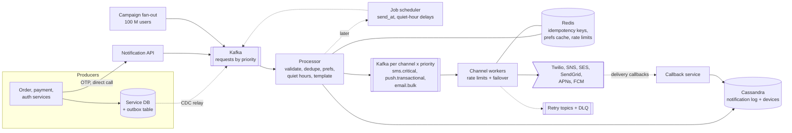
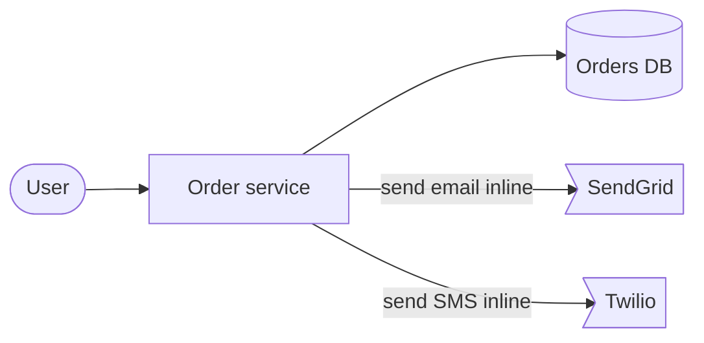
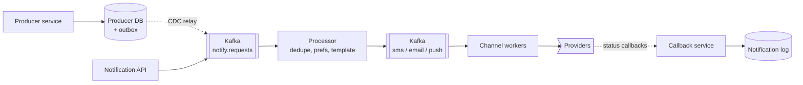
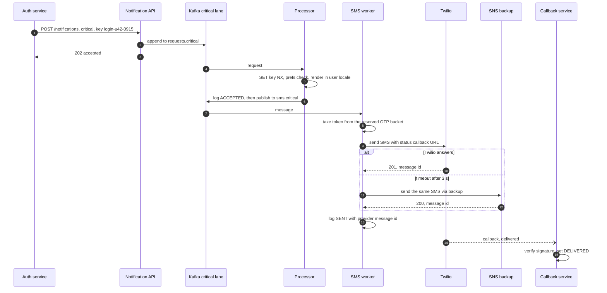

> **In one line:** producers hand over notifications through a transactional outbox, one processor applies dedupe, preferences, quiet hours and templates, and Kafka topics split by channel and priority feed rate-limited channel workers that fail over between providers, so an OTP never waits behind a marketing blast and nothing committed is ever lost.

## The design at a glance



Business events reach Kafka through an outbox in the producer's own database, so a committed order always produces its notification; OTPs call the API directly because a user is waiting. The processor drops duplicates, applies preferences and quiet hours, renders the template, and publishes to a topic per channel and priority. Channel workers send within each provider's rate limit, and provider callbacks update every notification's status.

## How to spend the 30 minutes

| Minutes | What you do | What to say or draw |
|---|---|---|
| 0-3 | Requirements | Which channels? OTP latency? Marketing broadcasts? Preferences and quiet hours? |
| 3-6 | Numbers | 1 B a day, 12 k/s average, 55 k/s during a broadcast, OTPs ~1 k/s |
| 6-9 | API and data model | `POST /notifications` with idempotency key, notification log, devices |
| 9-14 | Design v1 and its flaws | Order service calls SendGrid and Twilio inline: lost or phantom messages, slow providers, duplicates |
| 14-21 | Design v2 | Outbox, processor pipeline, Kafka per channel, retries, callbacks |
| 21-25 | Design v3 | Priority lanes, provider failover, broadcast fan-out, scheduling, tokens |
| 25-29 | Deep dives | Outbox, OTP isolation, dedupe, failover, fan-out |
| 29-30 | Recap | The 60-second summary at the bottom |

## Requirements

**Functional**

- Services send a notification to a user by template, on one or more channels: SMS, email, push.
- OTPs and security alerts go out immediately.
- Respect user preferences per category and channel, quiet hours, and frequency caps.
- Schedule a notification for later, or for 10:00 in each user's local time.
- Broadcast a campaign to a segment of up to 100 M users.
- Track status per notification: sent, delivered, bounced, failed, opened.

**Non-functional**

- OTPs handed to the provider within 2 s p99, even during a broadcast. Transactional within 30 s. Bulk may take an hour.
- If the producer's database commit succeeds, the notification is never lost. If it rolls back, nothing is sent.
- No duplicates in normal operation; retries must not double-send.
- 99.99% available ingest. A provider outage must not stop a channel.
- An unsubscribe takes effect within a minute.

**Out of scope**

- Running our own SMTP servers or SMS carrier links (we use providers).
- The in-app inbox UI and A/B testing of content.

> **Say it like this:** "Volume is moderate, about 12 k a second. The real problems are not losing a message between a producer's commit and our pipeline, not sending twice, keeping OTPs fast during a 100-million-user campaign, and surviving providers that throttle and fail."

## Back-of-the-envelope numbers

| Quantity | Estimate | How |
|---|---|---|
| Users | 200 M registered, 100 M daily active | Assumption |
| Notifications per day | ~1 B | 700 M push + 250 M email + 50 M SMS |
| Average rate | ~12 k/s | 1 B ÷ 86,400 s ≈ 11.6 k |
| Broadcast peak | ~55 k/s for 30 minutes | 100 M users ÷ 1,800 s |
| OTPs | ~230/s average, ~1 k/s peak | 20 M a day ÷ 86,400 s, morning login peaks ~4x |
| Kafka throughput | ~6 MB/s average, ~28 MB/s peak | 11.6 k x 500 bytes, 55 k x 500 bytes |
| Notification log | ~500 GB/day, ~15 TB for 30 days | 1 B x ~500 bytes (template id + params, not the body), before replication |
| Device tokens | ~400 M, ~80 GB | 2 devices per user x ~200 bytes |
| Provider callbacks | ~7 k/s | (250 M email + 50 M SMS) x ~2 events ÷ 86,400 s |

**What the numbers tell us:**

- 12 k/s is easy for Kafka. The hard parts are isolation, external limits and correctness, not raw throughput.
- The broadcast is a self-inflicted 5x spike. It is the traffic that must yield, so it gets its own lanes and a throttle.
- Providers are the bottleneck and SMS costs real money per message, so dedupe and preference checks happen before sending.
- 15 TB of write-heavy, key-looked-up records with a 30-day TTL fits Cassandra.

## API

```http
POST /v1/notifications
Idempotency-Key: order-81723-shipped
{ "user_id": "u_42", "template": "order_shipped", "params": { "order_id": "81723", "eta": "Oct 17" },
  "channels": ["push", "email"], "priority": "transactional", "send_at": null }
→ 202 { "notification_id": "n_9f1c", "status": "ACCEPTED" }

POST /v1/campaigns
{ "segment_id": "seg_inactive_30d", "template": "comeback_offer", "channels": ["push"], "send_at_local": "10:00" }
→ 202 { "campaign_id": "c_77" }

GET /v1/notifications/{id}
→ 200 { "status": "DELIVERED", "channel": "sms", "provider": "twilio", "events": [...] }

PUT  /v1/users/{user_id}/preferences  { "marketing": { "email": false, "push": true }, "quiet_hours": { "start": "22:00", "end": "08:00" } }
POST /v1/devices                       { "user_id": "u_42", "platform": "ios", "token": "...", "app_version": "7.3" }
POST /webhooks/{provider}              signed delivery callbacks from Twilio, SES, SendGrid
```

- `202`, not `200`: sending is asynchronous, and the caller polls or listens for status.
- The idempotency key comes from the business event (`order-81723-shipped`), so producer retries and outbox replays collapse into one notification.
- An OTP is the same call with `"priority": "critical"`. Params marked sensitive, like the code, are never written to the log.
- Webhooks verify the provider's signature, so nobody can fake "delivered".

## Data model

```text
notifications          Cassandra, partition key = notification_id, TTL 30 days
  notification_id, idempotency_key, user_id, campaign_id
  template_id, template_version, params (sensitive ones masked)
  channel, priority, status, provider, provider_msg_id
  created_at, sent_at, delivered_at, attempts

notifications_by_user  Cassandra, partition key = user_id, clustering = created_at DESC
provider_msg_index     Cassandra, (provider, provider_msg_id) → notification_id

devices                Cassandra, partition key = user_id
  token, platform, app_version, locale, last_seen_at
devices_by_token       Cassandra, token → user_id (to move or delete a token)

preferences            Postgres, key = user_id, cached in Redis
  per category and channel opt-in, quiet hours, time zone, frequency caps

templates              Postgres: template_id, version, channel, locale, subject, body
outbox                 in each producer's own database: id, event_type, payload, created_at
```

- **Cassandra for the log and devices**: a billion writes a day, lookups by key, and built-in TTL.
- **`provider_msg_index`**, because callbacks only carry the provider's message id.
- **Postgres for preferences and templates**: small (preferences are ~40 GB), need correct updates, and are read through a Redis cache.
- **The outbox lives in the producer's database**, because that is the only way to commit it atomically with the business change.

## Design v1: the simplest thing that works



1. The order service commits the order.
2. In the same request it renders an email and calls SendGrid, then calls Twilio for the SMS.
3. It returns "order placed" to the user.

For one service and a few thousand orders a day, this works and is easy to debug.

## Where v1 breaks

| Problem | Why it happens | What the user sees |
|---|---|---|
| A slow provider slows checkout | The send is inside the request | Checkout hangs because email is slow |
| Lost or phantom notifications | Crash between commit and send, or send before a rollback | No confirmation for a real order, or "confirmed" for a failed one |
| Duplicates | A retried request sends again | Two OTPs, two "shipped" texts |
| Every team sends its own way | No shared preferences, quiet hours or templates | A marketing push at 3 AM; unsubscribe does not work |
| A provider blip loses the message | No retry, nothing stored | The receipt simply never arrives |
| No delivery status | Fire and forget | Support cannot answer "did my SMS arrive?" |

## Design v2: an outbox, a pipeline, a queue per channel



### Fix 1: one notification service

Every team calls one service that owns templates, preferences, providers and status. The send leaves the request path: producers get `202` in milliseconds, whatever the providers are doing.

### Fix 2: the outbox pattern

In the same transaction as the order, the producer inserts an `outbox` row. A relay publishes it to Kafka: Debezium tails the database log, or a poller reads unpublished rows and marks them. Commit means the notification will go out; rollback means it never existed. The relay is at-least-once, which is why the idempotency key exists.

### Fix 3: one processing pipeline

For each request, in order: validate (template and user exist); dedupe with `SET idem:<key> <notification_id> NX EX 86400` in Redis; check preferences and the suppression list (hard bounces, spam complaints, SMS STOP replies); apply quiet hours and frequency caps; pick the user's devices; render the template in their locale. Write the notification row, publish, then commit the Kafka offset. If the key already exists, drop the request only if that notification was already published; otherwise resume it, so a crash mid-pipeline loses nothing.

### Fix 4: a Kafka topic per channel

Push, email and SMS have different providers, speeds and failure modes, so each gets its own topic and worker pool. A slow email provider no longer delays push. Workers take a token from a per-provider bucket in Redis before each call, staying under the provider's limit (SES has a per-account send rate, SMS has per-number limits).

### Fix 5: retries with backoff and a DLQ

On a timeout, `429` or `5xx`, the worker publishes the message to a retry topic (`sms.retry.30s`, `sms.retry.5m`) and moves on, so one failure never blocks the partition. Backoff grows with jitter; after 5 attempts the message lands in the DLQ. Permanent errors (invalid number, unknown token) are not retried.

### Fix 6: status from provider callbacks

The worker stores the provider's message id and marks the notification `SENT` (and skips any message already `SENT`). Twilio status callbacks, SES events (delivery, bounce, complaint) and SendGrid's event webhook reach the callback service, which finds the notification through `provider_msg_index` and moves its status forward. APNs and FCM do not call back per message, so "delivered" and "opened" for push come from the app itself.

## Where v2 still breaks

| Problem | Why it happens | What the user sees |
|---|---|---|
| OTP stuck behind a broadcast | One topic per channel; 100 M marketing pushes queue ahead | The login code arrives after it expired |
| One provider outage | All SMS goes through Twilio | No SMS at all for an hour |
| A 100 M-user broadcast | Marketing calls the API 100 M times, or one giant loop | Hours of load, `429`s, duplicates when the loop restarts |
| "Send at 10:00 local time" | No scheduling | Marketing runs scripts by hand per time zone |
| Dead device tokens | Uninstalls never cleaned up | Wasted sends and wrong delivery rates |

## Design v3: priority lanes, failover, fan-out and scheduling

This is the diagram at the top.

### Fix 7: topics per channel and priority

Three lanes, from ingest to provider: `critical` (OTP, security alerts), `transactional`, `bulk`. Requests land in `requests.critical` and so on, and channel topics are `sms.critical`, `push.transactional`, `email.bulk`. Each lane has its own consumer group and workers, so no backlog crosses lanes. Critical also gets reserved provider capacity: its own token bucket that bulk can never spend.

### Fix 8: provider failover

Each channel has a router with at least two providers (Twilio and SNS for SMS, SES and SendGrid for email). A circuit breaker per provider opens on rising errors or latency, and traffic moves to the other. OTPs fail over after one timeout of 3 s; bulk just waits. APNs and FCM are the only routes to their devices, so push retries instead.

### Fix 9: campaign fan-out

The campaign service snapshots the segment's user ids to S3 and splits them into chunks of 10 k. Fan-out workers claim a chunk, publish one request per user to `requests.bulk` at a capped rate, and checkpoint the chunk. The idempotency key is `campaign_id + user_id`, so a restarted chunk sends nothing twice.

### Fix 10: scheduled notifications

`send_at`, local-time campaigns, and quiet-hour deferrals become timers in the [job scheduler](09-job-scheduler.md). When a timer fires, the request re-enters `requests.*` and goes through the pipeline again, so a preference change in the meantime is respected.

### Fix 11: device token lifecycle

The app upserts its token on every start and login; a token moves to the new user on login, so shared phones do not leak. Delete a token when APNs answers `410 Unregistered` or FCM answers `UNREGISTERED`, and prune tokens not refreshed in about two months.

### Components

| Component | Job | Tech choice |
|---|---|---|
| Outbox + CDC relay | Commit the notification with the business change | Outbox table + Debezium |
| Notification API | Synchronous entry for OTPs and other services | Stateless, idempotency key required |
| Processor | Validate, dedupe, preferences, quiet hours, render | Stateless consumers, one group per lane |
| Redis | Idempotency keys, preference cache, rate-limit buckets, frequency caps | Cluster, 24 h TTL on keys |
| Kafka | Requests and channel topics per priority, retry topics, DLQ | Partition by user id |
| Channel workers | Call providers within limits, fail over | Async HTTP, circuit breakers |
| Callback service | Verify webhooks, update status | Stateless, signature checks |
| Cassandra | Notification log, user index, devices | TTL 30 days on the log |
| Campaign fan-out | Expand segments into per-user requests | Chunked snapshots in S3 |
| Job scheduler | `send_at`, local time, quiet-hour delays | See the job scheduler design |

## Key flow: sending an OTP during a broadcast



- **Duplicate request:** the auth service retries after a timeout; `SET NX` fails and the processor drops it.
- **Processor crashes after publishing:** Kafka redelivers the request, and the idempotency key stops a second send.
- **Twilio slow, not down:** failing over after 3 s risks two SMS if Twilio delivers late. For an OTP, a late code is worse than two.
- **Callback before the `SENT` write:** statuses only move forward, so a late `SENT` cannot overwrite `DELIVERED`.

## Deep dives

### The outbox: never lose a committed notification

**The problem.** The producer must change its database and tell us, and both must happen or neither.

**Options.**

| Option | Good | Bad |
|---|---|---|
| Commit, then call the API | Simple | A crash between the two loses the message |
| Call the API, then commit | Never lost | Rollback leaves a phantom "order confirmed" |
| Distributed transaction (2PC) | Atomic | Kafka and most services do not take part; slow and fragile |
| **Outbox row + CDC relay** | Atomic with the business change; no extra call in the request | A relay to run; at-least-once, so dedupe downstream |

**Pick.** Outbox with Debezium; a polling relay is fine for small producers. Delete published rows after a day.

### Keeping OTPs fast while 100 M pushes go out

**The problem.** A FIFO lane has no idea an OTP is more urgent than a coupon.

**Options.**

| Option | Good | Bad |
|---|---|---|
| One topic, priority field | Simple | Kafka reads a partition in order, so the OTP waits anyway |
| **Topics per priority, separate workers** | A bulk backlog cannot touch critical; scale each lane alone | More topics and consumer groups |
| Plus reserved provider capacity | Critical never fights bulk for the provider's limit | Reserved capacity can sit idle |
| Separate cluster for critical | Total isolation | Double the operations |

**Pick.** Topics per priority from ingest to provider, plus a reserved token bucket for critical. Alert on lag of the critical lane in seconds, not messages.

### Deduplication

**The problem.** Duplicates come from producer retries, outbox replays, Kafka redelivery, and worker crashes.

**Options.**

| Option | Good | Bad |
|---|---|---|
| No dedupe | Nothing to build | Users get two OTPs; SMS costs double |
| **Idempotency key in Redis (`SET NX`, 24 h)** | Fast, catches nearly every duplicate | Lost on a Redis failover for a moment |
| Unique row in the log (insert if absent) | Durable | A slower conditional write per request |
| Push collapse ids | Hides a duplicate on the screen | Push only |

**Pick.** Redis keys for the pipeline, plus a collapse id on push (`apns-collapse-id` on iOS, a notification `tag` on Android) so a duplicate replaces the first on screen. SMS and email providers generally do not dedupe for you, so admit a tiny window: a worker that dies after the provider accepted but before writing `SENT`.

### Provider failover and rate limits

**The problem.** Providers fail, throttle, and differ in price and quality by country.

**Options.**

| Option | Good | Bad |
|---|---|---|
| One provider per channel | Simple contract and billing | Their outage is your outage |
| Active-passive with circuit breaker | Survives outages | The backup is cold and may throttle when traffic suddenly arrives |
| **Weighted routing by country, cost and health** | Backups stay warm, best route per country | Routing table to maintain; stats per provider |

**Pick.** Weighted routing, say 80/20 per country, shifted automatically by health. Rate limits are Redis token buckets per provider account and sender, shared by all workers (see the [rate limiter](21-rate-limiter.md)). Watch bounce and complaint rates: providers like SES review or pause accounts that keep them high.

### Broadcast fan-out to 100 M users

**The problem.** One campaign means 100 M personalized messages, each with its own preferences and devices, in about 30 minutes.

**Options.**

| Option | Good | Bad |
|---|---|---|
| Marketing tool calls the API per user | No new component | 100 M HTTP calls; no checkpoint; restarts duplicate |
| **Chunked fan-out from a segment snapshot** | Throttled, restartable, dedupes per user | Snapshot can be a few minutes stale |
| FCM topic messaging | One call; Google fans out | No per-user preferences, caps or tracking |

**Pick.** Chunked fan-out capped at ~55 k/s, so 100 M takes ~30 minutes. Local-time campaigns split the snapshot by time zone and schedule each part. Use FCM topics only for identical, non-personal alerts like breaking news.

## Trade-offs to say out loud

- We chose **an outbox over calling the API after commit**, so a committed event always produces its notification. The cost is a CDC relay and at-least-once delivery we must dedupe.
- We chose **lanes per channel and priority over one queue with a priority field**, because Kafka cannot reorder a partition. The cost is more topics and some idle reserved capacity.
- We **fail OTPs over after 3 s** and accept a rare double SMS. The cost is occasional duplicates; the win is logins that do not stall.
- We **store template id and params, not rendered bodies**. The cost is that "show me exactly what was sent" needs a re-render with the stored template version.

## Follow-up questions

**Q: How do you avoid spamming a user who gets 20 events in a minute?**
Frequency caps per category in Redis, and digesting: low-priority notifications for the same user within 10 minutes are merged into one ("5 new comments").

**Q: The user has three devices. Which gets the push?**
All active devices, each with the same collapse id. When one is opened, a silent update clears the others.

**Q: How do you handle quiet hours across time zones?**
Store the user's time zone with preferences. At processing time compute their local time; if it falls in quiet hours and the notification is not critical, schedule it for the end of the window.

**Q: How does unsubscribe work for email?**
Every marketing email carries a one-click unsubscribe link and `List-Unsubscribe` header; the click updates preferences in Postgres and invalidates the Redis cache. Transactional messages like receipts still go out.

**Q: What if Kafka is down?**
The outbox keeps filling in the producers' databases and drains when Kafka returns; nothing is lost. The API buffers briefly, then returns `503` so OTP callers can retry.

**Q: How do you keep a template change from breaking 100 M messages?**
Templates are versioned and a campaign pins a version. New versions are previewed with sample params and rendered in a dry run before use.

## 60-second recap

- Producers commit an outbox row with their business change; Debezium relays it to Kafka. OTPs call the API directly.
- One processor dedupes with idempotency keys, checks preferences, suppressions and quiet hours, and renders a versioned template.
- Kafka topics per channel and priority, from ingest to provider, with reserved provider capacity for critical: OTPs never wait for marketing.
- Channel workers respect per-provider token buckets, retry through delay topics with backoff, and end in a DLQ.
- Weighted multi-provider routing with circuit breakers; OTPs fail over after 3 s.
- Callbacks update a forward-only status in Cassandra; push delivery comes from the app.
- Campaigns fan out from chunked snapshots at a capped rate; `send_at` and quiet hours go through the job scheduler.
