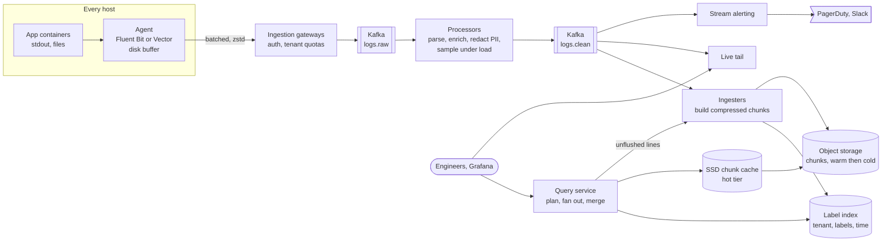
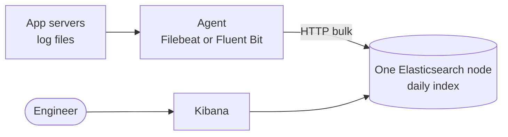
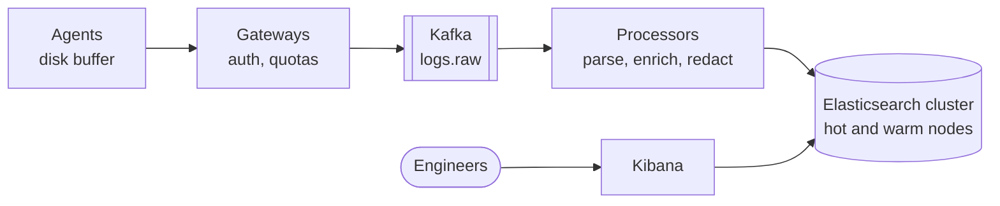
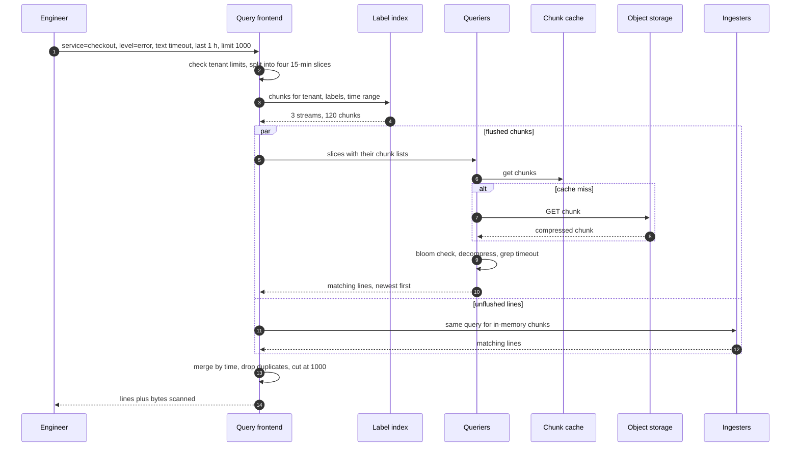

> **In one line:** agents with disk buffers ship logs through quota-enforcing gateways into Kafka, processors parse, enrich and redact them, and ingesters store compressed chunks in object storage indexed only by a few labels, so queries narrow by tenant, labels and time first and then scan text in parallel, at a fraction of the cost of indexing every word.

## The design at a glance



Write path: agents ship compressed batches to gateways, which authenticate the tenant, enforce quotas and write to Kafka; processors clean each line, and ingesters pack lines by stream into compressed chunks in object storage. Read path: the query service uses the small label index to find chunks for a tenant, label set and time range, then fans the text filter out across many queriers. Live tail and alerting read the clean stream directly, so they work in seconds.

## How to spend the 30 minutes

| Minutes | What you do | What to say or draw |
|---|---|---|
| 0-3 | Requirements | Ingest volume, retention, query patterns, alerting, tenants, PII |
| 3-6 | Numbers | 1 TB/hour = 280 MB/s, 24 TB a day, full-text index vs chunks cost |
| 6-9 | API and data model | Push API, query language, streams and labels |
| 9-14 | Design v1 and its flaws | Agent → one Elasticsearch node → Kibana: indexing falls behind, logs lost, PII, disk fills |
| 14-20 | Design v2 | Disk-buffered agents, gateways, Kafka, processors, ES cluster |
| 20-25 | Design v3 | Label index + chunks in S3, tiers, query fan-out, tail, alerts |
| 25-29 | Deep dives | Index choice, backpressure, PII, sampling |
| 29-30 | Recap | The 60-second summary at the bottom |

## Requirements

**Functional**

- Collect logs from every host and container.
- Search by time range, labels (service, env, level) and text, newest first.
- Live tail: stream matching lines to a browser as they arrive.
- Alerts on log patterns and error rates.
- Retention per tenant and log class (debug 3 days, app 30 days, audit 1 year).
- Multi-tenant: each team or customer sees only its own logs, within quotas.

**Non-functional**

- 1 TB/hour average, 3x spikes during incidents, from ~50 k hosts.
- Searchable within 30 s of being written; live tail and alerts within 5 s.
- A query over 1 hour of one service returns in about 2 s.
- No log loss when storage is slow or down; the agent never slows the app.
- PII is redacted before it is stored.

**Out of scope**

- Metrics and traces storage (we only link to traces by trace id).
- A full SIEM with threat detection rules.

> **Say it like this:** "This is a write-heavy firehose with rare, bursty reads. 280 MB a second must be absorbed without loss even when storage is down, and kept 30 days cheaply. Most queries are 'this service, last hour, contains X', so I'll index labels, not words, and scan text in parallel."

## Back-of-the-envelope numbers

| Quantity | Estimate | How |
|---|---|---|
| Ingest | ~280 MB/s average, ~800 MB/s peak | 1,000 GB ÷ 3,600 s = 278 MB/s; incidents x3 |
| Log lines | ~550 k/s average, ~1.6 M/s peak | 278 MB/s ÷ ~500 bytes per line |
| Per day | ~24 TB raw | 1 TB x 24 |
| Per host | ~5.6 KB/s, ~20 MB/hour | 278 MB/s ÷ 50 k hosts |
| Kafka buffer | ~30 TB disk | 24 h of raw + clean topics: 24 TB ÷ 5 (zstd) x 3 replicas x 2 |
| Option A: Elasticsearch | ~48 TB of disk per day kept | ~1x raw per copy (index + compressed source) x 2 copies |
| Option B: chunks in S3 | ~2.4 TB per day kept | ~10x compression; the label index is well under 1% of that |
| 30 days retained | A: ~1.4 PB, B: ~72 TB | 48 TB x 30, 2.4 TB x 30 |
| Storage per month | A: ~$115 k if all SSD, B: ~$1.7 k | 1.44 PB x $0.08 per GB-month (gp3); 72 TB x $0.023 (S3 Standard) |
| Scan speed | ~100 GB/s | 200 querier cores x ~500 MB/s (decompress + grep) |

**What the numbers tell us:**

- 280 MB/s is a firehose: a durable buffer (Kafka) is mandatory, and ingest must never depend on the store being healthy.
- Indexing every word needs ~20x the storage of compressed chunks, on disks instead of S3. Index labels, scan text on demand.
- Scanning is cheap once you narrow: labels and time cut 24 TB to a few GB, which 100 GB/s scans in well under a second.
- Retention dominates cost, so tier it and keep debug logs for days, not months.

## API

```http
POST /v1/push                                  (agents)
Authorization: Bearer <tenant ingest key>
Content-Encoding: zstd
{ "streams": [ { "labels": { "service": "checkout", "env": "prod", "level": "error" },
                 "lines": [ [ "2026-10-15T10:21:07.120Z", "payment timeout order=81723 trace_id=4bf92f35" ] ] } ] }
→ 204       or 429 Retry-After: 5   (over quota, agent keeps it on disk)

GET /v1/query?q={service="checkout", level="error"} |= "timeout"&start=...&end=...&limit=1000&direction=backward
→ 200 { "lines": [...], "stats": { "chunks_scanned": 412, "bytes_scanned": "3.1 GB" } }

GET /v1/query_range?q=sum by (service) (count_over_time({env="prod", level="error"}[1m]))&start=...&end=...&step=60s
→ 200 { "series": [...] }                     dashboards

GET /v1/tail?q={service="checkout"} |= "timeout"          WebSocket upgrade
```

- `204` only after Kafka has the batch (`acks=all`). `429` tells the agent to keep the batch on disk and back off, not to drop it.
- Labels are a small, low-cardinality set (service, env, level, region). `trace_id` and `user_id` stay in the line; as labels they would create millions of streams.
- The query language is LogQL-style: label matchers in braces first, then line filters like `|= "timeout"`. `direction=backward` with a `limit` stops early at the newest 1,000 matches.
- Every response reports bytes scanned, and each tenant has a scan budget per query.

## Data model

```text
stream          tenant_id + label set   { service=checkout, env=prod, level=error, region=eu }
line            timestamp_ns, text, structured metadata (trace_id, host, pod)
chunk           one stream, ~1.5 MB compressed, up to 1-2 hours of lines, immutable
                object key: <tenant>/<stream_hash>/<from>-<to>-<checksum>
                header: min/max time, line count, bloom filter of tokens like trace_id
label index     (tenant, day, label=value) → stream ids
                (tenant, stream id, time range) → chunk keys
tenants         quotas (ingest MB/s, active streams, query bytes), retention per class, PII rules
alert rules     tenant, expression, window, threshold, route
```

- **Chunks in object storage (S3, GCS)**: immutable files, 11 nines of durability, about 2 cents per GB-month.
- **Label index as daily index files in object storage, cached on query nodes**: it covers millions of streams, not billions of lines, so it is GBs.
- **Tenants and alert rules in Postgres**: small and rarely written.
- **Kafka partition = hash(stream) within the tenant's own subset of partitions**, so a stream's lines reach one ingester and become one chunk. Huge streams get an extra shard label to spread out.

## Design v1: the simplest thing that works



1. The app writes lines to a local file.
2. An agent tails the file and sends batches to Elasticsearch with the bulk API.
3. Elasticsearch puts every word into an inverted index, one index per day.
4. An engineer searches `checkout AND timeout` for the last 15 minutes in Kibana.

For a few dozen servers and a few GB a day, this is a perfectly good logging stack.

## Where v1 breaks

| Problem | Why it happens | What the user sees |
|---|---|---|
| Indexing falls behind | Full-text indexing is CPU-heavy; one node cannot index 280 MB/s | Logs show up hours late, during incidents |
| Logs lost when ES is slow or down | Agents only buffer a little in memory | The logs from the outage you are debugging are gone |
| Raw, unparsed lines | No parsing or enrichment | Cannot filter by service or pod; no link to traces |
| PII stored verbatim | Emails, tokens and card numbers in log lines | Compliance breach; anyone with Kibana sees them |
| One noisy service | A debug loop writes 10x more | Everyone's logs are delayed and the disk fills |
| Disk fills | No retention or tiers | The node falls over; someone deletes indices by hand |

## Design v2: buffer, process, and run a real cluster



### Fix 1: agents that buffer to disk

Run Fluent Bit or Vector on every host (a DaemonSet on Kubernetes). It tails container logs, joins multi-line stack traces, adds pod and namespace labels, batches and compresses. If the gateway is slow, it spills to a bounded disk buffer of a few GB (an average host writes ~20 MB an hour) instead of dropping or blocking. CPU and memory limits keep it from hurting the app.

### Fix 2: ingestion gateways

Stateless HTTP and gRPC endpoints behind a load balancer. They authenticate the tenant key (the tenant comes from the key, never from a label the agent sends), enforce per-tenant quotas with token buckets, reject oversized lines, and write to Kafka. Over quota, they answer `429` and the agent backs off.

### Fix 3: Kafka as the shock absorber

Kafka keeps 24 hours of raw logs. If processing or storage is down for two hours, nothing is lost; consumers catch up afterwards. Backpressure runs in a chain: storage slow → Kafka lag grows → if Kafka itself struggles, gateways send `429` → agents buffer on disk → only then do agents drop, debug first.

### Fix 4: processors

A consumer group reads `logs.raw` and, per line: parses (JSON, logfmt, nginx patterns); fixes timestamps; enriches with service, env, host, region and the trace id (from the line or its `traceparent`); redacts PII; drops prod debug lines unless a service has debug switched on. Processors are stateless and autoscale on Kafka lag.

### Fix 5: an Elasticsearch cluster with hot and warm nodes

Daily indices per tenant, shards of 30-50 GB, one replica. Index lifecycle management moves indices from SSD hot nodes to cheaper warm nodes after 3 days and deletes them after 30. Kibana stays the UI.

## Where v2 still breaks

| Problem | Why it happens | What the user sees |
|---|---|---|
| Storage bill | Every word indexed, two copies | ~1.4 PB of disk for 30 days; logs cost more than the product |
| Indexing CPU | Building the inverted index for 550 k lines/s | Dozens of data nodes just to keep up |
| Mapping explosions | Every new JSON key becomes a field; Elasticsearch caps fields per index (1,000 by default) | Documents rejected after one team logs a dynamic key |
| Wide queries time out | 30 days means thousands of shards | Dashboards spin, then fail |
| Alerts by polling | Saved searches every minute | Alerts minutes late, and they load the cluster |
| No live view | Search refresh is periodic | Engineers SSH into boxes to `tail -f` during incidents |

## Design v3: index labels, keep chunks in object storage

This is the diagram at the top.

### Fix 6: label index + compressed chunks

Ingesters consume `logs.clean`, append each line to an in-memory chunk for its stream, compress, and flush to object storage at ~1.5 MB or after an hour. Only each chunk's labels and time range go into the index. Storage drops from ~48 TB to ~2.4 TB a day, with no per-word indexing CPU. Kafka offsets are committed only up to lines already flushed, so a crashed ingester's replacement replays at most about an hour.

### Fix 7: hot, warm and cold tiers

**Hot** (last ~24 h): unflushed lines in ingesters plus an SSD chunk cache; most queries land here. **Warm** (to 30 days): S3 Standard, fetched on demand. **Cold** (to a year or more, audit only): an archive class like S3 Glacier, restored on request. Retention per tenant and log class deletes whole chunks by age.

### Fix 8: query service that narrows first, then scans

Labels and time first, text second: the frontend finds the chunks for the tenant, label matchers and range, splits the work into 15-minute slices, and fans them out to queriers. Each fetches its chunks, skips any whose bloom filter rules out the token, decompresses and greps. The frontend merges newest first and stops at the limit. Per-tenant limits on bytes scanned, plus a result cache for dashboards, keep one query from eating the pool.

### Fix 9: live tail

The tail service reads `logs.clean` with its own consumer group, matches each line against open sessions, and pushes matches over WebSocket. Each session is capped (say 200 lines/s); the excess becomes a "1,234 lines skipped" marker.

### Fix 10: alerting on the stream

A stream job (Flink or Kafka Streams) evaluates rules as lines pass: windowed counts per service and level, and patterns like `OutOfMemoryError`. Breaches page within seconds, with no load on the query path. It also emits log-derived metrics (error lines per service per minute) for dashboards and SLOs. Scheduled queries stay only for the rare rule a stream cannot express.

### Fix 11: adaptive sampling and shedding

When Kafka lag passes a threshold, processors shed: drop debug, sample repetitive info lines 1 in 10, never touch warn, error or audit. Drops are counted, so the UI says "8% of info lines sampled" instead of hiding gaps.

### Fix 12: multi-tenancy everywhere

The tenant id from the gateway prefixes every Kafka key, chunk key and index entry, and every query is scoped to it. Quotas cover ingest MB/s, active streams, query bytes and retention. Each tenant's streams map to a small, fixed subset of partitions and so of ingesters (shuffle sharding): one tenant's flood hurts a few nodes, not all.

### Components

| Component | Job | Tech choice |
|---|---|---|
| Agent | Tail, label, batch, disk buffer | Fluent Bit or Vector, DaemonSet |
| Ingestion gateway | Auth, tenant quotas, write to Kafka | Stateless, `acks=all` |
| Kafka | 24 h durable buffer, raw and clean topics | Partition by tenant + stream, zstd |
| Processors | Parse, enrich, redact PII, sample | Stateless consumers, autoscale on lag |
| Ingesters | Build and flush chunks, serve recent lines | Offsets committed after flush |
| Object storage | Chunks and index files, warm and cold tiers | S3 with lifecycle rules |
| Query service | Plan, fan out, merge, limits | Frontend + queriers, SSD chunk cache |
| Live tail | Match lines to sessions, push | Own consumer group, WebSocket |
| Stream alerting | Windowed counts and patterns | Flink or Kafka Streams, Alertmanager routing |

## Key flow: searching the last hour of checkout errors



- **A querier dies mid-query:** the frontend retries that slice on another querier.
- **An ingester is down:** its unflushed lines are missing until the replacement replays from Kafka, so the response is flagged partial.
- **Duplicates after a replay:** the merge drops lines with the same stream, timestamp and content hash.
- **Too wide a query** (30 days, no labels): rejected with a hint, or run as an async search job that writes results to S3.

## Deep dives

### Full-text index or label index + chunks?

**The problem.** At 24 TB a day, the index decides the bill and the query speed.

**Options.**

| Option | Good | Bad |
|---|---|---|
| **Full-text inverted index** (Elasticsearch, OpenSearch, Splunk) | Any word in any time range in milliseconds; rich aggregations | ~20x more storage on disks, heavy indexing CPU, mapping limits, shard management |
| **Label index + compressed chunks** (Loki style) | ~2.4 TB a day in S3, cheap ingest, simple operations | Text search is a scan; a needle across 90 days with no labels is slow |
| Columnar store (ClickHouse) | Fast aggregations on structured fields, good compression | Needs a schema, or a map column; free-text search is still a scan |

**Pick.** Label index + chunks, because most queries name a service and a recent window. Add per-chunk bloom filters for trace and request ids. If security needs needle-in-haystack search over months, route only security logs, a small fraction, to a full-text index.

### Backpressure without losing logs

**The problem.** During an incident, logs triple at the moment the storage is most likely to be struggling.

**Options.**

| Option | Good | Bad |
|---|---|---|
| Agents send straight to storage | Simple | Storage slowness becomes log loss |
| Block the application when the agent is full | Never loses a line | A logging problem becomes an outage |
| **Disk buffer → gateway 429 → Kafka → shed by level** | Each layer absorbs, the next pushes back; loss happens last and least valuable first | More moving parts |

**Pick.** The layered chain. Apps never wait; the agent's disk buffer covers hours, Kafka a day, and the last resort is dropping debug lines, counted.

### PII redaction

**The problem.** Developers log emails, tokens and card numbers. Once spread over chunks and tiers, they are very hard to delete.

**Options.**

| Option | Good | Bad |
|---|---|---|
| Redact in the agent | PII never leaves the host | Rules spread across 50 k hosts; agent CPU |
| **Redact in the processors** | One versioned rule set per tenant; easy to update | PII crosses the network and sits in `logs.raw` for its retention |
| Structured logging with a field denylist | Precise, cheap | Only for structured logs |

**Pick.** Processors, with a field denylist (`password`, `authorization`), regexes for emails, phone numbers and JWTs, and a Luhn check so only real card numbers are masked. Only processors may read `logs.raw`, and it expires after its 24 h. Hash user ids rather than delete them, so support can still search by hashed id.

### Sampling and dropping under load

**The problem.** You must cut volume, but you must not lose the lines that explain the incident.

**Options.**

| Option | Good | Bad |
|---|---|---|
| Random sampling of everything | Simple | Drops errors too |
| **Level-based: drop debug, sample info, keep warn and above** | Keeps what matters | Debug is missing exactly when you would want it |
| Trace-aware: keep all lines of sampled traces | Consistent story across services | Needs trace ids in lines |
| Dedupe repeated lines into a count | Huge win for log spam | Small CPU cost per line |

**Pick.** Level-based shedding plus repeat dedupe, only under pressure or over quota; keep every line of traces the tracing system sampled. Let an engineer switch debug on for one service for an hour during an incident.

## Trade-offs to say out loud

- We chose **a label index over a full-text index**, so storage is ~20x cheaper and lives in S3. The cost is that text search is a parallel scan, and unlabeled needle searches over months are slow.
- We put **Kafka between ingest and storage**, so a storage outage never loses logs. The cost is another cluster and a few seconds of latency.
- We **redact in processors, not agents**, for one rule set we can update in minutes. The cost is that raw PII sits in `logs.raw` for up to 24 h, readable only by processors.
- We **shed debug first under load**, so errors always get through. The cost is gaps in debug logs during incidents unless someone turns debug on for that service.

## Follow-up questions

**Q: Security wants every line containing one IP address over 90 days.**
That is the worst case for a label index. Use bloom filters on extracted IPs per chunk to skip most chunks, run it as an async job over the cold tier, or route security logs to a full-text index.

**Q: How do you link logs to traces?**
Processors extract the trace id into structured metadata and the chunk's bloom filter. From a trace view, the UI runs `{service="checkout"} | trace_id="4bf92f35"` over the span's time window.

**Q: How do you handle clock skew and late lines?**
Accept lines up to an hour late into the stream's open chunk; later ones go into a separate chunk for that time range. Lines too far in the future get the receive time.

**Q: A user asks to be deleted under GDPR. Now what?**
Rewriting chunks is expensive, so prevent the need: redact and hash personal data at ingest, keep retention short. For what remains, a background job rewrites affected chunks.

**Q: How do you go multi-region?**
Ingest and store where logs are produced, for data residency and to avoid cross-region transfer costs. The query frontend fans out across regions and merges.

**Q: Why not have apps write straight to Kafka?**
50 k hosts with Kafka credentials, client libraries in every language, and no central place for auth and quotas. Agents plus gateways keep apps dumb and the platform in control.

## 60-second recap

- Agents (Fluent Bit or Vector) on every host tail, label, batch and buffer to disk; apps never wait.
- Gateways authenticate tenants, enforce quotas with `429`, and write to Kafka, which holds 24 hours.
- Processors parse, enrich (service, host, trace id), redact PII, and shed debug under load.
- Ingesters build ~1.5 MB compressed chunks per stream in S3; only labels and time are indexed, ~20x cheaper than full text.
- Queries narrow by tenant, labels and time, then fan out grep across 200 cores and merge newest first.
- Tiers: hot in ingesters and SSD cache, warm in S3, cold in an archive class.
- Live tail and alerts read the clean stream within seconds; every layer is tenant-scoped and quota-limited.
