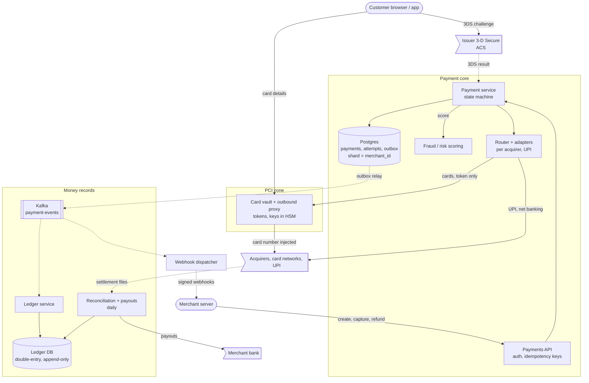
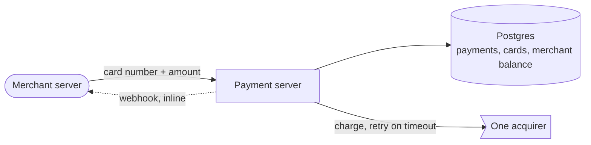
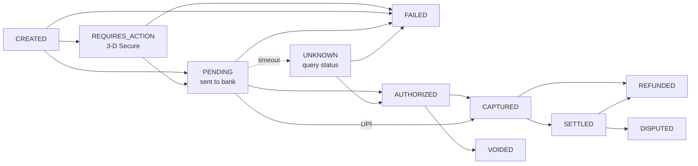
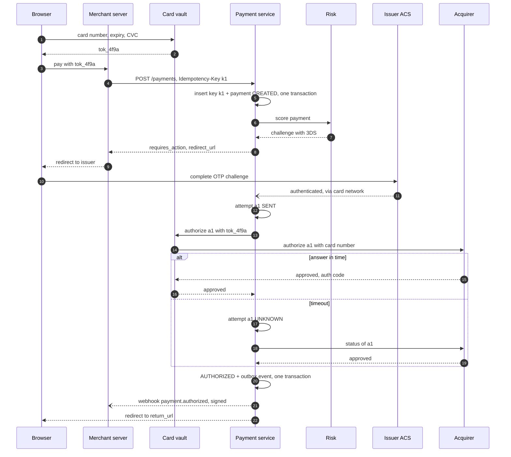

> **In one line:** wrap unreliable banks in an idempotent payment state machine, keep card numbers in a tiny isolated vault, never guess when a bank times out, and record every movement of money in a double-entry ledger that you reconcile against the banks' files every day.

## The design at a glance



Follow one payment. The browser sends the card to the vault and gets a token; the merchant creates a payment with that token and an idempotency key. The payment service scores risk, runs 3-D Secure if needed, and routes the charge, with the vault swapping in the card number on the way out. Every state change commits with an outbox event that feeds the ledger and webhooks; a daily job reconciles with the banks and pays merchants.

## How to spend the 30 minutes

| Minutes | What you do | What to say or draw |
|---|---|---|
| 0-3 | Requirements | Cards and UPI? Separate capture? Payouts? We are not the bank |
| 3-6 | Numbers | 50 M payments/day, 6 k/s peak, 12 k bank calls in flight |
| 6-9 | API and data model | Idempotency-Key, amounts in paise, payments + attempts + ledger |
| 9-12 | Design v1 | One server, card numbers in the DB, one acquirer, blind retry |
| 12-15 | Break v1 | Double charge, PCI scope, timeouts, balance column |
| 15-23 | Design v2 and v3 | Keys, vault, state machine, ledger, outbox, risk, 3DS, reconciliation |
| 23-29 | Deep dives | Unknown outcome, ledger, webhooks, consistency |
| 29-30 | Recap | The 60-second summary at the bottom |

## Requirements

**Functional**

- Merchants create payments by API: cards, UPI, net banking, wallets; capture now or later.
- A checkout SDK collects card details; saved cards are reused as tokens.
- 3-D Secure when the issuer, the regulator or our risk score requires it.
- Full and partial refunds; disputes (chargebacks).
- A webhook for every state change.
- Scheduled payouts to merchant bank accounts.

**Non-functional**

- Never charge twice, never lose a payment, trace every paisa.
- Strong consistency on money paths; dashboards and analytics may lag.
- 99.99% availability for payment creation.
- Our overhead p99 under 300 ms; bank time (1-3 s) and 3DS come on top.
- PCI DSS: card numbers isolated and encrypted with HSM-held keys.
- Peak 6,000 payments a second during festival sales.

**Out of scope**

- Being the issuer, card network or acquirer.
- Merchant onboarding and KYC, subscriptions, FX.

> **Say it like this:** "A payment gateway is a state machine around unreliable banks. Volume is modest, so the hard part is correctness: never charge twice on a retry, never guess when a bank times out, keep card numbers in a tiny vault, and record every movement in a double-entry ledger reconciled with the banks daily."

## Back-of-the-envelope numbers

| Quantity | Estimate | How |
|---|---|---|
| Payments | 50 M / day | Assumption for a large gateway |
| Average rate | ~600 / s | 50 M ÷ 86,400 s ≈ 580 |
| Peak rate | ~6,000 / s | 10x during festival sales |
| Bank calls in flight at peak | ~12,000 | 6,000 / s x ~2 s per bank round trip (Little's law) |
| Ledger lines | ~300 M / day, ~60 GB / day | ~6 lines per payment x 200 bytes |
| Ledger per year | ~22 TB | 60 GB x 365 |
| Webhooks | ~150 M / day, ~17,000 / s at peak | ~3 events per payment; 150 M ÷ 86,400 ≈ 1,700 / s, x10 |
| Settlement rows to match | ~35 M / day | ~70% of payments get captured |
| Downtime budget | ~52 min / year | 0.01% of 525,600 minutes |
| One minute down at peak | ~360,000 failed payments | 6,000 x 60 |

**What the numbers tell us:**

- 6,000 writes a second is easy for sharded Postgres: correctness, not throughput, drives the design.
- 12,000 slow bank calls in flight: async adapters with timeouts, and never a DB transaction held open across a bank call.
- The append-only ledger grows ~22 TB a year: partition by month, cache balances.
- Webhooks are 3x the payment volume and depend on merchants' servers, so they get their own queue.

## API

```http
POST /v1/tokens                      (browser SDK, vault domain)
{ "number": "4111 1111 1111 1111", "exp": "12/28", "cvc": "123" }
→ 201 { "token": "tok_4f9a", "brand": "visa", "last4": "1111" }

POST /v1/payments
Authorization: Bearer <merchant-secret-key>
Idempotency-Key: 8e1f5c0a-7b2d
{ "amount": 49900, "currency": "INR", "method": "tok_4f9a", "capture": "automatic",
  "order_ref": "ORD-1182", "return_url": "https://shop.example/done" }
→ 201 { "id": "pay_07Hq2", "status": "requires_action", "next_action": { "redirect_url": "https://acs.issuer.example/..." } }

POST /v1/payments/{id}/capture   { "amount": 49900 }     Idempotency-Key required
POST /v1/payments/{id}/refunds   { "amount": 10000 }     Idempotency-Key required
GET  /v1/payments/{id}

Webhook → POST https://shop.example/webhooks
Webhook-Signature: t=1760500000, v1=5f2b9c...
{ "id": "evt_91", "type": "payment.captured", "data": { "id": "pay_07Hq2", "status": "captured", "version": 4 } }
```

- Amounts are integers in the smallest unit (49900 paise = ₹499). Never floats.
- Every POST that moves money requires an `Idempotency-Key`.
- Card details go from the browser to the vault's domain; the merchant only sees `tok_...` and stays out of most PCI scope.
- `requires_action` tells the merchant's page to redirect the customer to 3-D Secure.
- Webhooks carry an event `id` for dedupe and a `version` for ordering.

## Data model

```text
payments           (Postgres, shard key = merchant_id)
  payment_id PK         embeds the shard number, so a GET routes without a lookup
  merchant_id, amount, currency, status, captured_amount, refunded_amount, token, order_ref, version

payment_attempts   (same shard)
  attempt_id PK         also the reference sent to the acquirer
  payment_id, acquirer, status (SENT, APPROVED, DECLINED, UNKNOWN), acquirer_ref, response_code

idempotency_keys   (same shard)
  (merchant_id, key) PK, request_hash, state (IN_PROGRESS, DONE), response, expires_at

outbox             (same shard)
  event_id PK, payment_id, type, payload, created_at

journals           (ledger Postgres, shard key = merchant_id)
  journal_id PK         derived from (payment_id, event), so a replay cannot post twice
ledger_entries     (same shard, append-only, monthly partitions)
  entry_id, journal_id, account, amount (signed), currency      each journal sums to zero

vault              (separate database inside the PCI zone)
  token PK, encrypted_pan, expiry, fingerprint
```

- **Payments, attempts, keys and outbox on the merchant's Postgres shard,** so payment, key and event commit in one local transaction. The biggest merchants get their own shards.
- **The ledger in its own Postgres cluster,** sharded by merchant since every journal belongs to one merchant. Corrections are new journals.
- **The vault in a separate network and database.** Only it can decrypt card numbers.

## Design v1: the simplest thing that works



1. The merchant posts the card number and amount.
2. The server inserts a payment with `status = pending` and saves the card for next time.
3. It calls the acquirer's charge API and waits; on a timeout it retries once.
4. On success it sets `status = success` and runs `UPDATE merchants SET balance = balance + amount`.
5. It POSTs a webhook to the merchant, then answers the original request.

This really works for a small shop.

## Where v1 breaks

| Problem | Why it happens | What the user sees |
|---|---|---|
| Merchant retry creates a second charge | The response was lost after the charge went through | Customer charged twice |
| Card numbers in the main database | Every service, engineer and backup is in PCI scope | One breach leaks every card |
| Blind retry on a bank timeout | The first request may have succeeded | Double charge, or a charge recorded as failed |
| A `status` column and a balance number | No history; a crash between charge and update loses the trail | Money nobody can explain or reconcile |
| One acquirer | Its outage is our outage | All payments fail |
| Inline webhooks | A slow merchant server blocks our response; failures are never retried | Slow checkout; merchant never hears of the payment |

## Design v2: idempotent state machine, vault, ledger, events

### Fix 1: idempotency keys stored with the response

The first request inserts `(merchant_id, key, request_hash, IN_PROGRESS)` in the same transaction as the payment. A retry with the same key gets the stored response; a concurrent duplicate gets `409`, retry later; the same key with a different body gets `422`. A retried create can no longer charge twice.

### Fix 2: a card vault that shrinks PCI scope

The SDK posts card details to the vault, which encrypts them with HSM-held keys and returns a token. Everyone else, merchant included, sees only tokens. On a charge, the vault acts as an outbound proxy and injects the card number into the acquirer request, so PCI scope is one small service, not the company.

### Fix 3: a payment state machine with attempts

Each bank call is a `payment_attempt` with its own id, sent as the reference. A timeout marks the attempt `UNKNOWN`, never `FAILED`, and triggers a status query instead of a new charge (deep dive below). Every transition is a conditional update (`WHERE status = 'AUTHORIZED'`), so two workers cannot both capture.



UPI is a push payment the customer approves in their own app, so it goes from `PENDING` straight to `CAPTURED`.

### Fix 4: a double-entry ledger

Replace the balance column with journals: each event writes debits and credits that sum to zero, and a balance is the sum of an account's entries. Nothing is updated in place, so every rupee has a history to check against the bank.

### Fix 5: a router with adapters

A router picks an acquirer per payment by method, card network, cost and recent success rate; adapters translate one internal interface to each acquirer's API or UPI. A circuit breaker per acquirer shifts traffic away from an outage within seconds.

### Fix 6: outbox and an async webhook dispatcher

The state change and an `outbox` row commit together; a relay publishes the row to Kafka (the pattern from the [notification system](15-notification-system.md)). The ledger and the webhook dispatcher consume from there, so a slow merchant never slows a payment, and a crash after commit loses no event.

## Where v2 still breaks

| Problem | Why it happens | What the user sees |
|---|---|---|
| Card testing and stolen cards | Bots try thousands of stolen cards with small amounts | Chargebacks, network fines, merchants lose goods |
| Issuers require strong authentication | RBI's extra factor for Indian cards, Europe's SCA | Declines; fraud liability stays with the merchant |
| Our records drift from the banks' | Unknown outcomes resolved later, missed responses, fee differences | Merchants paid the wrong amount |
| Merchants are never paid out | Captured money sits in our escrow account | Merchant cash flow stops |

## Design v3: risk, 3-D Secure, reconciliation and payouts

This is the diagram at the top.

### Fix 7: fraud and risk scoring before the bank

Before routing, risk scores the payment in ~50 ms: Redis velocity counters (attempts per card, device and IP per hour), card country vs IP country, amount vs the merchant's normal, and a gradient-boosted model. The answer is allow, 3DS challenge, or block. If risk is down, fall back to rules, leaning towards 3DS.

### Fix 8: 3-D Secure as `requires_action`

When the issuer, the rules or the risk score demand it, the payment goes to `REQUIRES_ACTION` and the customer is redirected to the issuer's access control server (ACS). With 3DS2 the issuer sees device and order data and either approves silently or asks for an OTP or biometric. The result goes into the authorization and generally shifts fraud liability to the issuer.

### Fix 9: daily reconciliation

Acquirers and the UPI network send settlement files listing what actually moved. Match every row to an attempt by acquirer reference, and the escrow bank statement to the ledger's bank account. Then fix breaks: a `FAILED` payment the bank settled is refunded; a captured one missing from the file is chased; fee differences get adjusting journals.

### Fix 10: refunds and payouts from the ledger

A refund is a conditional update (`refunded_amount + x <= captured_amount`), then its own idempotent attempt to the acquirer. Payouts run on a schedule (for example T+2): each merchant's reconciled payable, minus any reserve, goes by bank transfer with an idempotent payout id. A payout timeout follows the charge rule: query, never resend.

### Components

| Component | Job | Tech choice |
|---|---|---|
| Payments API | Merchant auth, idempotency | Stateless; keys stored with the payment |
| Card vault | Tokenize, encrypt, proxy | Separate network; keys in an HSM |
| Payment service | State machine, capture, refund | Stateless; Postgres sharded by `merchant_id` |
| Risk scoring | Allow, 3DS or block in ~50 ms | Gradient-boosted model, Redis counters |
| Router + adapters | Pick acquirer, translate | Success rate and cost, circuit breakers |
| Outbox relay + Kafka | Publish committed changes | Debezium CDC, keyed by `payment_id` |
| Ledger service | Post journals idempotently | Postgres, append-only |
| Webhook dispatcher | At-least-once delivery | Retry queues, HMAC signatures |
| Reconciliation + payouts | Match files, pay merchants | Daily SQL or Spark batch |

## Key flow: charge a card with 3-D Secure



- **Merchant retries step 4 with `k1`:** it gets the stored response; no second payment.
- **Risk says block:** `FAILED` with a reason, and no bank call at all.
- **Customer abandons 3DS:** the payment expires to `FAILED` after ~15 minutes.
- **Issuer decline** (stolen card, insufficient funds): `FAILED`. Another acquirer reaches the same issuer, so do not retry there.
- **Status query says nothing:** stay `UNKNOWN`, query with backoff, then reverse or reconcile (deep dive).
- **Capture** follows at once as its own idempotent call, or waits for the merchant if manual.

## Deep dives

### The bank timed out: did we charge the customer?

**The problem.** The acquirer did not answer in 30 seconds. The request died on the way, or the card is already charged.

**Options.**

| Option | Good | Bad |
|---|---|---|
| Retry the charge | Simple | Double charge if the first one went through |
| Mark it failed | Simple | Customer charged, merchant thinks unpaid; customer pays again |
| **Mark `UNKNOWN`, query, reverse, reconcile** | Never double charges, never loses money | Some payments stay pending for minutes, rarely until the next day |

**Pick.** Query the acquirer's status API with the attempt id at growing intervals (5 s, 30 s, 2 min). For cards, if it still cannot confirm, send a reversal for that same attempt so any hold is released, then fail cleanly. For UPI, keep polling: the bank's answer is final, and regulators set deadlines for reversing failed debits. The merchant sees `pending` until a webhook resolves it. The settlement file is the last backstop: anything we failed but the bank settled is refunded. Another acquirer is safe only if the first request provably never left.

### The double-entry ledger

**The problem.** Every rupee must be explained, and totals must match the bank.

**Options.**

| Option | Good | Bad |
|---|---|---|
| A balance column per merchant | Simple, fast | No history; a lost update is invisible |
| An event log only | History | Hard to answer "what do we owe merchant 42?" |
| **Double-entry journals** | Every movement balanced; errors show as non-zero totals | More rows; hot accounts need care |

**Pick.** Double-entry. A ₹499 capture with our fee of ₹10 (ignoring the acquirer's own fee):

| Event | Debit | Credit |
|---|---|---|
| Capture | Acquirer receivable 499 | Merchant payable 489, Fee revenue 10 |
| Acquirer settles to us | Bank escrow 499 | Acquirer receivable 499 |
| Payout to merchant | Merchant payable 489 | Bank escrow 489 |
| Refund ₹100 | Merchant payable 100 | Acquirer receivable 100 (netted from the next settlement) |

After three steps, escrow holds ₹10, exactly our fee revenue. `journal_id` is unique per `(payment_id, event)`, so a replayed event posts nothing twice. A running balance for fee revenue would be one hot row, so each merchant shard keeps its own sub-account and reports add them up.

### Webhooks: delivery, signatures, ordering

**The problem.** Merchant servers are slow or down, yet must learn every outcome.

**Options.**

| Option | Good | Bad |
|---|---|---|
| Call inline | Simple | Merchant latency becomes our latency; failures are lost |
| Fire once from a queue | Decoupled | A merchant outage loses events |
| **Outbox, Kafka, dispatcher with retries** | Durable and verifiable | At-least-once and out of order; merchants must handle both |

**Pick.** The dispatcher POSTs with a 10 s timeout and retries failures with exponential backoff and jitter for about three days, then parks the event and alerts the merchant. Per-merchant retry queues isolate dead endpoints. Each request is signed with HMAC-SHA256 over `timestamp.body` using the merchant's secret; the merchant recomputes it and rejects timestamps older than 5 minutes. Retries break ordering, so `captured` can arrive before `authorized`: merchants dedupe by event `id`, compare `version`, and treat a webhook as a hint to `GET` the payment.

### Consistency over availability on money paths

**The problem.** In a partition or failover you either reject requests or accept writes that may conflict.

**Options.**

| Option | Good | Bad |
|---|---|---|
| AP: accept writes anywhere, merge later | Always up | Both sides can capture or pay out; "merging" money means clawing it back |
| **CP: one leader per shard, synchronous replica, refuse when unsure** | One truth for every payment | Seconds of `503` during a failover |

**Pick.** CP for payments, idempotency keys, the ledger and payouts. A `503` costs one safe retry with the same key; a double payout costs real money. Replicate asynchronously to a second region for disaster recovery and fail over deliberately. Everything else stays AP: dashboards, analytics, webhook status, risk counters (if Redis is down, risk falls back to rules).

## Trade-offs to say out loud

- We chose **consistency over availability** on money paths. The cost is short `503`s during failovers, which idempotent retries absorb.
- We chose **`UNKNOWN` plus status queries over retries.** The cost is payments pending for a while.
- We chose a **separate vault with an outbound proxy.** The cost is an extra hop per card charge, for a PCI scope of one service.
- We chose **async ledger posting via the outbox** over writing it in the payment transaction. The cost is seconds of lag; idempotent journals mean nothing is lost or doubled.
- We chose **at-least-once webhooks.** The cost is duplicates and reordering that merchants must handle.

## Follow-up questions

**Q: Why separate authorization and capture?**
Authorization holds funds; capture takes them. A shop authorizes at checkout and captures at shipping. An uncaptured authorization can be voided, or expires, typically after about a week.

**Q: How are saved cards stored in India?**
Since 2022, RBI rules bar merchants and gateways from storing card numbers for card-on-file payments. You store a network token from Visa, Mastercard or RuPay instead, kept in the vault.

**Q: How do disputes work?**
The acquirer reports a chargeback. The payment becomes `DISPUTED`, a journal moves the amount from merchant payable to a dispute hold, and the merchant uploads evidence. Won: release the hold. Lost: the debit stands, plus a fee.

**Q: How does the router choose an acquirer?**
By method and network, then cost and recent success rate for that card range, skipping acquirers whose circuit breaker is open. Failures that never reached the bank may move to the next acquirer; declines never do.

**Q: How do you handle multiple currencies?**
Amounts carry their currency in minor units, ledger accounts are per currency, and a journal never mixes currencies without an FX account.

**Q: A big merchant runs a flash sale. What breaks?**
Their shard and acquirer capacity. Give the largest merchants dedicated shards, apply per-merchant [rate limits](21-rate-limiter.md), and warn acquirers ahead of time.

## 60-second recap

- A state machine around unreliable banks; volume is modest (6 k/s peak), so the design is about correctness.
- Idempotency keys stored with their response; unique ids all the way down: attempts, journals, events.
- Card numbers live only in a small PCI vault that tokenizes and proxies acquirer calls.
- Risk decides allow, 3-D Secure or block; a router with adapters reaches acquirers and UPI.
- A bank timeout means `UNKNOWN`: query, reverse, reconcile. Never a blind retry.
- An outbox feeds Kafka, which feeds a double-entry ledger and signed, retried webhooks.
- Daily reconciliation against settlement files, payouts from reconciled balances; CP for money, AP for the rest.
