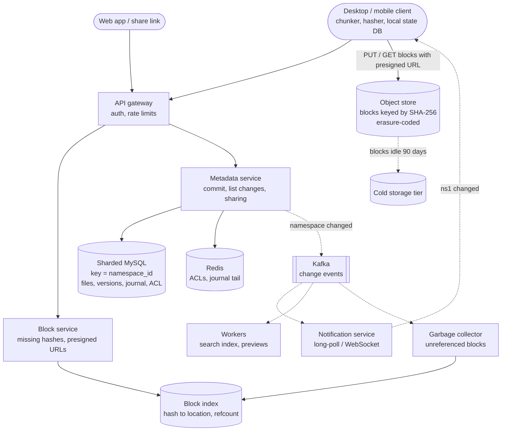
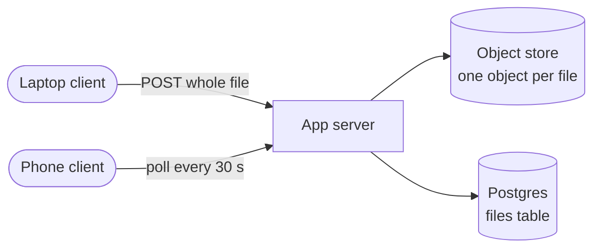
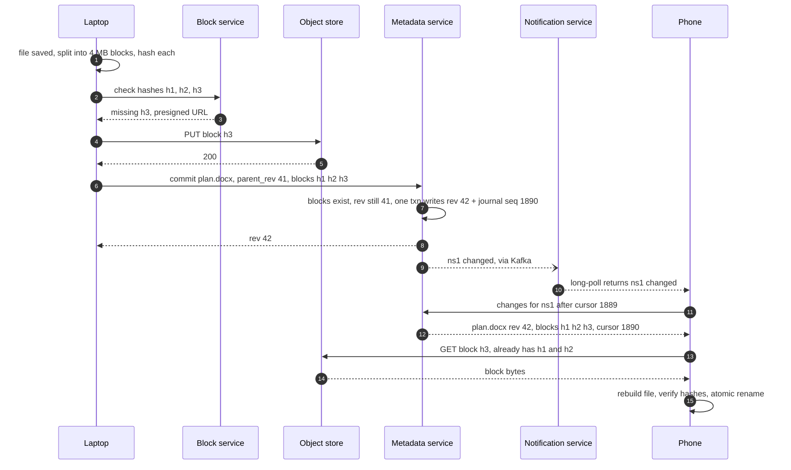

> **In one line:** the client cuts files into 4 MB blocks named by their hash and uploads only the blocks the server lacks straight to object storage, then commits the new version (a list of block hashes) to a metadata database sharded by namespace, which appends to that namespace's change journal so every other device pulls exactly what changed from its cursor.

## The design at a glance



**Upload**: the client hashes each 4 MB block, asks the block service which hashes are new, uploads only those straight to object storage, then commits the file's block list. **Sync**: the new version and a journal entry are written in one transaction on the namespace's shard, a "namespace changed" ping reaches every other device, and each one pulls the journal from its cursor and downloads only the blocks it lacks.

## How to spend the 30 minutes

| Minutes | What you do | What to say or draw |
|---|---|---|
| 0-3 | Requirements | Sync client or web only? Sharing? Versions? Max file size? |
| 3-6 | Numbers | Exabytes of blocks, 1 trillion files, 100 M connected devices |
| 6-10 | API and data model | Check blocks, commit, list changes, notify. Everything keyed by namespace |
| 10-13 | Design v1 | Whole files through an app server, poll for changes |
| 13-16 | Break v1 | Failed big uploads, whole-file re-uploads, missed changes, lost edits |
| 16-23 | Design v2 | Hashed blocks, presigned uploads, journal + cursor, push, conflicted copies |
| 23-25 | Design v3 | Huge files, huge shared folders, garbage collection, storage cost |
| 25-30 | Deep dives and recap | Chunking, sync protocol, conflicts, commit consistency |

## Requirements

**Functional**

- Upload, download, move, rename and delete files and folders from desktop, mobile and web.
- Changes on one device appear on the user's other devices automatically.
- Work offline; sync when back online.
- Share files and folders with people (viewer / editor) or by link.
- Version history, and a trash that keeps deleted files for 30 days.
- Files up to 50 GB.

**Non-functional**

- Durability of 11 nines: losing a file is the unforgivable bug.
- A change shows on other online devices within a few seconds.
- Strong consistency per namespace: the journal never skips or reorders a change.
- 99.9% availability for sync. Transfers can retry.
- Never re-upload data the server already has.

**Out of scope**

- Real-time co-editing (that is the [collaborative editor](10-collaborative-editor.md)).
- Full-text search internals and billing.

> **Say it like this:** "The bytes are easy: immutable blocks in object storage. The hard part is metadata and sync: knowing exactly which version each device has, never losing an edit, and telling 100 million idle devices when something changed. I'll split files into hashed blocks, keep metadata in SQL sharded by namespace with a change journal, and push a tiny 'something changed' signal to clients."

## Back-of-the-envelope numbers

| Quantity | Estimate | How |
|---|---|---|
| Users | 500 M registered, 100 M daily | Assumption |
| Logical data | 2.5 EB | 500 M x 5 GB average |
| Unique data | ~2 EB | ~20% of blocks are duplicates: 2.5 EB x 0.8 |
| Raw disk | ~3 EB | 2 EB x 1.5 erasure-coding overhead |
| Files | ~1 trillion | 500 M users x 2,000 files |
| Metadata | ~500 TB, ~500 shards | 1 T files x 500 bytes, ~1 TB per MySQL shard |
| Upload volume | 2 PB / day ≈ 185 Gbps | 100 M users x 20 MB of new data, ÷ 86,400 s |
| Block uploads | ~6 k / s | 2 PB ÷ 4 MB = 500 M blocks a day, ÷ 86,400 |
| File commits | ~12 k / s average, ~35 k / s peak | 100 M x 10 changed files ÷ 86,400, x3 |
| Connected devices | ~100 M, ~1,000 servers | ~100 k idle connections per server |

**What the numbers tell us:**

- Exabytes of immutable data belong in an erasure-coded object store, never in a database.
- 500 TB of transactional metadata: SQL, sharded. 35 k commits a second over 500 shards is 70 per shard, so the hard part is correctness, not throughput.
- 100 M mostly idle connections need their own notification tier that only says "something changed".
- 185 Gbps is after dedupe and delta sync. Without them it would be many times higher.

## API

```http
POST /v1/blocks/check
{ "namespace_id": "ns1", "hashes": ["sha256:ab12", "sha256:cd34", "sha256:ef56"] }
→ 200 { "missing": ["sha256:ef56"], "upload_urls": { "sha256:ef56": "https://blocks.example/...?sig=..." } }

PUT <presigned upload_url>                  (4 MB body, straight to object storage)

POST /v1/files/commit
Idempotency-Key: 9c1f...
{ "namespace_id": "ns1", "path": "/Docs/plan.docx", "parent_rev": 41, "blocks": ["sha256:ab12", "sha256:cd34", "sha256:ef56"] }
→ 200 { "file_id": "f9", "rev": 42 }     or 409 { "server_rev": 43 }

GET /v1/changes?namespace_id=ns1&cursor=1889&limit=500
→ 200 { "entries": [{ "seq": 1890, "op": "upsert", "path": "/Docs/plan.docx", "rev": 42, "blocks": [...] }], "cursor": 1890, "has_more": false }

GET /v1/notify?cursors=ns1:1890,ns7:5512    (long-poll, held up to 60 s)
→ 200 { "changed": ["ns1"] }

POST /v1/shares { "namespace_id": "ns1", "path": "/Team", "grantee": "bob@example.com", "role": "editor" }
```

- Blocks are **named by SHA-256**, so uploads are idempotent and dedupe is a lookup.
- Commit carries `parent_rev`, the version the client edited. If the server has moved on, it answers `409` instead of overwriting.
- `/changes` is a **cursor-paged journal**: a device offline for a week catches up exactly, page by page.
- `/notify` carries no file data, only which namespaces changed, so there is a single sync path (`/changes`) to get right.

## Data model

```text
namespaces     ns_id PK, owner_id, kind (user root / shared folder), next_seq
files          (ns_id, file_id) PK, parent_id, name, is_folder, latest_rev, deleted_at
file_versions  (ns_id, file_id, rev) PK, size, blocks [hash ...], author, created_at
journal        (ns_id, seq) PK, file_id, op, rev, ts            seq is the cursor
acl            (ns_id, principal_id) PK, role
mounts         (user_id, path) → ns_id                            where a shared folder appears
block_index    hash PK → location, size, refcount, last_ref_at    separate KV store
```

- **All but `block_index` live in MySQL sharded by `ns_id`.** A commit touches `files`, `file_versions`, `journal` and `next_seq` of one namespace: one local ACID transaction, no distributed transactions.
- **A namespace is a user's root or a shared folder.** A shared folder is its own namespace that members mount, so every file has exactly one home shard.
- **`journal.seq` comes from `next_seq` in the same transaction**, so it has no gaps and follows commit order. That is what makes cursors safe.
- **`block_index` in a key-value store sharded by hash** (DynamoDB or Cassandra style): exact-key lookups, evenly spread. At least 500 billion blocks x 100 bytes ≈ 50 TB.
- **Blocks in object storage** (S3, or an in-house erasure-coded store at this scale), keyed by hash.

## Design v1: the simplest thing that works



1. The client watches a folder. When a file changes, it posts the whole file to the app server.
2. The app server writes it to object storage, then upserts `(user_id, path, size, modified_at, object_key)` in Postgres.
3. Other devices poll `GET /files?changed_since=T` every 30 seconds and download each changed file in full.
4. If two devices upload the same path, the last upload wins.

For a few thousand users with small files this works, and it already separates bytes (object store) from metadata (SQL).

## Where v1 breaks

| Problem | Why it happens | What the user sees |
|---|---|---|
| Big uploads fail and restart | One long HTTP request through an app server | A 10 GB upload dies at 90% on hotel Wi-Fi and starts over |
| Small edits re-upload everything | The file is the unit of transfer and storage | Changing 1 MB of a 1 GB file uploads 1 GB, and a file shared by 1,000 users is stored 1,000 times |
| A crash between the two writes | Object store and DB are written separately | Files pointing at nothing, or bytes nobody can find |
| `changed_since` misses changes | Clock skew, and commits finish in a different order than their timestamps. One Postgres for 1 trillion rows | A file silently never syncs. The database falls over |
| Polling | 100 M devices every 30 s = 3.3 M requests a second, almost all empty | Changes take up to 30 s, and a huge bill |
| Last write wins | No check of which version the client edited | Of two offline edits, one is silently lost |

## Design v2: hashed blocks, a journal per namespace, and push

### Fix 1: chunk on the client, upload straight to object storage

The client splits each file into 4 MB blocks and hashes each with SHA-256. The block service returns presigned URLs and the client `PUT`s blocks directly to object storage, several in parallel. A failed upload resumes by sending only the blocks still missing. App servers never carry file bytes.

### Fix 2: dedupe and delta sync by hash

Before uploading, the client asks `blocks/check` which hashes are missing and sends only those. If 1 MB changes in place inside a 1 GB file, one or two blocks change and 4-8 MB goes up, not 1 GB. A block many users have is stored once. Downloads work the same way: a device fetches only the blocks it does not already have.

### Fix 3: blocks first, metadata commit last

When a block lands, an object-store event triggers a verifier that re-hashes it and adds it to the block index, so nobody can plant junk under another block's hash. A version exists only once its commit succeeds, and the commit checks that every listed block is in the index. So metadata never points at a missing block. A crash before the commit leaves orphan blocks: wasted space, never a broken file (cleanup is Fix 10). The commit is idempotent, so the client just retries.

### Fix 4: sharded metadata with a per-namespace journal

Shard MySQL by `ns_id`. In one transaction, a commit writes the `file_versions` row, updates `files`, and appends a `journal` row with the namespace's next `seq`. Each device keeps a cursor per namespace (the last `seq` it applied) and asks for everything after it. Sequence numbers from one transactional counter cannot be skipped or reordered, unlike timestamps.

### Fix 5: push a signal instead of polling

Each device holds one long-poll (or WebSocket) to the notification service, listing its namespaces and cursors. After a commit, the metadata service emits "ns1 changed" on Kafka, and the notification servers answer the long-polls of devices watching ns1. The device then pulls `/changes`. Sync takes a second or two, and an idle device costs one open connection. When a long-poll arrives, the server first compares its cursors with each namespace's latest `seq` and answers at once if the device is behind, so a lost ping costs at most one 60 s long-poll cycle.

### Fix 6: optimistic concurrency and conflicted copies

The commit says "I edited rev 41". If `latest_rev` is still 41, the new version becomes 42. If another device got there first, the server answers `409` and the client saves its version as `plan (Asha's conflicted copy 2026-10-15).docx` next to the winner. Nothing is lost; the user merges by hand.

### Fix 7: sharing, versions and trash on the same model

- **Sharing:** a shared folder is its own namespace with an `acl`, mounted into each member's tree. Every request checks the ACL (cached in Redis). A share link is an unguessable token mapped to `(ns_id, file_id, role, expiry)`.
- **Versions:** every commit adds an immutable `file_versions` row. Restoring rev 38 is a new commit with rev 38's block list, so it syncs like any change.
- **Trash:** delete sets `deleted_at` and writes a journal entry. After 30 days a purge job removes the rows.

## Where v2 still breaks

| Problem | Why it happens | What the user sees |
|---|---|---|
| A 50 GB upload | 12,500 blocks in one commit, and a client crash loses track of what was sent | Hours of upload redone, or a commit that times out |
| A folder shared with 50,000 people | One edit means 50,000 pings and 50,000 `/changes` reads on one shard | That shard overloads, sync slows for everyone on it |
| Space is never freed | Blocks are shared across files and users, so nobody knows when one is unused | Storage grows forever, and a naive delete corrupts other users' files |
| 3 EB at hot-storage prices | Most blocks are rarely read after a few weeks | Storage dominates the bill |

## Design v3: upload sessions, fan-out control, safe deletes, tiering

This is the diagram at the top.

### Fix 8: upload sessions for large files

The client opens an upload session and uploads blocks in parallel (say 8 at a time), and the server records each block against the session. After a crash, the client asks the session what is missing and continues. The final commit references the session instead of carrying 12,500 hashes.

### Fix 9: coalesce pings, cache the journal tail

The notification service sends at most one ping per device every few seconds, however many commits happen. The tail of each busy journal is cached in Redis, and older `/changes` reads go to replicas. One edit in a huge shared folder now costs one write and cheap cached reads.

### Fix 10: reference counts with a grace period

A consumer of the change stream increments a block's `refcount` when a version references it and decrements it when that version is purged, recording which journal entries it has applied so retries do not double-count. A block is deleted only when its count is zero and `last_ref_at` is older than a grace period such as 7 days. Every commit that reuses a block refreshes `last_ref_at`, so a block a new file points at cannot be deleted. A monthly mark-and-sweep audit catches drift.

### Fix 11: erasure coding and a cold tier

Store blocks with erasure coding, for example 6 data + 3 parity fragments across zones: 1.5x overhead instead of 3x for triple replication. Move blocks not read for 90 days to a cheaper cold tier.

### Components

| Component | Job | Tech choice |
|---|---|---|
| Client | Watch files, chunk, hash, keep local state and cursors | Local SQLite of paths, revs, block hashes |
| Block service | Missing hashes, presigned URLs, upload sessions | Stateless, over the block index |
| Object store | Blocks by hash, 11 nines | S3 / GCS or in-house, erasure-coded, hot and cold tiers |
| Block index | Hash to location, refcount | DynamoDB / Cassandra-style KV, sharded by hash |
| Metadata service + DB | Commits, journal, ACLs, versions, trash | Stateless service, MySQL sharded by `ns_id` with replicas |
| Notification service | Hold 100 M long-polls, ping on change | Servers built for many idle connections (Go, Netty), Kafka subscriber |
| Workers | Search index, previews, garbage collection | Kafka consumers |

## Key flow: save a file and sync it to another device



- **Crash after step 4, before the commit:** the block is an orphan for now. On restart the client re-checks hashes (h3 now exists) and retries the commit with the same idempotency key.
- **Someone else committed rev 42 first:** step 7 fails with `409`. The laptop saves a conflicted copy and commits it as a new file.
- **The ping in step 10 is lost:** the long-poll times out within 60 s, the phone calls `/changes` from its cursor, and nothing is missed.
- **Offline for months, journal compacted past the cursor:** the server says "reset". The phone lists the namespace in full and reconciles against its local database by hash.

## Deep dives

### Block size and delta sync

**The problem.** Bigger blocks mean fewer index rows; smaller blocks mean smaller re-uploads after an edit.

**Options.**

| Option | Good | Bad |
|---|---|---|
| Whole file | Simplest | Any edit re-uploads everything |
| **Fixed 4 MB blocks** | Simple, fast to hash, good dedupe | Inserting bytes near the start shifts every later block |
| Content-defined chunking (a rolling hash picks boundaries) | An insert changes only one or two chunks | Variable sizes, more CPU |
| rsync-style diff inside a block | Smallest transfer | CPU on both sides, needs the old version |

**Pick.** Fixed 4 MB blocks as the default: simple, and the index stays at hundreds of billions of rows instead of trillions. Add content-defined chunking or an rsync-style diff for file types where users insert in the middle.

### How a device learns what changed

**The problem.** A device must apply every change exactly once, in order, even after weeks offline.

| Option | Good | Bad |
|---|---|---|
| Poll with `modified_since` | Trivial | Skew and out-of-order commits lose changes |
| Compare Merkle trees of the folder | Finds any difference | Expensive to run often on big trees |
| **Per-namespace journal + cursor, plus a ping** | Exact, resumable, cheap when idle | A counter per namespace and a notification tier |

**Pick.** Journal + cursor for correctness, a long-poll or WebSocket ping for speed. A full listing (or Merkle comparison) is only the "reset" path.

### Conflicts

**The problem.** Two devices edit the same file offline and both come back.

| Option | Good | Bad |
|---|---|---|
| Last write wins | Nothing to build | Silent data loss |
| Lock files while open | No conflicts | Offline devices hold locks forever |
| **Conflicted copy** | Never loses data, easy to explain | The user merges by hand |
| Automatic merge | Best experience | Only for formats we understand, like Google Docs |

**Pick.** Optimistic concurrency on `parent_rev` plus conflicted copies. Real co-editing is a different product built on OT or CRDTs.

### Keeping blocks and metadata consistent

**The problem.** Blocks live in object storage, metadata in MySQL. No transaction spans both.

| Option | Good | Bad |
|---|---|---|
| Metadata first, then blocks | Fast commit | Other devices see a file whose blocks do not exist yet |
| Distributed transaction | Atomic | Object stores do not support it |
| **Blocks first, commit last, collect orphans** | Metadata never points at missing data | Orphans to clean up |

**Pick.** Blocks first, commit last, and the commit verifies every block. Orphans cost a little storage for a few days. Deletion is the dangerous direction, so it is slow and careful (Fix 10).

### Dedupe across users

**The problem.** If the server skips an upload because it "already has this hash", a client that knows a hash learns that someone stored the file, and if access is granted on the hash alone, the hash becomes a key to someone else's content.

**Pick.** Skip uploads only for blocks already in the user's own namespaces. Across users, dedupe on the server: the client uploads, the server keeps one copy. Access always comes from a version in a namespace the user can read, never from knowing a hash.

## Trade-offs to say out loud

- We chose **fixed 4 MB blocks** over content-defined chunking for simplicity and a smaller index. The cost is bigger re-uploads when bytes are inserted early in a file.
- We chose **sharding by namespace** over sharding by file, so a commit and its journal entry are one local transaction. The cost is that one giant namespace can outgrow its shard.
- We chose a **journal with cursors** over timestamps, so sync is exact and resumable. The cost is a counter update on every commit.
- We chose **conflicted copies** over automatic merging. The cost is that users sometimes merge by hand.
- We chose **slow garbage collection with a grace period**. The cost is paying for dead blocks for a week, in exchange for never deleting a live one.

## Follow-up questions

**Q: How is a file moved or renamed without re-uploading?**
Inside a namespace it is a metadata-only commit that changes `parent_id` or `name`. Across namespaces it is two commits on two shards: add the block list in the target first, then delete in the source, so a crash leaves a duplicate, never a lost file.

**Q: How do you encrypt data at rest?**
Each block is encrypted with a data key, and data keys are wrapped by a master key in a KMS. Dedupe uses the plaintext hash before encryption, so it still works on the server side.

**Q: Two users rename the same shared folder at once?**
Both commits hit the same row on the same shard. The first wins; the second gets `409`, and its client re-reads and retries or shows the conflict.

**Q: How do you avoid hot shards?**
Namespaces spread across shards by hash of `ns_id`. A huge team namespace moves to a dedicated shard, and reads go to replicas and the Redis journal cache.

**Q: How does the client know what it has locally?**
A local SQLite database of path, rev and block hashes per file, plus a cursor per namespace. On startup it rescans the folder against that database to find offline edits.

**Q: What breaks first at 10x?**
Notification connections and the busiest metadata shards. Add notification servers (their only state is connections) and split shards by moving namespaces.

## 60-second recap

- Clients split files into 4 MB SHA-256 blocks and upload only missing blocks, straight to object storage with presigned URLs.
- A version is a list of block hashes, committed only after its blocks exist.
- Metadata (files, versions, journal, ACLs) is in MySQL sharded by namespace, so a commit and its journal entry are one local transaction.
- Devices pull the journal from their cursor when a long-poll or WebSocket ping says their namespace changed.
- `parent_rev` catches conflicts, which become conflicted copies. Nothing is silently lost.
- Large files use resumable upload sessions; big shared folders get coalesced pings and cached journal reads.
- Blocks are erasure-coded, tiered to cold storage, and deleted only at refcount zero after a grace period.
