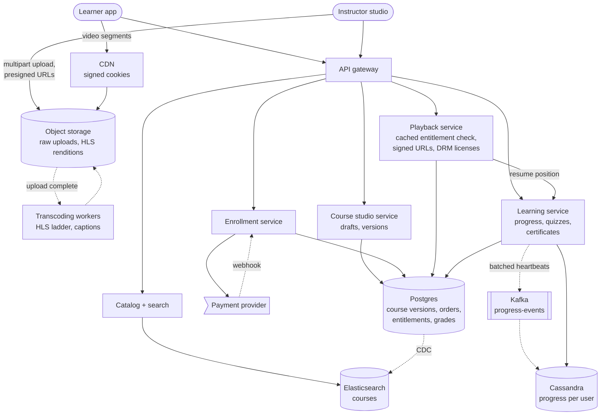
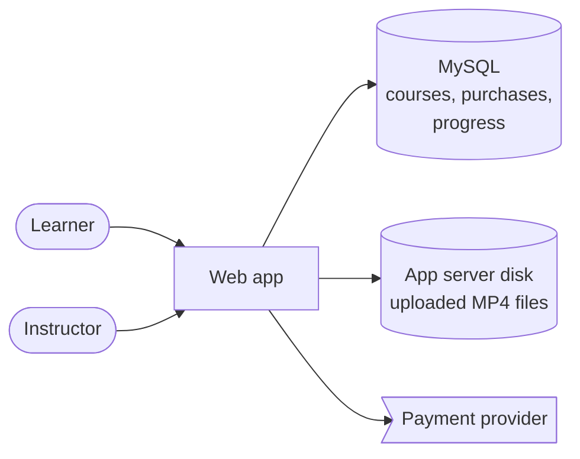
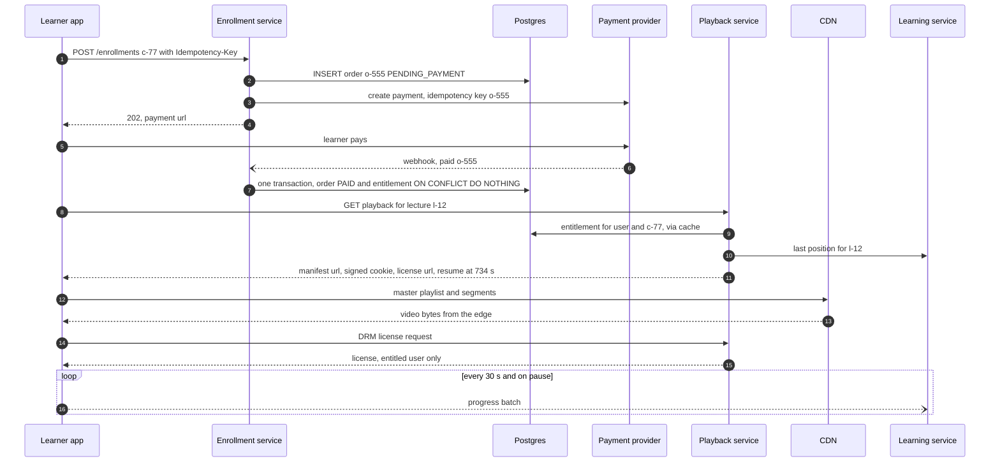

> **In one line:** upload lectures straight to object storage, transcode them once into HLS served by a CDN behind short-lived signed URLs, create an entitlement row idempotently from the payment webhook and check it before every playback, and track progress with batched heartbeats into a write-optimized store.

## The design at a glance



There are three paths. **Video**: the instructor uploads straight to object storage, workers transcode it once into an HLS bitrate ladder, and the CDN serves it. **Money**: the enrollment service writes an entitlement row only when the payment webhook arrives, so "paid" and "enrolled" can never disagree. **Learning**: the playback service checks the entitlement before handing out a signed URL and the resume position; the player sends progress in batches every 30 seconds through Kafka into Cassandra, and that progress drives completion and certificates.

## How to spend the 30 minutes

| Minutes | What you do | What to say or draw |
|---|---|---|
| 0-3 | Requirements | Recorded or live? Buy per course or subscribe? Graded certificates? |
| 3-6 | Numbers | 830 k peak viewers, 2.5 Tbps of video, 28 k progress batches/s, 6.5 PB stored |
| 6-9 | API and data model | Entitlement row per user per course, progress keyed by user, course versions |
| 9-12 | Design v1 | One app server streaming MP4 files, progress written to SQL every 5 s |
| 12-15 | Break v1 | Buffering, stolen videos, paid but not enrolled, progress writes melt the DB |
| 15-22 | Design v2 and v3 | Upload pipeline, HLS + CDN, signed URLs, entitlements, batched progress, versions |
| 22-29 | Deep dives | Video protection, payment consistency, progress at scale, grading, versioning |
| 29-30 | Recap | The 60-second summary at the bottom |

## Requirements

**Functional**

- Search and browse courses by topic, level, language, rating and price.
- Buy a course, then watch its lectures on web and mobile.
- Resume any lecture where you left off, on any device; see percent complete.
- Take quizzes and assignments: auto-graded or peer-graded.
- Get a verifiable certificate on completion.
- Rate and review courses you took.
- Instructors upload videos, build the curriculum and publish edits.

**Non-functional**

- Video starts in under 2 seconds and adapts to the network.
- Only entitled users can watch paid lectures; a copied link stops working within minutes.
- Paid always means enrolled, and nobody is charged twice.
- Progress loses at most ~30 seconds of watching; resume works across devices.
- 99.95% availability for playback and catalog.
- Multi-gigabyte uploads survive flaky connections.

**Out of scope**

- Live classes, discussion forums, instructor payouts, ads.

> **Say it like this:** "This is a video platform with a store and a gradebook attached. Video is the bandwidth problem, so it goes through a transcoding pipeline to a CDN. Money is the correctness problem, so enrollment is an entitlement row created idempotently from the payment. Progress is the write-volume problem, so it is batched and stored in a write-optimized database."

## Back-of-the-envelope numbers

| Quantity | Estimate | How |
|---|---|---|
| Learners | 100 M registered, 10 M daily | |
| Watch time | 400 M minutes a day | 10 M x 40 minutes |
| Concurrent viewers | ~280 k average, ~830 k peak | 400 M ÷ 1,440 minutes in a day, x3 at peak |
| Video egress | ~2.5 Tbps at peak | 830 k x 3 Mbps average rendition |
| Video library | 1 M hours | 200 k courses x 5 hours |
| Video storage | ~6.5 PB | 1 M hours x (4.5 GB of renditions for a ~10 Mbps ladder + ~2 GB raw) |
| New video | ~2,000 hours a day | 10,000 instructors x 12 minutes |
| Progress batches | ~28 k / s at peak | 830 k viewers ÷ one batch every 30 s |
| Progress rows | ~12 B, ~600 GB | 100 M learners x 3 courses x 40 lectures x 50 bytes |
| Enrollments | ~6 / s average, ~60 / s in a sale | 500 k a day ÷ 86,400 s, x10 during sales |

**What the numbers tell us:**

- 2.5 Tbps can only come from a CDN. Our servers hand out manifests, keys and signed URLs, never video bytes.
- 6.5 PB belongs in object storage, and we transcode once at upload, never on the fly.
- Progress is the busiest write path, ~500x enrollments. Batch it, buffer it in Kafka, store it keyed by user.
- Enrollments are few but involve money: Postgres, idempotency keys and a unique entitlement row.

## API

```http
GET /api/v1/courses?q=kubernetes&level=beginner&lang=en&sort=rating&cursor=...
→ 200 { "courses": [ { "course_id": "c-77", "title": "...", "rating": 4.7, "price": 12.99 } ], "next_cursor": "..." }

POST /api/v1/enrollments
Idempotency-Key: 7a3c...
{ "course_id": "c-77", "payment_method": "card" }
→ 202 { "order_id": "o-555", "status": "PENDING_PAYMENT", "payment_url": "..." }      (409 if already enrolled)

GET /api/v1/courses/c-77/lectures/l-12/playback
→ 200 { "manifest_url": "https://cdn.../c-77/a-901/master.m3u8", "drm_license_url": "...", "resume_at_sec": 734 }      (403 if not entitled)

POST /api/v1/progress
{ "events": [ { "lecture_id": "l-12", "position_sec": 764, "watched_buckets": "<bitmap>", "client_ts": "..." } ] }
→ 204

POST /api/v1/quizzes/q-9/attempts
{ "quiz_version": 3, "answers": [ { "q": 1, "a": "b" }, { "q": 2, "a": ["a", "c"] } ] }
→ 200 { "score": 8, "max": 10, "passed": true }

POST /api/v1/studio/courses/c-77/uploads
{ "file_name": "lecture12.mp4", "size_bytes": 3800000000 }
→ 201 { "upload_id": "u-31", "part_urls": ["https://storage.../part-1?signature=...", "..."] }
```

- **Playback is one call**: entitlement check, short-lived signed access to that lecture's files, and the resume position.
- **Progress is batched**: every 30 seconds and on pause or close (`sendBeacon`). Watched time is a bitmap of 10-second buckets, so a retried batch is harmless.
- **Uploads bypass our servers**: multipart presigned URLs; a failed part is retried alone.
- **Enrollment is `202`**: the payment webhook grants access, not the browser coming back.

## Data model

```text
courses                    (Postgres, copied to Elasticsearch)
  course_id PK, instructor_id, title, level, language, price,
  published_version, rating_avg, rating_count

course_versions            (Postgres)
  course_id + version   PK
  status         DRAFT | PUBLISHED | ARCHIVED
  curriculum     JSON: sections, lectures (lecture_id, asset_id), quizzes (quiz_id, quiz_version)

video_assets               (Postgres, immutable once READY)
  asset_id PK, raw_key, hls_prefix, duration_sec, drm_key_id,
  status         UPLOADED | TRANSCODING | READY | FAILED

orders                     (Postgres)
  order_id PK, user_id, course_id, amount, status, payment_ref, idempotency_key UNIQUE

entitlements               (Postgres, shard key = user_id)
  user_id + course_id   PK      at most one per user per course
  source         PURCHASE | SUBSCRIPTION | ORG
  order_id, granted_at, expires_at, revoked_at

lecture_progress           (Cassandra, partition = user_id, clustering = course_id, lecture_id)
  position_sec, watched_buckets (bitmap), completed, updated_at

quiz_attempts, submissions, peer_reviews, certificates, reviews   (Postgres)
```

- **Postgres for courses, orders, entitlements and grades.** Relational and involves money; the `(user_id, course_id)` key makes a double enrollment impossible.
- **Cassandra for progress.** 12 billion rows, write-heavy, always read by user, so "my progress in this course" is one partition read.
- **Elasticsearch for the catalog**, fed by CDC: text search, filters and ranking by rating and popularity.
- **Object storage for video and certificate PDFs**, served through the CDN.

## Design v1: the simplest thing that works



1. The instructor uploads an MP4 through the app server, which saves it to disk.
2. A learner searches with `WHERE title LIKE '%kubernetes%'`.
3. They pay; when the browser returns from the provider, the server inserts a `purchases` row.
4. The player loads `/videos/l-12.mp4` and the server streams the file.
5. Every 5 seconds the player reports its position and the server runs `UPDATE progress SET position = ?`.

This works for one instructor with a few hundred students.

## Where v1 breaks

| Problem | Why it happens | What the user sees |
|---|---|---|
| Video buffers | One 1080p MP4 from one server; 2.5 Tbps cannot come from app servers, and a phone on 3G cannot play 1080p | Long start, constant buffering |
| Videos get stolen | A plain, permanent URL to an MP4 | Paid courses on file-sharing sites the next day |
| Paid but not enrolled | Access is granted only when the browser returns; close the tab and nothing is recorded. A retry creates a second purchase | "I paid and can't open my course", or a double charge |
| Progress writes melt the DB | 830 k viewers x 1 write every 5 s = 166 k writes/s on MySQL | The whole site slows down; progress is lost |
| App servers do heavy lifting | 4 GB uploads stream through them; `LIKE` search scans every course | Failed uploads, slow and poor search |

## Design v2: a video pipeline, entitlements and batched progress

### Fix 1: direct, resumable uploads

The studio asks for an upload and gets presigned multipart URLs. The browser sends 100 MB parts straight to object storage and retries only the parts that fail. When the upload completes, a storage event puts a transcoding job on a queue. App servers never touch video bytes.

### Fix 2: transcode once into HLS, serve from a CDN

Workers split the video into chunks and encode them in parallel into a ladder of renditions (240p to 1080p) as 6-second HLS segments with a master playlist, plus thumbnails and captions. The asset becomes `READY` and immutable. The player picks a rendition to match the network (no more buffering), and the CDN serves the bytes (no more bandwidth wall). See [video streaming](04-video-streaming.md) for details.

### Fix 3: signed, short-lived access, plus DRM for paid content

The playback service issues a CDN signed cookie (or URL token) that covers only `/c-77/a-901/*` and expires in 10 minutes; the player renews it while you watch, and each renewal re-checks the entitlement. Segments are encrypted, and only entitled users get the DRM license (Widevine, FairPlay, PlayReady). A copied link dies in minutes; the files alone are useless.

### Fix 4: enrollment is an entitlement row, created from the webhook

`POST /enrollments` writes an order as `PENDING_PAYMENT` with the client's idempotency key, and uses `order_id` as the provider's key. When the webhook says "paid", one transaction marks the order `PAID` and runs `INSERT INTO entitlements ... ON CONFLICT DO NOTHING`. Closing the tab no longer matters, a duplicate webhook does nothing, and a reconciler settles orders still pending after 15 minutes. See the [payment gateway](17-payment-gateway.md).

### Fix 5: check the entitlement on every playback

The playback service looks up `(user_id, course_id)` in a Redis cache (5-minute TTL) backed by Postgres: about 1,400 checks a second at peak (830 k viewers starting a new lecture every ~10 minutes). A purchase writes the cache through so a new learner can watch at once; a refund deletes the key, and the next cookie renewal fails.

### Fix 6: batch progress and write it to Cassandra

The player sends a batch every 30 seconds and on pause or exit. The learning service drops it on Kafka (partitioned by `user_id`) and returns `204`. A consumer keeps the latest position per lecture, ORs the watched-bucket bitmaps, and upserts one Cassandra row per lecture; one consumer owns each user, so writes never race. Load drops from 166 k writes/s to ~28 k, and they land in a database built for writes.

### Fix 7: catalog search on Elasticsearch

Course changes flow from Postgres to Elasticsearch through CDC. Search gets typo tolerance, filters, and ranking by rating, enrollments and recency. Course pages and thumbnails are cached on the CDN.

## Where v2 still breaks

| Problem | Why it happens | What the user sees |
|---|---|---|
| An instructor edits a live course | Lectures and quizzes change in place under 50,000 active learners | Progress points at deleted lectures; a quiz changes mid-attempt |
| Assignments cannot be graded at scale | Essays and projects need a human; one instructor, 100,000 learners | Submissions never graded |
| Certificates can be faked | A PDF anyone can edit | Employers stop trusting them |
| Reviews from people who never took the course | Anyone can rate | Fake ratings skew search ranking |

## Design v3: versioned courses and trustworthy learning records

This is the diagram at the top.

### Fix 8: immutable course versions

Instructors edit a `DRAFT` copy of the curriculum; publishing creates version N+1. Lecture IDs stay stable across versions, and a replaced video is a new `asset_id`, so progress keyed by lecture survives. Quiz attempts pin the `quiz_version` they started on. Certificates record which version was completed.

### Fix 9: auto-grading and peer grading

Multiple-choice and numeric questions are graded instantly against an answer key that never leaves the server. Code assignments run tests in a sandboxed container from a job queue. Essays and projects go to 3-4 peers with a rubric; the median score counts, and you must review others to get your own grade.

### Fix 10: verifiable certificates

When all required lectures are complete and the graded items are passed, the learning service issues one certificate per `(user_id, course_id)`, renders a PDF to object storage, and publishes a verification page at `/certificates/<id>`. Anyone can check it there; an edited PDF does not match the record.

### Fix 11: reviews only from real learners

Only users with an entitlement who have finished some of the course can review, once per course. A worker recomputes the average and pushes it to Elasticsearch, which uses it for ranking.

### Components

| Component | Job | Tech choice |
|---|---|---|
| Object storage + CDN | Raw uploads, HLS renditions, PDFs | S3 + CloudFront, signed cookies, origin shield |
| Transcoding workers | Upload to HLS ladder, captions, thumbnails | FFmpeg on autoscaled workers, job queue |
| Catalog + search | Course search and pages | Elasticsearch, fed by CDC |
| Course studio service | Drafts, versions, upload URLs | Postgres |
| Enrollment service | Orders, webhooks, entitlements | Postgres, idempotency keys, reconciler |
| Playback service | Entitlement check, signed access, DRM licenses | Redis cache over Postgres, multi-DRM provider |
| Learning service | Progress, quizzes, grading, certificates | Kafka + Cassandra for progress, Postgres for grades |

## Key flow: buy a course and start watching



- **Duplicate webhook:** the order is already `PAID` and the entitlement insert does nothing.
- **Webhook lost:** when the browser returns, the enrollment service asks the provider for the status itself; the reconciler catches the rest.
- **Already enrolled:** `POST /enrollments` returns `409` before any charge.
- **Refund:** set `revoked_at`, delete the cache key; playback stops at the next cookie renewal, within 10 minutes.
- **Progress service down:** the player keeps batches locally and retries; same-device resume uses the local copy.

## Deep dives

### How do you protect paid video?

**The problem.** Make copying hard without hurting real learners.

**Options.**

| Option | Good | Bad |
|---|---|---|
| Public CDN URLs | Simplest, fully cacheable | Anyone can share and download |
| **Signed cookies or tokens, short expiry** | Cheap, works on every device, links die in minutes | A logged-in user can still save the segments |
| HLS AES-128 encryption, key from our server | Files alone are useless | The key is visible to the player, so a determined user can decrypt |
| **DRM (Widevine, FairPlay, PlayReady)** | Keys are protected by the device's DRM module; allows offline downloads that expire | A license service to pay for and run |

**Pick.** Signed short-lived access for everything, plus DRM for paid courses. Add a faint watermark with the user ID, because nothing stops a screen recording.

### Keeping payment and enrollment consistent

**The problem.** The charge lives at the provider, the access in our database. They must never disagree.

**Options.**

| Option | Good | Bad |
|---|---|---|
| Grant access when the browser returns | Simple | Closed tab means paid without access; easy to fake |
| Distributed transaction with the provider | In theory atomic | Providers do not offer it |
| **Order first, webhook grants an idempotent entitlement, reconciler** | Every payment ends in access or a refund; retries are safe | A few seconds before access; a reconciler to run |

**Pick.** The webhook path. Playback checks only the entitlement row, so subscriptions (`SUBSCRIPTION` with `expires_at`) and company licenses (`ORG`) reuse the same check.

### Progress tracking at scale

**The problem.** 830 k people watching, each wanting exact resume and correct percent complete, without 166 k database writes a second.

**Options.**

| Option | Good | Bad |
|---|---|---|
| Write every heartbeat to SQL | Simple, always fresh | Far too many writes |
| Redis only | Very fast | Memory cost for 12 B rows; durability worries |
| **Client batches, Kafka, consumer coalesces, Cassandra** | 6x fewer requests, smooths spikes, cheap durable storage | Up to 30 s of progress lost if the app crashes |

**Pick.** The batched path. Position is "latest wins". Completion uses a bitmap of 10-second buckets (360 bits for an hour), merged with OR, so duplicates and out-of-order batches cannot inflate or erase progress, and skipping to the end does not count as watching.

### Quizzes and grading

**The problem.** Some work can be graded by code, some needs people, and the volume is huge.

**Options.**

| Option | Good | Bad |
|---|---|---|
| **Auto-graded questions and test-run code** | Instant, free, consistent | Only for closed answers; cheating needs question pools and attempt limits |
| Instructor or TA grading | High quality | Does not scale past a few hundred learners |
| **Peer grading with a rubric** | Scales with the class | Noisy; needs 3-4 reviewers, the median, and deadlines |
| AI-assisted grading | Fast feedback on essays | Must be checked; fairness concerns |

**Pick.** Auto-grade everything that can be; peer-grade open work, using the median of 3-4 reviews. Store each grade with the `quiz_version`, so later edits never change old scores.

### Course versioning when instructors edit

**The problem.** Instructors fix and extend courses while thousands of learners are halfway through.

**Options.**

| Option | Good | Bad |
|---|---|---|
| Edit in place | Simple | Breaks progress, grades and certificates |
| **Immutable versions, everyone on latest, stable lecture IDs** | Learners get fixes; progress carries over by lecture ID | Percent complete can drop when lectures are added |
| **Immutable versions, learners pinned to theirs** | Graded programs stay fair | Learners miss fixes; old versions kept longer |

**Pick.** Both, by course type. Self-paced video courses move everyone to the latest version. Graded courses with deadlines keep each cohort on the version it started.

## Trade-offs to say out loud

- We chose **HLS + CDN over plain MP4** for adaptive bitrate and global reach. The cost is transcoding compute and about 2x storage.
- We chose **signed access plus DRM** over public URLs. The cost is a license service; screen recording still works, so we watermark.
- We chose **webhook-driven entitlements over trusting the redirect**. The cost is a few seconds of delay and a reconciler.
- We chose **batched heartbeats** over writing every event. The cost is up to 30 seconds of progress lost on a crash.
- We chose **immutable course versions** over in-place edits so progress, grades and certificates stay consistent. The cost is storing old versions and migration rules.
- We chose **peer grading** for open work so it scales. The cost is noisier grades.

## Follow-up questions

**Q: How do offline downloads work on mobile?**
The app downloads encrypted segments and gets a persistent DRM license that expires (say 30 days). Renewing it re-checks the entitlement, so a refunded course stops playing.

**Q: How do subscriptions change the design?**
They only change how entitlements are created: a `SUBSCRIPTION` row with `expires_at`, extended by the renewal webhook. Playback does not change.

**Q: How do you stop "watch everything, then refund"?**
Progress data makes the policy enforceable: refunds within 30 days only if less than a set share of the course was watched.

**Q: How are recommendations built?**
A daily batch job finds courses often taken together and similar topics, precomputes rows per user and caches them. New users get popular courses in their chosen topics.

**Q: A big course launches and everyone presses play. What breaks?**
The CDN is cold. An origin shield collapses misses so storage sees one request per segment, and we pre-warm the opening lectures.

**Q: How do captions and translations fit in?**
The pipeline runs speech-to-text and writes WebVTT tracks that the HLS master playlist references. Translations are extra tracks added later without re-encoding video.

## 60-second recap

- Uploads go straight to object storage; workers transcode once into an HLS ladder with captions.
- The CDN serves all video bytes (~2.5 Tbps) behind 10-minute signed cookies; paid content also uses DRM.
- Enrollment writes an order first; the payment webhook creates a unique `(user_id, course_id)` entitlement idempotently, and a reconciler catches the rest.
- Playback checks the entitlement (cached) before every signed URL and license, and returns the resume position.
- Progress is batched every 30 s through Kafka into Cassandra: latest position for resume, OR-merged bitmaps for completion.
- Quizzes auto-grade where possible, peer-grade open work, and pin the quiz version.
- Courses are immutable versions with stable lecture IDs; certificates are records with a public verification page.
