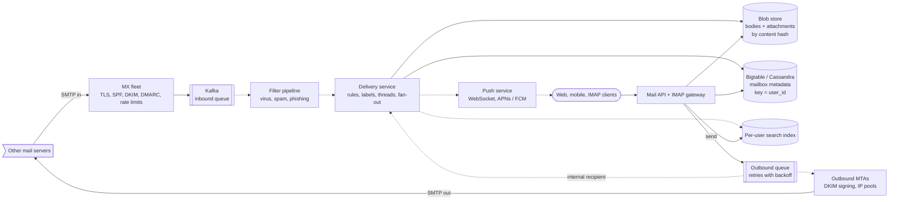
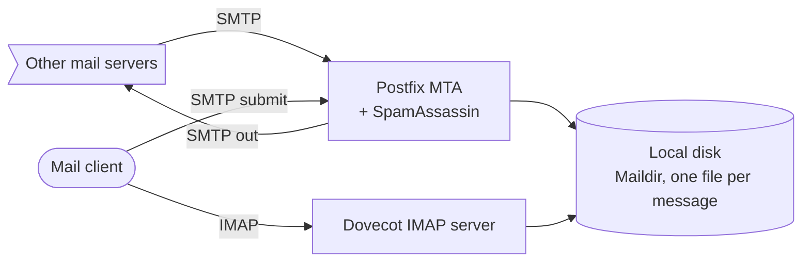
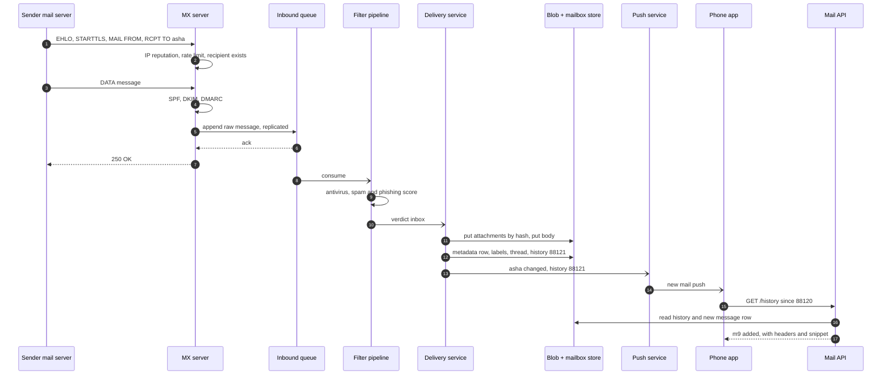

> **In one line:** MX servers accept mail only after writing it to a durable queue, a filtering pipeline scores it, and a delivery service stores the body and attachments once in blob storage and a small metadata row per recipient in a wide-column store keyed by user, then indexes it for that user's search and pushes a "new mail" signal; outgoing mail leaves through a retrying queue and DKIM-signing MTAs that guard the IP reputation.

## The design at a glance



**Inbound**: a sender's server connects to an MX server, which checks reputation and authentication and answers `250 OK` only after the message is safely in Kafka. Filters score it, and the delivery service writes the body to blob storage, a metadata row into the recipient's partition, an entry in their search index, and pings their devices. **Outbound**: the API puts the message on a queue; internal recipients are delivered directly, and external ones go through MTAs that sign with DKIM and retry with backoff.

## How to spend the 30 minutes

| Minutes | What you do | What to say or draw |
|---|---|---|
| 0-3 | Requirements | Send, receive, search, labels, threads. IMAP? Attachment size limit? |
| 3-6 | Numbers | 1 B users, ~460 k deliveries a second, exabytes of mail |
| 6-9 | API and data model | List, read, send, label, search, sync. Everything keyed by user |
| 9-12 | Design v1 | One Postfix + Dovecot box with Maildir on local disk |
| 12-15 | Break v1 | One disk, spam, slow search, polling, one IP, duplicate attachments |
| 15-22 | Design v2 | MX fleet + queue, filter pipeline, wide-column + blobs, search, push, outbound queue |
| 22-25 | Design v3 | Mailing lists, bulk senders, huge mailboxes, regions |
| 25-29 | Deep dives | Labels and threads, spam and SPF / DKIM / DMARC, outbound reputation, storage |
| 29-30 | Recap | The 60-second summary at the bottom |

## Requirements

**Functional**

- Receive mail from any server on the internet; send mail to any address.
- Web and mobile apps, plus IMAP and SMTP submission for desktop clients.
- Labels or folders, conversation threads, read / starred flags, archive and delete.
- Full-text search over your own mail, including attachment text.
- Attachments up to 25 MB; new mail shows up on open devices within seconds.
- Spam, virus and phishing protection.

**Non-functional**

- Never lose a message we accepted with `250 OK`. Durability 11 nines.
- Availability 99.99% for reading and sending. Inbound can be delayed briefly (senders retry), never dropped.
- Delivery to the inbox within a few seconds of acceptance.
- Read-your-writes per user: a sent message is in Sent, a label change sticks.
- Search results in under a second.

**Out of scope**

- Calendar, contacts and chat.
- Ads, and the internals of the spam model.

> **Say it like this:** "Email is a write-heavy pipeline with a hard promise: once we say 250 OK, the message is ours to keep. Every read is inside one user's mailbox, so I'll partition everything by user: metadata in a wide-column store, bodies in blob storage, a search index per user. Inbound flows through a queue and filters; outbound through a retrying queue that protects our IP reputation."

## Back-of-the-envelope numbers

| Quantity | Estimate | How |
|---|---|---|
| Users | 1 B accounts, 500 M daily active | Assumption |
| Mail delivered | 40 B / day ≈ 460 k / s, ~1 M / s peak | 1 B x 40 messages ÷ 86,400 s, x2 |
| SMTP offered | ~80 B / day | About half is rejected as spam at the edge |
| Mail sent | 5 B / day ≈ 58 k / s | 1 B x 5 messages ÷ 86,400 s |
| Average message | 50 KB | ~20 KB body and headers, attachments averaged in |
| New data | 2 PB / day ≈ 0.7 EB / year | 40 B x 50 KB |
| Stored mail | ~2 EB logical, ~3 EB on disk | 1 B x 2 GB average (spam and deletes are purged), x1.5 erasure coding |
| Messages stored | ~40 trillion | 2 GB ÷ 50 KB = 40,000 per user, x 1 B users |
| Metadata | ~20 PB | 40 T x 500 bytes |
| Client API calls | ~120 k / s average | 500 M x 20 calls ÷ 86,400 s |

**What the numbers tell us:**

- 460 k deliveries a second, each touching blobs, metadata and the index: an asynchronous pipeline with queues between stages.
- Exabytes of immutable bodies go to blob storage. Metadata rows stay small (~500 bytes) so listing an inbox is cheap.
- Every read is "my mailbox": partition by `user_id` and never query across users.
- Attachments dominate bytes and are often duplicated, so store them by content hash.

## API

```http
GET /v1/threads?label=INBOX&page_token=p2&limit=50
→ 200 { "threads": [{ "thread_id": "t1", "subject": "...", "snippet": "...", "unread": true, "labels": ["INBOX"] }], "next_page_token": "p3" }

GET /v1/messages/m7
→ 200 { "headers": {...}, "body_html": "...", "attachments": [{ "id": "a1", "name": "q3.pdf", "size": 2400000, "url": "..." }] }

POST /v1/messages/send
Idempotency-Key: 5d2e...
{ "to": ["bob@other.com"], "subject": "Q3", "body": "...", "attachment_ids": ["a1"], "in_reply_to": "<m6@ourmail.com>" }
→ 202 { "message_id": "m9", "status": "queued" }

POST /v1/messages/m7/modify  { "add_labels": ["Work"], "remove_labels": ["INBOX", "UNREAD"] }

GET /v1/search?q=from:asha invoice after:2026/01/01&page_token=...

GET /v1/history?since=88120          → 200 { "changes": [{ "id": 88121, "type": "added", "message_id": "m9" }], "latest": 88121 }
```

- Send returns **`202`**: the message is queued; delivery happens asynchronously with retries. The idempotency key stops a double tap from sending twice.
- Attachments are uploaded first (resumable) and referenced by id, so the send call is small.
- **`/history`** is a per-user change log. After a push, or when the app opens, the client asks for changes since its last id instead of re-listing the mailbox.
- Archive is just "remove the `INBOX` label". Labels make folders a special case.

## Data model

```text
messages     row key = user_id # msg_id (time-ordered)
             inbound_id, thread_id, from, to, subject, snippet, date, size, labels set,
             flags, body_ref, attachment_refs [hash ...], rfc822_message_id
label_index  row key = user_id # label # reverse_time # msg_id → thread_id     newest first per label
threads      row key = user_id # thread_id → msg_ids, subject, last_date, labels
history      row key = user_id # history_id → change                          for client sync
labels       row key = user_id # label_id → name, unread_count
blobs        blob store, key = SHA-256 of content → bytes, refcount
search       per-user inverted index (terms → msg_ids), sharded by user_id
```

- **Metadata in a wide-column store (Bigtable, or Cassandra with `user_id` as the partition key).** Rows are sorted within a user, so "Inbox, newest 50" is one short range scan. It absorbs hundreds of thousands of writes a second and scales by adding nodes.
- **Bodies and attachments in blob storage.** Immutable, large, rarely read after the first week. Attachments are keyed by hash and stored once.
- **Search index per user**, because every query is scoped to one user. Small users are grouped many to an index shard.
- **`history`** is the per-user journal that clients and the IMAP gateway sync from.

## Design v1: the simplest thing that works



1. A sender's server looks up the MX record for `ourmail.com`, connects, and sends `MAIL FROM`, `RCPT TO` and `DATA`.
2. Postfix runs SpamAssassin rules and writes the message as a file into the user's Maildir.
3. The user's client connects over IMAP; Dovecot lists the folder and serves the message.
4. To send, the client submits over SMTP (port 587). Postfix queues it on disk and delivers it to the recipient's MX, retrying on failure.
5. Search scans the files (or a simple per-folder index).

This is how many small companies ran mail for years. It works for a few thousand mailboxes.

## Where v1 breaks

| Problem | Why it happens | What the user sees |
|---|---|---|
| One box holds every mailbox | 1 B users x 2 GB = 2 EB, on one disk | Disk full; one crash loses everyone's mail |
| Spam floods in | Half of inbound is spam, rule filters are easy to beat, and every message costs CPU | Inbox full of junk, real mail delayed |
| Search scans files | 40,000 messages per user, read from disk | Searches take seconds to minutes |
| New mail arrives late | Clients poll, or hold IMAP IDLE connections one server cannot scale | Mail shows up minutes later on the phone |
| All mail leaves from one IP | One compromised account's spam burns the shared IP's reputation | Every user's mail lands in spam folders elsewhere |
| A 10 MB attachment to 500 colleagues | Stored once per mailbox | 5 GB for one email |

## Design v2: a pipeline, a mailbox store, and a reputation-aware outbound path

### Fix 1: an MX fleet that queues before it says yes

Publish several MX records pointing at a fleet of stateless SMTP servers in several regions. Each server checks the connecting IP's reputation, rate-limits it, rejects unknown recipients with `550` at `RCPT TO`, and writes the raw message to a replicated Kafka topic **before** answering `250 OK` (messages over ~1 MB go to blob storage first, and the queue carries a pointer). If the queue is unavailable it answers `451` (try later), and the sender retries, as SMTP requires. No accepted message can be lost, and no single box holds mail.

### Fix 2: a layered filter pipeline

Cheap checks first, expensive ones later:

- **At the SMTP edge:** IP blocklists and reputation, per-IP rate limits, and SPF, DKIM and DMARC verification. Obvious junk is refused before we store a byte.
- **After acceptance:** antivirus on attachments, an ML classifier for spam and phishing (content, URLs, sender reputation, "Report spam" clicks from users), and link checks against a safe-browsing list.

The verdict routes the message to the inbox, the spam label, or quarantine.

### Fix 3: metadata in a wide-column store, bytes in blob storage

The delivery service consumes filtered messages. For each recipient it applies the user's filter rules, picks labels, finds the thread, writes the body and attachments to the blob store (attachments keyed by SHA-256, so the 10 MB file sent to 500 colleagues is stored once), then writes the metadata row, label index rows and a history entry in that user's partition. Writes are idempotent on `(user_id, inbound_id)`, an id the MX assigns when it accepts the message, so a retry after a crash never creates a duplicate.

### Fix 4: a search index per user

An indexer consumes delivery events and adds the message's terms (headers, body, extracted attachment text) to the user's inverted index within seconds. A query reads only that user's shard, so it is fast no matter how many users exist.

### Fix 5: push new mail to clients

After a delivery the service publishes "user 42 changed, history 88121". The push service forwards it over a WebSocket to open web clients and through APNs or FCM to phones. The IMAP gateway sends an untagged `EXISTS` to clients sitting in `IDLE`. Each client then calls `/history?since=` and fetches only what is new. A lost push is harmless: the next sync catches up from the history id.

### Fix 6: an outbound queue with retries and reputation control

Send puts the message on a durable outbound queue. Internal recipients go straight to the delivery service. For external ones, an MTA signs the message with DKIM and delivers it to the recipient's MX:

- **`4xx` (temporary):** retry with exponential backoff, for example 1 min, 5 min, 30 min, 2 h, then every few hours for up to 5 days, then bounce to the sender.
- **`5xx` (permanent):** bounce at once with the reason.
- **Reputation:** separate IP pools for trusted senders and new or suspicious accounts, per-account send limits, an outbound spam check, and gradual warm-up of new IPs. Our domain publishes SPF, DKIM and DMARC records so receivers trust us.

## Where v2 still breaks

| Problem | Why it happens | What the user sees |
|---|---|---|
| A mailing list with 500,000 members | One post becomes 500,000 deliveries at once, and list servers rewrite messages, which breaks DKIM | The pipeline backs up for everyone; list mail fails DMARC |
| Bulk senders | A bank sends 50 M statements in an hour from a few IPs | Personal mail queues behind the flood |
| Huge mailboxes | Automated accounts with 10 M+ messages make giant partitions | Slow listing and hot nodes |
| A region goes down | Each mailbox lives in one region | Users there cannot read or receive mail |

## Design v3: fan-out, fair queues, bounded partitions, and regions

This is the diagram at the top.

### Fix 7: fan-out for mailing lists

The delivery service stores a list message's body once and writes recipient metadata rows in batches, spread over workers by `user_id`. One SMTP transaction may carry many `RCPT TO` lines, and the raw message is stored once for all of them. For our own outgoing lists, throttle per destination domain, authenticate with SPF, DKIM and DMARC, add one-click `List-Unsubscribe`, and keep the complaint rate low: Gmail and Yahoo have required all three of bulk senders since 2024. When a list rewrites a message, receivers can use ARC headers to see the original authentication results.

### Fix 8: fair queues by sender reputation

Partition inbound work by priority: personal mail and known-good senders in a fast lane, bulk senders in a throttled lane. When a bulk sender exceeds its rate, the MX answers `421` or `451` and the sender slows down and retries. Personal mail is never stuck behind a marketing blast.

### Fix 9: bound the partitions and cache the first page

Bucket message rows by `user_id + month`, so no single partition grows without limit, and keep each active user's first inbox page and unread counts in Redis. Listing the inbox touches one bucket or the cache.

### Fix 10: home regions with replication

Every user has a home region. Their mailbox is replicated across three zones in that region and asynchronously to a second region. MX servers in every region accept mail and forward it through the queue to the user's home region. If a region fails, users are switched to the replica, accepting that the last few seconds of changes show up late, once the old region recovers.

### Components

| Component | Job | Tech choice |
|---|---|---|
| MX fleet | Accept SMTP, authenticate, rate-limit, queue | Stateless SMTP servers in every region |
| Inbound queue | Durable buffer between accept and deliver | Kafka, replicated, partitioned by `inbound_id` |
| Filter pipeline | Virus, spam, phishing verdicts | Workers calling AV engines and an ML scorer |
| Delivery service | Rules, labels, threads, fan-out | Stateless, idempotent, routes by `user_id` |
| Mailbox store | Metadata, labels, threads, history | Bigtable or Cassandra keyed by `user_id` |
| Blob store | Bodies and attachments | Object storage, attachments by SHA-256, bodies packed |
| Search | Per-user full-text index | Lucene-style shards grouped by user |
| Mail API + IMAP gateway | Web, mobile, IMAP, SMTP submission | Stateless |
| Push service | New-mail signals | WebSocket servers, APNs and FCM |
| Outbound queue + MTAs | Retries, DKIM signing, IP pools | Durable delayed-retry queue, MTA fleet |

## Key flow: receive an email



- **Queue down:** the MX answers `451`. The sender keeps the message and retries for days.
- **Delivery crashes after the blob write:** the queue redelivers. Attachments are keyed by hash and rows by `(user_id, inbound_id)`, so the retry overwrites rather than duplicates; a body written twice leaves a dead copy that compaction removes.
- **Filters are slow:** the queue grows and mail is delayed, never lost. Consumers scale on queue lag.
- **Unknown recipient:** refuse with `550` at `RCPT TO`. Accepting and bouncing later sends bounces to forged senders (backscatter).
- **Push lost:** the app catches up from its last history id on the next open.

## Deep dives

### Labels, folders and threads

**The problem.** Users want folders, Gmail-style labels and conversations, and IMAP clients only understand folders.

| Option | Good | Bad |
|---|---|---|
| Folders (a message lives in one place) | Simple, maps to IMAP | A message cannot be in "Work" and "Travel" |
| **Labels (a set per message)** | Folders are a special case, archive = remove `INBOX` | IMAP shows one message in several folders |
| Thread by subject only | Easy | Unrelated "Hello" mails get merged |
| **Thread by `References` / `In-Reply-To`, then subject** | Accurate for real replies | Some clients drop the headers |

**Pick.** Labels stored as a set on the message, plus `label_index` rows for listing. Threads come from the `References` and `In-Reply-To` headers, falling back to normalised subject plus participants within a time window. The IMAP gateway shows each label as a folder.

### Spam, phishing and sender authentication

**The problem.** About half of inbound mail is junk, and the `From:` line is trivial to forge. Three DNS-based checks tell you who really sent a message:

- **SPF:** the sending IP is listed in the DNS of the envelope sender's domain.
- **DKIM:** the message is signed by the domain in `d=` (public key in DNS), so it was not changed in transit.
- **DMARC:** SPF or DKIM passed for a domain that matches the visible `From:`. The owner's policy says what to do otherwise (none, quarantine, reject).

| Option | Good | Bad |
|---|---|---|
| Content rules (SpamAssassin style) | Simple, explainable | Spammers learn the rules quickly |
| Authentication only | Stops forged `From:` lines | Spammers authenticate their own domains too |
| ML on content, URLs and reputation | Adapts, learns from "Report spam" | Needs data and careful false-positive control |
| **All of them, cheapest first** | Most junk refused before we store it | More moving parts |

**Pick.** Reputation and authentication at the SMTP edge, then antivirus and the ML classifier after acceptance. A DMARC failure under a `reject` policy is refused; borderline mail goes to the spam label so users can rescue it, and those rescues train the model.

### Outbound delivery and IP reputation

**The problem.** If receivers decide our IPs send spam, every user's mail suffers.

| Option | Good | Bad |
|---|---|---|
| One shared IP pool | Simple | One spammer hurts everyone |
| **Pools by trust level** | New or suspicious accounts cannot damage trusted mail | More IPs to warm up and monitor |
| Dedicated IPs per big customer | Isolates their reputation | Needs steady volume to stay warm |

**Pick.** Trust-based pools, per-account send limits, outbound spam scoring, and feedback loops (receivers report complaints back to us). Retries use exponential backoff with jitter and give up after about 5 days with a bounce.

### Storage layout and attachment dedupe

**The problem.** 40 trillion messages and exabytes of bytes, but each user reads mostly their newest mail.

| Option | Good | Bad |
|---|---|---|
| Whole message as one blob per mailbox | Simple | Duplicate attachments, slow listings |
| **Small metadata rows + blobs by hash** | Fast listing, attachments stored once | Refcounts to manage on delete |
| One object per small body | Simple | Tens of trillions of tiny objects |
| **Pack small bodies into large files** | Few big objects, cheap | Compaction when mail is deleted |

**Pick.** Metadata rows in the wide-column store, attachments by SHA-256 with a refcount, small bodies packed into large append-only files addressed by `(file, offset)`. Deleted data is reclaimed by compaction and refcount sweeps, and mail untouched for a year moves to a colder tier.

## Trade-offs to say out loud

- We chose to **queue before `250 OK`** over delivering synchronously. The cost is a few seconds of delivery latency, in exchange for never losing accepted mail.
- We chose a **wide-column store keyed by user** over SQL. The cost is no cross-user queries and no multi-row transactions, so label index rows are written idempotently and repaired by a background check.
- We chose a **per-user search index** over one global index. The cost is many small indexes to manage; the win is that each query touches one small shard.
- We chose **labels over folders**. The cost is a translation layer for IMAP.
- We chose **dedupe by content hash** for attachments. The cost is reference counting and slower deletes.

## Follow-up questions

**Q: How does IMAP work on top of this?**
The IMAP gateway maps each label to a folder and keeps a per-label UID counter so IMAP's ascending UIDs hold. It reads the history log to answer `IDLE` and to sync flags.

**Q: How do you delete a message for good?**
Remove the metadata row and index entries, then decrement the attachment refcounts. Bytes are reclaimed later by compaction, and backups expire on a schedule so deletion is real.

**Q: How do you handle a 25 MB attachment?**
The client uploads it resumably to blob storage first, and the send references its id. Larger files are sent as a link to [cloud storage](18-cloud-storage.md).

**Q: What about encryption?**
TLS between servers (STARTTLS, with MTA-STS so senders refuse to downgrade) and between clients and us. At rest, blobs are encrypted with keys wrapped by a KMS.

**Q: How do you stop a hacked account from spamming?**
Per-account send limits, outbound spam scoring, and anomaly detection (a sudden burst to thousands of new recipients). Suspicious mail goes through the low-trust IP pool or is held.

**Q: What fails first at 10x?**
The filter pipeline (ML scoring per message) and the search indexer. Both sit behind queues, so the symptom is delay, not loss; scale them on queue lag.

## 60-second recap

- MX fleet in every region: reputation, rate limits, SPF / DKIM / DMARC, then write to Kafka before `250 OK`.
- Layered filtering: cheap checks at the edge, antivirus and ML spam and phishing scoring after acceptance.
- Delivery writes bodies and attachments to blob storage (attachments by hash, stored once) and small metadata rows, labels, threads and history into a wide-column store keyed by user.
- A per-user search index and a per-user history log; a push service tells clients to sync from their last history id.
- Outbound queue with exponential backoff for 5 days, DKIM signing, trust-based IP pools.
- v3: fan-out for mailing lists, fair queues for bulk senders, bucketed partitions, home regions with replication.
- Storage for 1 B users: ~2 EB of mail and ~20 PB of metadata, all partitioned by `user_id`.
