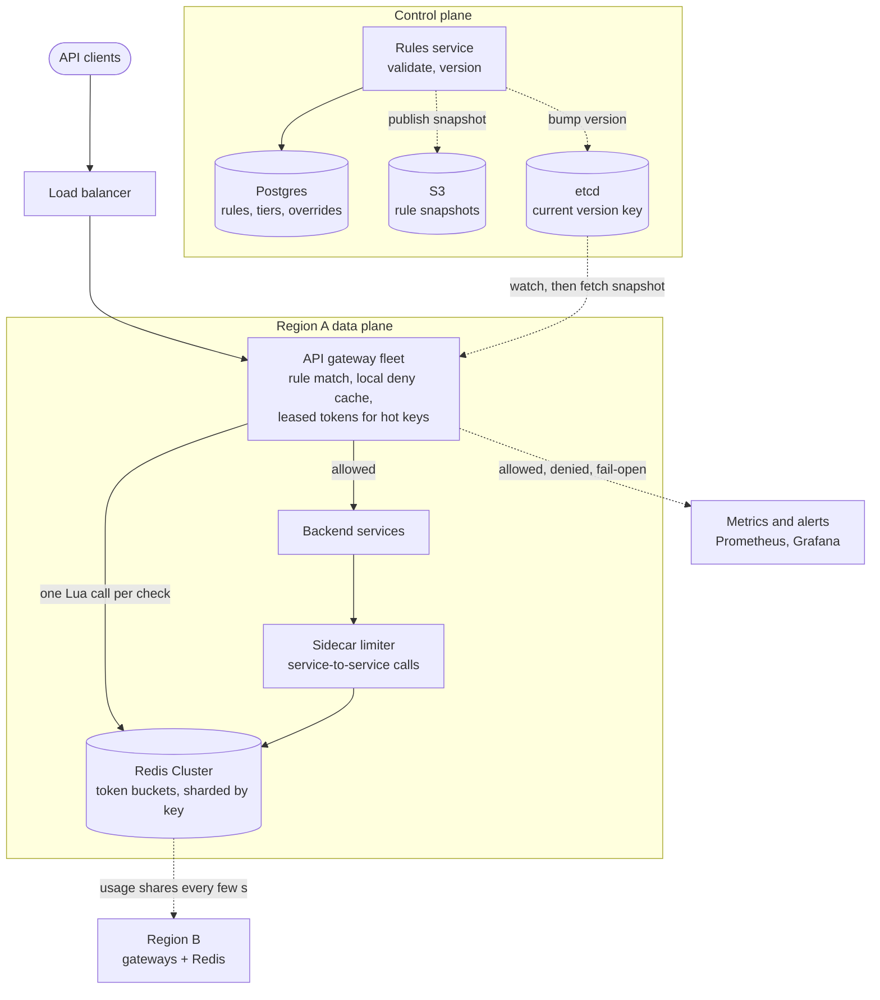
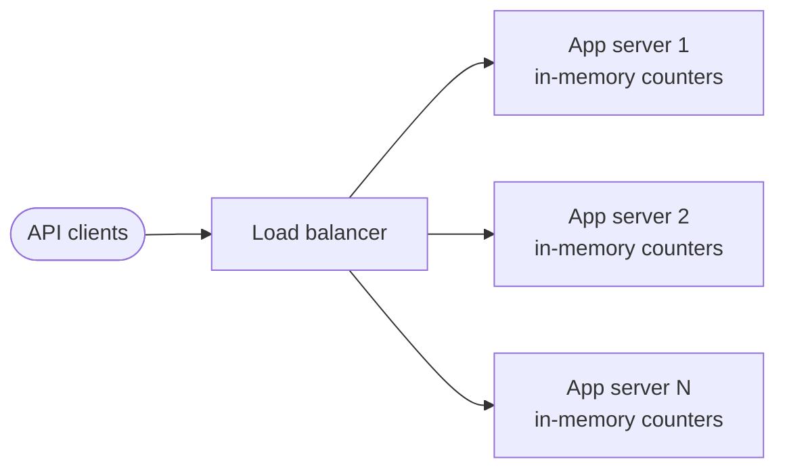
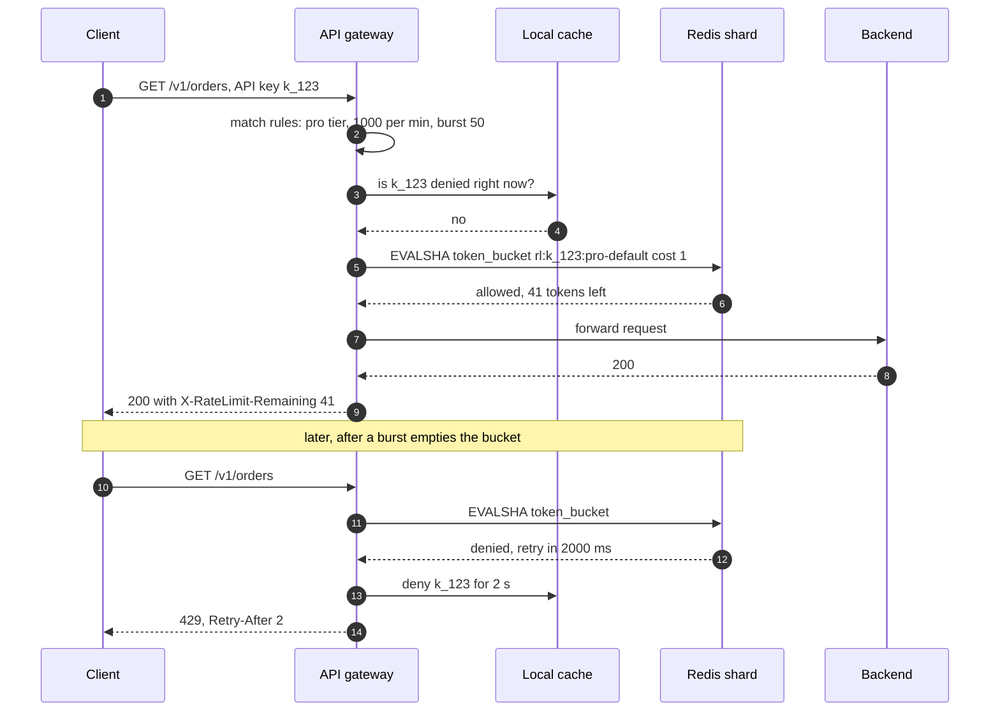

> **In one line:** check every request at the API gateway against hot-reloaded rules, using a token bucket per key in Redis updated by one atomic Lua script, with a local layer in each gateway for hot keys and denied clients, a deliberate fail-open policy, and a `429` with `Retry-After` when the bucket is empty.

## The design at a glance



Every request reaches a gateway, which matches it against rules held in memory, rejects it locally if the client was denied a moment ago, and otherwise runs one Lua token-bucket script on the Redis shard that owns that key. Allowed requests go on to the backend; the rest get `429` with `Retry-After`. Rules change through the control plane and reach every gateway in seconds without a deploy; internal calls go through a sidecar using the same buckets.

## How to spend the 30 minutes

| Minutes | What you do | What to say or draw |
|---|---|---|
| 0-3 | Requirements | Limit by what (key, user, IP, endpoint)? Tiers? Bursts? Hard or soft? |
| 3-6 | Numbers | ~460 k checks/s at peak, 20 M active keys, 50 gateways |
| 6-9 | API, rules, data model | Rule shape, response headers, bucket state in Redis |
| 9-12 | Design v1 | In-memory counter per server, then break it behind a load balancer |
| 12-19 | Design v2 | Gateway + Redis, the algorithms table, the race and the Lua fix |
| 19-24 | Design v3 | Local + global for hot keys, fail-open, multi-region |
| 24-29 | Deep dives | Placement, atomicity, rules hot reload, monitoring |
| 29-30 | Recap | The 60-second summary at the bottom |

## Requirements

**Functional**

- Limit requests per API key, user, IP and endpoint, with tiers (free 100/min, pro 1,000/min, enterprise custom).
- Several rules can match one request; all of them must pass.
- Allow short bursts above the average rate, configurable per rule.
- Throttled requests get `429` with `Retry-After`; every response carries rate-limit headers.
- Rules change without a deploy; a new rule can run in shadow mode (log only) first.
- The same limits protect internal service-to-service calls.

**Non-functional**

- Adds under 2 ms p99 to a request.
- Accurate fleet-wide: within ~5% of the limit, not multiplied by the server count.
- A limiter failure never takes the API down (fail open), except on endpoints marked sensitive.
- ~460,000 checks a second at peak, 20 M active keys.
- Rule changes live everywhere within 10 seconds.

**Out of scope**

- Network-level DDoS protection (the CDN or scrubbing service handles floods first).
- Monthly billing quotas (mentioned in follow-ups), authentication.

> **Say it like this:** "A rate limiter is a shared counter checked on every request, so the design is about staying correct across 50 gateway nodes while adding under 2 ms. I'll put it in the API gateway, use a token bucket in Redis updated by an atomic Lua script, add a local layer for hot keys, and decide up front what happens when Redis is down."

## Back-of-the-envelope numbers

| Quantity | Estimate | How |
|---|---|---|
| Requests | ~230,000 / s average, ~460,000 / s peak | 20 B requests a day ÷ 86,400 s, x2 at peak |
| Gateway nodes | ~50 | 460 k ÷ ~10 k requests/s per node |
| v1 effective limit | 50x too loose | 100/min per node x 50 nodes = 5,000/min |
| Redis primaries | ~10 | One script per request: 460 k/s ÷ ~50 k scripts/s per shard, with headroom |
| Active keys | ~20 M | 5 M API keys and users + 15 M IPs seen in a window |
| Token-bucket memory | ~2 GB | 20 M keys x ~100 bytes (two numbers + key overhead) |
| Sliding-log memory, for contrast | ~60 GB | 1 M busy keys x 1,000 timestamps (limit 1,000/min) x ~60 bytes |
| Rules | ~10,000, a few MB | Tiers x endpoints + customer overrides, in memory on every gateway |
| Latency budget | < 2 ms p99 | Same-zone Redis round trip ~0.5 ms |

**What the numbers tell us:**

- State is small (2 GB) but traffic is huge (460 k ops/s): size Redis for throughput, and shard by key.
- The sliding log needs ~600x the memory of a token bucket for busy keys (60 GB vs 100 MB for the same 1 M keys).
- With 50 gateways, any purely local limit is off by up to 50x: the count must be shared.
- One Redis round trip per request fits the budget, but cutting it for hot keys and denied clients saves the most load.

## API

```http
POST /internal/v1/ratelimit/check          (gateway or sidecar → limiter, if not embedded)
{ "identity": { "api_key": "k_123", "ip": "203.0.113.7" }, "route": "GET /v1/orders", "cost": 1 }
→ 200 { "allowed": true, "limit": 1000, "remaining": 41, "reset_s": 3, "rule_id": "pro-default" }

PUT /admin/v1/rules/pro-default            (admin)
{ "match": { "tier": "pro" }, "key": "api_key", "limit": 1000, "period_s": 60, "burst": 50, "mode": "enforce" }
→ 200 { "version": 42 }

What a throttled client sees:
HTTP/1.1 429 Too Many Requests
Retry-After: 2
X-RateLimit-Limit: 1000
X-RateLimit-Remaining: 0
X-RateLimit-Reset: 2
```

- `cost` lets expensive endpoints take more tokens (a search might cost 5).
- Headers go on **every** response, so good clients slow down before they hit the wall. `X-RateLimit-Reset` here is seconds until refill; some APIs send an epoch time, so document which. An IETF draft is standardising `RateLimit` headers along the same lines.
- `429` means "you are over your limit". Use `503` only when the service itself is overloaded and shedding load.
- `mode: shadow` logs what a rule would block without blocking it.

## Data model

```text
rules                (Postgres, control plane)
  rule_id, version
  match              tier, endpoint, method
  key_type           api_key | user_id | ip
  limit, period_s, burst, cost_per_route
  mode               enforce | shadow
  fail_mode          open | closed
  updated_by, updated_at

clients              (Postgres)
  api_key_hash, customer_id, tier, overrides

bucket state         (Redis, data plane)
  rl:{k_123}:pro-default         hash { tokens: 41.5, ts: 1760540400123 }
  rl:{203.0.113.7}:login-by-ip   hash { tokens: 2, ts: ... }
  TTL = time to refill, so idle keys vanish on their own
```

- **Postgres for rules and clients.** Small, relational, changed by humans; we want history and validation.
- **Redis for bucket state.** Sub-millisecond, atomic scripts, per-key TTL; losing it only resets some buckets to full, which is safe.
- **Partition key** is the identity inside `{...}`, a Redis Cluster hash tag: all rules for one identity land in one slot, so one script can check them together.

## Design v1: the simplest thing that works



1. A request arrives at any app server with API key `k_123`.
2. The server builds the key `k_123:2026-10-15T18:04` (the current minute) and increments a counter in a local hash map.
3. If the counter is above 100, it answers `429`; otherwise it serves the request.
4. A background thread drops counters from past minutes.

On a single server this is correct and costs nanoseconds. It is a fixed-window counter, the simplest algorithm there is.

## Where v1 breaks

| Problem | Why it happens | What the user sees |
|---|---|---|
| Limits multiply by server count | Each of 50 servers counts alone, and the load balancer spreads a client across all of them | An abuser gets ~5,000/min instead of 100, and the real limit changes every time we autoscale |
| Double burst at window edges | A fixed window resets at :00 | 100 requests at 18:04:59 and 100 more at 18:05:00: 200 in one second |
| State lost on every deploy | Counters live in process memory | Each deploy resets everybody's limits |
| Rules are constants in code | Changing a limit means a release | Blocking an attacker takes an hour, not a minute |
| Every service rolls its own | Different languages, different bugs | Inconsistent limits; some endpoints have none |
| No visibility | Nobody records who was throttled | Support cannot answer "why am I getting 429s?" |

## Design v2: one limiter at the gateway, state in Redis

### Fix 1: enforce at the API gateway

Every external request already passes the gateway, so the limiter becomes one filter there, written once, before any backend does work. This fixes "every service rolls its own". Internal calls get the same filter in a sidecar (placement deep dive).

### Fix 2: shared state in Redis

Bucket state moves to a Redis Cluster, keyed by rule and identity. All 50 gateways read and write the same bucket, so the limit is the limit whatever the fleet size, and deploys no longer reset anything. Keys carry a TTL, so 15 M IPs that come and go clean themselves up.

### Fix 3: a token bucket instead of a fixed window

| Algorithm | How it works | Memory per key | Accuracy | Bursts |
|---|---|---|---|---|
| Fixed window counter | `INCR` a counter per minute | 1 counter | Up to 2x the limit across a window edge | Double burst at the edge |
| Sliding window log | Sorted set of request timestamps; drop old ones, count the rest | One entry per request in the window | Exact | None beyond the limit |
| Sliding window counter | This and last window's counters; estimate = current + previous x (share of previous window still inside) | 2 counters | Close; assumes requests were spread evenly last window | Smooth |
| **Token bucket** | Tokens refill at rate r up to capacity b; each request takes one | 2 numbers (tokens, last refill time) | Exact for what it promises | Up to b at once, on purpose |
| Leaky bucket | Requests drain from a queue at a fixed rate; overflow is dropped | A queue, or a counter + timestamp | Exact output rate | None; queued requests wait |

Sliding window counter example: limit 100/min, at 18:05:15 the current window has 30 and the previous had 80, so the estimate is 30 + 80 x 45/60 = 90, allowed. **Pick the token bucket:** two numbers per key, bursts are an explicit setting (`burst: 50` is the capacity), and the average rate is exact. Use a leaky bucket where a downstream needs a perfectly even rate, like a partner API that takes 10 calls a second and no more.

### Fix 4: one atomic Lua script per check

The naive version races: two gateways both `GET` the bucket, see 1 token, allow, and `SET` 0, so two requests pass on one token. Redis runs a Lua script start to finish with no other command in between, so read, refill, take and write become one step:

```lua
-- KEYS[1] = bucket   ARGV = capacity, refill per second, cost
local cap, rate, cost = tonumber(ARGV[1]), tonumber(ARGV[2]), tonumber(ARGV[3])
local t   = redis.call('TIME')                          -- Redis's clock, so gateway clock skew is irrelevant
local now = tonumber(t[1]) * 1000 + math.floor(tonumber(t[2]) / 1000)
local b   = redis.call('HMGET', KEYS[1], 'tokens', 'ts')
local tokens = tonumber(b[1]) or cap
local ts     = tonumber(b[2]) or now
tokens = math.min(cap, tokens + (now - ts) / 1000 * rate)
local ok = 0
if tokens >= cost then tokens = tokens - cost; ok = 1 end
redis.call('HSET', KEYS[1], 'tokens', tokens, 'ts', now)
redis.call('PEXPIRE', KEYS[1], math.ceil((cap - tokens) / rate * 1000) + 1000)
local retry_ms = (ok == 1) and 0 or math.ceil((cost - tokens) / rate * 1000)
return { ok, math.floor(tokens), retry_ms }
```

Gateways load it once and call `EVALSHA`: one round trip per check. A missing key means a full bucket, which is why the TTL can be the time to refill.

### Fix 5: rules from a config service, hot reloaded

Rules live in Postgres behind a rules service that validates and versions them. Gateways hold the whole rule set in memory and reload it within seconds of a change (deep dive below). Blocking an attacker becomes an admin call, not a release.

### Fix 6: headers and metrics on every decision

Each check returns `remaining` and `retry_ms`, which become the response headers. Each gateway also counts allowed, denied and shadow-denied per rule, and ships them to Prometheus.

## Where v2 still breaks

| Problem | Why it happens | What the user sees |
|---|---|---|
| Every request pays a Redis round trip | 460 k scripts a second, ~0.5 ms each | Added latency and a big Redis bill |
| Hot keys | One large customer at 50 k requests/s maps to one key, one shard, one thread | That shard's p99 rises for every tenant on it |
| Abusers keep knocking | A blocked client retrying 10,000 times a second still costs 10,000 scripts | The limiter does the most work for the worst clients |
| Redis down or slow | The gateway cannot decide | Either a full outage (fail closed) or no protection (fail open), picked by accident |
| Several regions | One central Redis adds 70-150 ms across oceans; separate Redis per region lets a client get its limit once per region | Slow everywhere, or limits 3x too loose |

## Design v3: local + global, with a failure plan

This is the diagram at the top.

### Fix 7: a local deny cache

When Redis answers "denied, retry in 2 s", the gateway remembers `k_123 denied until now + 2 s` in process memory and rejects that key locally until then. The bucket cannot refill sooner anyway, so nothing is lost, and a client hammering at 10,000 a second costs Redis almost nothing.

### Fix 8: leased tokens for hot keys

A gateway that sees a key more than ~100 times a second stops asking per request. It takes tokens in batches (say 5% of the bucket's capacity, passed as `cost`) and spends them from memory, going back to Redis when they run out. Tokens leave the shared bucket before they are used, so the global limit still holds; the cost is that a gateway can sit on a few unused tokens for a moment. For a giant key, also split it into 8 sub-buckets on different shards, each with an eighth of the rate, picked at random per lease.

### Fix 9: fail open by default, fail closed where abuse is expensive

The Redis call has a 5 ms timeout and a circuit breaker. When it trips, each gateway falls back to a local token bucket at limit ÷ (number of gateways) x 1.5, so protection degrades instead of vanishing. Rules marked `fail_mode: closed` (login, OTP sends, payments) reject instead: a few minutes of failed logins is cheaper than a credential-stuffing run with no limit. Every fail-open decision is counted and alerts.

### Fix 10: per-region enforcement, synced shares

Each region checks its own Redis, so latency stays local. Most keys only ever appear in one region. For keys seen in several, a background job sums their usage per region every few seconds and gives each region a share of the rate in proportion to where the traffic actually arrives. A client that moves regions can overshoot for a few seconds. Strict quotas (a contract of 1 M calls a day) go to the key's home region instead.

### Components

| Component | Job | Tech choice |
|---|---|---|
| Rate-limit filter | Match rules, deny cache, leases, call Redis, set headers | Plugin in the gateway (Envoy, NGINX, Kong) |
| Redis Cluster | Token buckets, one per rule and identity | ~10 primaries per region with replicas, hash tag = identity |
| Sidecar limiter | Same checks for service-to-service calls | Envoy sidecar with local limits + global calls to the same Redis-backed service |
| Rules service | Validate, version and publish rules | Stateless service over Postgres |
| Snapshot + version key | Push rules to every gateway | Snapshot in S3, version key in etcd, gateways watch |
| Usage sync | Share global limits across regions | Job publishing per-key regional usage every few seconds |
| Metrics | Allowed, denied, shadow, fail-open, Redis latency | Prometheus + Grafana, alerts |

## Key flow: check one request



- **Redis times out (5 ms):** the circuit breaker opens; the gateway uses its local fallback bucket, or rejects if the rule fails closed.
- **Client ignores `Retry-After`:** its retries hit the local deny cache and never reach Redis.
- **Backend fails after the token was taken:** the token stays spent. Refunding is possible but rarely worth the extra write.
- **Rules reload mid-request:** each request uses the snapshot it started with; the swap is a pointer change.

## Deep dives

### Where does the limiter live?

**The problem.** The same logic can run at the edge, next to each service, or inside the code.

| Option | Good | Bad |
|---|---|---|
| **API gateway** | One implementation, rejects before any backend work, language-neutral | Sees only incoming external traffic; knows little about the cost of a request |
| Sidecar (for example Envoy) | Covers service-to-service calls; per-service limits; language-neutral | One more hop and component per pod |
| Library in the service | Full context (plan, request cost), no extra hop | One implementation per language; a deploy to change; easy to forget |

**Pick.** Gateway for external traffic, sidecar for internal calls, both talking to the same Redis. A library only where a limit needs business data the gateway cannot see, such as "5 password resets per account per day".

### Atomic updates: why Lua?

**The problem.** Read, refill, take and write must happen as one step, or concurrent gateways admit too much.

| Option | Good | Bad |
|---|---|---|
| `GET` then `SET` | Obvious | Races; over-admits under concurrency |
| `INCR` then `EXPIRE` | Fine for fixed windows | A crash between them leaves a key with no TTL; no token bucket |
| `WATCH` / `MULTI` / `EXEC` | Optimistic, no scripts | Retries pile up exactly on the hot keys |
| A distributed lock per key | General | Two extra round trips; the lock is the new bottleneck |
| **Lua script (`EVALSHA`)** | Atomic, one round trip, any algorithm | Must stay short: Redis runs nothing else while it runs |

**Pick.** Lua. Keep the script O(1), and keep all keys it touches in one hash slot (Redis Cluster rejects multi-slot scripts), which is why the identity is the hash tag.

### Rules config and hot reload

**The problem.** Limits change daily (a customer upgrades, an attack starts), and 50 gateways in 3 regions must agree within seconds.

| Option | Good | Bad |
|---|---|---|
| Rules in code or a config file | Reviewed like code | A deploy per change |
| Gateways read the database per request | Always fresh | Adds a DB call to every request |
| Gateways poll the rules service every 10 s | Simple | 10 s lag; 50 gateways x 3 regions of polling |
| **Snapshot + watched version key** | Seconds to propagate, no per-request cost | Two systems (S3 and etcd) to run |

**Pick.** The rules service validates each change, writes Postgres, publishes a compiled snapshot to S3 and bumps `/ratelimit/version` in etcd. Gateways watch the key, fetch and validate the snapshot, and swap a pointer. If a snapshot is bad, they keep the last good one. New rules start in shadow mode and roll out to 5% of gateways before the rest.

### Monitoring

**The problem.** A wrong rule looks exactly like an outage to the customers it blocks.

- **Per rule:** allowed, denied and shadow-denied per second. Alert when one rule's deny rate jumps 10x (bad rule or real attack).
- **Limiter health:** Redis p99 and errors, script time, fail-open count (alert on any sustained value), deny-cache hit rate.
- **Top throttled keys:** a heavy-hitters list per minute, the same count-min idea as the [leaderboard](14-leaderboard.md), so support can see who is throttled and why.
- **Audit:** who changed which rule, when, from which version.

**Pick.** Dashboards per tier, alerts on fail-open and on deny-rate jumps, and the rule ID on every `429` log line so "why was I throttled?" takes one search.

## Trade-offs to say out loud

- We chose a **token bucket over a sliding log** because it needs two numbers per key instead of one entry per request. The cost is that a full bucket allows a burst, which we size on purpose.
- We chose **central Redis over local counters** so the limit holds across 50 gateways. The cost is a ~0.5 ms round trip, which the deny cache and leases cut for the busiest keys.
- We chose **fail open by default** because a limiter outage should not be an API outage. The cost is a few minutes of weaker protection, so sensitive routes fail closed.
- We chose **per-region enforcement** for latency. The cost is a few seconds of possible overshoot when a client's traffic moves between regions.
- We chose **leased tokens for hot keys** to protect Redis. The cost is a few tokens idling on one gateway for a moment.

## Follow-up questions

**Q: How do you rate-limit by IP when many users share one (office, mobile carrier NAT)?**
Use IP limits only as a loose outer guard (high limits, mainly on unauthenticated routes like login), and per-key or per-user limits for everything authenticated.

**Q: How do you do monthly quotas, like 1 M calls per month?**
Not with the token bucket. Count usage per key durably (a counter table updated in batches from the gateway logs), check it against the plan, and enforce from the home region. Being a few hundred calls over is acceptable; losing the count is not.

**Q: Should a throttled request be queued instead of rejected?**
For user-facing APIs, reject fast with `Retry-After`; queues add latency and memory under attack. A leaky-bucket queue suits outgoing calls to a fragile partner API.

**Q: How should clients behave?**
Slow down as `Remaining` gets low, and retry after `Retry-After` with exponential backoff plus jitter, so throttled clients do not all return in the same second.

**Q: What if one Redis shard dies?**
Its replica is promoted in seconds. Replication is async, so a few buckets lose their last updates and some clients get a little extra. That is acceptable, so we do not pay for synchronous replication.

**Q: What breaks first at 10x?**
Redis CPU on the hottest shards. Add shards, lower the lease threshold so more keys are served locally, and push the coarsest IP limits out to the CDN.

## 60-second recap

- The limiter is a filter in the API gateway, plus a sidecar for internal calls; rules match by API key, user, IP, endpoint and tier.
- v1's in-memory counters break behind a load balancer: 50 servers mean 50x the limit, and every deploy resets them.
- Token bucket per rule and identity in Redis: two numbers per key, explicit bursts, TTL equal to the refill time.
- One Lua script does read, refill, take and write atomically, fixing the race where two gateways spend the same token.
- A local deny cache and leased tokens remove most Redis calls for abusers and hot keys.
- Fail open with a local fallback by default, fail closed on login, OTP and payments; regions enforce locally and sync shares.
- `429` with `Retry-After`, headers on every response, rules hot-reloaded via a watched etcd key, metrics per rule.
