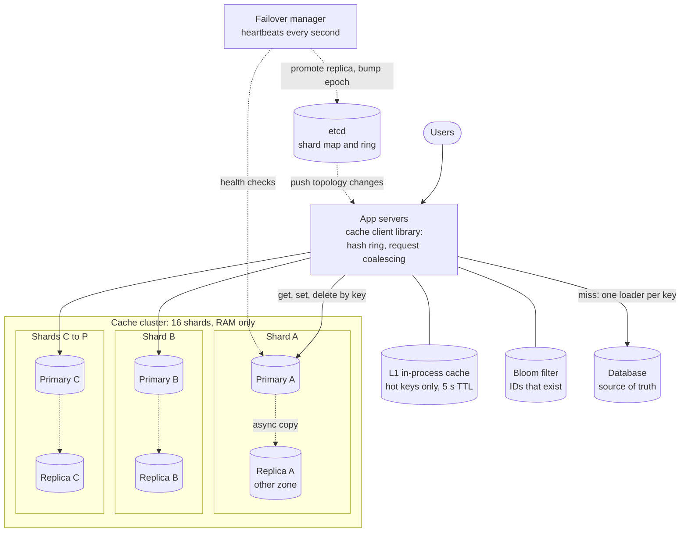
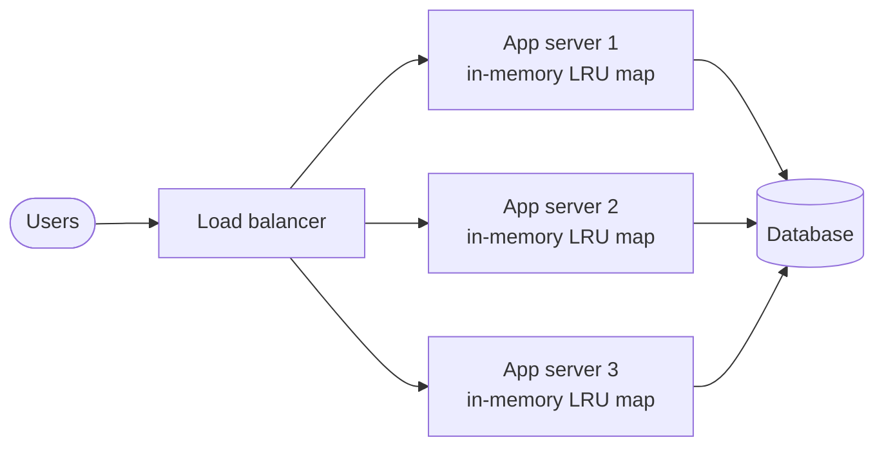
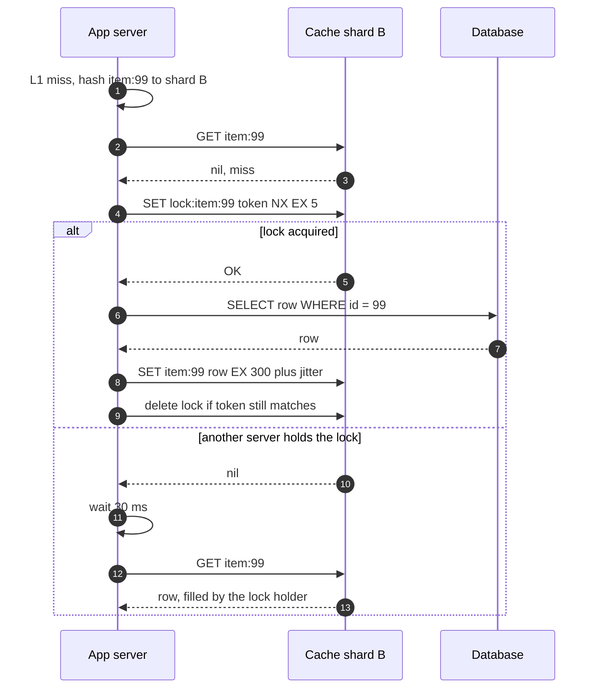
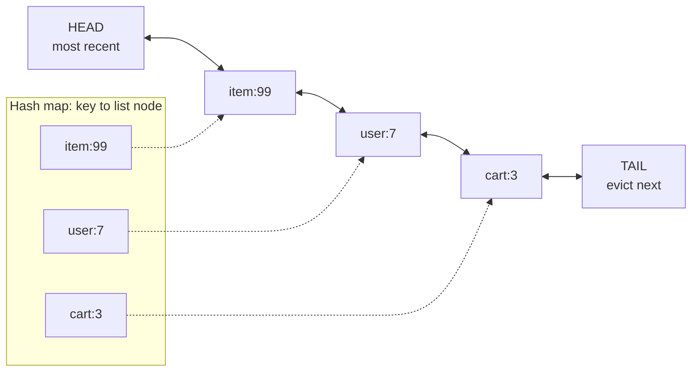

> **In one line:** spread keys over in-memory nodes with consistent hashing, give each shard a replica for failover, evict with LRU plus TTLs, and shield the database from hot keys, stampedes and missing keys with a tiny local cache, one rebuild per key, and negative caching.

## The design at a glance



The client library hashes each key onto a ring and talks straight to the owning primary; the hottest keys are served from an L1 cache in the app. On a miss, one request per key loads the database and writes back with a jittered TTL; writes update the database, then delete the key. If a primary dies, its replica is promoted and the new map is pushed through etcd.

## How to spend the 30 minutes

| Minutes | What you do | What to say or draw |
|---|---|---|
| 0-3 | Requirements | What do we cache? How stale may it be? Cache or database? |
| 3-6 | Numbers | 1 M ops/s, 1 TB hot data, so 16 shards; hit ratio drives DB load |
| 6-8 | API and data model | get / set with TTL / delete; item = key, value, expiry, LRU pointers |
| 8-12 | Design v1 and its flaws | A cache inside each app server: stale copies, cold starts, wasted RAM |
| 12-19 | Design v2 | Separate cluster, consistent hashing, LRU, replicas, cache-aside |
| 19-24 | Design v3 | Hot keys, stampedes, penetration, avalanche, big values |
| 24-29 | Deep dives | Partitioning, routing, LRU in O(1), invalidation races |
| 29-30 | Recap | The 60-second summary at the bottom |

## Requirements

The cache exists for two reasons: reads in under a millisecond instead of 5-10 ms, and keeping 95%+ of reads off the database.

**Functional**

- `get(key)` returns the value or a miss.
- `set(key, value, ttl)` stores a value that expires on its own.
- `delete(key)` removes it, so writers can invalidate.
- Evict the least useful items when memory is full.
- Add or remove nodes without flushing the cache.

**Non-functional**

- p99 under 1 ms for a get inside the data center.
- 1 M operations a second at peak, scaling by adding nodes.
- 99.9% available; losing one node must not flood the database.
- Eventually consistent: the database is the truth, and a cached value is stale for at most its TTL.
- No durability needed, but losing most of the cache at once is an outage for the database.
- Hit ratio above 95%: each miss is a 5-10 ms database query.

**Out of scope**

- Using the cache as the primary database (see the [key-value store](24-key-value-store.md)).
- Rich data types, pub/sub, scripting, multi-key transactions.
- Replicating cache contents across regions.

> **Say it like this:** "I'm designing a shared, sharded, in-memory cache beside a database: sub-millisecond gets, a million operations a second, a terabyte of hot data. Some staleness and losing a node are fine; the database seeing the full read load is not. The interesting parts are key placement, eviction, invalidation, and surviving hot keys and stampedes."

## Back-of-the-envelope numbers

| Quantity | Estimate | How |
|---|---|---|
| Peak operations | 1 M / s | 900 k gets + 100 k sets and deletes |
| Hot data | ~1 TB | 1 B items x ~1 KB (key, value, metadata) |
| Usable RAM per node | 64 GB | 96 GB box; a third left for fragmentation, buffers, snapshot forks |
| Throughput per node | ~100 k ops / s | Conservative for one Redis process |
| Shards | 16 (32 nodes with replicas) | Memory: 1 TB ÷ 64 GB ≈ 16. CPU: 1 M ÷ 100 k = 10. Memory wins |
| DB reads that leak through | 45 k / s at 95% hits, 9 k / s at 99% | 900 k x miss ratio |
| Network per node | ~0.5 Gbit / s | 1 M x 1 KB = 1 GB/s ÷ 16 = 62.5 MB/s |
| One hot 10 KB key at 200 k reads / s | 16 Gbit / s on one node | 200 k x 10 KB = 2 GB/s: more than a 10 Gbit NIC |
| Keys moved going 16 → 17 nodes | ~94% with mod N, ~6% with a ring | 16/17 vs 1/17 |

**What the numbers tell us:**

- Memory, not CPU, sets the cluster size, so plan by bytes per item.
- Every point of hit ratio is 9 k database reads a second: the number to watch.
- A modulo resize would dump ~850 k reads a second (94% of 900 k) on the database. Consistent hashing is required.
- Average traffic per node is tiny, but one hot key can saturate a NIC.

## API

```http
get(key)                          → value | MISS
multi_get([k1, k2, k3])           → { k1: v1, k3: v3 }        (k2 missed)
set(key, value, ttl_s)            → OK
set_if_absent(key, value, ttl_s)  → OK | EXISTS               (rebuild locks)
delete(key)                       → OK
```

- On the wire this is a compact protocol over long-lived TCP connections (Redis RESP, Memcached's protocol), not HTTP: headers would outweigh many values.
- Every `set` needs a TTL, so a missed invalidation heals itself.
- `multi_get` groups keys by shard: one parallel request per shard, not one per key.
- `set_if_absent` is atomic on the owner: a cheap lock.
- Values up to 1 MB (Memcached's default limit), keys up to 250 bytes.

## Data model

```text
item                       (RAM on the node that owns the key)
  key          bytes       "user:42:profile:v3", up to 250 B
  value        bytes       opaque, up to 1 MB, compressed if over a few KB
  expires_at   unix ms     every item has one
  prev, next   pointers    position in the node's LRU list

per node
  hash table   key → item                   O(1) lookup
  LRU list     doubly linked, newest first   O(1) touch and evict

cluster metadata           (etcd, a few KB)
  ring         virtual node token → shard id
  shards       shard id → primary, replica, epoch
```

- **Items live only in RAM**, because sub-millisecond reads rule out disk. The partition key is the hashed cache key; the database stays the source of truth.
- **Metadata lives in etcd**: tiny, strongly consistent (clients must agree on ownership), and watchable, so changes reach clients within a second.
- Version the key name (`:v3`) so a format change reads new keys and old ones age out.

## Design v1: the simplest thing that works



1. A request for user 42 lands on app server 2.
2. It checks its own LRU map (Caffeine in Java, say). A hit takes about a microsecond.
3. On a miss it queries the database, stores the row with a 5-minute TTL, and returns it.
4. On a profile update, that server writes the database and deletes the key from its own map.

This is fine for small, read-mostly data like feature flags: no network hop, nothing new to run.

## Where v1 breaks

| Problem | Why it happens | What the user sees |
|---|---|---|
| Inconsistent copies | A write deletes only the local copy | You rename yourself, refresh, and another server shows the old name for 5 minutes |
| Memory duplication | 50 servers each hold the same 4 GB hot set | The cache can never outgrow one heap, so the hit ratio stays low |
| Cold starts | The cache dies with the process | Every deploy starts empty: latency spikes, DB load surges |
| Misses grow with the fleet | Each key misses once per server | 50 servers, 50 DB reads per key |

## Design v2: a shared cache cluster, sharded with consistent hashing

### Fix 1: move the cache into its own cluster

All app servers share one cache. Each key has one home, so one `delete` fixes it for everyone; the hot set is stored once, so it can be 1 TB; deploys do not empty it; a key misses once for the whole fleet. The cost is a network hop: ~0.3 ms instead of ~1 µs, still over 10x faster than the database.

### Fix 2: partition with consistent hashing and virtual nodes

`hash(key) mod N` moves ~94% of keys when going from 16 to 17 nodes: an instant flush. Instead, put nodes and keys on a hash ring (0 to 2^32 - 1); a key belongs to the first node clockwise, so a new node takes only ~1/17 of the keys. Each physical node gets 100-200 virtual nodes, which keeps every node within roughly 10-15% of the average load and spreads a dead node's keys over all survivors.

### Fix 3: route in the client

The client library loads the ring from etcd, watches it for changes, hashes the key and uses a pooled connection straight to the owner. No proxy hop.

### Fix 4: bound memory with LRU and TTLs

Each node has a 64 GB limit and evicts the least recently used items when full. Every item has a TTL, so stale data dies even if a delete is lost. Expired items are dropped lazily on read and by a background sweeper.

### Fix 5: replicas and automatic failover

Each primary streams writes asynchronously to a replica in another zone. A failover manager (Redis Sentinel, or Redis Cluster's built-in voting) pings primaries every second; after a few seconds of silence, confirmed by a majority of watchers, it promotes the replica, bumps the shard's epoch and updates etcd. Without this, a dead node sends ~56 k reads a second (1/16) to the database.

### Fix 6: cache-aside reads, delete on write

Read the cache; on a miss, read the database and `set` with a TTL. On writes, update the database, then `delete` the key. The next reader loads the fresh row.

## Where v2 still breaks

| Problem | Why it happens | What the user sees |
|---|---|---|
| Hot key | A flash-sale item lives on one shard and gets 200 k reads/s | That node's CPU or NIC maxes out; every key on it slows |
| Cache stampede | A hot key expires and thousands of requests miss at once | All query the DB for one row: spike, timeouts |
| Cache penetration | IDs that do not exist (bots, bugs) are never cached | Every such request reaches the DB: an easy DoS |
| Cache avalanche | A bulk warm-up gives a million keys the same TTL | They all expire in the same second: a wall of misses |
| Big values | One 5 MB value takes milliseconds to send from a single-threaded node | Latency spikes for other keys on that shard |

## Design v3: protect the database on bad days

This is the diagram at the top.

### Fix 7: hot keys: detect, then spread

Detect them by sampling keys in the client and counting the top few per second. Then:

- **L1 in-process cache** for detected hot keys only, 5 s TTL. It is v1 again, but tiny: staleness is capped at 5 s and each app server absorbs its own share.
- **Key copies:** store `item:99#0` to `item:99#7` on eight shards. Readers pick one at random and writers delete all eight, so each shard takes an eighth.

### Fix 8: stampedes: one rebuild per key

- **Request coalescing:** inside a server, concurrent misses for one key share one database call.
- **Rebuild lock:** the first server to miss does `set_if_absent("lock:item:99", token, 5 s)` and rebuilds; the others wait ~30 ms and retry the cache.
- **Probabilistic early refresh:** store a soft expiry in the value; near it, each reader refreshes in the background with a probability that rises toward expiry. One request rebuilds while the rest still hit, because the hard TTL sits a bit past the soft one.
- **Jittered TTLs**, so the L1 copies on 50 servers and the eight key copies do not all expire in the same instant.

### Fix 9: penetration: remember what does not exist

- **Negative caching:** store a `NOT_FOUND` marker for 30-60 s.
- **Bloom filter** of valid IDs: "definitely absent" returns 404 without touching cache or database. 100 M IDs at 10 bits each is ~125 MB for 1% false positives. Keep one shared copy (a bitmap in the cache cluster), add each ID on create, and rebuild it nightly, since a Bloom filter cannot delete.

### Fix 10: avalanche: never expire together

Jitter every TTL: `300 s + random(0, 60 s)`. Warm a restarted node from a snapshot or its replica before it takes traffic. Cap concurrent database fallbacks so the database degrades instead of falling over.

### Fix 11: big values and fragmentation

Cap values at 1 MB, compress big ones, or keep them in object storage and cache a pointer. Delete big keys with Redis `UNLINK`, which frees memory in the background. Fragmentation: Memcached's slab allocator wastes the gap between an item and its fixed-size chunk (slab rebalancing helps); in Redis, watch `mem_fragmentation_ratio` and enable active defrag.

### Fix 12: watch the hit ratio

Per shard and key prefix: hit ratio, evictions/s, memory, p99 latency, ops/s and network (hot shards), replication lag. Alert on a drop of a point or two.

### Components

| Component | Job | Tech choice |
|---|---|---|
| Cache client library | Ring, routing, pooling, coalescing, timeouts | Wrapper around a Redis client |
| L1 cache and Bloom filter | Absorb hot keys, reject impossible IDs | L1 in app memory, 5 s TTL; shared filter, rebuilt nightly |
| Cache nodes | Hold items in RAM, evict, expire | Redis or Valkey, 64 GB, LRU policy |
| Replicas | Take over when a primary dies | One per shard, other zone, async |
| Failover manager | Detect dead primaries, promote | Redis Sentinel or Redis Cluster voting |
| etcd | Shard map every client agrees on | Strongly consistent, watchable |

## Key flow: read a key that just expired



- **Lock holder crashes:** the lock expires in 5 s. Release it with a check-and-delete (a small Lua script) so a slow holder cannot delete someone else's lock.
- **Still a miss after a few retries:** go to the database through the limiter, or serve stale data.
- **Row does not exist:** set `NOT_FOUND` for 60 s.
- **Shard B is down:** a tight timeout makes it a miss; within seconds the new map points at the promoted replica.

The write flow: update the database, then `delete item:99`, retrying on failure. The TTL caps the damage if every retry fails.

## Deep dives

### How do keys map to nodes?

**The problem.** All clients must agree on a key's home, load must be even, and resizing must not flush the cache.

**Options.**

| Option | Good | Bad |
|---|---|---|
| `hash mod N` | Trivial, even | A resize moves ~N/(N+1) of keys |
| Ring, one point per node | A resize moves ~1/N | Uneven arcs: one node can own 3x the average; a dead node's load lands on one neighbour |
| **Ring with virtual nodes** | Even load, weights for big machines, failure load spreads | A bigger ring: 16 x 200 = 3,200 entries, trivial |
| Fixed hash slots (Redis Cluster: CRC16 mod 16,384) | Move whole slots; small explicit map | Slot map must stay in sync; keys migrate with slots |

**Pick.** Virtual nodes, or hash slots with Redis Cluster. Same idea: many small partitions per node, so moving capacity moves small pieces.

### Client-side routing or a proxy?

**The problem.** Something turns a key into a node address on every request.

**Options.**

| Option | Good | Bad |
|---|---|---|
| **Smart client library** | No extra hop | A library per language; every app tracks topology |
| Proxy tier (twemproxy, mcrouter, Envoy) | Thin clients; routing and retries in one place | Extra hop, another fleet to scale |
| Sidecar proxy per app host | Thin client, local hop only | One more process per host |

**Pick.** Smart client with one or two languages; a sidecar with many.

### Which eviction policy, and how is LRU O(1)?

**The problem.** The cache is always full. What goes when a new item arrives?

**Options.**

| Option | Good | Bad |
|---|---|---|
| **LRU** | Recent items get read again; cheap | One big scan flushes the hot set |
| LFU | Keeps steady favourites through scans | Counters must decay, or old favourites never leave |
| TTL only | No bookkeeping | Memory fills before items expire |
| Random | Cheapest | Evicts hot items as readily as cold |

**Pick.** LRU plus TTLs; LFU when scans pollute the cache. LRU in O(1):



- **get:** find the node via the map, unlink it (it knows `prev` and `next`), relink it at the head.
- **set:** insert at the head and into the map; while over the limit, drop the tail from the list and the map.
- **Doubly** linked, because unlinking from the middle needs the predecessor without a scan.
- Production caches approximate it to save memory and avoid touching a shared list on every read. Redis keeps no list: it samples 5 keys and evicts the one idle longest (its LFU mode keeps a small decaying counter per key). Memcached splits its list into hot, warm and cold segments.

### Cache patterns and invalidation on writes

**The problem.** The database changes. Who loads the cache, and how does it learn?

**Options.**

| Option | Good | Bad |
|---|---|---|
| **Cache-aside** | Simple; cache outage only slows reads; caches only what is read | Miss after each write; small race windows |
| Read-through | Cache layer loads on miss; app code stays clean | Cache must know how to query the DB |
| Write-through | Cache always has the latest write | Slower writes; caches unread data |
| Write-behind | Very fast writes, absorbs bursts | Lost data if a node dies before flushing |

**Pick.** Cache-aside with delete-on-write and TTLs; write-behind only for loss-tolerant counters.

- **Why delete, not update?** Writers commit v1 then v2, but their `set`s can arrive v2 then v1, leaving v1 cached. A delete gives the same result in any order.
- **The stale-set race.** Reader A misses and reads v1; writer B commits v2 and deletes; A's slow `set` writes v1 back. A short TTL caps it, a second delete a second later usually catches it, and a lease prevents it (B's delete voids the token A got on its miss, so A's `set` is rejected). Tailing the database change log (CDC) to issue deletes catches writes from every service.

## Trade-offs to say out loud

- We chose **cache-aside over write-through** so a cache outage only slows reads. The cost is a miss after every write and a small stale window.
- We chose **async replication** for sub-millisecond writes. The cost is that a failover can drop recent deletes, leaving stale values until their TTL.
- We chose **client-side routing over a proxy** to save a hop. The cost is pushing topology to every app server.
- We chose **delete over update on writes** so out-of-order writers cannot leave a wrong value. The cost is one extra miss.
- We added an **L1 cache for hot keys** to save single shards. The cost is up to 5 s of staleness for those keys.

## Follow-up questions

**Q: Redis or Memcached?**
Memcached is multi-threaded and simple, without built-in replication. Redis (or Valkey) adds data types, replication, persistence and clustering.

**Q: Can a failover lose data?**
Yes: async replication can drop the last few writes. A lost `set` becomes a miss; a lost `delete` leaves a stale value until its TTL. Redis `WAIT` makes one write wait for a replica when it matters.

**Q: How do you avoid split brain?**
Promotion needs a majority of watchers (2 of 3 Sentinels) and gives the new primary a higher epoch. Clients ignore maps with an older epoch, and the old primary is turned into a replica when it returns.

**Q: The whole cache cluster is down. Now what?**
The database cannot take 900 k reads a second. Fall back through a concurrency limiter, serve stale L1 data or defaults, and refill gradually.

**Q: How do you pick a TTL?**
By tolerable staleness: seconds for prices and stock, minutes for profiles, hours for catalog data. Always add jitter.

**Q: How does this work across regions?**
One cluster per region in front of its database replica. Each region deletes keys from its own replication stream, so a key is invalidated only after the new row arrives locally.

## 60-second recap

- Shared in-memory cluster: 1 TB, 1 M ops/s, 16 shards of 64 GB, each with a replica in another zone.
- Consistent hashing with virtual nodes, so a resize moves ~1/N of keys. Clients route directly using a map from etcd.
- Approximate LRU (hash map plus doubly linked list), jittered TTL on every key.
- Cache-aside: load on miss; on writes, update the database, then delete the key.
- Failover by majority vote and epochs; TTLs cap the damage from lost writes.
- Bad days: L1 and key copies for hot keys, coalescing and a rebuild lock for stampedes, negative caching and a Bloom filter for missing keys, TTL jitter for avalanches.
- Watch the hit ratio: 1% is 9 k database reads a second.
