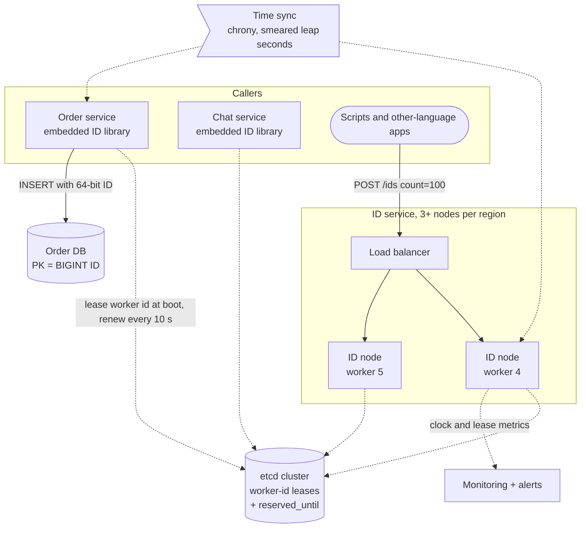
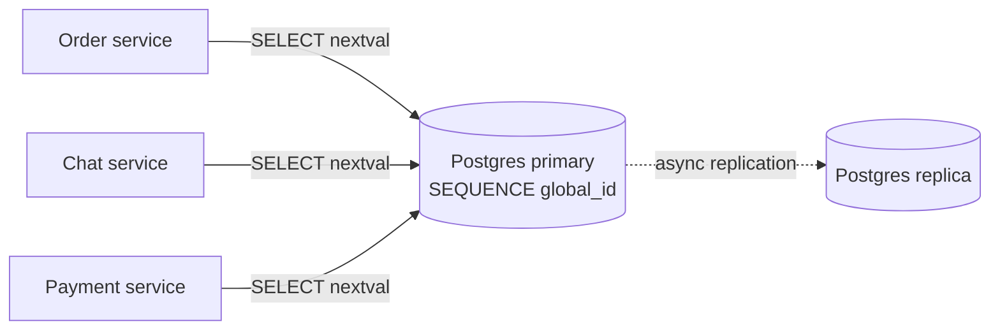
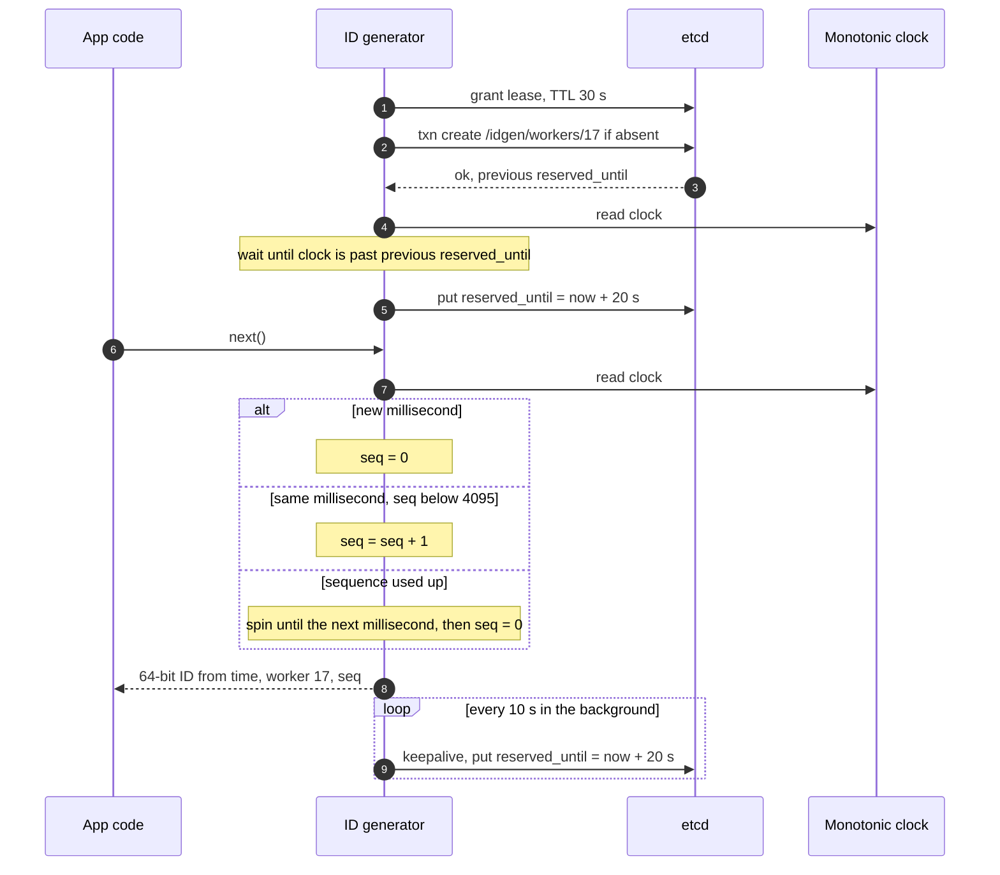

> **In one line:** every generator packs a millisecond timestamp, a leased 10-bit worker id and a 12-bit per-millisecond counter into one 64-bit integer, so IDs are unique and roughly time-sorted with no network call per ID; the only shared piece is etcd, which hands out worker ids.

## The design at a glance



Most IDs never cross the network: a service's embedded library reads a clock that cannot go backwards, bumps a per-millisecond counter and ORs three fields into one 64-bit number in under a microsecond. Apps that cannot embed it call a small ID service in batches. etcd is touched at boot and every 10 seconds to renew a worker-id lease, never per ID.

## How to spend the 30 minutes

| Minutes | What you do | What to say or draw |
|---|---|---|
| 0-3 | Requirements | 64 or 128 bits? Sortable? Rate per node? Who calls it? |
| 3-6 | Numbers | 41 + 10 + 12 bits: 69 years, 1,024 workers, 4,096 IDs per ms |
| 6-10 | API, data model, v1 | `next()`, batch, decode. One database sequence |
| 10-14 | Break v1, compare options | Single point of failure, round trip per ID. The options table |
| 14-19 | Design v2 | Snowflake bit layout, next-ID algorithm, sequence overflow |
| 19-24 | Break v2, design v3 | Duplicate worker ids, clock going backwards. etcd leases, monotonic clock |
| 24-29 | Deep dives | Ordering, library vs service, index locality |
| 29-30 | Recap | The 60-second summary at the bottom |

## Requirements

**Functional**

- Return a unique 64-bit integer, one at a time or in batches.
- Sorting by ID is close to sorting by creation time.
- Any ID can be decoded into its timestamp and generator, for debugging.

**Non-functional**

- Unique, always: across machines, restarts, failovers and clock corrections. A duplicate is data corruption.
- Fits a signed 64-bit integer (Postgres `BIGINT`, Java `long`).
- 10,000+ IDs a second per node, bursts of 100,000; about 1 M a second company-wide.
- Under 10 µs in-process; p99 under 2 ms over the network.
- No single point of failure: losing a machine or zone must not stop ID generation.
- "Roughly sorted" is enough: IDs from different nodes may be out of order by a few milliseconds.

**Out of scope**

- Strict global ordering (needs a sequencer, see the deep dive).
- Short, human-friendly codes (the [URL shortener](01-url-shortener.md) problem).
- Hiding the creation time from whoever sees the ID.

> **Say it like this:** "I need IDs that are unique forever, fit in 64 bits and sort roughly by time, at 10 k+ per second per node, with nothing central on the hot path. I'll start with a database sequence, break it, then build Snowflake. The bit packing is easy; the real design is clocks going backwards and duplicate worker ids."

## Back-of-the-envelope numbers

| Quantity | Estimate | How |
|---|---|---|
| Timestamp range (41 bits of ms) | ~69.7 years | 2^41 = 2.2 x 10^12 ms ÷ 3.16 x 10^10 ms per year |
| Workers alive at once (10 bits) | 1,024 | 2^10 |
| IDs per worker per ms (12 bits) | 4,096 | 2^12 |
| Max per worker | ~4.1 M / s | 4,096 x 1,000 |
| Max for the fleet | ~4.2 B / s | 4.096 M x 1,024 |
| Needed per node | 10 per ms, bursts of 100 | 10 k / s and 100 k / s ÷ 1,000 |
| Headroom per node | ~400x, ~40x in bursts | 4,096 ÷ 10, 4,096 ÷ 100 |
| Company-wide demand | ~1 M / s | Assumption; 0.02% of the ceiling |
| Index saving vs UUID at 10 B rows | ~80 GB per index | 10 B x (16 - 8) bytes |

**What the numbers tell us:**

- Sequence overflow is rare (400x headroom), and waiting for the next millisecond costs under 1 ms.
- The real limit is **1,024 worker ids**: plenty for an ID service, too few if all 5,000 pods of a fleet embed the library.
- 69.7 years needs a recent epoch. From 1970 the bits run out in 2039; from 2026-01-01 they last until about 2095.
- Volume is easy. **Uniqueness under failure** (clocks, restarts, duplicate worker ids) is the problem.

## API

```http
POST /v1/ids?count=100
→ 200 { "ids": ["104161627070337025", "104161627070337026", ...] }

GET /v1/ids/104161627070337025/decode
→ 200 { "time": "2026-10-15T10:21:07.123Z", "worker_id": 17, "sequence": 1 }

GET /v1/health
→ 200 { "worker_id": 17, "lease_ok": true, "clock_offset_ms": 0.4 }
```

- In library mode the API is just `ids.next()`; HTTP is for everyone else.
- IDs travel as **strings** in JSON: JavaScript numbers are exact only up to 2^53, which Snowflake IDs pass 25 days after the epoch.
- `count` (up to 1,000) buys many IDs per network hop. Each ID carries the time it was minted, not used.
- `health` lets the load balancer drop a node whose lease or clock is bad.

## Data model

```text
etcd, one key per worker id          (the only shared state)
  /idgen/workers/17
    holder          "order-svc-7f9c, pod uid"
    lease           TTL 30 s, renewed every 10 s
    reserved_until  generator time + 20 s, rewritten at every renewal

generator state                      (in memory, per process)
  worker_id, last_ts (last ms used), sequence (0-4095)

constants                            (never change once IDs exist)
  epoch 2026-01-01T00:00:00Z, layout 1 sign | 41 time | 10 worker | 12 sequence
```

- **etcd** (or ZooKeeper), because worker ids need "create only if absent" plus a lease that expires when the holder dies, replicated over Raft.
- **Nothing to shard:** the shared state is at most 1,024 tiny keys. Other systems use the ID as their primary key (see the last deep dive).

## Design v1: the simplest thing that works



1. The order service runs `SELECT nextval('global_id')` on a shared Postgres.
2. Postgres bumps the sequence and returns `1000042`. Sequences are not rolled back with transactions, so an aborted insert leaves a gap, never a repeat.
3. The service inserts the order with `id = 1000042`.
4. A replica follows asynchronously and is promoted if the primary dies.

This honestly works: unique, 64-bit, perfectly ordered. For one product with modest traffic, ship it.

## Where v1 breaks

| Problem | Why it happens | What the user sees |
|---|---|---|
| One database behind every ID | The counter lives on one primary | Primary down: nobody can create an order, a message or anything else |
| A round trip per ID | Each `nextval` is a remote call, ~0.5-1 ms | Every create is slower; one primary cannot serve 1 M a second |
| Failover repeats numbers | The async replica's sequence can be behind | After promotion, new rows reuse issued IDs: duplicate-key errors or overwrites |
| Other regions | One primary in one region | 100-200 ms per ID far away; a partition means no IDs at all |
| Noisy neighbours | Every team shares one counter | A backfill grabbing 50 M IDs slows down checkout |

## Design v2: Snowflake, mint IDs locally from time + worker + sequence

### Fix 1: stop asking a shared counter for every ID

Every row above comes from one shared counter, so you want generators that work alone. The candidates:

| Option | How it works | Good | Bad |
|---|---|---|---|
| UUID v4 | 122 random bits | No coordination at all | 128 bits, not sortable, random B-tree inserts |
| UUID v7 / ULID | 48-bit ms time + 74 / 80 random bits | No coordination, sortable | Still 128 bits, no `BIGINT` |
| DB auto-increment | One counter, one database | Simple, strictly ordered | It is v1 |
| Multi-master, step = N | Server k issues k, k+N, k+2N | No shared counter | Adding a server changes N; servers drift, so IDs stop tracking time; still a round trip |
| Ticket server | A tiny DB that only hands out numbers; two of them, odd and even | Easy, 64-bit | Round trip per ID, central dependency |
| Leased ranges | Grab a block of 1 M numbers, count in memory | Compact, coordination once per block | Not time-ordered across nodes |
| **Snowflake** | Time + worker id + sequence | 64-bit, time-sorted, no per-ID coordination | Needs unique worker ids and sane clocks |

Snowflake is the only row that is 64-bit, sortable and coordination-free. If 128 bits is fine, say UUID v7 is simpler: no worker ids. Leased ranges suit short codes, as in the [URL shortener](01-url-shortener.md).

### Fix 2: the 64-bit layout

| Bits | Field | Size | What it gives |
|---|---|---|---|
| 63 | Sign | 1 bit, always 0 | Positive in signed 64-bit types |
| 62-22 | Timestamp | 41 bits | ms since a custom epoch, 2^41 ms ≈ 69.7 years |
| 21-12 | Worker id | 10 bits | 1,024 generators |
| 11-0 | Sequence | 12 bits | 4,096 IDs per ms per worker |

`id = (ts << 22) | (worker << 12) | seq`. With the epoch at 2026-01-01, the moment 2026-10-15 10:21:07.123 UTC is `ts = 24,834,067,123`; worker 17, sequence 1 gives `104161627070337025`. Decoding reverses it: `ts = id >> 22`, `worker = (id >> 12) & 1023`, `seq = id & 4095`. Time sits in the top bits, so comparing IDs compares milliseconds first: that is the whole "sortable" trick.

### Fix 3: the next-ID algorithm

```text
next_id():
  lock
  now = clock_ms() - EPOCH
  if now < last_ts:
      fail("clock moved backwards")              // v2 just refuses; v3 does better
  if now == last_ts:
      seq = (seq + 1) & 4095
      if seq == 0:                                // all 4,096 used in this ms
          while now <= last_ts:                   // spin until the next ms
              now = clock_ms() - EPOCH
  else:
      seq = 0
  last_ts = now
  unlock
  return (now << 22) | (worker_id << 12) | seq
```

- **Sequence overflow:** the 4,097th call in a millisecond waits for the next one. Never let the counter wrap within a millisecond; that repeats an ID.
- **One mutex is enough:** it costs tens of nanoseconds, and 10 k IDs a second is one call every 100 µs.

### Fix 4: run it as a library with a worker id from config

Each service embeds the generator; its deployment config sets `WORKER_ID`. No shared component on the hot path (row 1), no round trip (row 2), no counter to fail over (row 3), every region mints locally (row 4), every team has its own generators (row 5).

## Where v2 still breaks

| Problem | Why it happens | What the user sees |
|---|---|---|
| Two generators share a worker id | Copied config, a cloned VM | Identical IDs: duplicate-key errors, or silent overwrites in upsert stores like Cassandra |
| Clock steps backwards | NTP steps a fast clock back, a VM snapshot is restored | v2 refuses, so the node errors for the length of the step |
| Restart after the clock moved back | `last_ts` was only in memory | The new process reissues IDs it already handed out |
| Leap second | The kernel repeats one second of Unix time | Every node replays a second of timestamps |
| Ids do not follow autoscaling | Config cannot track pods; 1,024 ids for 5,000 pods | New pods get no id, or reuse a live one |

## Design v3: leased worker ids and a clock that cannot go backwards

This is the diagram at the top.

### Fix 5: lease worker ids from etcd

At boot the generator takes a 30-second lease, picks a random id and runs a transaction: "create `/idgen/workers/<id>` with my lease only if it does not exist". If taken, it tries another. It renews every 10 seconds; if it dies, the id frees itself 30 seconds later. Two live generators can never hold the same key, and autoscaling just works (rows 1 and 5). In ZooKeeper this is an ephemeral znode.

### Fix 6: read a clock that cannot go backwards

Read the wall clock once at boot, then advance it with the monotonic clock (`CLOCK_MONOTONIC`, Java `System.nanoTime()`). NTP never steps that clock, only tunes its rate, so IDs cannot go backwards while the process lives. Backstop: if `now < last_ts` anyway, wait when the gap is under 10 ms, refuse beyond (row 2).

### Fix 7: remember the high-water mark across restarts

At every renewal the generator writes `reserved_until = now + 20 s` into its key and never issues a later timestamp. A new holder of that id waits until its clock passes `reserved_until` (row 3). After a crash that is already true, because the lease needed 30 seconds to expire; a clean shutdown records its real last timestamp, so restarts wait only milliseconds. This is also the fence for Fix 5: a generator cut off from etcd stops within 20 seconds, 10 seconds before anyone else can take its id.

### Fix 8: smear leap seconds

Sync every host from a source that smears the leap second over 24 hours (Google Public NTP and Amazon Time Sync both do), so the clock runs about 0.001% slow for a day instead of repeating a second (row 4). Never mix smeared and unsmeared servers.

### Fix 9: an ID service for big or polyglot fleets

Huge fleets and other languages call a small ID service (3+ nodes per region) in batches, so a handful of worker ids serves thousands of pods (row 5).

### Components

| Component | Job | Tech choice |
|---|---|---|
| ID library | Pack time, worker id, sequence | ~100 lines per language, monotonic clock, one mutex |
| ID service | IDs for callers without the library | 3+ stateless nodes per region, gRPC or HTTP, batches |
| etcd | Worker-id leases, `reserved_until` | 3 or 5 nodes across zones, 30 s TTL |
| Time sync | Clocks within a few ms, smeared leap seconds | chrony against one smeared source |
| Monitoring | Clock offset, backwards steps, overflow waits, lease loss | Metrics and alerts |

## Key flow: boot a generator and mint an ID



- **Id taken:** the transaction fails; try another random id. With 300 holders, about 70% of first tries succeed.
- **etcd down:** new generators cannot start. Running ones carry on for 20 seconds, then stop rather than risk duplicates. A 5-node etcd across 3 zones fails only if a majority dies.
- **Clock far behind `reserved_until` at boot:** wait if milliseconds, refuse and alert if seconds.
- **Long GC pause:** on waking, the generator is past `reserved_until`, so it blocks until it renews or re-registers.

## Deep dives

### How do you hand out worker ids?

**The problem.** No two live generators may share an id. Two nodes with id 17, each minting 10 IDs per millisecond, both use sequences 0-9 every millisecond: constant collisions.

| Option | Good | Bad |
|---|---|---|
| Static config | No dependencies | Human error; no autoscaling |
| StatefulSet ordinal (`id-0`, `id-1`) | Unique within the set, no runtime dependency | Fixed-size fleets only |
| Low bits of the IP | No coordination | Collides once the subnet exceeds 1,024 addresses |
| **etcd / ZooKeeper lease** | Automatic, dead nodes free their ids | Dependency at boot and renewal; must fence |

**Pick.** Leases for the library; ordinals for the small ID service. If a duplicate slips through, a unique key fails loudly, but an upsert (Cassandra `INSERT`, DynamoDB `PutItem` without a condition) silently overwrites a row. Use conditional writes where cheap and alert on duplicate-key errors.

### What if the clock goes backwards?

**The problem.** Time is the top of the ID, so a backwards clock replays IDs. NTP slews small errors gradually but steps large ones (`ntpd` steps beyond 128 ms by default).

| Option | Good | Bad |
|---|---|---|
| Refuse and throw | Never duplicates | Node is down for the whole step |
| Wait it out | Invisible for tiny steps | Stalls every call; useless for a 10 s step |
| Logical clock: keep `last_ts`, borrow future ms | Never stalls | Timestamps run ahead of real time; needs a cap |
| **Monotonic clock anchored at boot** | Steps cannot touch it | Restarts need the high-water mark |

**Pick.** Monotonic clock plus `reserved_until`, waiting up to 10 ms and refusing beyond. Leap seconds are smeared. None has been added since 2016 and they are due to end by 2035, but do not rely on that.

### How ordered are the IDs?

**The problem.** The interviewer will ask what "sorted" really means here.

- **Same worker:** strictly increasing.
- **Different workers:** ordered by millisecond, then worker id. NTP keeps clocks within about 1-10 ms, so events further apart than that are ordered correctly; closer ones can come in any order. This is **k-sorted**.

| Option | Good | Bad |
|---|---|---|
| **Snowflake, k-sorted** | No coordination; fine for keys and "newest first" | Ties within a few ms ordered by worker |
| Per-entity sequence (`chat_id → seq`) | Exact order where it matters | A counter per entity |
| One global sequencer | Total order | That is v1 again |

**Pick.** Snowflake for keys, plus a per-conversation sequence where exact order matters, as in the [chat app](08-chat-app.md).

### Library or service?

**The problem.** The generator can live inside each app or behind the network.

| Option | Good | Bad |
|---|---|---|
| Library | Sub-microsecond, nothing to run | A worker id per instance; one implementation per language |
| ID service | Few worker ids, clocks watched in one place | 0.5-1 ms per call; one more tier to keep up |
| Service + batching | One hop per 100-1,000 IDs | IDs carry fetch time, not use time |

**Pick.** The library for big, hot services in your main language; the service with batching for the rest. Both lease from the same etcd.

### Why sortable IDs help the database

**The problem.** The ID is the primary key of your biggest tables, and B-trees care about insert order.

| Option | Good | Bad |
|---|---|---|
| Random UUID v4 in a B-tree | Even spread | Inserts hit random pages; once the index outgrows memory they become disk reads, and split pages sit half full |
| **Sortable ID in a B-tree** | Inserts go to the right-most page, which stays in memory; "newest 20" is a primary-key range scan | That one page is contended at extreme insert rates |
| Sortable ID in a range-sharded store (Bigtable, Spanner, CockroachDB) | Time-range scans | All writes hit the last range: a hot spot |

**Pick.** Snowflake keys in MySQL and Postgres. InnoDB also copies the primary key into every secondary index entry, so 8 bytes instead of 16 saves ~80 GB per index at 10 B rows. In range-sharded stores, hash or prefix the key; hash-partitioned ones (DynamoDB, Cassandra) do not care.

## Trade-offs to say out loud

- We chose **Snowflake over UUID v4** for 8-byte, time-sorted keys. The cost is managing worker ids and trusting clocks.
- We chose **Snowflake over UUID v7** to fit a `BIGINT`. The cost is etcd; with 128 bits allowed, UUID v7 is simpler.
- We accept **k-sorted, not strict, order** so generators never talk. The cost is IDs within a few ms on different nodes may be out of order.
- A generator **stops rather than risk a duplicate**. The cost is brief unavailability; callers retry elsewhere.
- We chose **etcd leases over static config** so autoscaling is safe. The cost is a hard stop if etcd is unreachable for 20 seconds.

## Follow-up questions

**Q: A JavaScript client shows the wrong ID. Why?**
JavaScript numbers are exact only to 2^53, which IDs pass 25 days after the epoch. Send IDs as strings.

**Q: Can outsiders learn things from our IDs?**
Yes, the creation time, and gaps hint at volume. If that matters, keep Snowflake internal and expose a random public ID.

**Q: How do you go multi-region?**
Split the worker bits into 3 region bits and 7 worker bits: 8 regions x 128 workers. Each region leases from its own etcd, so no ID needs a cross-region call.

**Q: You need more than 1,024 generators.**
Rebalance, for example 13 worker bits and 9 sequence bits: 8,192 workers at 512 IDs per ms, still 51x a 10 k/s node. Decide up front; changing the layout under running generators risks collisions.

**Q: Why not shard rows by `id % 16`?**
The low 12 bits are the sequence, mostly 0 at low traffic, so rows pile onto a few shards. Hash the ID first.

**Q: Someone needs 1 M IDs for a backfill.**
One worker mints 4,096 per ms, so 1 M takes about 245 ms. Give the job its own worker id so it never slows anyone else.

## 60-second recap

- 64 bits: sign, 41 bits of ms since a 2026 epoch (69.7 years), 10-bit worker id (1,024), 12-bit sequence (4,096 per ms).
- Each generator mints locally under one mutex; overflow waits for the next millisecond.
- Worker ids are leased from etcd with put-if-absent and a 30 s TTL, so two live nodes never share one.
- A monotonic clock anchored at boot, `reserved_until` for restarts, smeared leap seconds.
- When in doubt, stop issuing rather than risk a duplicate.
- k-sorted: strict per worker, ordered across workers to within clock skew.
- Library for hot services, an ID service with batches for the rest; sorted 8-byte keys keep B-tree inserts cheap.
