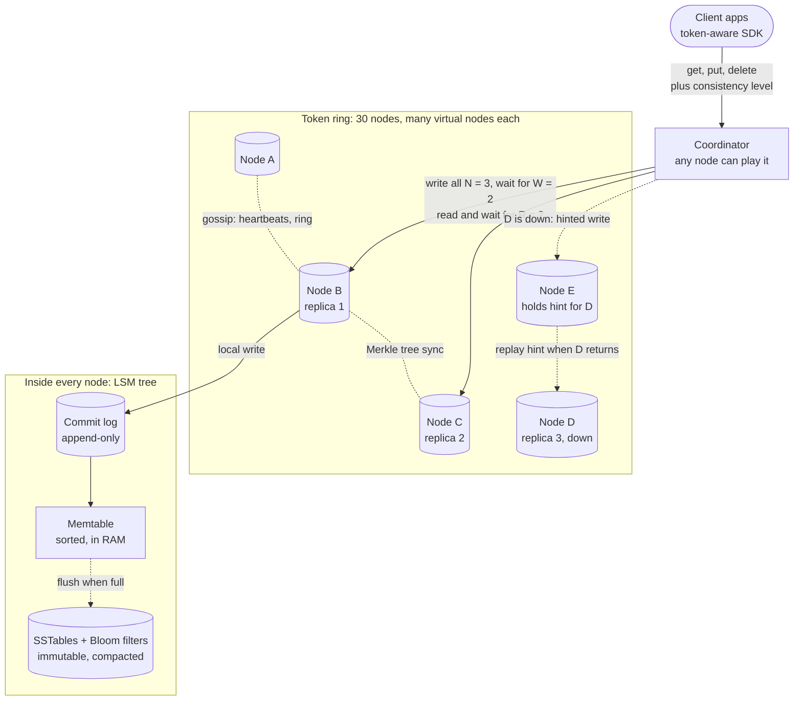
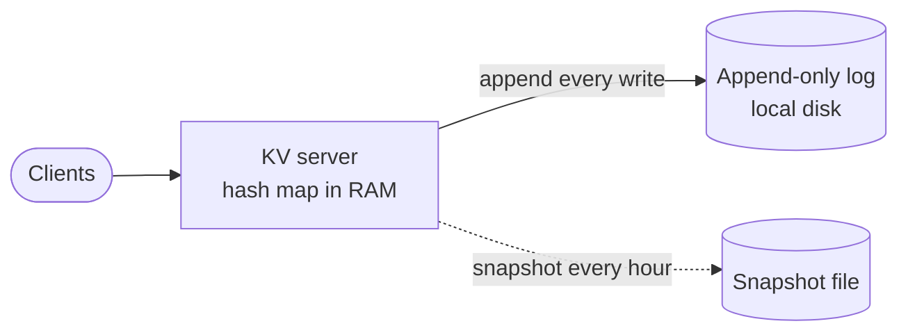
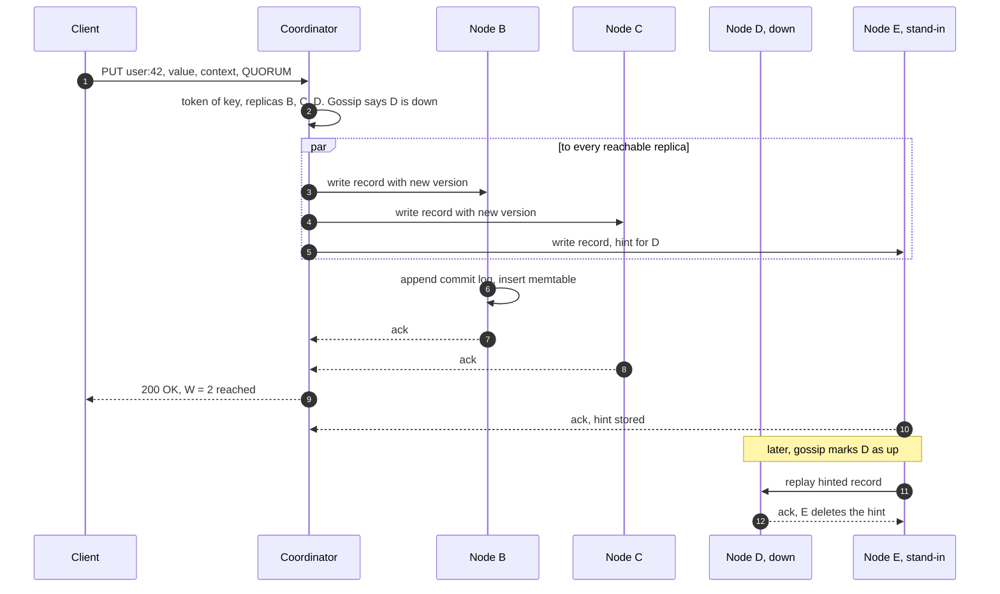

> **In one line:** hash keys onto a ring of nodes with virtual nodes, keep each key on the next 3 nodes, let each request choose how many replicas must answer (R + W > N for fresh reads), heal failures with hinted handoff, read repair and Merkle-tree sync, and store data on each node in an LSM tree so writes are sequential appends.

## The design at a glance



Any node can coordinate a request. It hashes the key, finds the three replicas clockwise, writes to all three and answers after W = 2 acks; a read waits for R = 2 and returns the newest version. A stand-in keeps hints for a down replica, gossip spreads who is alive, and Merkle trees catch whatever else drifted. On each node a write is a commit-log append plus a memtable insert.

## How to spend the 30 minutes

| Minutes | What you do | What to say or draw |
|---|---|---|
| 0-3 | Requirements | Value size? Read/write mix? How fresh must reads be? |
| 3-6 | Numbers | 10 TB, 300 k ops/s, half writes, so ~30 nodes |
| 6-8 | API and data model | get / put / delete, consistency level, version context |
| 8-11 | Design v1 and its flaws | One node: hash map in RAM plus an append-only log |
| 11-18 | Design v2 | Ring with virtual nodes, 3 replicas, quorum R and W, conflicts |
| 18-23 | Design v3 | Hinted handoff, read repair, Merkle trees, gossip, LSM engine |
| 23-29 | Deep dives | Conflict resolution, LSM vs B-tree, CAP and consistency levels, adding nodes |
| 29-30 | Recap | The 60-second summary at the bottom |

## Requirements

**Functional**

- `put(key, value)`, `get(key)`, `delete(key)`.
- Values are opaque bytes, typically ~1 KB, at most 1 MB.
- The caller picks a consistency level per request: `ONE`, `QUORUM` or `ALL`.
- Optional TTL per key.
- Add or remove nodes with no downtime.

**Non-functional**

- Scale: 10 TB of data, 300 k operations a second at peak, growing.
- Highly available, 99.99%: writes keep working while a node, or a whole zone, is down.
- p99 under 10 ms for `QUORUM` reads and writes within a region.
- Eventually consistent by default; read-your-writes for callers that ask for strict quorums.
- Durable: an acknowledged write is on W nodes and survives losing any one of them.
- No single point of failure and no master.

**Out of scope**

- Range scans across keys, secondary indexes, SQL.
- Multi-key transactions.
- Multi-region replication (one follow-up question).

> **Say it like this:** "This is a Dynamo-style store: a leaderless ring, each key on three nodes, and the caller decides how many must answer. I'll aim for 10 TB and 300 k ops a second, always writable during failures, eventually consistent by default with quorums when callers need fresh data. The hard parts are partitioning, quorums, conflicts, healing replicas, and the per-node storage engine."

## Back-of-the-envelope numbers

| Quantity | Estimate | How |
|---|---|---|
| Data | 10 TB | 10 B keys x ~1 KB |
| Stored with replicas | 30 TB | N = 3 |
| Nodes for disk | 15 | 4 TB SSD each, kept half full for compaction: 30 TB ÷ 2 TB |
| Peak traffic | 300 k ops / s | 150 k writes + 150 k reads |
| Work on replicas | 750 k ops / s | Writes go to all 3 replicas (450 k), quorum reads ask 2 (300 k) |
| Nodes for throughput | 30 | ~25 k ops / s per node: 750 k ÷ 25 k |
| Disk writes per node | ~15 MB/s, ~150 MB/s with compaction | 450 k x 1 KB = 450 MB/s ÷ 30; compaction rewrites data ~10x |
| Bloom filter RAM per node | ~1.25 GB | 30 B key copies ÷ 30 nodes = 1 B keys x 10 bits |

**What the numbers tell us:**

- Throughput needs 30 nodes, twice what disk needs. We grow by adding nodes, so a new node must move little data: consistent hashing.
- With 30+ nodes, something is always restarting or being replaced. Failure is normal: replicas, hinted handoff, repair, no master.
- 450 k replica writes a second must become sequential appends: an LSM tree.
- Bloom filters fit easily in RAM, so a read for an absent key rarely touches disk.

## API

```http
GET /v1/kv/{key}?consistency=QUORUM
→ 200 { "values": ["<bytes>"], "context": "c2Fk..." }
   (more than one value only when concurrent writes left siblings)

PUT /v1/kv/{key}?consistency=QUORUM
{ "value": "<bytes>", "context": "c2Fk...", "ttl_s": 86400 }
→ 200 { "context": "ZmFz..." }

DELETE /v1/kv/{key}?consistency=QUORUM&context=ZmFz...
→ 204
```

- `consistency` is per request. The coordinator turns it into R for reads or W for writes.
- `context` is an opaque version: a vector clock, or a timestamp under last-write-wins. Sending back the context you read tells the store which versions your write replaces.
- `values` is a list because, with vector clocks, a read can return concurrent siblings. The client merges them and writes back with the merged context.
- `DELETE` writes a tombstone instead of removing anything; otherwise a replica that missed the delete would bring the value back.

## Data model

```text
record                one version of one key, on each of its N replicas
  key          bytes       hashed to a 64-bit token (Murmur3)
  value        bytes       or a tombstone marker for a delete
  version      write timestamp (LWW) or vector clock [(node, counter), ...]
  expires_at   optional TTL

ring + membership     a copy on every node, spread by gossip
  tokens       virtual node token → node id
  nodes        node id → address, zone, status (UP, DOWN, JOINING, LEAVING), heartbeat

hint                  on a stand-in node while a replica is down
  target node, record, created_at        collected for up to 3 hours of downtime
```

- **Records live in each node's own LSM tree on local SSD.** This system is the database; it depends on nothing else.
- **Ring and membership live on every node**, spread by gossip, so there is no ZooKeeper to lose.
- **Hints live in a local log** on the stand-in, deleted once delivered.
- The partition key is the key itself; its token decides the owners.

## Design v1: the simplest thing that works



1. `put(k, v)`: append `(k, v)` to the log, fsync in small batches (group commit every few ms), update the hash map, acknowledge.
2. `get(k)`: one hash map lookup in RAM.
3. `delete(k)`: append a tombstone and remove the key from the map.
4. Restart: load the latest snapshot, then replay the log written after it.

This is a real design (roughly Redis with append-only persistence), good for a few hundred GB and tens of thousands of ops a second.

## Where v1 breaks

| Problem | Why it happens | What the user sees |
|---|---|---|
| Data does not fit | 10 TB vs a few hundred GB of RAM in one box | Writes fail once memory is full |
| Throughput ceiling | One box does ~25 k ops/s; we need 300 k | Timeouts at peak |
| Single point of failure | One node, one disk | Every crash or upgrade is a full outage; a dead disk loses data |
| Slow restarts | Loading a huge snapshot and replaying the log | Minutes of downtime after each restart |

## Design v2: partition, replicate, and let callers pick the quorum

### Fix 1: partition with consistent hashing and virtual nodes

Hash each key to a 64-bit token. Nodes own ranges of the ring, and a key belongs to the first virtual node clockwise from its token. Each physical node owns many virtual nodes (Cassandra defaults to 16 today; older versions used 256), so load is even, a new node takes a little from everyone, and a dead node's data is rebuilt from many peers in parallel. Space and throughput now grow by adding nodes.

### Fix 2: replicate to the next N = 3 distinct nodes

From the key's position, walk clockwise and take the first three distinct physical nodes, skipping extra virtual nodes of a node already chosen and preferring different zones. This is the key's **preference list**. A node or a whole zone can die without losing data, and a restarting node is just one replica down.

### Fix 3: quorum reads and writes

Any node can coordinate. A write goes to all N replicas and is acknowledged after W succeed. A read asks R replicas and returns the newest version. If **R + W > N**, every read set shares at least one node with every successful write set, so the read sees the latest acknowledged write. N = 3, W = 2, R = 2 keeps working with one replica down. Callers tune R and W per request.

### Fix 4: version every record

Without a leader, two clients can write the same key through different coordinators at the same moment. Every record carries a version. The simple choice is **last-write-wins** by timestamp (Cassandra). The Dynamo paper's choice is **vector clocks**, which detect truly concurrent writes and return both as siblings for the app to merge.

## Where v2 still breaks

| Problem | Why it happens | What the user sees |
|---|---|---|
| Temporary node failure | A down replica misses its writes; with 2 of 3 replicas down, a strict quorum write cannot succeed | Write errors during the outage, stale reads after it |
| Replicas drift forever | A missed write is never re-sent; cold keys are never read, so nobody notices | Old data surfaces when the good replica fails |
| Replicas disagree on a read | One copy is behind | Reads at `ONE` flip between old and new values |
| Nobody knows who is alive | There is no master, and adding one would add a single point of failure | Requests go to dead nodes and time out |
| Each node's storage | 1 TB per node does not fit in RAM; an on-disk B-tree costs random page reads and writes per put | Write latency climbs at 15 k writes/s per node |

## Design v3: heal without a master

This is the diagram at the top.

### Fix 5: sloppy quorum and hinted handoff

When a home replica is unreachable, the coordinator sends its copy to the next healthy node on the ring with a **hint**: "this belongs to D". When gossip reports D is back, the stand-in replays the hint and deletes it. Hints are collected only for the first ~3 hours of an outage; after that, repair takes over. We follow the Dynamo paper: the stand-in counts toward W (a **sloppy quorum**), so writes succeed even with two home replicas down. The cost is that R + W > N no longer guarantees overlap until the hint lands. Cassandra makes the other choice: it keeps hints on the coordinator and never counts them toward `QUORUM`.

### Fix 6: read repair

A read compares the versions it gets back. If one replica is behind, the coordinator writes the newest version to it before (or just after) answering. Keys that are read often heal almost immediately.

### Fix 7: anti-entropy with Merkle trees

Each replica builds a hash tree per token range: leaves hash small slices of keys, and each parent hashes its children. Two replicas compare roots; if they match, the range is in sync after one hash. If not, they walk down only the differing branches and stream just those slices. Run it over every range every few days. It catches what hints and read repair miss: cold keys, lost hints, replaced disks.

### Fix 8: gossip for membership and failure detection

Every second, each node swaps its table of (node, heartbeat counter, status, tokens) with a random peer, sometimes a seed node. News spreads exponentially, reaching all 30 nodes in a few rounds. A node whose heartbeat stops rising is marked DOWN by a phi accrual detector, which scores suspicion from heartbeat gaps instead of one fixed timeout. DOWN only means "route around it and keep hints". Ownership changes only on an explicit join, decommission or replace, so a network blip never moves data.

### Fix 9: an LSM tree on every node

A write appends to the commit log (sequential, fsync batched) and inserts into the memtable, a sorted structure in RAM; then it is acknowledged. When the memtable hits its size limit (say 128 MB) it is flushed as an immutable sorted file, an SSTable. A read checks the memtable, then only the SSTables whose Bloom filter says "maybe", and keeps the newest version. Compaction merges SSTables in the background, keeping the newest version of each key and dropping expired tombstones. Every disk write is sequential and no write reads first, so writes stay fast.

### Components

| Component | Job | Tech choice |
|---|---|---|
| Client SDK | Hash the key, send to a replica, retry | Token-aware driver, skips a hop |
| Coordinator | Fan out to N replicas, count R or W, read repair | Role of whichever node got the request |
| Storage node | Own token ranges, store records | Commit log + memtable + SSTables on NVMe |
| Hint log | Hold writes for down replicas | Local files, 3-hour window |
| Gossip and failure detector | Membership, ring, liveness | Every second, phi accrual |
| Repair service | Merkle-tree sync per range | Scheduled, throttled, every few days |

## Key flow: a QUORUM write while one replica is down



- **Fewer than W acks:** the client gets an error, but the replicas that did write keep the value. Nothing is rolled back, so a later read may see it. Retrying a plain put is safe: writing the same value twice is harmless.
- **Coordinator dies mid-write:** the client retries through another node.
- **Stand-in E dies before replaying:** the hint is lost, and the next Merkle repair finds the difference.
- **D is down longer than the hint window:** hints stop; when D returns, run a full repair on its ranges, or replace it.

## Deep dives

### Resolving conflicting writes

**The problem.** Two clients update `cart:7` at the same moment through different coordinators, or during a partition. Which version wins?

**Options.**

| Option | Good | Bad |
|---|---|---|
| **Last-write-wins (timestamps)** | Simple, no siblings, tiny metadata | Silently drops one of two concurrent writes; clock skew can make an older write win |
| Vector clocks and siblings | Detects true concurrency; nothing is lost | Clients must merge; clocks grow and need pruning |
| CRDTs (counters, sets that merge) | Merges automatically and correctly | Only for data that fits a CRDT type |

How vector clocks work: a version is a list of (node, counter). A write through A gives `[A:1]`. Two clients read it; one writes through A (`[A:2]`), the other through B (`[A:1, B:1]`). Neither descends from the other, so a read returns both. The client merges them (for a cart, the union) and writes with context `[A:2, B:1]`; through A that becomes `[A:3, B:1]`, which supersedes both.

**Pick.** LWW by default, with NTP-synced clocks, for data where the latest write is what you want (profiles, settings). Vector clocks or CRDTs where concurrent updates must merge (carts, counters).

### LSM tree or B-tree on each node?

**The problem.** Each node takes ~15 k replica writes a second and must keep reads fast.

**Options.**

| Option | Good | Bad |
|---|---|---|
| **LSM tree** (Cassandra, RocksDB) | Sequential writes, no read before write, good compression | A read may check several files; compaction uses I/O and disk headroom |
| B-tree (InnoDB, Postgres) | One place per key, fast and predictable reads | Random page writes on updates; slower under heavy writes |

**Pick.** LSM. Choose compaction by workload: size-tiered merges similar-sized files (cheap for writes, but can need up to half the disk free, hence "kept half full"); leveled keeps each key in few files (faster reads, more write I/O). Tombstones are kept for a grace period (Cassandra: 10 days) before compaction drops them. Repair must run more often than that, or a replica that missed the delete brings the value back.

### Consistency levels and CAP

**The problem.** Callers want different things: a metrics write wants speed, a balance read wants freshness. And during a network partition you cannot have both.

**Options** (N = 3).

| W, R | Good | Bad |
|---|---|---|
| **2, 2 (`QUORUM`)** | Overlap: fresh reads; survives one replica down | Waits for the second-fastest replica |
| 1, 1 (`ONE`) | Fastest, most available | May read stale data |
| 3, 1 | Reads fast and fresh | A write fails if any replica is down |
| 1, 3 | Writes always fast | A read fails if any replica is down |

**Pick.** `QUORUM`/`QUORUM` by default, `ONE` for loss-tolerant data. In CAP terms the system is **AP by default**: during a partition, sloppy quorums and low levels keep both sides writable, and versions are reconciled later. A caller that needs the overlap guarantee can demand a strict quorum of home replicas; on the minority side its requests then fail, which is choosing C. Even without partitions, R and W trade latency for freshness.

### Adding and removing nodes

**The problem.** We need to grow from 30 to 40 nodes, or retire a broken one, while serving traffic.

**Options.**

| Option | Good | Bad |
|---|---|---|
| `hash mod N` | Trivial | Nearly every key moves on a resize |
| Ring, one token per node | Only neighbours' data moves | Load lands on one neighbour; uneven ranges |
| **Ring with virtual nodes** | Each node gives a little; streaming from many peers is fast | More ranges to track and repair |

**Pick.** Virtual nodes. **Join:** the new node picks tokens, gossips JOINING and streams its future ranges from current replicas, while writes go to both old and new owners. Then it turns UP and a cleanup job removes data the old owners no longer own. **Decommission:** the leaving node streams its ranges to their next owners, then leaves. **Replace:** a new node takes a dead node's tokens and streams from surviving replicas. Throttle streaming to protect live latency.

## Trade-offs to say out loud

- We chose **AP with tunable consistency over CP** (a Raft or Paxos leader per partition) so writes keep working through failures, with no failover pause. The cost is stale reads at low levels, conflicts, and repair machinery.
- We chose **last-write-wins as the default** for simplicity. The cost is that one of two truly concurrent writes is silently lost.
- We chose an **LSM tree over a B-tree** for sequential writes. The cost is read amplification, compaction I/O and tombstones.
- We chose **hash partitioning over range partitioning** for even load with no hot ranges. The cost is no range scans across keys.
- We chose **gossip over a central coordinator** so nothing is a single point of failure. The cost is membership that converges in seconds, not instantly.

## Follow-up questions

**Q: Is DynamoDB built exactly like this?**
No. The 2007 Dynamo paper is leaderless, as here. The DynamoDB service keeps each partition on three replicas across zones with a Paxos-elected leader that takes the writes; strongly consistent reads go to the leader, eventually consistent ones to any replica. Cassandra and Riak are closer to this design.

**Q: How would you support range queries?**
Use a compound key: a hashed partition key picks the nodes, and a clustering key keeps rows sorted inside the partition, as Cassandra does. Ranges across partition keys need range partitioning, like Bigtable or HBase.

**Q: How do you handle clock skew with LWW?**
Keep clocks synced with NTP, let the coordinator (not the client) stamp writes, and use vector clocks or CRDTs for data that cannot lose an update. For a compare-and-set, use a per-key Paxos round (Cassandra's lightweight transactions), which costs extra round trips.

**Q: What about a hot key?**
Virtual nodes spread ranges, not single keys. Put a cache in front of it (see the [distributed cache](22-distributed-cache.md)), allow reads at `ONE` from any replica, or split a hot counter into sub-keys and sum them on read.

**Q: How do you run in several regions?**
Keep N replicas per region and use `LOCAL_QUORUM`, so a request waits only for replicas in its own region while replication to other regions happens in the background.

**Q: How do you implement TTL?**
Store `expires_at` with the record. Reads treat expired records as missing; compaction later drops them like tombstones.

## 60-second recap

- Leaderless ring: keys hashed to tokens, many virtual nodes per node, so growth moves little data. Each key lives on the next 3 distinct nodes across zones.
- Quorums: W = 2, R = 2 of N = 3, so R + W > N and reads see the latest acknowledged write. Callers can pick `ONE` or `ALL`.
- Conflicts: last-write-wins by default, vector clocks or CRDTs where merges matter.
- Healing: hinted handoff for short outages, read repair for hot keys, Merkle-tree sync for everything else; gossip and a phi accrual detector track who is alive.
- Each node runs an LSM tree: commit log, memtable, SSTables with Bloom filters, and compaction. Writes are sequential appends.
- AP by default: writable through partitions and node loss, consistency tunable per request.
