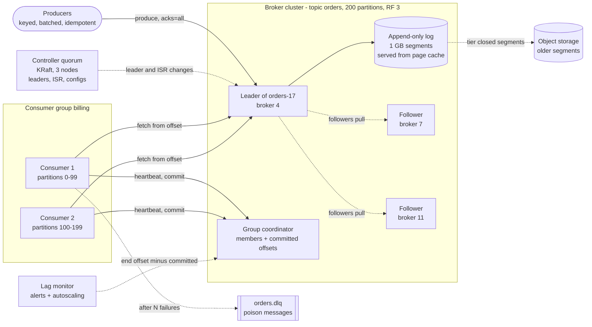
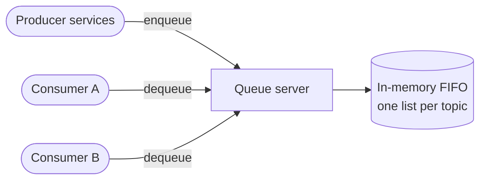
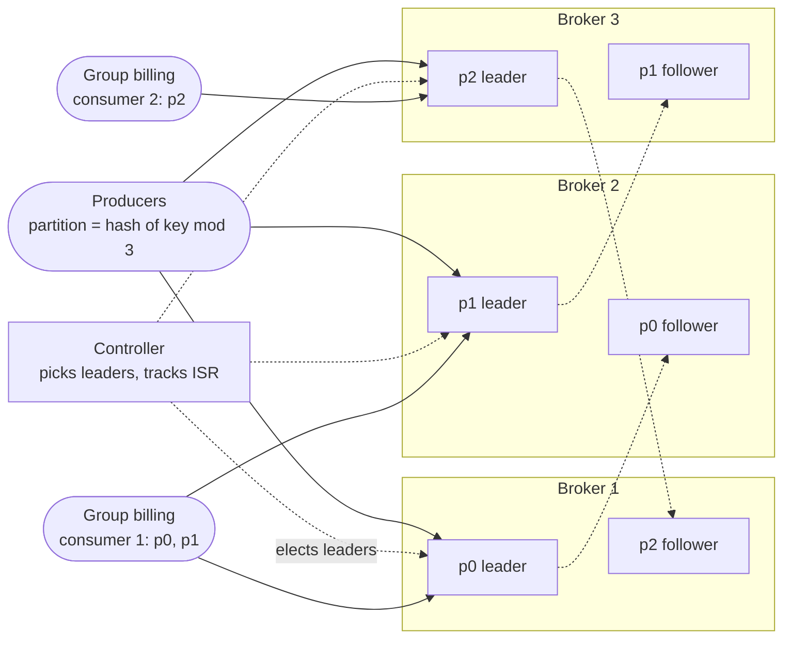
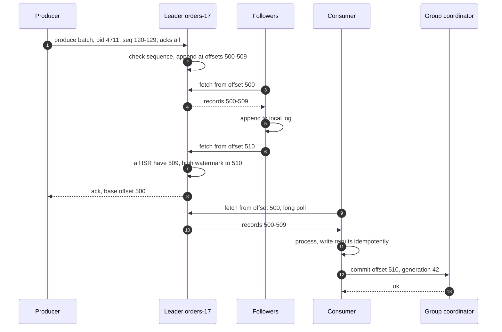

> **In one line:** split each topic into partitions, store each partition as an append-only log replicated to three brokers, and let consumers pull from offsets they commit themselves, so ordering holds per partition and throughput grows by adding partitions and brokers.

## The design at a glance



The producer hashes the key to a partition and sends a batch to its leader, which appends it to the log. Followers pull the records, and once every in-sync replica has them the leader acks. Each consumer in a group owns some partitions, reads forward from its committed offset and commits to the group coordinator; the controller quorum decides who leads each partition.

## How to spend the 30 minutes

| Minutes | What you do | What to say or draw |
|---|---|---|
| 0-3 | Requirements | Work queue or event log? Replay? Ordering? Delivery guarantee? |
| 3-6 | Numbers | 1 M msgs/s peak, 1 GB/s, 7-day retention, ~120 TB on disk |
| 6-9 | API and data model | Produce, fetch, commit. Topic → partitions → segments |
| 9-12 | Design v1 | One server, an in-memory list per topic |
| 12-15 | Break v1 | Crash loses data, read deletes, one box |
| 15-22 | Design v2 and v3 | Log on disk, partitions, groups, replication + ISR, controller, idempotence, DLQ |
| 22-28 | Deep dives | acks and min ISR, delivery semantics, log vs queue, retention |
| 28-30 | Recap | The 60-second summary at the bottom |

## Requirements

**Functional**

- Producers publish messages, with an optional key, to a named topic.
- Several independent services (consumer groups) each receive every message.
- Inside one group, each message goes to one consumer, so the group shares the work.
- Messages with the same key arrive in the order they were written.
- Consumers can replay from an older offset or timestamp.
- Retention per topic by time or size, or "keep the latest value per key" (compaction).

**Non-functional**

- Durable: an acknowledged message survives losing any one broker.
- Throughput: 1 M messages/s at peak, 1 KB average, 10x growth by adding machines, no central bottleneck.
- Publish p99 under ~20 ms with full replication in one region; end-to-end under 100 ms when consumers keep up.
- 99.99% available for produce. A dead broker means seconds of failover, not an outage.

**Out of scope**

- Cross-region replication (a follow-up), stream processing, schema registry, admin UI.

> **Say it like this:** "I'll build a log-based broker like Kafka: topics split into partitions, each an append-only replicated log, consumers pulling by offset. I'll design for 1 M messages a second, keep order per key, and default to at-least-once with idempotent consumers."

## Back-of-the-envelope numbers

| Quantity | Estimate | How |
|---|---|---|
| Messages in | 200 k/s average, 1 M/s peak | Given; peak is 5x average |
| Ingest bandwidth | 200 MB/s average, 1 GB/s peak | x 1 KB per message |
| Raw data per day | ~17 TB | 200 MB/s x 86,400 s = 17.3 TB |
| On disk, 7 days, 3 replicas | ~360 TB raw, ~120 TB compressed | 17.3 x 7 x 3 = 363 TB; batches compress ~3x with zstd |
| Brokers | ~12 | 120 TB ÷ ~10 TB used per broker (16 TB disks, under 70% full) |
| Peak network out | ~5 GB/s total, ~420 MB/s per broker | 2 GB/s to followers + 3 groups x 1 GB/s, ÷ 12. Fine on 25 Gbit NICs |
| Partitions for `orders` | ~200 | 1 M/s peak ÷ 5 k/s one consumer can process |
| Page cache window | ~20 minutes | 12 x 64 GB = 768 GB ÷ 600 MB/s written (200 MB/s x 3, before compression) |
| Disk pattern | ~200 MB/s sequential vs ~1 MB/s random | One HDD: ~200 random 4 KB writes/s |

**What the numbers tell us:**

- 1 GB/s in, 5 GB/s out and 120 TB do not fit on one machine, so topics are **partitioned** across a dozen brokers.
- Sequential I/O is ~100x faster than random on spinning disks (SSDs prefer it too), so storage is an **append-only log**.
- Consumers that keep up read data written seconds ago, still in RAM: **serve reads from the page cache**.
- Partition count is set by **consumer parallelism**: one partition has one reader per group.

## API

Real brokers use a binary protocol over long-lived TCP connections; HTTP is just for the whiteboard.

```http
POST /topics
{ "name": "orders", "partitions": 200, "replication_factor": 3, "retention_ms": 604800000 }
→ 201

POST /topics/orders/partitions/17/records          (produce one batch)
{ "producer_id": 4711, "producer_epoch": 3, "base_sequence": 120, "acks": "all",
  "records": [ { "key": "order-981", "value": "<bytes>", "headers": { "type": "OrderPlaced" } } ] }
→ 200 { "base_offset": 88412233 }

GET /topics/orders/partitions/17/records?offset=88412233&max_bytes=1048576&max_wait_ms=500
→ 200 { "records": [ ... ], "high_watermark": 88412890 }

POST /groups/billing/join      { "member_id": "c-1", "topics": ["orders"] }
→ 200 { "generation": 42, "assignment": { "orders": [0, 1, 2] } }

POST /groups/billing/offsets   { "member_id": "c-1", "generation": 42, "offsets": { "orders-17": 88412300 } }
→ 204
```

- **The client picks the partition** (`hash(key) mod 200`) from cached metadata, so brokers never forward data.
- **Producers batch and compress** for 5-10 ms: one request, one append and one replication round for hundreds of messages.
- **Fetch is a long poll**, so idle consumers cost almost nothing.
- **`producer_id` + `base_sequence`** let the leader drop a retried batch it already has.
- **`generation`** on commits stops a consumer that lost its partitions in a rebalance from committing for them.

## Data model

```text
topic             name, partition_count, replication_factor, retention.ms, retention.bytes,
                  cleanup.policy (delete | compact)
partition         (topic, index) → leader, replicas [4, 7, 11], ISR [4, 7, 11],
                  leader_epoch, high_watermark
  log on disk     one directory per partition, segments named by first offset:
                  00000000000088000000.log        record batches, append-only
                  00000000000088000000.index      sparse offset → byte position
                  00000000000088000000.timeindex  timestamp → offset
record batch      base_offset, producer_id, epoch, base_sequence, codec, CRC, records[]
consumer group    group_id, generation, members, assignment (partition → member)
committed offset  (group, topic, partition) → next offset to read
```

- **Messages: segment files on local disk**, not a database. The only operations are "append" and "read forward from N", which files plus the page cache do at disk speed.
- **Cluster metadata: a Raft-replicated metadata log** in the controllers. Small, but it must have exactly one answer.
- **Committed offsets: an internal compacted topic** (`__consumer_offsets`), so they are replicated like messages.
- **Shard keys:** messages by `hash(key) mod partitions`; groups by `hash(group_id)`, which picks the coordinating broker.

## Design v1: the simplest thing that works



1. A producer sends a message. The server appends it to an in-memory list for `orders` and returns `200`.
2. A consumer calls `dequeue`. The server pops the head and returns it; the message is gone.
3. Two consumers get different messages, so they share the work.
4. On an empty list the consumer gets `204` and polls again shortly.

This honestly works at a few thousand messages a second; it is the shape of a work queue.

## Where v1 breaks

| Problem | Why it happens | What the user sees |
|---|---|---|
| A crash loses everything | Messages live only in RAM | Every unconsumed order vanishes on a deploy |
| Delete on read | Popped before it is processed | Consumer crashes mid-work, message lost |
| One reader, no replay | Once popped, nobody else sees it | Billing and analytics cannot both read orders; no reprocessing after a bug fix |
| Slow consumers fill memory | Messages pile up in RAM | Server runs out of memory or rejects producers |
| One machine | One NIC, one disk, no replica | Throughput caps at one box; its failure stops every producer |
| Order breaks | A and B pop `created` and `paid` for one order and finish out of order | "Payment for unknown order" downstream |

## Design v2: a partitioned, replicated log



Drawn with two replicas per partition to keep it small (production uses three). Each broker leads one partition and follows another.

### Fix 1: an append-only log on disk

Each partition is a directory of segment files. The broker only appends to the active segment and rolls a new one every 1 GB; a sparse index maps offsets to file positions, so "read from N" is a binary search plus a sequential read. Writes land in the OS page cache, so a broker process crash loses nothing; a machine losing power is covered by replicas (Fix 5). Tail reads come from page cache, and `sendfile()` moves bytes to the socket without copying through the broker (zero-copy; TLS loses this).

### Fix 2: reads do not delete, consumers keep an offset

Each message has an offset, its position in the partition. Consumers fetch "from offset N" and commit "done up to N". Only retention deletes data. A crashed consumer resumes from its last commit, any number of groups read the same data, replay is resetting an offset, and a slow consumer just falls behind on disk instead of filling RAM.

### Fix 3: partitions across brokers

A topic has N partitions, each an independent log on some broker. The producer picks `hash(key) mod N`, so all events for `order-981` land in one partition, in order. More partitions and brokers mean more throughput. **There is no order across partitions**: that is the price of scale.

### Fix 4: consumer groups, one consumer per partition

Inside a group, each partition is owned by exactly one consumer (a consumer may own several). One in-order reader per partition keeps per-key order. Parallelism equals partition count: the 201st consumer on 200 partitions idles. The group coordinator tracks members by heartbeat and moves partitions when one joins, leaves or goes silent. That is a **rebalance**.

### Fix 5: leader, followers and the ISR

With replication factor 3, the leader serves all writes and reads for its partition; followers pull from it like consumers. The **in-sync replica set (ISR)** is the replicas caught up within ~30 seconds. A record is committed once every ISR member has it; the leader then advances the **high watermark**, and consumers only see records below it. With `acks=all` and `min.insync.replicas=2`, an acked message is on at least two machines.

### Fix 6: a controller owns the metadata

Leader and ISR decisions need exactly one answer. A quorum of 3 controllers runs Raft over a metadata log (KRaft). When a broker dies, the controller picks a new leader from the ISR and bumps the **leader epoch**; a cut-off old leader cannot commit because its requests carry a stale epoch, and on rejoining it truncates records the new leader lacks. Older Kafka kept this in ZooKeeper, a separate system with slow controller failover; KRaft standbys already hold the metadata, and Kafka 4.0 removed ZooKeeper.

## Where v2 still breaks

| Problem | Why it happens | What the user sees |
|---|---|---|
| Producer retries duplicate messages | Ack lost in a timeout, producer resends, leader already had it | Two `OrderPlaced` events, charged twice |
| Duplicates after a consumer crash | Processed but not committed; the next owner re-reads | Same email sent twice |
| A poison message | One record always throws and is retried forever | Its whole partition stalls |
| Rebalance storms | Classic rebalances revoke every partition; 50 pods rolling = 50 pauses | Lag spikes on every deploy |
| Silent lag | Nobody watches it until retention deletes unread data | A group loses messages, found days later |
| Long retention is expensive | 7 days x 3 replicas already fills local disks | No replay for audits or new services |

## Design v3: exactly-once where it counts, and run it safely

This is the diagram at the top.

### Fix 7: idempotent producers

Each producer has an ID, and each batch a per-partition sequence number. A retried batch whose sequence the leader already wrote is acked with the original offset, not appended again; a gap is rejected, so retries cannot reorder either. Modern Kafka clients enable this by default.

### Fix 8: transactions for read-process-write

A job that reads `orders`, writes `invoices` and commits its input offset does all three atomically. A transaction coordinator writes commit or abort markers, and `read_committed` consumers skip aborted records. A restart with the same `transactional.id` bumps an epoch that fences the old zombie. This is exactly-once **inside the log only**: emails and payment calls still need idempotent consumers.

### Fix 9: retry topic and dead-letter queue

After 3 failures, the consumer publishes the record to `orders.retry` (with backoff), then to `orders.dlq`, commits and moves on. The DLQ gets an alert, an owner and a replay tool. Parking breaks order for that key, so park only messages whose order does not matter.

### Fix 10: calmer rebalances

Cooperative rebalancing revokes only the partitions that move. Static membership gives each pod a stable ID, so one restarting within the session timeout gets its partitions back with no rebalance.

### Fix 11: lag monitoring and backpressure

Lag = log end offset minus committed offset. Alert on lag in seconds and on lag nearing retention, and autoscale consumers up to the partition count. Pulling is natural backpressure: consumers take only what they can handle. Brokers throttle clients over their byte-rate quota by delaying responses, and a producer with a full buffer blocks, then fails.

### Fix 12: tiered storage and compaction

Keep a day on local SSD and move closed segments to object storage, far cheaper than triple-replicated disk. "Latest state per key" topics use compaction instead of deletion.

### Components

| Component | Job | Tech choice |
|---|---|---|
| Producer client | Partition, batch, compress, retry safely | Idempotence on, `acks=all`, zstd |
| Broker | Store partition logs, serve produce and fetch | Local SSD, page cache, `sendfile` |
| Controller quorum | Leaders, ISR, configs, membership | 3 KRaft controllers (Raft) |
| Group coordinator | Membership, assignment, offsets | Broker role, `__consumer_offsets` |
| Consumer | Fetch, process idempotently, commit | Cooperative rebalancing, static IDs |
| Tiered storage | Cheap long retention | S3 or GCS |
| Lag monitor | Alert and autoscale on lag | Prometheus exporter |

## Key flow: publish with acks=all, then consume



- **Ack lost:** the producer retries with the same sequence numbers and the leader returns offset 500 without appending again.
- **Slow follower:** after ~30 s it leaves the ISR. If the ISR falls below `min.insync.replicas`, `acks=all` writes are refused: durability over availability.
- **Leader dies before step 3:** no follower has the batch, so it was never committed. The producer retries on the new leader; the old one truncates its copy on rejoining.
- **Leader dies after step 5, before step 8:** a follower holding 500-509 becomes leader and keeps them, and the retry is recognised as a duplicate by its sequence numbers.
- **Consumer dies between steps 11 and 12:** the next owner reprocesses the batch, which is why step 11 must be idempotent.

## Deep dives

### How durable is "acknowledged"?

**The problem.** Each replica the producer waits for adds latency; waiting for too few means an ack can still be lost.

**Options.**

| Option | Good | Bad |
|---|---|---|
| `acks=0` | Fastest | Lost on any hiccup, silently |
| `acks=1` | Leader has it, one round trip | Lost if the leader dies before followers copy it |
| `acks=all`, min ISR 1 | Waits for whoever is in sync | If the ISR shrinks to the leader, no better than `acks=1` |
| **`acks=all`, min ISR 2, RF 3** | Survives any one broker loss, still writable with one down | Waits for the slower follower; refuses writes with two down |

**Pick.** RF 3, `acks=all`, `min.insync.replicas=2`, and unclean leader election off, so a stale replica never becomes leader. `acks=1` only for data you can lose.

### Delivery semantics

**The problem.** Crashes happen between "process" and "commit", so you choose which way to fail.

**Options.**

| Option | How | Good | Bad |
|---|---|---|---|
| At-most-once | Commit, then process | No duplicates | A crash loses the message |
| **At-least-once** | Process, then commit; producers retry | Nothing lost | Duplicates after crashes |
| Exactly-once in the log | Idempotent producer + transactions + `read_committed` | No loss or duplicates for log-to-log jobs | Extra latency; external side effects not covered |

**Pick.** At-least-once by default, with idempotent consumers: a dedupe table keyed by event ID, upserts, or storing the offset in the same database transaction as the result. Transactions only for stream jobs that read and write topics.

### Log (Kafka) vs queue (RabbitMQ, SQS)

**The problem.** "Message queue" means two different designs.

**Options.**

| | Log (Kafka, Pulsar, Kinesis) | Queue (RabbitMQ, SQS) |
|---|---|---|
| After a read | Stays until retention | Deleted once acked |
| Progress | One offset per partition per group | Ack per message |
| Parallelism | Capped by partitions | Add consumers freely |
| Ordering | Per partition | Best effort (SQS standard), per message group (SQS FIFO) |
| Failures | Consumer parks messages itself | Visibility timeout and redelivery, DLQ after N receives |
| Replay, many readers | Built in | One copy per queue, replay is hard |
| Best for | Event streams, CDC, analytics | Tasks with uneven run times, per-task retries |

SQS hides a received message for the visibility timeout (30 s default); if not deleted in time it reappears, and after `maxReceiveCount` receives it goes to the DLQ. RabbitMQ pushes up to a prefetch limit and redelivers unacked messages.

**Pick.** A log for event streams with several subscribers and replay, which is this design. A queue for "do this task once" work where one slow task must not block the ones behind it.

### Retention and log compaction

**The problem.** Disks fill, some consumers need history, and some topics are really "latest state per key".

**Options.**

| Option | Good | Bad |
|---|---|---|
| Delete by time (7 days) | Predictable replay window | A consumer 8 days behind loses data |
| Delete by size | Caps disk | Window shrinks during spikes |
| **Compaction** | Latest record per key kept forever | Only for keyed state; change history is lost |
| **Tiered storage** | Months of history at object-storage prices | Old reads are slower |

Both deletion and compaction work on closed segments, never the active one. Compaction rewrites segments keeping the newest record per key; offsets do not change (they get gaps). A null value is a tombstone: it deletes the key, and is itself removed after a grace period.

**Pick.** Time-based deletion for events, compaction for state (offsets, settings, CDC tables), tiered storage when someone needs a month of replay.

## Trade-offs to say out loud

- We chose **a log over a delete-on-ack queue** for replay and many readers. The cost is parallelism capped by partitions, and a stuck message blocks its partition.
- We chose **per-partition over global ordering** so throughput scales. The cost: producers must pick a good key.
- We chose **`acks=all` with min ISR 2** so acked data survives a broker loss. The cost is a few ms of latency and refused writes with two replicas down.
- We rely on **replication, not fsync per message**. The cost: losing all three replicas at once can lose recent data, so spread them across zones.
- We default to **at-least-once plus idempotent consumers**. The cost is dedupe logic in every consumer.

## Follow-up questions

**Q: How do you support delayed messages?**
A log has no native delay. Use delay topics (`retry-1m`, `retry-10m`) whose consumer waits until each message is due, or a timer service that stores messages in time buckets, as in the [job scheduler](09-job-scheduler.md). SQS has delays up to 15 minutes; RabbitMQ uses a plugin or TTL plus a dead-letter exchange.

**Q: And priority messages?**
A partition is FIFO. Use `orders.high` and `orders.low` topics, with a bigger consumer pool for high or consumers that poll high first. RabbitMQ has native priority queues.

**Q: How many partitions, and can you add more later?**
Size for future consumer parallelism, about 2x today's need. You can add partitions, but `hash(key) mod N` changes, so a key's new events can land in a different partition from its old ones.

**Q: One tenant sends 30% of the traffic.**
Their key makes a hot partition. Salt it into sub-keys if their events need no total order, or give them their own topic.

**Q: What happens when a broker dies?**
The controller notices missed heartbeats and moves leadership of its partitions to ISR members. Clients get "not leader", refresh metadata and retry: a few seconds of errors, no acked data lost.

**Q: Multi-region?**
A cluster per region, with selected topics copied asynchronously (MirrorMaker 2 or cluster linking). Acks stay local; a regional failover can lose the last few seconds, and offsets must be translated.

## 60-second recap

- Topics split into partitions; each partition is an append-only log of 1 GB segments with a sparse offset index.
- Sequential writes, page-cache reads and zero-copy let a dozen brokers handle 1 GB/s in and 5 GB/s out.
- Producers hash the key to a partition, so order holds per key, never across partitions.
- Leader plus two followers; `acks=all` with min ISR 2 survives any one broker loss. A KRaft quorum picks leaders and fences stale ones with epochs.
- Consumer groups give each partition to one consumer, which commits offsets and can replay.
- At-least-once with idempotent consumers by default; idempotent producers plus transactions give exactly-once inside the log.
- Retention by time or size, compaction for state, tiered storage, a DLQ, alerts on lag.
