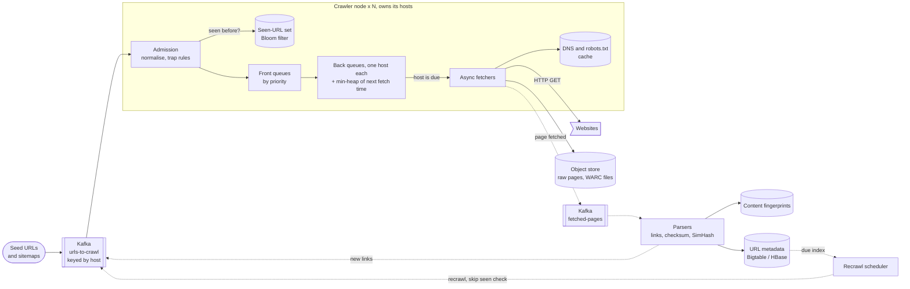
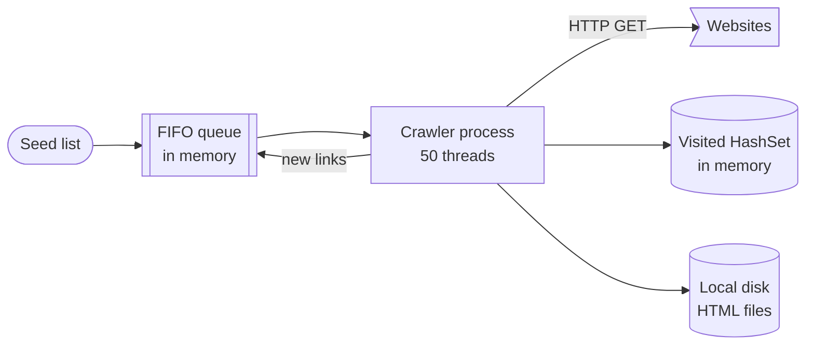
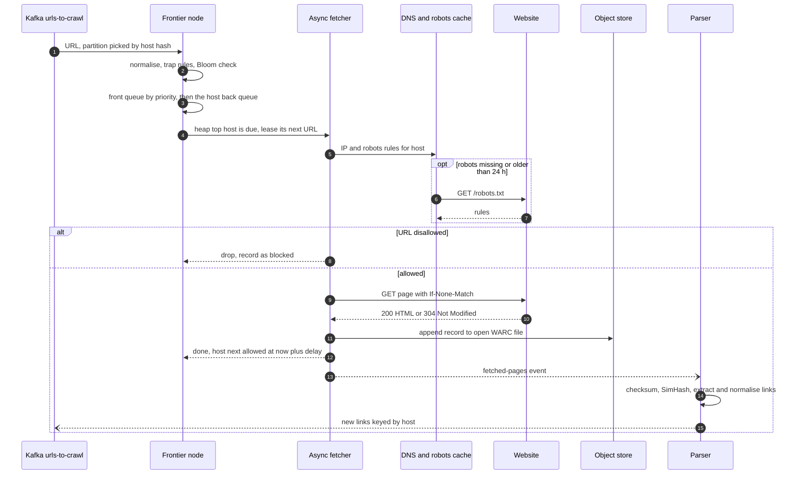

> **In one line:** shard the URL frontier by host so one node alone decides when each host may be hit again, keep a thousand async fetches in flight, drop repeat URLs with a Bloom filter and repeat content with fingerprints, and recrawl pages when they are likely to have changed.

## The design at a glance



Follow one URL around the loop. Kafka routes it by host to the node that owns that host, which normalises it, drops it if the Bloom filter has seen it, and files it in a priority queue and then in its host's back queue. When the heap says the host is due, a fetcher checks robots.txt and saves the page; a parser sends the new links back to Kafka, and the recrawl scheduler re-feeds pages that are likely to have changed.

## How to spend the 30 minutes

| Minutes | What you do | What to say or draw |
|---|---|---|
| 0-3 | Requirements | Scale, HTML only, freshness, politeness |
| 3-6 | Numbers | ~400 pages/s, ~320 Mbps, 100 TB a month, 10 B known URLs |
| 6-9 | API and data model | Seed and recrawl endpoints, URL metadata row, WARC files |
| 9-12 | Design v1 | One machine, a BFS queue, a HashSet of visited URLs |
| 12-15 | Break v1 | Slow, impolite, out of memory, no recovery, duplicates |
| 15-23 | Design v2 and v3 | Front and back queues, heap, shard by host, Bloom filter, recrawl, traps |
| 23-29 | Deep dives | Politeness, URL dedupe, near-duplicates, traps |
| 29-30 | Recap | The 60-second summary at the bottom |

## Requirements

**Functional**

- Start from seed URLs and sitemaps; discover more pages by following links.
- Download HTML pages and store content plus metadata for the indexer.
- Fetch each URL at most once per crawl cycle.
- Recrawl pages based on how often they change and how important they are.
- Obey robots.txt and a polite per-host rate.

**Non-functional**

- About 1 billion pages a month, so ~400 pages/s sustained.
- Politeness: one request in flight per host, seconds apart.
- Robust against crashed nodes, hostile servers, broken HTML and traps.
- Horizontally scalable: no machine holds all the state.
- Fresh: news home pages revisited within hours, the long tail within weeks.
- Exactness not needed: skipping 1% of new URLs or fetching a page twice is fine.

**Out of scope**

- Indexing and ranking. The crawler hands pages to the indexer.
- Rendering JavaScript for every page (a follow-up).
- Images, video and other non-HTML content.

> **Say it like this:** "A crawler is a loop: frontier, fetch, parse, extract links, drop the ones we've seen, put the rest back. At 400 pages a second throughput is easy. The hard parts are politeness while staying busy, holding billions of URLs, and not wasting fetches on duplicates and traps."

## Back-of-the-envelope numbers

| Quantity | Estimate | How |
|---|---|---|
| Pages fetched | ~400 / s, plan for ~1,000 / s | 1 B a month ÷ 2.6 M s ≈ 385, plus retries and redirects |
| Average page | ~100 KB | HTML only, uncompressed |
| Bandwidth | ~40 MB/s (~320 Mbps) | 400 x 100 KB |
| Page storage | ~100 TB a month raw, ~25 TB compressed | 1 B x 100 KB; HTML compresses about 4:1 |
| Links extracted | ~20,000 / s | 400 pages x ~50 links |
| Known URLs | ~10 B | Far more links are found than fetched |
| Seen-URL set | ~12 GB Bloom filter, ~80 GB exact | 10 B x 9.6 bits for 1% false positives, vs 10 B x 8-byte hashes |
| URL metadata | ~5 TB | 10 B x ~500 bytes |
| Fetches in flight | ~1,000-2,000 | Little's law: 400-1,000 / s x ~2 s per fetch |
| Hosts in rotation | ~4,000 or more | 400 / s, each host hit at most once per 10 s: 400 x 10 |

**What the numbers tell us:**

- 320 Mbps fits on a few machines. The hard part is **politeness while staying busy**, not throughput.
- A thousand fetches in flight means async I/O.
- 10 B URLs do not fit in one HashSet: use a Bloom filter, sharded across nodes.
- 100 TB a month goes to object storage; thousands of interleaved hosts mean a per-host frontier.

## API

Users are internal (indexing team, operators); the other "client" is every website we visit.

```http
POST /api/v1/seeds
{ "urls": ["https://example.com/", "https://news.example.org/sitemap.xml"], "priority": "high" }
→ 202 { "accepted": 2 }

POST /api/v1/recrawl
{ "url": "https://example.com/products/42", "reason": "sitemap_lastmod_changed" }
→ 202

GET /api/v1/urls/{url_hash}
→ 200 { "status": 200, "last_fetched_at": "2026-10-14T08:00:00Z", "content_hash": "9f2c...", "next_crawl_at": "2026-10-21T08:00:00Z" }

PUT /api/v1/hosts/{host}/policy
{ "min_delay_s": 30, "paused": false }
→ 200

GET /products/42                       (what we send to a website)
Host: example.com
User-Agent: ExampleBot/1.0 (+https://example.com/bot)
If-None-Match: "a1b2c3"
→ 200 page, or 304 Not Modified
```

- `202 Accepted`: seeds and recrawl requests only enqueue; the fetch happens when politeness allows.
- The host policy endpoint is the "a site owner complained" lever: slow down or pause one host without a deploy.
- Conditional GET with the stored ETag turns an unchanged page into a tiny `304`, which makes recrawls cheap.

## Data model

```text
url_meta                  (Bigtable / HBase, row key = reversed host + path)
  row_key           "com.example.www/products/42"
  url_hash          64-bit fingerprint of the normalised URL
  status, last_fetched_at, next_crawl_at, recrawl_interval
  content_hash      checksum of the page text (exact duplicates)
  simhash           64-bit fingerprint (near duplicates)
  etag, last_modified
  page_ref          WARC file + offset + length in object storage
  priority, depth, inlink_count

host_state                (in memory on the owning crawler node, checkpointed)
  host, ip, dns_expires_at, robots_rules, robots_fetched_at
  delay_s, next_allowed_at, pages_this_cycle, error_count

pages                     (object store, ~1 GB WARC files)
  record = request + response headers + body

content_fingerprints      (key-value store, key = content_hash)
  content_hash → canonical url_hash
```

- **`url_meta` in Bigtable or HBase:** billions of rows accessed by key, and reversed-host keys keep a site's pages together for range scans. Both split hot ranges on their own. (In Cassandra, partition by `url_hash` to avoid giant partitions.)
- **`host_state` in memory** on the one node that owns the host, because it is read on every fetch.
- **Pages in S3, GCS or HDFS as WARC files,** the standard web-archive format; ~1 GB files beat a billion tiny objects on cost.
- **`content_fingerprints` sharded by the hash itself,** because copies live on different hosts.
- **Shard key for the frontier and host state: a hash of the host.**

## Design v1: the simplest thing that works



1. Put the seed URLs in an in-memory FIFO queue and in a `HashSet` of visited URLs.
2. Fifty threads loop: pop a URL, resolve the host with the system resolver, `GET` the page.
3. Save the HTML to local disk.
4. Parse it, pull every `<a href>`, make relative links absolute.
5. Add each link not in the set to the set and to the back of the queue.

This is breadth-first search over the web graph. It honestly works for a few million pages, and every later version keeps this loop.

## Where v1 breaks

| Problem | Why it happens | What the user sees |
|---|---|---|
| Far too slow | 50 blocking threads at ~1 s per page, plus a blocking DNS lookup each, give ~50 pages/s | 1 B pages takes ~230 days, not a month |
| Impolite | A page's 500 links to its own site sit together; 50 threads hit it at once | Sites block our IPs as a DoS attack |
| Out of memory | 10 B URLs x ~100 bytes is ~1 TB for the visited set alone | The process dies long before the crawl ends |
| No recovery | Queue and set live only in RAM | A crash in week three means starting over |
| Duplicates | `HTTP://Example.com/a` and `http://example.com/a#top` look different; mirrors get fetched too | A big share of the budget re-downloads pages we have |
| No priority | FIFO treats spam and a news home page the same | Important pages wait behind junk |

## Design v2: a distributed crawler with a polite frontier

### Fix 1: split the loop into stages

Fetchers are network-bound and run on the same node as the frontier shard they pull from. Parsers are CPU-bound and form their own pool. Parsers publish links to Kafka `urls-to-crawl`; fetchers publish to `fetched-pages`. Kafka absorbs bursts and holds events while a consumer is down (see the [message queue](25-message-queue.md)).

### Fix 2: async fetchers and a DNS cache

Each fetcher runs an event loop (Netty, Go or asyncio) holding a thousand open connections, with keep-alive per host. DNS goes through a local caching resolver plus an in-process cache that respects TTLs, resolved ahead of time while the URL waits in its queue. Hosts repeat, so nearly every lookup is a memory hit. Fixes "far too slow".

### Fix 3: a frontier built for politeness

- **Front queues**, say 10, one per priority level. A prioritiser scores each URL from inbound links, host importance and depth. Fixes "no priority".
- **Back queues**, each holding URLs of exactly one host (a `host → queue` table tracks which). Two workers can never hit one host at once.
- **A min-heap** with one entry per back queue, keyed by the earliest time that host may be hit again.

A fetcher pops the heap top, waits until that time, fetches one URL from that queue, then pushes the host back with `now + delay`. An empty back queue is refilled from the front queues, favouring high priority. Fixes "impolite".

### Fix 4: robots.txt per host

Before the first fetch of a host, get `/robots.txt` and cache its rules in `host_state` for up to 24 hours, the limit in the robots standard (RFC 9309). A 4xx means no rules; a 5xx or no answer means assume everything is disallowed and retry later. A `Crawl-delay` line (non-standard but common) sets the host's minimum delay.

### Fix 5: shard the frontier by host

A hash of the host picks one of, say, 1,024 Kafka partitions, and each node owns a set of partitions. That node holds the host's back queue, heap entry, robots rules, DNS entry and seen-set slice, so politeness is a local decision with no distributed lock. Queues keep their head in memory and their tail on local disk. Fixes "out of memory".

### Fix 6: normalise URLs, then check a Bloom filter

Resolve each link against the page's base URL, lowercase scheme and host, drop default ports and `#fragments`, resolve `./` and `../`, sort query parameters, and strip tracking and session ones (`utm_*`, `sid`). A Bloom filter then answers "queued this before?" in ~1.2 GB per node (10 nodes, 10 B URLs). It never calls a seen URL new, and at 1% false positives it skips about 1 in 100 new URLs, which is acceptable.

### Fix 7: checksum the content

Different URLs often serve the same page (mirrors, `?print=1`, `http` and `https`). The parser hashes the extracted text and looks it up in `content_fingerprints`; a match is recorded as a duplicate and its links are not extracted again. With Fix 6, this fixes "duplicates".

### Fix 8: object storage, metadata and checkpoints

Fetchers append pages to ~1 GB WARC files; the `fetched-pages` event carries `(file, offset, length)` and the parser writes `url_meta`. Queues are append-only segment files copied to object storage, and every few minutes each node checkpoints its heap, host table, queue positions and Bloom filter with its Kafka offsets. A replacement node loads the checkpoint and replays Kafka from there. A few pages get fetched twice; nothing is lost. Fixes "no recovery".

## Where v2 still breaks

| Problem | Why it happens | What the user sees |
|---|---|---|
| Pages go stale | Each URL is fetched once; the Bloom filter drops it whenever it is linked again | Search shows yesterday's headlines |
| Spider traps | Endless "next month" calendar links, session ids, paths like `/a/b/a/b/a/b` | One host eats millions of fetches |
| Near-duplicates | A checksum changes when one ad or timestamp changes | The index fills with 99% identical pages |

## Design v3: keep it fresh and stay out of traps

This is the diagram at the top.

### Fix 9: recrawl by change rate and importance

After each fetch, compare the new content hash with the old: changed halves `recrawl_interval`, unchanged (or `304`) doubles it, within 1 hour and 60 days. Importance tightens the upper bound, so a news home page never waits more than an hour. Sitemap `lastmod` and RSS feeds pull a page forward. `next_crawl_at` goes into a time-bucketed due index, like the [job scheduler](09-job-scheduler.md); an hourly job publishes due URLs to Kafka with a `recrawl` flag that skips the Bloom filter. Fixes "pages go stale".

### Fix 10: limits that defuse traps

At admission: URLs up to 2,048 characters, path depth up to about 15, no segment repeated more than twice, session parameters stripped, a cap on query-string variants per path, and a per-host page budget that grows with importance. At fetch: 30 s timeout, 10 MB cap, at most 5 redirects. Fixes "spider traps".

### Fix 11: SimHash for near-duplicates

Also compute a 64-bit SimHash of the text. Pages whose SimHashes differ in 3 or fewer bits are near-copies, marked as duplicates. A host whose new pages are mostly near-duplicates gets its budget cut, which also catches traps that generate slightly different pages forever. Fixes "near-duplicates".

### Components

| Component | Job | Tech choice |
|---|---|---|
| Kafka `urls-to-crawl` | Route every URL to the node owning its host | ~1,024 partitions keyed by host hash |
| Admission + seen set | Normalise, trap rules, dedupe, priority | In-process Bloom filter, 1% false positives |
| Front and back queues + heap | Priority, then politeness per host | Memory head, disk tail, min-heap |
| Fetchers | ~1,000+ fetches in flight | Async HTTP client, keep-alive, strict timeouts |
| DNS and robots caches | Skip repeat lookups | Caching resolver, robots kept 24 h |
| Object store | Raw pages | S3 / GCS / HDFS, ~1 GB WARC files |
| Parsers | Links, text, checksum, SimHash | Stateless workers on `fetched-pages` |
| URL metadata | Status, hashes, schedule per URL | Bigtable / HBase, reversed-host keys |
| Recrawl scheduler | Re-feed due URLs | Hourly job over a time-bucketed index |

## Key flow: crawl one URL



- **Timeout or 5xx:** requeue with exponential backoff and grow the host's delay; after repeated failures, pause the host for hours.
- **429 or 503 with `Retry-After`:** set the host's `next_allowed_at` to at least that time.
- **Redirect:** publish the target as a new URL so it gets normalisation, dedupe and politeness.
- **Fetcher crashes:** the host was leased; after 2 minutes with no result, it returns to the heap.
- **Parser crashes:** Kafka redelivers. Writes are keyed by URL hash and fetch time, so replays overwrite.

## Deep dives

### How does the frontier stay polite and busy?

**The problem.** We need a thousand fetches in flight, but each host gets at most one at a time, seconds apart.

**Options.**

| Option | Good | Bad |
|---|---|---|
| One FIFO; workers sleep after hitting a host | Trivial | Workers idle when the next URLs share one host |
| Global per-host lock in Redis | Works for any number of workers | A round trip per fetch; workers keep pulling locked hosts |
| **Back queue per host + min-heap** | Heap top is always a host we may hit now; O(log n) | Needs host sharding; refilling queues takes care |

**Pick.** Back queues plus a heap, sharded by host. Keep several times more active hosts than fetch slots so a due host always exists. A good delay rule is "about 10 times the last fetch time", with a floor of a few seconds and `Crawl-delay` as an override, so a struggling server automatically gets fewer requests.

### Seen URLs: Bloom filter or exact set?

**The problem.** 20,000 links a second checked against ~10 B known URLs.

**Options.**

| Option | Good | Bad |
|---|---|---|
| Look up `url_meta` | Exact, nothing new to run | 20,000 random reads a second, mostly hits |
| Exact set of 8-byte hashes, sharded | No false positives; ~8 GB per node on 10 nodes | 6-7x the memory of a Bloom filter |
| **Bloom filter per node** | ~12 GB total at 1%; a few bit checks per URL | Skips ~1% of new URLs; no deletes |

**Pick.** A Bloom filter per node with 7 hash functions (optimal for 1% at ~9.6 bits per URL). A false positive is sticky, so rebuild filters each cycle with new hash seeds and double-check high-priority URLs (sitemap entries) against `url_meta`. No deletes is fine: the scheduler, not the filter, decides revisits. To never miss a URL, use the exact set in RocksDB on SSD.

### Exact and near-duplicate content

**The problem.** Mirrors, printer versions, one article under ten URLs, pages that differ by one ad.

**Options.**

| Option | Good | Bad |
|---|---|---|
| Checksum of the text | Exact, one lookup | One changed word gives a new hash |
| **SimHash (64-bit)** | Similar pages land a few bits apart; 8 bytes per page | "Within 3 bits" over billions needs index tables |
| MinHash + LSH | Estimates shared-phrase overlap well | Hundreds of hashes per page |

**Pick.** Checksum first, then SimHash. To find near matches, split the 64 bits into 4 blocks of 16. Fingerprints within 3 bits must match exactly on at least one block, since 3 differing bits touch at most 3 blocks, so index by each block and compare only candidates that share one. At billions of pages, use more tables on longer bit groups (any 3 of 6 blocks gives 20 tables) so each lookup returns few candidates.

### Spider traps and limits

**The problem.** Some sites generate unlimited URLs: calendars, faceted filters (`?color=red&size=m&sort=price`), session ids, or deliberate traps.

**Options.**

| Option | Good | Bad |
|---|---|---|
| Per-host page budget per cycle | Bounds any trap, even unknown ones | Big honest sites need big budgets, so scale by importance |
| URL rules (length, depth, repeats, session params, variants) | Cheap, runs before the Bloom check | Each rule catches only its own trap |
| Content-yield check: share of near-duplicates per host | Catches traps whose URLs all look different | Reacts after some wasted fetches |

**Pick.** All three, plus fetch limits and a minimum transfer rate against slow-drip servers. The budget is the safety net; rules and the yield check stop most traps first. Honour `rel=canonical` so faceted pages collapse to one URL.

## Trade-offs to say out loud

- We chose **sharding by host over a shared frontier** so politeness needs no locks. The cost is skew, and moving hosts means moving checkpointed state.
- We chose a **Bloom filter over an exact set** to cut memory 6-7x. The cost is skipping ~1% of new URLs until the next rebuild.
- We chose **at-least-once processing**. The cost is refetching a few pages after a crash, which sites and the indexer tolerate.
- We chose **politeness over speed**: one request every few seconds per host. The cost is that big sites take long to crawl fully.
- We chose **adaptive recrawl over a fixed cycle**. The cost is that a page that suddenly starts changing is caught only at its next visit.

## Follow-up questions

**Q: How do you crawl pages that need JavaScript?**
Send pages whose raw HTML has little text or few links to a separate render queue served by headless Chrome. Rendering costs far more than a fetch, so it gets its own budget.

**Q: How do you add a crawler node?**
Move some of the fixed Kafka partitions to it; it loads their last checkpoint and continues from the saved offsets. No host is rehashed.

**Q: Many small sites share one IP. Is per-host politeness enough?**
Not always. Route all subdomains of one registered domain to the same node, and keep a per-IP limit on each node as a second check.

**Q: A site owner asks us to stop. What happens?**
An operator pauses the host through the policy API, effective at the next heap pop. Robots.txt changes apply within 24 hours.

**Q: How do you know the crawl is healthy?**
Track pages/s, errors by status code, duplicate share, frontier size and DNS hit rate. A jump in duplicates or in pages from one host usually means a trap.

**Q: How does the indexer get pages?**
It consumes the parser's output events and reads bodies from object storage by `page_ref`, so crawling and indexing scale independently.

## 60-second recap

- The loop: frontier, fetch, parse, extract, dedupe, repeat. 1 B pages a month is ~400 pages/s and ~320 Mbps.
- Priority front queues feed per-host back queues; a min-heap of next-allowed times keeps us polite and busy.
- All state for a host lives on one node, picked by host hash and routed by Kafka.
- Async fetchers keep a thousand requests in flight; DNS and robots.txt are cached.
- URLs are normalised and checked against a Bloom filter; content against a checksum and SimHash.
- Pages go to WARC files in object storage, metadata to Bigtable or HBase; checkpoints plus Kafka replay make crashes cheap.
- A recrawl scheduler brings pages back by change rate and importance; budgets and URL rules defuse traps.
