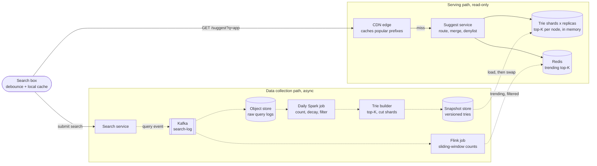
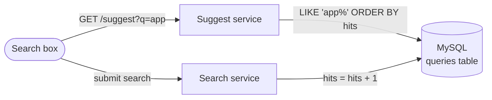
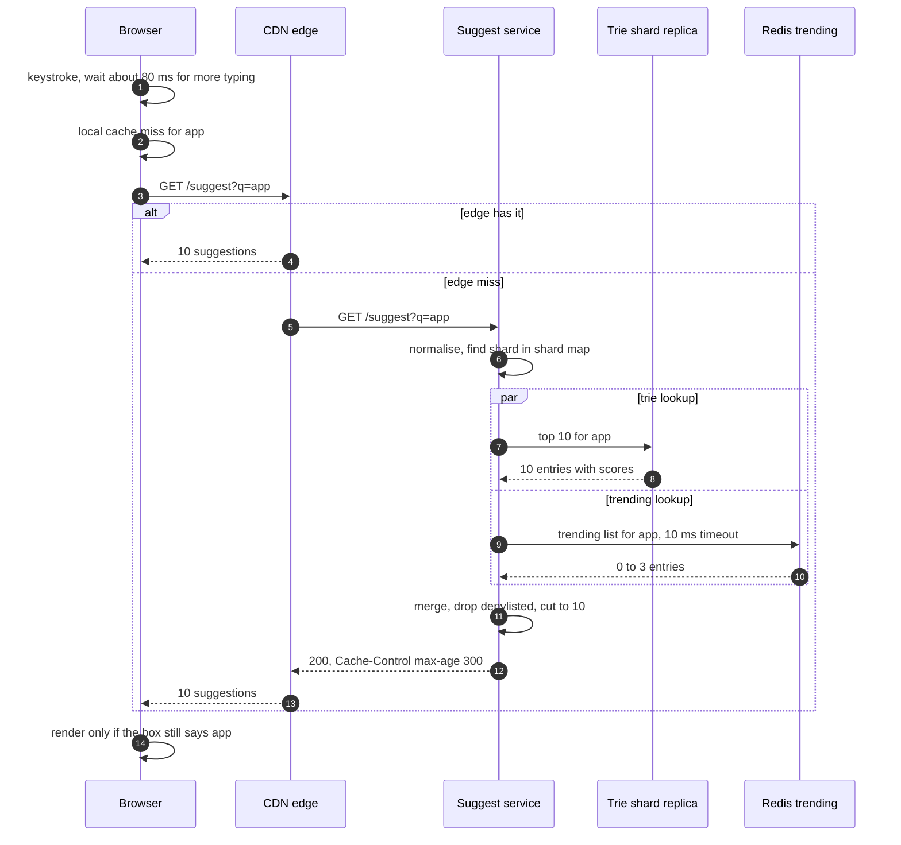

> **In one line:** count submitted searches offline, build a trie that already stores the top 10 completions at every prefix, serve each keystroke with one in-memory lookup behind browser and CDN caches, and blend in a small real-time trending list, filtered for safety on both paths.

## The design at a glance



Two paths that never block each other. **Serving:** a keystroke goes to the CDN, then to the suggest service, which reads one precomputed top-10 list from an in-memory trie shard, merges a few trending entries from Redis and drops anything on the denylist. **Collection:** submitted searches flow through Kafka; a daily job counts them and builds a new trie snapshot that serving nodes swap in, while a Flink job spots spikes within minutes.

## How to spend the 30 minutes

| Minutes | What you do | What to say or draw |
|---|---|---|
| 0-3 | Requirements | How many suggestions, latency, freshness, languages, personalised? |
| 3-6 | Numbers | ~58 K requests/s, ~120 K at peak, 500 M queries, ~150 GB trie |
| 6-9 | API and data model | One cacheable GET; a trie node with cached top-K |
| 9-12 | Design v1 | SQL `LIKE 'prefix%'` ordered by count |
| 12-14 | Break v1 | Short prefixes scan millions of rows; counter contention |
| 14-22 | Design v2 and v3 | Top-K trie, offline build, sharding, caches, trending stream |
| 22-29 | Deep dives | Trie vs key-value, shard skew, trending, safety filters |
| 29-30 | Recap | The 60-second summary at the bottom |

## Requirements

**Functional**

- As the user types, show up to 10 completions for the current prefix.
- Rank by popularity, favouring recent searches.
- Refresh suggestions at least daily; trending queries (breaking news) appear within minutes.
- Never show offensive, unsafe or personal suggestions; remove a bad one within minutes.
- Suggestions per language and region.

**Non-functional**

- p99 under 100 ms from request to suggestions on screen, so ~10 ms on the server.
- ~120 K requests/s at peak.
- 99.99% available, but failure is quiet: if autocomplete is down, search still works.
- Eventual consistency is fine: a new query appearing a day later is acceptable.

**Out of scope**

- Search results themselves.
- Spelling correction and deep personalisation (follow-ups).

> **Say it like this:** "Autocomplete is a read-heavy, latency-critical lookup: for a prefix, return the 10 best completions in a few milliseconds. The trick is doing the work offline: count queries from logs, build a trie that already stores the top 10 at every node, and serve it from memory. I'll add a real-time stream only for trending queries."

## Back-of-the-envelope numbers

| Quantity | Estimate | How |
|---|---|---|
| Searches | ~1 B / day, ~12 K/s | 1 B ÷ 86,400 ≈ 11,600 |
| Suggest requests | ~5 B / day: ~58 K/s average, ~120 K/s peak | ~5 requests per search after debouncing and client caching; peak ≈ 2x |
| Server time budget | ~10 ms of the 100 ms | The rest is network (~50 ms on mobile) and rendering |
| Distinct queries kept | ~500 M | Searched by enough distinct users in 30 days |
| Query text | ~12.5 GB | 500 M x ~25 bytes |
| Trie nodes | up to ~1 B | A compressed trie has at most ~2 nodes per stored query |
| Trie memory | ~150 GB | 1 B nodes x ~150 bytes (10 suggestion ids with scores, child links) |
| Response size | ~1 KB | 10 suggestions x ~30 bytes, plus JSON and headers |
| Peak bandwidth | ~120 MB/s (~1 Gbps) | 120 K/s x 1 KB |
| Search log | ~100 GB / day | 1 B x ~100 bytes |

**What the numbers tell us:**

- 120 K reads a second and no writes on the serving path: precompute everything and replicate freely.
- ~10 ms of server time rules out a database query per keystroke. It has to be one in-memory lookup.
- 150 GB is too big to reload on every replica as one unit each day: split it into ~10 shards of ~15 GB.
- Suggest requests outnumber searches 5 to 1, so the log records submitted searches, never keystrokes.

## API

```http
GET /api/v1/suggest?q=app&lang=en&region=IN&limit=10
→ 200
Cache-Control: public, max-age=300
{ "q": "app", "version": "2026-10-15.1",
  "suggestions": [ { "text": "apple", "trending": false }, { "text": "app store", "trending": false } ] }

POST /internal/v1/denylist
{ "phrase": "some bad phrase", "match": "contains", "reason": "legal" }
→ 201

POST /internal/v1/snapshots/{version}/activate
→ 202
```

- **No user id or cookie in the cache key.** The response depends only on `q + lang + region`, so the browser and CDN can cache it.
- `q` is normalised (lowercase, trimmed, single spaces) so `App ` and `app` share one cache entry.
- `max-age` depends on prefix length: minutes for 1-3 characters (few and very hot), little or none for long prefixes.
- There is no "log a keystroke" endpoint. The search service publishes submitted queries to Kafka.
- `activate` rolls a snapshot version onto every replica. Pointing it at yesterday's version is the rollback.

## Data model

```text
search_log            (Kafka → object store, hourly files)
  ts, query (normalised), lang, region, user_hash, from_suggestion

query_stats           (Parquet, written by the daily Spark job)
  query, lang, region, score (decayed count), distinct_users_30d

trie snapshot         (object store, one file per shard per version)
  node: edge label, child offsets, top_k = [(suggestion_id, score) x 10]
  suggestions: suggestion_id → text

shard_map             (etcd, published with each snapshot)
  [start_prefix, end_prefix) → shard_id, version

trending              (Redis, key = lang + prefix, TTL 30 min)
  "trend:en:earthq" → sorted set of (query, trend_score)

denylist              (Postgres, cached in every suggest server)
  phrase, match_type, reason, added_by, added_at
```

- **Logs in object storage behind Kafka:** append-only, huge, read only by batch jobs. Kafka means the search service never waits.
- **Snapshots as files, not a database:** serving needs the whole structure in RAM, and a memory-mappable file loads fast and is trivial to version and roll back.
- **`shard_map` in etcd:** tiny, must be identical on every router, and routers can watch it for changes.
- **Redis for trending:** small, rewritten every minute, with a TTL so it empties itself if the job stops.
- **Postgres for the denylist:** small, edited by people, needs an audit trail.
- **Partitioning:** the trie by prefix range; the trending set is small enough for one Redis primary with replicas.

## Design v1: the simplest thing that works



1. A table `queries(query VARCHAR PRIMARY KEY, hits BIGINT)`.
2. Every submitted search runs `INSERT ... ON DUPLICATE KEY UPDATE hits = hits + 1`.
3. Every keystroke sends `GET /suggest?q=app`.
4. The service runs `SELECT query FROM queries WHERE query LIKE 'app%' ORDER BY hits DESC LIMIT 10`.

This works for a site search with a hundred thousand distinct queries and a few requests a second. The index on `query` turns `LIKE 'app%'` into a range scan, which is the right instinct.

## Where v1 breaks

| Problem | Why it happens | What the user sees |
|---|---|---|
| Short prefixes are slow | The index finds the range for `s%`, but `ORDER BY hits` must read and sort every match: millions of rows | Seconds of delay on the first letters, right when typing starts |
| Read load | ~120 K range scans a second at peak | Database CPU pinned, timeouts |
| Counter contention | `hits + 1` on every search, on hot rows like `weather` | Lock waits slow down search and suggestions together |
| All-time counts | No notion of recency | Last year's news outranks today's |
| No safety | Every searched string is a candidate | Offensive or private queries shown as suggestions |
| One region | Every keystroke crosses the world to one database | 200 ms or more per keystroke far away |

## Design v2: a precomputed top-K trie, built offline

### Fix 1: split collection from serving

The search service publishes each submitted query to Kafka `search-log` and moves on; a sink writes hourly files to object storage. No counter is updated on any request path, so "counter contention" disappears and serving becomes read-only.

### Fix 2: a daily aggregation job with recency weighting

A Spark job reads the last 30 days of logs, normalises queries and computes a decayed score: the sum over days of that day's distinct-user count times `0.5^(age_days / 7)`, a 7-day half-life. It keeps only queries searched by at least, say, 50 distinct users, which drops typos and private one-offs, and runs safety filters (blocklists, a toxicity classifier, patterns for phone numbers and emails). Fixes "all-time counts" and "no safety".

### Fix 3: a trie that caches the top K at every node

Each node is a prefix and stores the 10 best completions below it, with scores. A lookup walks one node per character and returns the cached list: O(length of prefix), whether the prefix is `a` with millions of completions or `apple wat` with five. Build bottom-up: a node's top 10 is the merge of its children's top 10, plus itself if it is a complete query. Compressing single-child chains (a radix trie) keeps it under 2 nodes per query. Fixes "short prefixes are slow".

### Fix 4: build offline, ship snapshots, swap atomically

The builder writes each shard as a flat, memory-mappable file, versioned by date. A serving node downloads the new version, loads it next to the old one, checks it (known prefixes must return sensible lists), then swaps a pointer and frees the old copy. That needs room for two copies, one more reason for small shards. Replicas roll one at a time, so capacity never drops.

### Fix 5: shard by prefix range, replicate each shard

Cut ~10 ranges of the sorted prefix space with equal traffic, not equal letters, for example `[a, am)`, `[am, b)`. Every node's top 10 was computed over all the data, so a lookup needs only the node for its prefix and touches exactly one shard. Each shard has 3 or more replicas across zones, and hot shards get more. Fixes "read load".

### Fix 6: cache at the client and the edge

The browser waits ~50-100 ms after a keystroke before sending (debounce), cancels stale requests, and caches results per prefix for the session, so backspacing is free. Responses carry `Cache-Control`, and the CDN serves hot short prefixes from an edge near the user. Snapshots are just files, so trie replicas also run in every major region. Fixes "one region" and removes a large share of origin traffic.

## Where v2 still breaks

| Problem | Why it happens | What the user sees |
|---|---|---|
| Breaking news is missing | The trie is rebuilt once a day | An earthquake hits; typing `earthq` shows nothing about it for hours |
| Bad suggestions stay up | Removing one waits for the next build | A harmful or defamatory suggestion stays live for a day |

## Design v3: a real-time trending layer and instant takedowns

This is the diagram at the top.

### Fix 7: count recent searches in a sliding window

A Flink job reads `search-log` and keeps, per query, distinct-user counts for the last hour in 1-minute buckets (a HyperLogLog per bucket, since those merge cleanly). A query is trending when that count is far above its usual rate from `query_stats`, say 5x and at least 500 users. If too many distinct queries make the state large, a count-min sketch plus a heap of candidates bounds memory (as in the [leaderboard](14-leaderboard.md)).

### Fix 8: publish trending lists per prefix and merge at read time

Every minute the job takes the current trending set, keeps the queries that pass the safety filter, and rewrites a Redis sorted set for each of their prefixes (`trend:en:e`, `trend:en:ea`, ... up to 20 characters), deleting prefixes that dropped out. A few thousand queries x 20 prefixes is ~100 K small entries, and a 30-minute TTL clears everything if the job stops. The suggest service reads the trie list and the trending list in parallel, gives trending entries up to 3 of the 10 slots, and removes duplicates. Fixes "breaking news is missing".

### Fix 9: a denylist checked on every response

Every suggest server keeps the denylist in memory, refreshed every 30 seconds, and drops matches before responding. Adding an entry also purges the affected prefixes from the CDN. Takedowns go live in about a minute. Fixes "bad suggestions stay up".

### Components

| Component | Job | Tech choice |
|---|---|---|
| Browser | Debounce, cancel stale requests, cache per prefix | ~80 ms debounce, in-memory map |
| CDN edge | Serve hot short prefixes near users | Cache key `q + lang + region`, TTL by prefix length |
| Suggest service | Normalise, route, merge, apply denylist | Stateless, 10 ms timeout on Redis |
| Trie shards | Precomputed top 10 per prefix | ~10 shards x 3+ replicas, ~15 GB memory-mapped each |
| Redis trending | Trending top-K per prefix | Sorted sets, 30 min TTL |
| Kafka `search-log` | Durable stream of submitted searches | Partitioned by query hash |
| Spark aggregation + trie builder | Decayed counts, thresholds, filters, snapshots | Daily batch, output to object storage |
| Flink trending job | Sliding-window counts, spike detection | 1 h window, sliding every minute |
| Shard map | Which range lives on which shard | etcd, versioned with each snapshot |

## Key flow: typing a prefix



- **A trie replica dies:** the load balancer sends the request to another replica. The data is read-only, so replicas are interchangeable.
- **A whole shard is down:** return trending entries only, or nothing. Autocomplete is a helper and must fail quietly.
- **Redis is slow:** skip trending after 10 ms and return the trie list.
- **The user types faster than responses arrive:** the client ignores any response for a prefix that is no longer in the box.
- **A bad snapshot:** checks fail before the swap, so the old version keeps serving.

## Deep dives

### Trie in memory or a prefix table in a key-value store?

**The problem.** Once top-K is precomputed, both answer "top 10 for this prefix" in one lookup. The difference is memory and operations.

**Options.**

| Option | Good | Bad |
|---|---|---|
| **In-memory radix trie, top-K per node** | Shared prefixes stored once; microsecond lookups; a shard is one file | Custom serving code; full reload each build |
| Prefix → top-10 rows in Redis or Cassandra | Off the shelf; single keys can be updated | A key for every prefix, each with its own copy of 10 strings; a network hop |
| Search engine suggester (Elasticsearch completion, built on in-memory FSTs) | Built in, supports fuzzy matching | Less control over ranking and merging; a heavier cluster to run |

**Pick.** The trie for the daily list, because memory is the main cost and it shares prefixes. A key-value prefix table only for the small trending set, where updating single keys matters more than memory.

### Sharding and skew

**The problem.** Far more queries start with `s` or `c` than with `x` or `q`, and the shortest prefixes get the most traffic of all.

**Options.**

| Option | Good | Bad |
|---|---|---|
| One shard per first letter | Trivial routing | Very unbalanced shards |
| Hash of the prefix | Even spread | Breaks the trie into unrelated nodes and loses its compression |
| **Ranges cut by traffic weight** | Balanced; neighbouring prefixes stay together | The shard map is recomputed and shipped with every build |

**Pick.** Traffic-weighted ranges. Each shard holds the nodes for its range plus the few ancestors needed to walk down, and because top-K was computed globally, a request never fans out. For the very hot 1-2 character prefixes (about 1,300 for letters and digits), copy them onto every shard so the router can send them anywhere, behind the CDN and browser caches that absorb most of them.

### Trending: fast, but hard to game

**The problem.** A daily build is too slow for breaking news, but a sudden spike is also exactly what a manipulation campaign looks like.

**Options.**

| Option | Good | Bad |
|---|---|---|
| Rebuild the whole trie every hour | One system | A heavy job for a few changes, and still up to an hour late |
| Update trie counts on every search | Instant | Writes on the read path; top-K lists along the whole prefix path need redoing; replicas drift apart |
| **Sliding-window stream, merged at read time** | Minutes of delay; touches only a small set | Two sources to merge |

**Pick.** The stream. To resist gaming, count distinct users rather than searches, require spread across regions and networks, ignore known bots, and run every candidate through the classifier plus stricter rules (for example, a person's name next to a crime word goes to human review) before it reaches Redis.

### Keeping suggestions safe

**The problem.** A suggestion looks like the product's own words. Hateful, sexual, violent or defamatory text and personal data must never appear, even while someone types an innocent prefix.

**Options.**

| Option | Good | Bad |
|---|---|---|
| Blocklist of words and phrases | Fast, predictable | Misses spelling variants; can over-block innocent words |
| ML classifier on candidates | Catches variants and context | False positives; needs labelled data |
| Minimum distinct-user threshold | Private one-off searches never surface | New genuine queries appear later |
| **Serving-time denylist with CDN purge** | Takedown in about a minute | Only covers items someone reported |

**Pick.** All four in layers. Threshold, blocklist and classifier run in the daily build, where time is cheap, and again on the trending path. The denylist at serving time is the emergency brake.

## Trade-offs to say out loud

- We chose **precomputed top-K over ranking at query time**, so a keystroke is one memory lookup. The cost is memory (10 entries per node) and lists up to a day old, patched by trending.
- We chose **daily snapshots plus a small real-time layer over updating the trie live**. The cost is two sources to merge and keep consistent.
- We chose **range sharding by traffic over hashing** so a lookup hits one shard and the trie stays compact. The cost is a new shard map every build.
- We **cache at the browser and CDN for minutes**. The cost is that takedowns need a purge and trends reach cached prefixes a few minutes late.
- We require a **distinct-user threshold** before a query can be suggested. The cost is that new long-tail queries appear later; the benefit is that private searches never leak.

## Follow-up questions

**Q: How would you personalise suggestions?**
Keep the global list cacheable and blend personal items in a separate small call or on the device: the user's own recent searches take 1-3 slots at the top. Personalised responses are never cached at the CDN.

**Q: How do you match a word in the middle, like `watch` finding "apple watch"?**
Also index popular queries under each word boundary (`watch` → "apple watch") with a lower weight. That multiplies trie size by the average number of words, so limit it to popular queries.

**Q: What about typos?**
If a prefix has few completions, also look up candidates within edit distance 1, from a separate fuzzy index. Keep it off the main path so normal lookups stay fast.

**Q: How do you support many languages?**
A trie per language and region, built by the same pipeline, with the language in the shard map. Normalisation is language-specific: accents, scripts, and languages written without spaces.

**Q: What if the daily build fails?**
Serving keeps yesterday's snapshot and an alert fires. Trending still covers fresh events, and a bad snapshot is rolled back with one `activate` call.

**Q: How do you measure quality?**
Suggestion click-through rate, characters typed before a pick, and which position gets picked. A/B test ranking by routing a share of users to a different snapshot version.

**Q: Why not just use Elasticsearch?**
It is a good choice at smaller scale. At 120 K requests a second with custom ranking and merging, a read-only in-memory trie is cheaper and more predictable.

## 60-second recap

- Read-heavy: ~120 K suggest requests/s at peak, with ~10 ms of server time inside a 100 ms p99.
- Collection: submitted searches go to Kafka and object storage; a daily Spark job computes decayed distinct-user counts and applies thresholds and safety filters.
- Build: a radix trie with the top 10 cached at every node, cut into traffic-balanced prefix ranges, shipped as versioned snapshots and swapped in atomically.
- Serving: browser debounce and cache, then the CDN, then a stateless suggest service doing one in-memory lookup on one shard replica.
- Trending: Flink sliding-window counts feed per-prefix lists in Redis, merged into up to 3 of the 10 slots.
- Safety in layers: thresholds, blocklists and a classifier offline; a denylist with CDN purge at serving time.
- The serving path is read-only and replicated, so a failure means a slightly worse list, never a broken search box.
