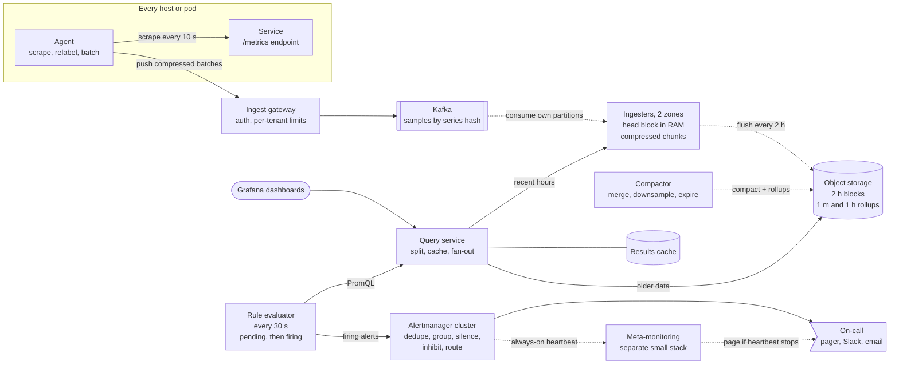
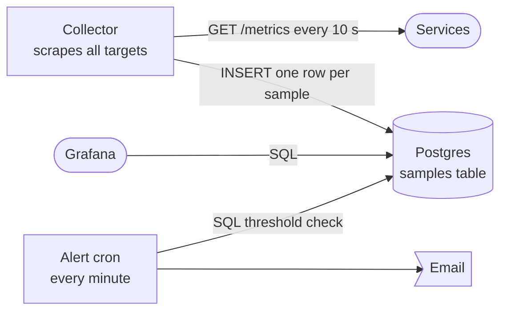
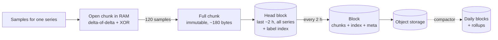
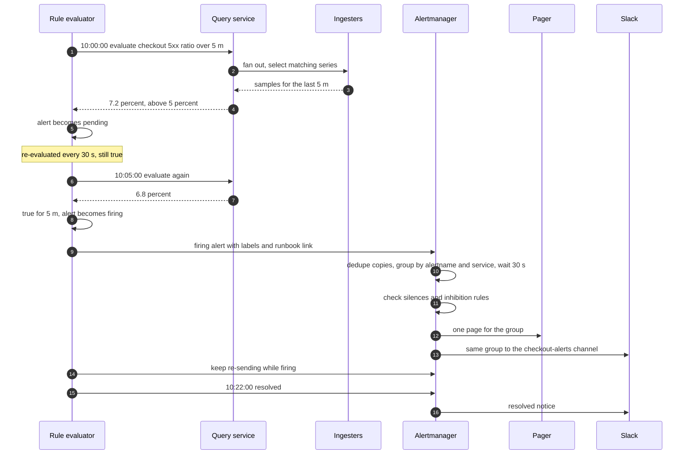

> **In one line:** agents push scraped samples through Kafka to sharded ingesters that keep two hours in memory as compressed chunks (~1.5 bytes per sample) and flush immutable blocks to object storage, while rules evaluated every 30 seconds feed an Alertmanager that dedupes, groups and routes pages.

## The design at a glance



Agents scrape the services on their host every 10 seconds and push compressed batches to the gateway, which enforces per-tenant limits and writes to Kafka. Ingesters consume their partitions, keep the last two hours in memory and flush immutable blocks to object storage, where the compactor builds rollups. Dashboards and alert rules both read through the query service, and Alertmanager turns hundreds of firing alerts into one page.

## How to spend the 30 minutes

| Minutes | What you do | What to say or draw |
|---|---|---|
| 0-3 | Requirements | What is a metric? How many series? Retention? Who gets paged? |
| 3-6 | Numbers | 10 M series, 10 s interval, 1 M samples/s, 1.5 bytes per sample |
| 6-9 | API and data model | Push, query_range, rules, silences. Series = name + labels |
| 9-12 | Design v1 | One collector, one row per sample in Postgres, cron alerts by email |
| 12-15 | Break v1 | 7 TB a day, 1 M inserts/s, slow queries, alert spam |
| 15-23 | Design v2 and v3 | Agents, Kafka, TSDB chunks, label index, ingesters, Alertmanager, limits, rollups |
| 23-28 | Deep dives | Push vs pull, compression, cardinality, downsampling, alert routing |
| 28-30 | Recap | The 60-second summary at the bottom |

## Requirements

**Functional**

- Collect metrics from ~100 k hosts. A sample is **name + labels + timestamp + value**, like `http_requests_total{service="checkout", status="500"} 18234 @ 10:00:00`.
- Types: **counters** (only go up: requests served), **gauges** (up and down: memory used), **histograms** (counts per latency bucket, so p99 can be computed later).
- Query with label filters and aggregations over a time range, for dashboards.
- Alert rules such as "error ratio above 5% for 5 minutes", routed to the owning team's pager, Slack or email.
- Silences for maintenance windows.

**Non-functional**

- Ingest 1 M samples/s, with 2x headroom.
- A sample is queryable within ~30 s of being scraped.
- Dashboards: p95 under 1 s for the last 6 hours, under 10 s for a year.
- Alerting is the critical path: 99.99% available, paging within a minute of the rule's `for` window ending.
- Multi-tenant: one team's bad metric must not hurt anyone else.
- Retention: raw 15 days, 1-minute rollups 30 days, 1-hour rollups a year.
- A few lost samples are fine; a lost alert is not.

**Out of scope**

- Logs and traces (see [distributed logging](16-distributed-logging.md)), anomaly detection, billing.

> **Say it like this:** "10 million active series scraped every 10 seconds is a million samples a second, so this is a write-heavy time-series problem. The hard parts are storing a sample in a byte or two and keeping cardinality under control. Alerting must be more reliable than what it watches, so it gets its own watchdog."

## Back-of-the-envelope numbers

| Quantity | Estimate | How |
|---|---|---|
| Active series | 10 M | Given (100 k hosts x ~100 series each) |
| Samples in | 1 M/s | 10 M series ÷ 10 s interval |
| Samples per day | 86.4 B | 1 M/s x 86,400 s |
| Bytes per sample | 16 raw, ~1.5 compressed | 8-byte timestamp + 8-byte float; delta-of-delta + XOR |
| Raw data per day | ~130 GB compressed | 86.4 B x 1.5 bytes (1.4 TB uncompressed) |
| Ingester memory | ~160 GB | 10 M series x ~8 KB (labels, index, open chunks) x 2 zones |
| Ingest bandwidth | ~100 MB/s before compression | 1 M samples/s x ~100 bytes per text line |
| Storage for a year | ~5 TB with rollups, vs 47 TB raw | Raw 15 d: 1.9 TB. 1 m with 4 values: 86 GB/day x 30 = 2.6 TB. 1 h: 1.4 GB/day x 365 = 0.5 TB |
| Query load | ~700 dashboard queries/s + ~330 rule evaluations/s | 1,000 open dashboards x 20 panels ÷ 30 s refresh; 10,000 rules ÷ 30 s |

**What the numbers tell us:**

- A million tiny writes a second rules out one row per sample: we need batched, append-only, compressed storage, a **time-series database**.
- At ~1.5 bytes per sample a day is only 130 GB, and the last two hours fit in RAM.
- Memory scales with **active series**, not traffic, so cardinality is the thing to limit.
- With rollups a year is ~5 TB in object storage; the real costs are ingester RAM and query fan-out.

## API

```http
POST /api/v1/push                      (agent → gateway, snappy-compressed protobuf)
X-Tenant-ID: payments
{ "series": [ { "labels": { "__name__": "http_requests_total", "service": "checkout",
                            "pod": "checkout-7f9c", "status": "500" },
                "samples": [ [1760522400000, 18234], [1760522410000, 18240] ] } ] }
→ 204          (429 if the tenant is over its series or rate limit)

GET /api/v1/query_range?query=sum by (status) (rate(http_requests_total{service="checkout"}[5m]))
                       &start=1760518800&end=1760522400&step=60
→ 200 { "result": [ { "metric": { "status": "500" }, "values": [ [1760518800, "3.2"], ... ] } ] }

GET /api/v1/series?match[]=http_requests_total{service="checkout"}
→ 200 { "data": [ { "__name__": "http_requests_total", "service": "checkout", "pod": "..." } ] }

PUT /api/v1/rules/checkout
{ "interval": "30s", "rules": [ { "alert": "CheckoutHighErrorRate",
  "expr": "sum(rate(http_requests_total{service=\"checkout\", status=~\"5..\"}[5m])) / sum(rate(http_requests_total{service=\"checkout\"}[5m])) > 0.05",
  "for": "5m", "labels": { "severity": "page", "team": "payments" } } ] }
→ 200

POST /api/v1/silences
{ "matchers": [ { "name": "service", "value": "checkout" } ], "startsAt": "2026-10-16T02:00:00Z",
  "endsAt": "2026-10-16T03:00:00Z", "comment": "planned DB failover" }
→ 200 { "silenceID": "a1b2c3" }
```

- **Push is batched**: thousands of series per request, so 1 M samples/s is a few hundred requests a second.
- **`429` means back off.** The agent keeps a bounded buffer, retries with backoff and drops the oldest samples if it fills: metrics tolerate small gaps.
- **`step`** sets the resolution, and the query service uses it to pick raw data or a rollup tier.
- **Rules live in Git** and CI pushes them, so alert changes get code review.

## Data model

```text
series        series_id = hash(tenant + sorted labels)
              labels { __name__, service, pod, status, ... }
sample        (series_id, timestamp_ms int64, value float64)     16 bytes raw, ~1.5 compressed
chunk         series_id, min_ts, max_ts, 120 samples (20 min at 10 s), Gorilla-encoded
block         2-hour window, immutable: chunk files + index + meta.json
  index       symbols table, series → chunk refs, postings: label=value → sorted series_ids
rollup        (series_id, bucket_start, sum, count, min, max) at 1 m and 1 h
alert state   (rule, label set) → inactive | pending since t | firing since t
silence       matchers, starts_at, ends_at, author, comment
```

- **Last ~2 hours: ingester memory**, rebuilt from Kafka after a restart. Recent data is written constantly and read most.
- **Blocks and rollups: object storage (S3).** Immutable files, cheap and durable storage, no database servers to run.
- **Rules and routing: Git.** Silences and the notification log are replicated inside the Alertmanager cluster.
- **Shard key:** `hash(tenant, labels)` picks the Kafka partition and so the ingester. One series always lands on one ingester and appends to one chunk.

## Design v1: the simplest thing that works



1. The collector reads a list of targets from a config file.
2. Every 10 s it calls `GET /metrics` on each target, parses lines like `http_requests_total{status="500"} 18234` and inserts one row per sample: `(name, labels jsonb, ts, value)`.
3. Grafana runs SQL like `SELECT date_trunc('minute', ts), avg(value) ... GROUP BY 1` per panel.
4. A cron job runs threshold queries every minute and emails the team when one matches.

This honestly works for a few hundred hosts and a few thousand series.

## Where v1 breaks

| Problem | Why it happens | What the user sees |
|---|---|---|
| Storage explodes | ~80 bytes per row with header and index entry; 86 B rows a day is ~7 TB/day | Disk fills in days |
| Writes outpace one database | 1 M inserts/s into a B-tree index on one primary | Dropped samples, gaps in every graph |
| Queries are slow | "p99 for 200 pods over 7 days" scans hundreds of millions of rows | Dashboards time out |
| One collector | 100 k targets must all be scraped inside 10 s by one box | Scrapes run late, data missing under load |
| Alert spam | One email per matching row per minute, no grouping | 400 emails in one outage; people stop reading |
| Single box | Collector, DB and alerting on one machine | One failure loses the data and the alerts |

## Design v2: a time-series pipeline

### Fix 1: agents pull locally, push centrally

An agent on every host scrapes the services next to it every 10 s, relabels (drops or renames labels), batches, compresses and pushes to an ingest gateway. Scrape work is spread over 100 k hosts, and you keep pull's best feature: a target that does not answer is recorded as `up = 0`.

### Fix 2: a gateway and a Kafka buffer

The gateway authenticates the tenant, validates samples and writes batches to Kafka, partitioned by `hash(tenant, labels)`. Kafka absorbs deploy spikes and ingester restarts and lets ingesters replay what they had not flushed, so writes no longer depend on one database keeping up (see [message queue](25-message-queue.md)).

### Fix 3: a real time-series storage engine



Each series appends to an open chunk in memory. Timestamps are stored as delta-of-delta (a regular 10 s scrape costs 1 bit) and values as XOR against the previous value (an unchanged value costs 1 bit). That is ~1.5 bytes per sample instead of ~80 in Postgres. Every 2 hours the head becomes a block, is uploaded to object storage and is never modified again.

### Fix 4: an inverted index from labels to series

For every `label=value` pair, keep a sorted list of series IDs (a postings list). `http_requests_total{service="checkout", status="500"}` intersects three lists to find a few hundred series in milliseconds, then reads only their chunks.

### Fix 5: sharded ingesters and a fan-out query service

Each ingester owns some Kafka partitions, and two ingesters in different zones consume each partition, so losing one loses neither data nor query results. Since series are spread by hash, the query service fans each query out to the ingesters (last 2 hours) and object storage (older), then merges and dedupes the two zones' copies.

### Fix 6: a rule evaluator and an Alertmanager

The evaluator runs each rule every 30 s. A true condition makes the alert **pending**; if it stays true for the `for` window (say 5 minutes) it becomes **firing** and goes to Alertmanager, which dedupes, groups, applies silences and inhibition, and routes by labels to the team's pager or Slack. Three Alertmanagers in a gossip cluster share state, so one dying loses no page.

## Where v2 still breaks

| Problem | Why it happens | What the user sees |
|---|---|---|
| A `user_id` label explodes series | A deploy adds a label with 2 M values, each a new series in RAM | Ingesters run out of memory for every tenant |
| Year-long queries crawl | A 1-year panel reads 3.15 M raw samples per series (365 x 8,640) | Capacity dashboards time out |
| Raw storage grows forever | 130 GB/day for a year is 47 TB, and long scans get slower | Cost and query time grow monthly |
| Incident dashboards stampede | 200 people refresh one dashboard, re-running every query | The query tier falls over mid-incident |
| Silence looks like health | If ingestion or the evaluator stops, no rule is true | A real outage with zero pages |

## Design v3: guard rails, rollups and a watcher for the watcher

This is the diagram at the top.

### Fix 7: per-tenant cardinality limits

The gateway tracks active series per tenant and per metric, and rejects new series over the limit (say 500 k per tenant, 50 k per metric) with a `429` naming the metric; existing series keep flowing. Agents drop known-bad labels by relabeling. One team's mistake now costs only that team.

### Fix 8: downsampling and retention tiers

The compactor merges 2-hour blocks into daily ones, then writes 1-minute and 1-hour rollups (sum, count, min, max). Raw data expires after 15 days, 1-minute after 30, 1-hour after a year. The query service picks the coarsest tier that fits the `step`, so a 1-year panel reads 8,760 points per series instead of 3.15 M.

### Fix 9: query splitting, caching and recording rules

The query service splits long ranges into days, runs them in parallel and caches finished days, which never change. Identical concurrent queries collapse into one. **Recording rules** precompute heavy aggregations every 30 s (error ratio per service, `pod` aggregated away), so dashboards read 50 series instead of 50,000.

### Fix 10: meta-monitoring and a dead-man switch

A small separate Prometheus, in another region or account, watches the pipeline: Kafka lag, ingestion rate, rule evaluation failures, failed notifications. Alertmanager also forwards an always-firing "watchdog" alert to an external heartbeat service that pages if it stops arriving. Silence now means healthy, not broken.

### Components

| Component | Job | Tech choice |
|---|---|---|
| Agent | Scrape, relabel, batch, buffer | Prometheus agent or OTel Collector |
| Ingest gateway | Auth, validation, tenant limits | Stateless |
| Kafka | Buffer and replay log | 12 h retention, RF 3 |
| Ingesters | Head block, compression, flush | 2 zones, ~10 nodes x 32 GB RAM |
| Object storage | Blocks and rollups | S3 or GCS |
| Compactor | Merge, dedupe, downsample, expire | Background workers |
| Query service | Split, cache, fan out, merge | PromQL engine + Memcached results cache |
| Rule evaluator | Alert and recording rules | Two replicas |
| Alertmanager | Dedupe, group, silence, inhibit, route | 3-node gossip cluster |
| Meta-monitoring | Watch the watcher | Separate stack + heartbeat |

## Key flow: from a bad metric to a page



- **Condition clears while pending:** back to inactive, nobody paged. The `for` window exists to filter blips.
- **No data at all:** a threshold over missing data is never true, so it never fires. Pair key rules with `absent()` or `up == 0` rules, and rely on meta-monitoring.
- **An evaluator dies:** two replicas evaluate the same rules and both send; Alertmanager dedupes identical label sets.
- **Pager provider down:** Alertmanager retries, and the route has a fallback receiver (phone or SMS).

## Deep dives

### Push or pull?

**The problem.** Either the monitoring system calls every target, or every target sends to it.

**Options.**

| Option | Good | Bad |
|---|---|---|
| Pull (Prometheus) | `up` shows dead targets; server controls the rate; debug with curl | Needs a network path to every target; short jobs end before a scrape |
| Push (StatsD, OTLP, Datadog agent) | Works through NAT, from serverless and short jobs | No built-in liveness; buggy clients can flood you; needs a buffer |
| **Agent pulls locally, pushes centrally** | Liveness per target, works across networks, scrape load spread out | An agent per host to deploy and upgrade |

**Pick.** The hybrid. Short batch jobs push their final metrics to the gateway just before exiting, since no scrape will catch them.

### How do you store a sample in 1-2 bytes?

**The problem.** A raw sample is 16 bytes, and there are 86 billion a day.

**Options.**

| Option | Good | Bad |
|---|---|---|
| Raw 16-byte pairs | Simple, random access | 1.4 TB a day |
| Generic block compression (zstd) | Easy | Several bytes per sample; whole blocks must be decompressed |
| **Delta-of-delta + XOR (Gorilla)** | ~1.37 bytes per sample in Facebook's paper; appends one sample at a time | A chunk is decoded from its start (fine at 120 samples) |

Timestamps 10:00:00, :10, :20, :31 give deltas 10, 10, 11 and delta-of-deltas 0, 1: a zero costs 1 bit, a small number a few bits. For values, XOR each float with the previous one: an unchanged value is all zeros (1 bit), and a nearby value has long runs of leading and trailing zeros, so only the middle bits are stored.

**Pick.** Gorilla-style chunks of 120 samples. Counters and steady gauges compress best, noisy values worst, so the average lands around 1-2 bytes.

### The cardinality problem

**The problem.** Series count is the product of label values. `http_requests_total` with 30 endpoints x 5 statuses x 4 methods x 500 pods is already 300 k series. Add `user_id` and every active user multiplies it, at ~8 KB of RAM each. Pod names also change on every deploy, so series churn.

**Options.**

| Option | Good | Bad |
|---|---|---|
| Trust teams | No work | One deploy can take the shared cluster down |
| **Hard limits at the gateway** (series per tenant and per metric, labels per series) | Protects everyone, clear errors | The offending team loses new series until it fixes them |
| **Relabel at the agent** | Stops the problem at the source | Config per offender |
| Recording rules that aggregate away labels | Cheap dashboards | Per-pod detail lost |
| Per-user data in logs, traces or OLAP | Right tool for unbounded IDs | Different query language |

**Pick.** Limits, relabeling and a cardinality dashboard. Unbounded IDs (user, request, order) never become labels.

### Downsampling and retention tiers

**The problem.** Nobody needs 10-second points from last year, but capacity planning needs last year.

**Options.**

| Option | Good | Bad |
|---|---|---|
| Keep raw for a year | Full detail | 47 TB; year-long queries read 3.15 M samples per series |
| Rollups of the average only | Smallest | Hides spikes; averages of averages or percentiles are wrong |
| **Rollups with sum, count, min, max** | Correct averages, maxima and rates | 4 values per point, so the 1-minute tier saves little space |

**Pick.** Raw 15 days, 1-minute 30 days, 1-hour a year, all in object storage. At a 10 s interval the 1-minute tier mostly buys query speed; the storage saving comes from deleting raw after 15 days. Never average p99s: keep histogram bucket counts and compute quantiles at query time.

### From 400 alerts to one page

**The problem.** A database failure makes 40 services fail at once, each with many pods, and on-call gets hundreds of pages.

**Options.**

| Feature | What it does | Example |
|---|---|---|
| Dedupe | Identical label sets from replicas or repeat evaluations become one | Both evaluators send `CheckoutHighErrorRate` |
| Grouping | Alerts sharing labels become one notification after a 30 s wait | 40 crashing pods: one page saying "40 pods" |
| Inhibition | A bigger alert mutes related smaller ones | `DatabaseDown` mutes `HighLatency` on services that use it |
| Silences | Mute by label matchers for a time window | Planned failover 02:00-03:00 |
| Routing | A label tree picks the receiver | `severity=page` → team pager, the rest → Slack |
| Repeat and resolve | Remind every few hours, send "resolved" | Still broken at 14:00: a reminder |

**Pick.** All of them, in a 3-node Alertmanager cluster. Every evaluator sends to every node, and nodes gossip silences and a notification log so normally only one sends. In a network split both may send: a duplicate page is the right way to fail.

## Trade-offs to say out loud

- We chose **agents that pull locally and push centrally** over pure pull, to cross networks and spread scrape load. The cost is an agent fleet to operate.
- We put **Kafka before the ingesters** to absorb spikes and replay after crashes. The cost is another system and a few seconds of latency.
- We **shard by series hash** so writes spread evenly. The cost is that queries fan out to all ingesters, softened by caching and recording rules.
- We enforce **hard cardinality limits**. The cost is rejected series until a team fixes its labels.
- We **downsample after 15 days**. The cost: no 10-second detail for last month.
- We accept **losing a few samples** but not alerts, so alerting gets replicas, a cluster and a dead-man switch.

## Follow-up questions

**Q: How do you get p99 latency across 500 pods?**
Each pod exports a histogram. Sum the bucket rates across pods, then compute the quantile from the summed buckets. Per-pod p99s cannot be averaged into a correct overall p99.

**Q: What about late or out-of-order samples?**
Accept them into the head within a window (say an hour) and reject anything older with a clear error. It mostly matters after an agent outage.

**Q: How do you monitor a 30-second batch job?**
It finishes between scrapes, so it pushes its final metrics to the gateway before exiting. Alert on "last success timestamp too old".

**Q: What happens if Kafka is down?**
Agents buffer for some minutes, then drop the oldest samples, and meta-monitoring pages the platform team. Rules over data already in the ingesters keep working.

**Q: How do you stop one tenant's huge query from hurting others?**
Per-tenant query limits (series touched, samples scanned, concurrency) and shuffle sharding: each tenant's series live on a small subset of ingesters, so its heavy queries touch only that subset.

## 60-second recap

- A sample is name + labels + timestamp + value; counters, gauges, histograms. 10 M series at 10 s is 1 M samples/s.
- Agents scrape locally and push batches through a gateway with per-tenant limits into Kafka.
- Ingesters keep 2 hours in memory as Gorilla chunks (~1.5 bytes per sample) with an inverted label index, then flush immutable blocks to object storage.
- The compactor builds 1-minute and 1-hour rollups: raw 15 days, rollups 30 days and a year, ~5 TB total.
- The query service splits, caches and fans out; recording rules precompute heavy aggregates.
- Rules run every 30 s, pending then firing; Alertmanager dedupes, groups, silences, inhibits and routes.
- Cardinality limits protect the shared cluster, and a separate stack with a dead-man switch watches the watcher.
