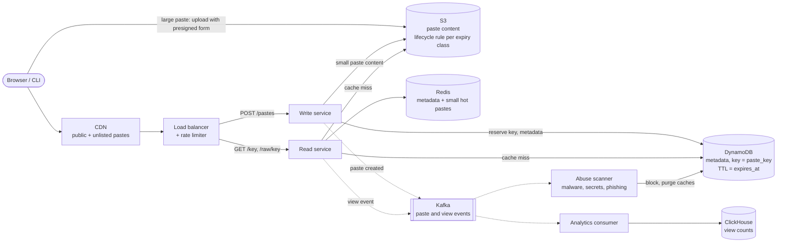
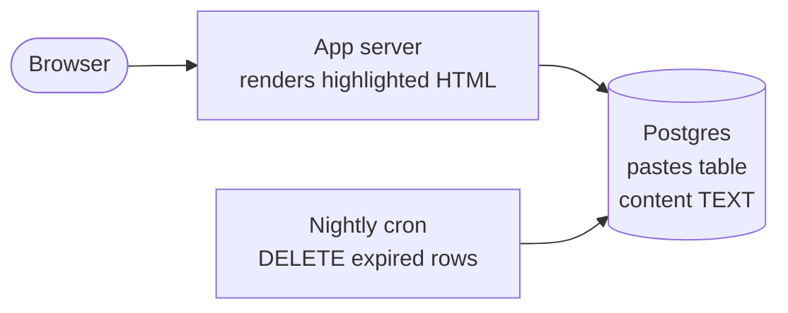
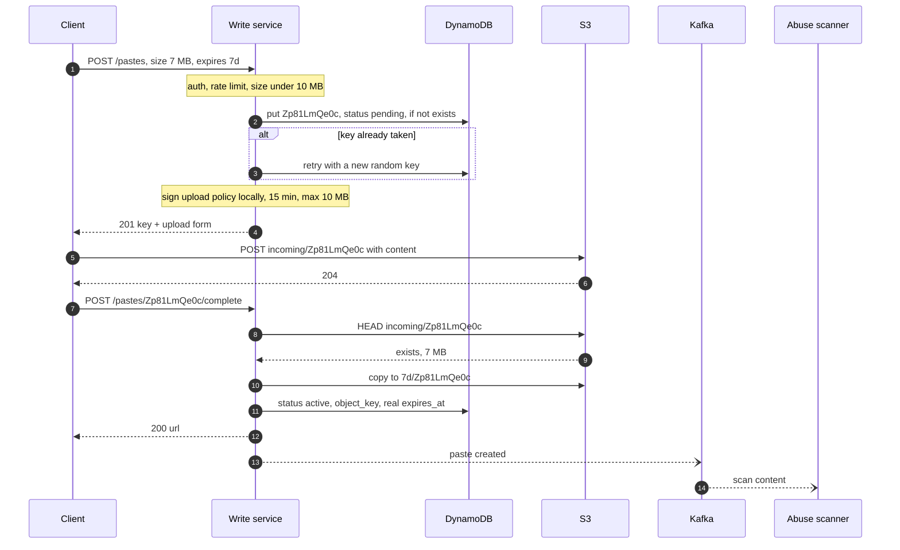

> **In one line:** store each paste's text as an immutable object in S3 under a random 10-character key, keep a ~500-byte metadata row in a key-value store, and serve reads from a CDN and Redis because content never changes; expiry is a row TTL checked on every read plus bucket lifecycle rules that delete the bytes.

## The design at a glance



Follow two paths. **Create**: the write service reserves a random key with a conditional put, stores the text in S3 (big pastes go straight from the client to S3 with a presigned upload), and marks the row active. **Read**: the CDN answers most public reads; on a miss the read service checks visibility and expiry in Redis or DynamoDB, then returns the text. Scanning and view counts run off the hot path, through Kafka.

## How to spend the 30 minutes

| Minutes | What you do | What to say or draw |
|---|---|---|
| 0-3 | Requirements | Max size? Expiry options? Public, unlisted, private? Edits? |
| 3-6 | Numbers | 1 M pastes a day, 10 KB average, 18 TB over 5 years |
| 6-9 | API and data model | Create, read, raw, delete. Small metadata row, big immutable blob |
| 9-12 | Design v1 | One server, text in a SQL table, highlighting on the server |
| 12-15 | Break v1 | Blobs in the database, every read hits it, guessable keys |
| 15-22 | Design v2 and v3 | S3 + key-value store, random keys, CDN, TTL + lifecycle, presigned uploads, abuse |
| 22-29 | Deep dives | Key generation, caching and visibility, expiry, dedupe |
| 29-30 | Recap | The 60-second summary at the bottom |

## Requirements

**Functional**

- Create a paste: text up to 10 MB, optional title and language, expiry (10 minutes to 1 year, or never), visibility: public, unlisted (anyone with the link) or private.
- Read it by short URL, `pb.io/k3Xq9ZmT2a`, plus a raw-text URL.
- Syntax highlighting, done in the browser.
- Expired pastes stop being served, then get deleted.
- Owners list and delete their pastes, and see view counts.
- Pastes are immutable: "edit" creates a new paste or revision.

**Non-functional**

- Reads p99 under 100 ms when cached; small creates p99 under 300 ms.
- 99.95% availability for reads: pastes are linked from tickets, chats and docs.
- Durable: a paste without expiry is never lost.
- Unlisted keys must be unguessable; private pastes need auth.
- ~10 reads per paste on average, skewed to a few viral ones.

**Out of scope**

- Live collaborative editing, comments, forks, stars.
- Full-text search over pastes.
- Sign-up and billing (assume login exists).

> **Say it like this:** "This is a blob store with a tiny metadata index. I'll design for 1 M new pastes a day, 10 KB average, 10 MB max. Content goes to object storage, metadata to a key-value store, and since pastes never change, caching is easy. The interesting parts are expiry across caches, unguessable keys and abuse."

## Back-of-the-envelope numbers

| Quantity | Estimate | How |
|---|---|---|
| New pastes | ~12 / s average, ~60 / s peak | 1 M ÷ 86,400 s, x5 for peaks |
| Reads | ~120 / s average, ~600 / s peak | ~10 reads per paste |
| Average paste | ~10 KB | Mostly logs and code snippets; capped at 10 MB |
| New content | ~10 GB / day | 1 M x 10 KB |
| Content over 5 years | ~18 TB, before expiry | 10 GB x 365 x 5 |
| Metadata over 5 years | ~1.8 B rows, ~0.9 TB | 1 M x 365 x 5, ~500 bytes each |
| Read bandwidth | ~6 MB/s at peak | 600 x 10 KB |
| One viral 5 MB paste | ~5 GB/s | 1,000 views a second x 5 MB |
| Redis hot set | ~3 GB | 200 k pastes read today x 10 KB + 1 M rows x 500 bytes |
| S3 cost at 18 TB | ~$400 a month | 18,000 GB x ~$0.023 per GB-month |

**What the numbers tell us:**

- 60 writes a second is tiny. The job is storing blobs cheaply and serving reads, not write throughput.
- 18 TB of mostly cold text belongs in object storage; ~1 TB of small rows fits a key-value store.
- Average reads are light, but one viral paste needs gigabytes a second: the CDN matters more than server count.
- Storage is cheap, so do not build complex dedupe to save money.

## API

```http
POST /api/v1/pastes
Authorization: Bearer <token>              (optional: anonymous allowed)
Idempotency-Key: 9b2e41...
{ "content": "...", "title": "nginx error", "language": "nginx", "visibility": "unlisted", "expires_in": "7d" }
→ 201 { "key": "k3Xq9ZmT2a", "url": "https://pb.io/k3Xq9ZmT2a", "expires_at": "2026-10-22T10:00:00Z" }

POST /api/v1/pastes                         (over 1 MB: declare the size, no content)
{ "size_bytes": 7340032, "language": "text", "visibility": "public", "expires_in": "never" }
→ 201 { "key": "Zp81LmQe0c", "upload": { "url": "https://pb-content.s3.amazonaws.com", "fields": "...signed policy..." } }

POST /api/v1/pastes/{key}/complete
→ 200 { "url": "https://pb.io/Zp81LmQe0c" }

GET /api/v1/pastes/{key}
→ 200 { "title": "nginx error", "language": "nginx", "size_bytes": 5120, "raw_url": "https://raw.pbcontent.io/k3Xq9ZmT2a" }
   (404 unknown, or private and not yours. 410 expired or deleted)

GET https://raw.pbcontent.io/{key}
→ 200 Content-Type: text/plain; charset=utf-8, Cache-Control: public, max-age=86400

DELETE /api/v1/pastes/{key}
→ 204
```

- One create endpoint, two modes: inline content up to 1 MB (one call, easy from `curl`), or a presigned upload for bigger pastes.
- `expires_in` is picked from a fixed list (10m, 1h, 1d, 7d, 30d, 1y, never), so each choice maps to a storage lifecycle rule.
- Raw text comes from a separate, cookie-less domain as `text/plain` with `X-Content-Type-Options: nosniff`, so a paste full of script can never run as our site.
- Private pastes answer `404`, not `403`, to strangers, so probing a key tells them nothing.

## Data model

```text
pastes                       (DynamoDB, partition key = paste_key)
  paste_key     string  PK   "k3Xq9ZmT2a", 10 random base62 chars
  paste_id      int64        Snowflake ID, time-sortable
  owner_id      string       null for anonymous pastes
  title, language            language is a hint for the browser highlighter
  visibility    enum         public | unlisted | private
  status        enum         pending | active | blocked | deleted
  size_bytes    int
  content_hash  string       SHA-256, for scanning and dedupe
  object_key    string       "7d/k3Xq9ZmT2a" in S3
  created_at    timestamp
  expires_at    timestamp    also the DynamoDB TTL attribute

owner index     (GSI: partition = owner_id, sort = paste_id, newest first)
content         (S3: one immutable object per paste, prefix = expiry class)
view_events     (ClickHouse: paste_key, ts, country, referrer)
```

- **Metadata in DynamoDB.** Every read is "get by exact key", items are tiny, it has a built-in per-item TTL, and random keys spread load evenly over partitions.
- **Owner index as a sparse GSI.** Anonymous pastes have no `owner_id`, so they are never indexed. Sorting by `paste_id` gives "my pastes, newest first" for free.
- **Content in S3.** Designed for 11 nines of durability, cheap per GB, any size, with lifecycle rules.
- **Views in ClickHouse.** Columnar storage makes "views per day per country" fast over billions of events.

## Design v1: the simplest thing that works



1. `POST /pastes` inserts `(content, language, visibility, expires_at)`. Postgres returns the auto-increment id `48213`, which becomes the key `cxD` in base62.
2. `GET /cxD` selects the row, checks expiry and visibility, runs a highlighter over the text on the server, adds 1 to `views`, and returns HTML.
3. A nightly cron runs `DELETE FROM pastes WHERE expires_at < now()`.

For a team-internal pastebin this is fine, and it shows the shape: a key, a blob, an expiry.

## Where v1 breaks

| Problem | Why it happens | What the user sees |
|---|---|---|
| Big blobs in the database | 10 GB of text a day; Postgres moves large values to TOAST storage, but they stay in the database | Backups and replicas grow ~3.6 TB a year, restores take hours, and paste bodies push metadata out of the buffer cache |
| Every read hits the database | No cache; a viral 1 MB paste read 1,000 times a second | 1 GB/s out of one Postgres: timeouts for everyone |
| Server-side highlighting | Tokenizing a 10 MB paste on every view | Seconds of CPU per view; a few views stall the server |
| Sequential keys | base62 of an auto-increment id | Anyone can walk `cxD`, `cxE`... and read every unlisted paste |
| Expiry by a nightly `DELETE` | Millions of rows with large values removed at once | Nightly I/O spikes and table bloat slow the site |
| One server, one database | Single points of failure | All pastes are down during a deploy or a crash |

## Design v2: content in object storage, metadata in a key-value store

### Fix 1: move content to S3, keep metadata small

Each paste's text becomes one S3 object; the metadata row shrinks to ~500 bytes in DynamoDB. Backups, replication and the cache now handle 1 TB of small rows instead of 18 TB of text, and S3 takes care of durability and cost. Fixes row 1.

### Fix 2: random, unguessable keys

Draw 10 base62 characters from a secure random generator and reserve them with a conditional put (`attribute_not_exists(paste_key)`), retrying on the very rare clash. Each paste also gets a time-sortable Snowflake `paste_id` from the [unique ID generator](23-unique-id-generator.md) for owner lists. Why not the [URL shortener](01-url-shortener.md)'s leased ranges? See the first deep dive. Fixes row 4.

### Fix 3: highlight in the browser

The server returns raw text and a `language` hint; a JavaScript highlighter such as Prism or highlight.js colors it on the user's device. Above ~1 MB, show plain text or highlight only what is on screen. Fixes row 3, and every response becomes a plain blob that is easy to cache.

### Fix 4: cache everything, because pastes never change

An edit creates a new paste or revision, so a cached copy is never stale: it can only be deleted or expire. The read service uses Redis read-through for metadata and for pastes under 64 KB. The CDN caches public and unlisted raw text with `max-age = min(1 day, time until expiry)`, so a viral paste costs the origin a few requests per edge location. Private pastes are `Cache-Control: private, no-store` and only served after an auth check. Fixes row 2.

### Fix 5: stateless services, replicated stores

Separate write and read services behind a load balancer, so the read fleet scales on its own. DynamoDB and S3 replicate across zones by themselves; Redis gets a replica. Fixes row 6.

### Fix 6: expiry by TTL and lifecycle rules

`expires_at` is the DynamoDB TTL attribute, so rows delete themselves in the background, free of write capacity. TTL deletion can lag by days, so every read still checks `expires_at` and answers `410`. Content lives under one prefix per expiry class (`1d/`, `7d/`, `30d/`, `365d/`, `keep/`), each with an S3 lifecycle rule that deletes objects after that many days. Lifecycle counts whole days, so 10-minute and 1-hour pastes go under `1d/`: the read check hides them on time, the bytes go a day or two later. Fixes row 5.

## Where v2 still breaks

| Problem | Why it happens | What the user sees |
|---|---|---|
| Large uploads pass through our servers | 10 MB bodies arrive slowly from mobile links | Threads and memory tied up; creates time out under load |
| Anyone can post anything | Anonymous and free by design | Malware, phishing, leaked API keys, spam; the domain lands on blocklists |
| View counts on the read path | Each read still adds 1 to the paste's row | A viral paste becomes a hot key that DynamoDB throttles, and CDN-served views are never counted |

## Design v3: presigned uploads, an abuse pipeline, analytics off the hot path

This is the diagram at the top.

### Fix 7: presigned uploads for large pastes

Above 1 MB, the client declares the size. The write service reserves a key (status `pending`, TTL 1 hour) and returns a presigned S3 POST policy for one object key under `incoming/`, valid 15 minutes, with a `content-length-range` of 1 byte to 10 MB. The client uploads straight to S3 and calls `complete`; the service checks the object's size, copies it inside S3 to its expiry prefix, and marks the paste active. Our servers never touch the bytes.

### Fix 8: abuse controls

- **Rate limits** on creates per IP and account, smaller caps for anonymous users, and 404 limits against key guessing (see the [rate limiter](21-rate-limiter.md)).
- **Async scanning.** Every new paste goes onto Kafka. Scanners check for malware signatures, phishing links (safe-browsing lookup) and secrets like cloud or private keys (patterns plus entropy). A hit sets `status = blocked`, deletes the Redis entry and purges the CDN. For a leaked key, tell the owner and report it to the issuer, who can revoke it.
- **Public pastes** carry `noindex` until their scan passes, so search engines never pick up spam.
- **Takedowns.** A report button and a legal queue; moderators block pastes through the same purge path.

### Fix 9: count views off the hot path

The read service drops a view event on Kafka and returns. CDN logs feed the same topic, so edge hits count too. A consumer batches events into ClickHouse; counts lag about a minute. No hot row, no missing views.

### Components

| Component | Job | Tech choice |
|---|---|---|
| CDN | Public and unlisted text near users | CloudFront / Cloudflare, `max-age` capped at expiry |
| Load balancer + rate limiter | Spread load, stop abuse | L7 load balancer, token bucket in Redis |
| Write service | Reserve key, store content, presign | Stateless |
| Read service | Visibility and expiry checks | Stateless, Redis read-through |
| DynamoDB | Metadata, owner index | Key = `paste_key`, TTL on `expires_at` |
| S3 | Paste content | Object per paste, lifecycle rule per prefix |
| Redis | Hot metadata and small pastes | LRU, primary + replica, ~3 GB |
| Kafka + scanners | Malware, secret, phishing scans | Consumers that block and purge |
| ClickHouse | View counts | Batched inserts from a consumer |

## Key flow: create a large paste



- **Upload never finishes:** the pending row expires by TTL, and a 1-day lifecycle rule on `incoming/` deletes the orphaned bytes.
- **`complete` called twice:** it is idempotent; an active paste returns the same URL.
- **Upload missing or too large:** S3 rejects sizes outside the signed range; a failed `HEAD` makes `complete` answer `409`.
- **Small pastes (almost all):** one call. Reserve the key, put the object under its expiry prefix, mark the row active.

The read path: CDN, read service, metadata from Redis or DynamoDB; check status, expiry and visibility; return the text with `Cache-Control` set from both; emit a view event.

## Deep dives

### How do you generate the paste key?

**The problem.** Keys must be unique and short, and for unlisted pastes the key is the only lock, so it must be unguessable.

| Option | Good | Bad |
|---|---|---|
| Leased ranges + scramble, as in the [URL shortener](01-url-shortener.md) | Unique by construction, no collision check | A scrambled counter is a permutation, not a secret: whoever works it out can enumerate |
| Snowflake ID in base62 ([ID generator](23-unique-id-generator.md)) | Unique, no coordination | 10-11 characters and ordered by time: easy to enumerate |
| Hash of the content | Same text, same key | Anyone holding the text can find the paste; truncated hashes collide |
| **10 random base62 characters + conditional put** | ~60 bits of real randomness | One conditional write; a clash about once per 470 M creates |

**Pick.** Random keys for the URL, Snowflake `paste_id` inside for ordering. With 1.8 B pastes in 62^10 ≈ 8.4 x 10^17 keys, a guess hits once in ~470 M tries, and 404 rate limits make scanning hopeless. Truly sensitive pastes should be private, not unlisted.

### Caching immutable content

**The problem.** Reads are skewed toward a few viral pastes, and every cached copy must respect visibility, expiry and takedowns.

| Option | Good | Bad |
|---|---|---|
| No cache | Simple | Every read pays DynamoDB plus an S3 fetch |
| Redis only | Fast, easy to invalidate | A viral paste still flows through our servers at GB/s |
| **CDN for public and unlisted, Redis for all** | The edge absorbs viral spikes | Deletes and takedowns need a CDN purge |
| CDN for private too, with signed URLs | Edge speed everywhere | Complex; a leaked signed URL works until it expires |

**Pick.** CDN plus Redis, private pastes never at the CDN. Immutability means no invalidation on edit, only on delete and takedown, and `max-age` never exceeds the time to expiry. Unlisted responses carry `X-Robots-Tag: noindex` to stay out of search engines.

### Expiry and deletion

**The problem.** Pastes live from 10 minutes to forever, and copies sit in the CDN, Redis, DynamoDB and S3.

| Option | Good | Bad |
|---|---|---|
| Cron job that finds and deletes | Exact | Big periodic deletes, the v1 problem |
| **Row TTL + read-time check + lifecycle rules** | Nothing to run; deletes are free | Bytes linger up to ~2 days; needs a prefix per expiry class |
| A delete timer per paste | Exact deletion of bytes | Millions of timers for little gain (see the [job scheduler](09-job-scheduler.md)) |

**Pick.** TTL plus read check plus lifecycle. Correctness lives in the read check; TTL and lifecycle are only garbage collection. **Burn after reading** is the exception: the read does a conditional update `status: active → burned`, so only the first reader wins, and the response is never cached.

### Dedupe by content hash

**The problem.** People and bots post the same stack trace again and again. Store identical text once?

| Option | Good | Bad |
|---|---|---|
| No dedupe | Each object has one owner and one lifetime, so lifecycle rules just work | Pay for duplicates, ~$400 a month at 18 TB anyway |
| Global dedupe by SHA-256 | Less storage and cache memory | Reference counts, lifecycle rules stop working for shared objects, privacy leak |
| **Dedupe public pastes only, server-side** | Catches most bot reposts with no privacy risk | A reference count and a cleanup job for shared objects |

**The privacy caveat.** If users can tell an upload was deduplicated (an instant create, a shared object key, the hash in a response), they can test whether anyone ever pasted a given text, such as a guessed config with a password in it. Invisible, server-side dedupe of already-public content leaks nothing.

**Pick.** Start with none. If reposts become a real cost, dedupe public pastes server-side: shared objects live under `shared/<sha256>` with no lifecycle rule, a reference count drops when a TTL deletion arrives through DynamoDB Streams, and a cleanup job deletes objects at zero.

## Trade-offs to say out loud

- We chose **S3 plus a key-value store over text in SQL** so the database stays small and storage cheap. The cost is two writes per create and orphans to clean up.
- We made **pastes immutable** so caching needs no invalidation. The cost is that edits create new keys or revisions.
- We chose **random keys over leased ranges** so unlisted links cannot be enumerated. The cost is a conditional write and 10 characters instead of 7.
- We **highlight in the browser** so servers spend no CPU and responses are cacheable. The cost is slow rendering on old phones, so we skip it above 1 MB.
- We **scan asynchronously** so creates stay fast. The cost is a bad paste can be live for seconds before it is blocked.
- We **expire with TTL and lifecycle rules** instead of exact deletes. The cost is that bytes linger a day or two, so reads must check `expires_at`.

## Follow-up questions

**Q: How would you support edits, like Gist revisions?**
Each revision is a new immutable object; the row keeps `head_revision`. `/key` shows the latest with a short CDN `max-age`; `/key/rev` URLs can be cached forever.

**Q: Could a paste attack your users with XSS?**
Raw text is served from a separate cookie-less domain as `text/plain` with `nosniff`. The highlighter escapes HTML before it adds colors, and the main site sends a strict Content Security Policy.

**Q: Isn't an S3 fetch slow for a 200-byte paste?**
It can take tens to a couple of hundred milliseconds, so Redis absorbs the hot ones. You can also store content under ~4 KB inline in the DynamoDB item (items go up to 400 KB).

**Q: How do you cut storage cost?**
Compress before storing: text often shrinks 3-5x with gzip or zstd. Do not move small pastes to S3 Standard-IA, which bills every object as at least 128 KB.

**Q: How do you go multi-region?**
S3 cross-region replication and DynamoDB global tables, with reads served locally. By default global tables resolve conflicts with last-writer-wins, so a conditional put only guards its own region; with random 60-bit keys a cross-region clash is practically impossible.

## 60-second recap

- 1 M pastes a day, 10 KB average, ~18 TB in 5 years: a blob store with a small index.
- Content is an immutable S3 object per paste; ~500-byte metadata rows live in DynamoDB keyed by a random 10-character key.
- Small pastes go through the API; large ones upload straight to S3 with a presigned policy capped at 10 MB.
- Immutable content makes caching easy: CDN for public and unlisted, Redis for hot metadata and small pastes, private never at the edge.
- Expiry: DynamoDB TTL plus a check on every read, and S3 lifecycle rules per expiry prefix delete the bytes.
- Abuse: rate limits, async malware, secret and phishing scans, takedowns that purge caches.
- View counts flow through Kafka into ClickHouse, never on the read path.
